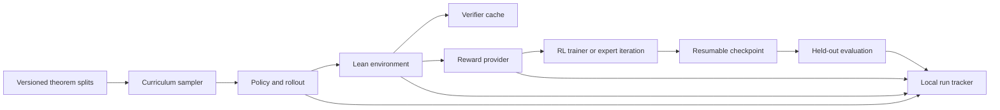

# Efficient Reinforcement Learning for Small Formal Reasoners

This project studies when reinforcement learning (RL) helps a small language model solve Lean theorems under a fixed compute budget. Manas's planned interactive comparison fixes `Qwen/Qwen2.5-0.5B-Instruct` and varies Lean reward attribution and prerequisite-aware curriculum. It uses no additional supervised fine-tuning (SFT) or continued pretraining. The user authorizes separate whole-proof GRPO and curriculum experiments. The current total ceiling is $95, including earlier runs. Historical budget ledgers remain unchanged. This pilot reuses TRL and the existing whole-proof checker. Anwesha's interactive Lean environment and Abhinav's interactive policy optimizer remain separate dependencies.

The current priority is correct mathematical execution and independent knowledge acquisition. The [local-action pilot](#local-action-correctness-pilot) measures verified witnesses; the [ordered RLP result](#ordered-arm-results) measures independently graded complete answers. Preserve both experiments and their different reward definitions. The user initially deferred Lean integration for the controlled RLP comparison. Its result now motivates a [proposed Lean-verified acquisition evaluation](docs/research_plan.md#lean-verified-acquisition-evaluation-proposal-2026-10-06). The [midterm reference](docs/team_workstreams.md#midterm-reference-rl-correctness-and-acquisition-2026-10-06) connects the experiments, grading corrections, and proposed next study. No new verifier integration or training follows from that documentation.

## Research questions

- Does prerequisite-aware curriculum improve held-out proof success at the same generated-token and Lean-call costs?
- Does tactic feedback improve learning over terminal reward in the same interactive environment?
- Do staged premise access and component-lemma training help when tested separately from theorem ordering?
- How does additional RL adaptation transfer from number theory to external undergraduate problems?

See [the research plan](docs/research_plan.md) and [the protocol](docs/experimental_protocol.md) for comparisons and inference limits.

For resuming Manas's work, read the historical [curriculum and RLP handoff](docs/team_workstreams.md#curriculum-and-rlp-handoff-2026-10-05) and the newer [midterm reference](docs/team_workstreams.md#midterm-reference-rl-correctness-and-acquisition-2026-10-06). They record the experiments, evidence limits, and proposed next steps. The status table below remains the source of truth.

## Architecture



The diagram shows intended interfaces. The data audit and local math probe are implemented. The Lean and RL interfaces remain planned. The expert-iteration branch is an earlier alternative, outside Manas's current RL-only comparison.

## Local setup

1. Install [uv](https://docs.astral.sh/uv/getting-started/installation/) and Python 3.12.
2. Install [elan and Lean](https://lean-lang.org/install/manual/). Lean is separate from the Python environment.
3. Run `uv sync` to install the repository's development tools.
4. Run `uv run pre-commit install` after you initialize or clone the Git repository.
5. Run `uv run pre-commit run --all-files` to check the current documents and metadata.

The Python project is not installable yet because the source modules have not been written. The Lean toolchain and mathlib revision must be pinned together when the first Lean fixture is added. Do not mix the original Lean 3 [MiniF2F repository](https://github.com/openai/miniF2F) with a Lean 4 verifier. A [Lean 4 MiniF2F port](https://github.com/google-deepmind/miniF2F) exists, but this project has not selected or pinned a benchmark revision.

## First milestone

The current deliverable is [the experiment plan](docs/research_plan.md), with controls in [the protocol](docs/experimental_protocol.md). It defines an unchanged-policy reference and the terminal/process reward by uniform/curriculum comparison. Premise unlocking and proof decomposition remain isolated extensions.

Execution depends on Anwesha's reconstructed Lean states and Abhinav's policy optimizer. After their interfaces arrive, the first run should measure unchanged-policy readiness before testing an optimizer update. The earlier proposed command `uv run python scripts/smoke.py --config configs/rl/smoke.yaml --dry-run` remains **unimplemented** and is not a launch instruction.

## Baselines and status

| Baseline | Planned entry point | Status |
| --- | --- | --- |
| Manas's RL-only experiment registration | `docs/research_plan.md` | Planned comparison documented; no runnable RL config or compute launch |
| Dataset preparation and overlap audit | `scripts/prepare_leandojo.py` | Original Nat probe preserved; broader pool curated on cpu-angad and archived privately in Drive; export recount passed; Lean replay pending |
| No-RL checkpoint evaluation | `scripts/probe_qwen.py` | Base public-math pilot completed; original Instruct proof diagnostic completed with pinned Lean; see capability probe |
| Spot L40S sampling diagnostic | S3 `capstate/acq/formal_rl/qwen_l40s_pilot_20261003_retry4/` | Worker reports complete; instance terminated; independent final recount pending. Earlier setup failures preserved. No RL update |
| TensorBoard diagnostic | `scripts/track_tensorboard.py`; cpu-angad `tensorboard_pilot_20261003/` | Server serves recorded pilot curves and prerequisite readiness counters through an SSH tunnel; scalar endpoint verified; source records remain in S3 |
| Separate whole-proof GRPO pilot | `scripts/run_grpo_pilot.py`; `configs/rl/qwen_05b_whole_proof_grpo.json` | Both arms complete; worker exit 0; CPU recount passes; instance terminated. No accepted training or validation proofs and no groups with reward variation. Failed runs remain preserved |
| Prerequisite curriculum diagnostic | `scripts/prepare_prerequisite_curriculum.py`; `configs/rl/qwen_05b_prerequisite_grpo.json` | Readiness finishes with no accepted proof or mixed-reward group. Worker exit 0; CPU recount exits 0. GRPO arms and unseen-combination evaluation skipped; instance terminated |
| Syntax-assisted prerequisite retry | `configs/rl/qwen_05b_prerequisite_grpo_syntax.json`; same preparer and runner | Readiness finishes with no accepted proof or mixed-reward group. Worker and CPU recount exit 0. GRPO arms skipped; instance terminated |
| Assisted proof-completion study | `configs/rl/qwen_05b_completion_grpo.json`; same preparer and runner | Completed and CPU-recounted; GPU terminated. Assisted completion gives mixed rewards and nonzero gradients. No unassisted held-out success; one eligible task prevents an ordering comparison |
| Number-theory acquisition preparation | `scripts/prepare_prerequisite_curriculum.py --number-theory-bootstrap` | CPU reference replay completes with exit 0 under the pinned checker. Concrete quotient, remainder, and divisibility exercises supplement symbolic prerequisites. Evaluation remains fixed. This preparation does not train a model |
| RLP number-theory acquisition | `scripts/prepare_rlp_corpus.py`; `scripts/run_rlp_pilot.py`; `configs/pretrain/qwen_05b_number_theory_rlp.json` | Completed; worker exit 0. Final policy, tokenizer, optimizer, and EMA teacher are present in S3 `capstate/acq/formal_rl/number_theory_rlp_20261004_ondemand/runtime/out/`. CPU recount passes. Arithmetic responses lack parseable boxed answers before and after training; independent capability gain is unestablished |
| RLP primitive-first continuation | `configs/pretrain/qwen_05b_number_theory_rlp_continuation.json`; same preparer and runner | Completed; worker and CPU audit exit 0; instance terminated. Audit verifies curriculum order, token counts, evaluation answers, and checkpoint receipts. Final policy copied to cpu-angad and retained in S3. Assisted held-out score remains 11/48; validation remains 7/16. No measured accuracy gain. S3 `capstate/acq/formal_rl/number_theory_rlp_20261004_continuation/` |
| Supervised adaptation diagnostic | `configs/midtrain/qwen_05b_gsm8k_lora.yaml` | GSM8K LoRA and matched evaluation completed; no final-answer accuracy gain; this is not formal-trace training |
| RLP precision audit | `scripts/audit_rlp_updates.py` | CPU diagnostic and behavior recount exit 0. Saved optimizer moments are BF16. Controlled updates demonstrate rounding loss. Evidence remains at CPU `artifacts/number_theory_rlp_v2/update_audit/`; previous results remain preserved |
| RLP midtraining precision correction | `configs/midtrain/qwen_05b_number_theory_rlp_fp32.json`; `scripts/run_rlp_pilot.py` | Worker and CPU recount exit 0; final checkpoint copied to cpu-angad and retained in S3. First real update confirms changed weights and FP32 moments. Held-out accuracy remains 11/48; validation changes from 7/16 to 6/16. No measured acquisition gain. Instance `<ec2-instance-id>` terminated. S3 `capstate/acq/formal_rl/number_theory_rlp_20261004_fp32_midtraining/` |
| Revised primitive RLP curriculum | `scripts/prepare_rlp_corpus.py --structured-primitives`; `configs/midtrain/qwen_05b_primitive_rlp.json` | Worker completed with exit 0. Final checkpoint and milestone checkpoints are in S3 `capstate/acq/formal_rl/primitive_rlp_20261005/runtime/out/`. CPU recount and failure analysis return exit 0. Final held-out performance deteriorates; see [failure analysis](docs/decisions.md#2026-10-05-examine-primitive-rlp-deterioration-on-cpu). Raw counts and diagnosis remain under CPU `primitive_midtraining_v1/audit_final/` and S3 `audit/`. No active project instance returned by the Stockholm EC2 query. |
| Structured RLP corpus admission | `scripts/audit_rlp_corpus.py` | Completed on CPU; exit 0. Numeric targets pass; prospective support admission flags implicit domains. Distribution, template overlap, constant-answer baselines, and admission records are archived. See [the corpus audit](#structured-rlp-corpus-audit). See the controlled preparation row for subsequent matched views and grader calibration. Further training remains pending. |
| Controlled mathematical RLP comparison | `scripts/prepare_rlp_corpus.py --controlled-mathematics`; `configs/midtrain/qwen_05b_controlled_rlp.json` | Ordered arm completed 432 optimizer steps. The blinded review and adjudicated score are complete. No fully correct answer appears across its five validation phases. The shuffled arm and the held-out comparison remain unscored. See [ordered-arm results](#ordered-arm-results). Artifacts are in S3 `capstate/acq/formal_rl/controlled_rlp_20261006/` and cpu-angad `artifacts/controlled_ordered_review_20261006/ordered_results_v2e/`. |
| Acquisition evaluation across saved policies | `scripts/evaluate_acquisition.py`; `configs/eval/acquisition_probe_v1.json` | Completed on cpu-angad; worker, raw recount, and blinded-content recount exit 0. Early RLP has small item-level gains without improved recognition; final RLP has no demonstrated acquisition gain under the fixed limits. See [content results](#acquisition-content-evaluation). CPU output: `formal_rl/artifacts/acquisition_eval_v1/`; S3: `capstate/acq/formal_rl/acquisition_eval_v1/`. Failed initial launcher preserved. |
| Acquisition, proof semantics, and strategy evaluation | `scripts/evaluate_acquisition.py`; `configs/eval/decomposition_probe_v2.json` | Completed on cpu-angad; inference, notation check, grade audits, and recount exit 0. Revised Astra grading gives no acquisition completion gain over the original. Partial progress, full correctness, disagreement, and truncation remain separate. See [decomposition results](#acquisition-proof-semantics-and-proof-strategy). CPU `artifacts/decomposition_eval_v2/`; S3 `capstate/acq/formal_rl/decomposition_eval_v2/complete.tar.gz`. |
| Knowledge/operator inventory and staged acquisition | `configs/eval/knowledge_inventory_v1.json`; `scripts/evaluate_acquisition.py`; `scripts/verify_local_operator.py` | Early and original inventory, adjudication, and recount complete; all exit 0. Early RLP remains the training start. Lean witness controls pass; direct probe exposes format and mathematical failures. See [inventory results](#knowledge-inventory-and-local-operations). CPU `artifacts/knowledge_inventory_v1/`; S3 `capstate/acq/formal_rl/knowledge_inventory_v1/complete.tar.gz`. Training and assistance fading remain pending; no new GPU launch. |
| Local-action correctness pilot | `configs/rl/qwen_05b_local_operator_grpo.json`; `scripts/run_grpo_pilot.py` | Pilot complete, exit 0; selected `policy_step_64`. Correct witnesses improve on supplied tasks; prose errors and weak composition transfer remain. See [results](#local-action-correctness-pilot). Instance `<ec2-instance-id>` is terminated. CPU `operator_pilot_v1/gpu_records/`; S3 `capstate/acq/formal_rl/operator_pilot_20261006/`. Independent acquisition and undergraduate capability remain unestablished. |
| Supervised fine-tuning on formal traces | `configs/midtrain/` | Earlier proposal; not implemented; outside the current main comparison |
| Terminal reward, uniform sampling | `configs/reward/` and `configs/curriculum/` | Not implemented |
| Terminal reward, adaptive sampling | `configs/reward/` and `configs/curriculum/` | Not implemented |
| Process reward, uniform sampling | `configs/reward/` and `configs/curriculum/` | Not implemented |
| Process reward, adaptive sampling | `configs/reward/` and `configs/curriculum/` | Not implemented |
| Verifier-filtered expert iteration | `configs/rl/` | Earlier alternative; not implemented; outside the current main comparison |

The table is the canonical project status. Update it when a command works; do not write a second status file. The [protocol](docs/experimental_protocol.md) defines matched budgets and the [metrics](docs/metrics.md) define each output.

The RLP continuation uses the same [local TensorBoard address](http://localhost:6006/#scalars). Its CPU server is `formal-rl-rlp-tb-server`; its exporter is `formal-rl-rlp-tb-exporter`. Both have bounded memory and runtime. Events live in `tensorboard_rlp_20261004/events/` under the CPU project root. The `rlp/progress` capability curves use cumulative generated training tokens, including the parent acquisition stage. These evaluations supply an answer-format prefix. Earlier proof-study events remain under `history/`. The scalar endpoint confirms the RLP views are served.

### Knowledge inventory and local operations

Early RLP (`checkpoint-118`) is the selected training start. Preserve its unchanged weights as the no-training control. Original Instruct and final RLP remain diagnostic references. This inventory evaluates early and original; it does not rerun final RLP. The [staged plan](docs/research_plan.md#knowledge-inventory-and-assisted-execution-2026-10-05) separates supplied execution, acquisition, retention, and transfer.

The early model does not consistently execute operations even with definitions and method guidance supplied. This supports testing supplied execution before assistance fading. It does not establish why the model fails or which knowledge is absent.

| Inventory outcome | Original Instruct: complete core | Early RLP: complete core | Original: fully correct | Early: fully correct |
| --- | ---: | ---: | ---: | ---: |
| Recall | 2 / 16 | 1 / 16 | 0 / 16 | 0 / 16 |
| Explained recognition | 7 / 32 | 14 / 32 | 4 / 32 | 8 / 32 |
| Supplied use | 4 / 16 | 4 / 16 | 1 / 16 | 2 / 16 |
| Independent use | 3 / 16 | 3 / 16 | 2 / 16 | 1 / 16 |

Early RLP improves explained recognition on these repeated presentations. It does not improve application completion. This result supports a narrower recognition gain, not independent knowledge acquisition. These tasks differ from earlier probes; their scores must not be pooled.

0 / 80 early responses reach the output cap in `early_inventory_summary.json`. The original reaches the cap on 2 / 80 responses in `original_inventory_summary.json`. These summaries come from `code/rl_inventory_summary.py a` and `b`, respectively. Both commands finish with `status: PASS` and exit 0 after checking raw generation records, review identities, evidence excerpts, and adjudications.

| Early RLP: complete core answer | Recall | Explained recognition | Supplied use | Independent use |
| --- | ---: | ---: | ---: | ---: |
| Divisibility | 0 / 2 | 2 / 4 | 1 / 2 | 1 / 2 |
| Euclidean division | 0 / 2 | 3 / 4 | 0 / 2 | 1 / 2 |
| Greatest common divisor | 0 / 2 | 3 / 4 | 0 / 2 | 0 / 2 |
| Bezout identities | 1 / 2 | 0 / 4 | 0 / 2 | 0 / 2 |
| Congruence | 0 / 2 | 1 / 4 | 1 / 2 | 0 / 2 |
| Modular inverse | 0 / 2 | 1 / 4 | 2 / 2 | 1 / 2 |
| Euclid's lemma | 0 / 2 | 3 / 4 | 0 / 2 | 0 / 2 |
| Modular cancellation | 0 / 2 | 1 / 4 | 0 / 2 | 0 / 2 |

Family counts come from `artifacts/knowledge_inventory_v1/early_inventory_summary.json`, recomputed by archived `knowledge_inventory_v1/code/rl_inventory_summary.py a`. Complete core answers can contain separable ancillary errors; full correctness excludes them. Both independent reviews, partial scores, and adjudications remain in `review/`. Reviewers inherit the session model, whose exact identifier is unavailable. The historical Astra label in the reused rubric does not identify these reviewers. Planted examples check grading consistency; they do not estimate grading accuracy. These are AI judgments, not human or Lean validation.

The generation limit is 1,024 new tokens per response, as frozen in `configs/eval/knowledge_inventory_v1.json`. Recognition requires an explanation; it is not a single-token test. Recognition rotates the same question, so its presentations are not independent concepts. Supplied use adds method guidance as well as facts. Family samples are small. These development tasks guide the curriculum and cannot serve as fresh held-out transfer evidence.

The [local-operation adapter](scripts/verify_local_operator.py) validates submitted polynomial witnesses in immutable Lean obligations. Its fixtures cover supplied-witness reuse, composition, integer linear combination, and scaling. It does not yet train the policy or grade model-generated proof steps.

16 / 16 witness controls match their expected result in `operator_controls_retry4/verification.jsonl`, recounted by `code/rl_operator_recount.py`. Correct witnesses are accepted and incorrect witnesses are rejected. The environment uses Lean `v4.10.0-rc1` with mathlib `29dcec074de168ac2bf835a77ef68bbe069194c5`. The mathlib revision comes from installation provenance, not a live Git checkout. Failed setup attempts remain preserved.

4 / 4 direct early-model responses fail the expression-only parser in `operator_probe_verified/summary.json`, produced by `code/rl_score_operator_probe.py`. This is a format result, not mathematical failure on every response. The separate `operator_content_check.json` records an explicit valid boxed witness and counterexamples to other submitted expressions. It does not repair responses or certify their explanatory prose. This greedy probe uses training fixtures and does not establish sampled reward variation.

Training remains pending. The next step is a declared extraction contract that preserves the submitted mathematical object, followed by sampled readiness. Freeze validation, retention, and withheld-composition manifests before optimizer updates. Reconcile the remaining compute budget before a paid launch. Keep the binary mathematical reward separate from format and infrastructure outcomes.

### Acquisition content evaluation

The saved-policy comparison does not establish a reliable acquisition gain from primitive RLP. Early RLP improves some answers; final RLP performs worse on constrained recognition and completed applications under the fixed response limits.

| Correct responses | Original Instruct | Early RLP (`checkpoint-118`) | Final RLP |
| --- | ---: | ---: | ---: |
| Concept recognition, repeated option orders | 19 / 24 | 19 / 24 | 17 / 24 |
| Definition and theorem recall, content review | 3 / 12 | 4 / 12 | 3 / 12 |
| Elementary application, content review | 3 / 12 | 4 / 12 | 0 / 12 |
| Elementary application, strict integer parsing | 3 / 12 | 3 / 12 | 0 / 12 |

These counts come from CPU `artifacts/acquisition_eval_v1/content_recount.json`, produced by archived `acquisition_eval_v1/code/review_recount.py`. The [frozen probe](configs/eval/acquisition_probe_v1.json) covers elementary number theory. Recognition repeats each concept with changed option order; those presentations are not independent knowledge items. A constant option label scores 6 / 24. A constant application answer of one scores 4 / 12. These baselines come from `recount.json` and its archived `code/recount.py`.

Content grading ignores answer formatting but requires all requested content and no substantive false claim. Two blinded AI reviewers agree on 71 / 72 responses. The remaining disagreement concerns whether prime-factorization uniqueness permits changing multiplicities. The stricter reading rejects it. The permissive reading raises final recall to 4 / 12 and leaves the application result unchanged. Both reviews, the source responses, and adjudication remain in `content_review/`. Agreement between AI reviewers does not establish independent human validation.

Early RLP gains two correct recall answers and loses one relative to the original model. It gains one correct application without losing a correct application. That application evaluates supplied Bezout coefficients; it does not demonstrate independent coefficient construction. The diagnostic does not isolate acquisition from changed response behavior.

The response limits bind, especially for the final policy. Final recall reaches its limit on 12 / 12 responses. Final applications reach their limit on 11 / 12 responses. Most final applications stop at an introduction or incomplete method. Zero completed correct applications therefore does not establish erased mathematical knowledge. Correct statements followed by false mathematics also occur, so parsing alone does not explain the errors.

This exploratory diagnostic was authored after historical failure analysis. It does not establish independence from training concepts or pretraining exposure. It does not evaluate proof semantics or proof strategy. All policies use the same CPU precision, chat template, greedy decoding, and frozen task-specific limits. No new training occurs. The next acquisition study needs a larger frozen item set and a preregistered response-length comparison before a general acquisition claim.

### Acquisition, proof semantics, and proof strategy

Neither saved RLP policy improves complete acquisition answers in this exploratory evaluation. The original policy completes 4/24 acquisition tasks under the revised content rubric. Each RLP checkpoint completes 2/24. Partial-credit totals also remain below the original. These observations concern this selected probe and response budget; they do not establish a general effect of RLP.

The [task config](configs/eval/decomposition_probe_v2.json) covers authored mathematical families with recall, explained application, proof-step checking, and complete proofs. The resolved remote manifest adds the public subsets recorded in its source manifest. Every task uses free generation with a maximum of 1,024 new tokens. The prompt limit is 2,048 tokens, with no prompt truncation. Execution uses matched FP32 CPU inference and greedy decoding. References and grading rubrics never enter the model prompt.

The [revised rubric](configs/eval/decomposition_grading_v2.json) accepts valid alternative proofs and conventional implicit steps. A complete core answer can retain credit despite a separable extra mistake. Errors required by the argument or contradicting its conclusion still reduce credit. The separate `full_correct` field excludes substantive mathematical errors anywhere in the answer.

| Complete core answers | Original Instruct | Early RLP (`checkpoint-118`) | Final RLP |
| --- | ---: | ---: | ---: |
| Definition and theorem recall | 1 / 12 | 0 / 12 | 1 / 12 |
| Explained application | 3 / 12 | 2 / 12 | 1 / 12 |
| Proof-step checking | 2 / 12 | 0 / 12 | 1 / 12 |
| Complete proof, unaided | 2 / 12 | 0 / 12 | 1 / 12 |
| Same proof, supplied facts | 4 / 12 | 0 / 12 | 3 / 12 |
| Same proof, facts and plan | 3 / 12 | 0 / 12 | 2 / 12 |
| ProcessBench selected subset | 0 / 4 | 0 / 4 | 0 / 4 |
| ProofNet-Verified selected subset | 0 / 4 | 0 / 4 | 0 / 4 |

Partial credit records valid progress even when an answer is incomplete or contains a central error. Each answer receives an ordinal score from zero to three. The following totals describe the rubric; they are not interval-scale measurements of knowledge.

| Partial-credit points | Original Instruct | Early RLP | Final RLP |
| --- | ---: | ---: | ---: |
| Definition and theorem recall | 15 | 16 | 13 |
| Explained application | 19 | 16 | 11 |
| Proof-step checking | 13 | 11 | 15 |
| Complete proof, unaided | 11 | 6 | 8 |
| Same proof, supplied facts | 14 | 9 | 14 |
| Same proof, facts and plan | 15 | 10 | 12 |
| ProcessBench selected subset | 3 | 3 | 5 |
| ProofNet-Verified selected subset | 2 | 1 | 4 |

Early RLP earns more partial credit on recall. Final RLP earns more partial credit on proof-step checking and the public subsets. Neither gain increases complete answers in those categories. The external samples are too small to support a benchmark-wide comparison. Both independent reviewers place acquisition completion below the original before adjudication.

Supplied facts improve complete-proof counts for the original and final policies. Adding a plan produces no further net gain. The early checkpoint completes no proof in these conditions. These contrasts locate difficulties in using facts and constructing valid deductions, but they do not isolate independent causal components. Facts can suggest a strategy, and a plan can reinforce knowledge. This study evaluates informal mathematics, not Lean syntax or formal proof acceptance.

| Generation record | Original Instruct | Early RLP | Final RLP |
| --- | ---: | ---: | ---: |
| Main responses | 80 | 80 | 80 |
| Generated tokens, including EOS | 40,123 | 32,975 | 63,735 |
| Responses reaching the output cap | 2 / 80 | 0 / 80 | 26 / 80 |

Truncation limits conclusions about latent knowledge, especially for the final checkpoint. Stored unaided-proof prefixes show no increase in complete core proofs between the shorter prefix and the full response at the declared limits. This prefix analysis does not test an increased generation cap. The separate [notation check](configs/eval/decomposition_notation_check.json) replaces ambiguous variable names in division uniqueness. It produces no complete proof in any checkpoint or assistance condition; partial progress remains recorded.

Two independent GPT-6 Astra reviewers grade checkpoint-blinded responses against references. A third Astra reviewer resolves disagreements against the saved mathematics. All reviewers use the same revised rubric. The independent reviews disagree on 44/321 real response views, including declared prefixes and the notation check. Both reviewers pass the same ten planted examples in each batch. These repeated controls do not measure accuracy on unseen answers. Scores remain AI judgments without human or Lean validation.

The rubric revision follows the user's request after original responses and prior strict grades were inspected. This is post hoc exploratory regrading. Both reviews, original strict grades, adjudications, full-correctness fields, and reviewer sensitivity counts remain preserved. Shared training concepts are intentional; lexical overlap checks do not establish semantic independence or unknown pretraining exposure.

Source: CPU `/mnt/data/manasvenkatasairavulapalli/formal_rl/artifacts/decomposition_eval_v2/core_summary.json`, produced by `decomposition_eval_v2/code/rl_core_summary.py`. Per-answer grades and evidence excerpts are in `core_review/`; raw responses and run records are in the checkpoint directories. The resolved protocol, source snapshots, and analysis code are in `decomposition_eval_v2/`. S3 prefix: `capstate/acq/formal_rl/decomposition_eval_v2/`. The final archive is `complete.tar.gz`.

Verification: inference and notation launchers return exit 0. `rl_core_review.py` passes for all checkpoint and notation batches. `rl_core_summary.py` passes the coverage, paired-count, matching, and recount checks. `uv run python -m unittest discover -s tests -p test_acquisition_eval.py -v` returns four passing tests. No training or paid GPU rental occurs.

### Saved RLP checkpoint

The final model and tokenizer are at `s3://<project-bucket>/capstate/acq/formal_rl/number_theory_rlp_20261004_continuation/runtime/out/policy_final/`. The CPU copy is `/mnt/data/manasvenkatasairavulapalli/formal_rl/artifacts/number_theory_rlp_v2/audit_final/saved_model/`. Load this directory through `AutoModelForCausalLM.from_pretrained` and `AutoTokenizer.from_pretrained` for the next proof-RL stage. `audit_final/model_manifest.json` records file sizes and hashes. Optimizer and EMA state remain in the S3 trainer checkpoints under `runtime/out/policy/`.

127,389 generated training tokens cover this continuation in `audit_final/summary.json`. 245,361 generated training tokens cover the parent and continuation together. Evaluation tokens remain separate. The audit checks raw token IDs and the scheduled order against the frozen context list. S3 `audit/` preserves the recount code, summary, manifest, log, and exit code.

| Assisted diagnostic | Before continuation | After continuation |
| --- | ---: | ---: |
| Held-out arithmetic and prime questions | 11 / 48 | 11 / 48 |
| Prime curriculum validation | 7 / 16 | 7 / 16 |

All intermediate prime-validation scores also remain unchanged. These are small authored diagnostics with a supplied answer-format prefix. They are not public undergraduate benchmark scores. The checkpoint is available for further RL; this experiment does not establish that mathematical acquisition is complete or that only Lean conventions remain to learn.

### Precision correction for RLP midtraining

The CPU audit compares every stored parameter between the parent and continuation. Its `summary.json` records 8,557,971 changed entries out of 494,032,768. Most entries remain unchanged. The optimizer checkpoint contains BF16 moments without FP32 master parameters. On identical saved weights with constant nonzero gradients, the BF16 control changes 660 of 65,536 entries. The FP32 control changes every sampled entry. Both zero-gradient controls leave weights unchanged. These controls demonstrate numerical update loss; they do not replay historical gradients or establish its contribution to the math score.

The behavior recount finds one corrected answer and one regression. Mean reasoned log probability decreases on the fixed textbook validation positions. Training groups contain reward variation, but positive sampled rewards do not establish improvement. `artifacts/number_theory_rlp_v2/update_audit/` on cpu-angad holds `tensors.jsonl`, `summary.json`, `behavior.json`, and the analysis code.

The correction repeats the continuation from its original parent policy and teacher, with the same data, seed, curriculum, reward, and registered limits. It treats acquisition as midtraining. The only experimental intervention is parameter and computation precision. Checkpoint storage allocation and update diagnostics are operational changes. Preserve the previous run as a precision-confounded null result.

The corrected run is complete. CPU `artifacts/number_theory_rlp_fp32_midtraining/audit_final/summary.json` records the independent recount. Its `comparison.json` pairs before/after answers and prediction records. Both recount commands exit 0. The first real update confirms FP32 optimizer moments and changed sampled weights. These checks establish functioning updates, not mathematical acquisition.

| Assisted diagnostic | Before corrected run | After corrected run |
| --- | ---: | ---: |
| Held-out arithmetic and prime questions | 11 / 48 | 11 / 48 |
| Prime curriculum validation | 7 / 16 | 6 / 16 |

One corrected held-out answer is offset by one regression. The precision settings change some baseline responses, despite identical aggregate baseline accuracy. Compare each run against its own baseline. Mean reasoned target log probability improves on the fixed textbook validation positions, but this does not produce a measured mathematical accuracy gain. These authored diagnostics do not establish undergraduate proof capability.

125,411 generated training tokens cover the corrected continuation in `summary.json`. Evaluation tokens are counted separately. The saved model is CPU `/mnt/data/manasvenkatasairavulapalli/formal_rl/artifacts/number_theory_rlp_fp32_midtraining/audit_final/saved_model/`. Its S3 copy is `capstate/acq/formal_rl/number_theory_rlp_20261004_fp32_midtraining/runtime/out/policy_final/`. Milestone checkpoints retain optimizer and teacher states. This model is a preserved experimental output; acquisition remains incomplete.

The next study prioritizes [primitive learning, retention, and composition](docs/research_plan.md#primitive-based-midtraining-2026-10-05). It specifies coherent derivations, theorem conditions, counterexamples, and independent tests. It remains planned. The completed precision experiment and its data remain unchanged.

### Revised primitive curriculum

448 unique training examples appear in CPU `primitive_midtraining_v1/prepared_ordered/manifest.json`. Replay expands the registered order to 596 presentations. The same manifest records 56 curriculum-validation items and 108 held-out items. The held-out set includes new instances and reserved witness-composition templates. Shared primitive templates cross splits deliberately; this is not a public benchmark or complete proof evaluation.

The curriculum covers witness construction, substitution, counterexamples, division, gcd, Bezout coefficients, modular inverses, primes, congruences, and computational parts of induction and contradiction. Dependencies precede their dependents. The rejected first draft remains at `primitive_midtraining_v1/prepared/`; its within-stage shuffle violated that ordering.

The new runner starts from the pinned original Instruct model with FP32 parameters and optimizer moments. Its reward measures the mean log-probability gain of a hidden mathematical continuation span. This is a task-conditioned RLP adaptation. Training definitions are assistance. Baseline and final evaluation remove that assistance; separate validation records measure performance with definitions. The prompt comparison occurs before updates within the registered lease. Checkpoints and raw records stream to S3.

The dashboard is [TensorBoard on this Mac](http://localhost:6006/#scalars). The current server is the RLP server named above; `formal-rl-tensorboard-prerequisite` is the earlier diagnostic session. Recorded event files remain under `/mnt/data/manasvenkatasairavulapalli/formal_rl/tensorboard_pilot_20261003/`. The [exporter](scripts/track_tensorboard.py) reads streamed S3 records. Earlier curves show proof sampling and GRPO logs. `prerequisite_20261004_live/progress` shows the completed readiness counters. It contains no invented loss or gradient values. Select the step axis because imported records use their monitoring time. Updates include the S3 synchronization delay. Diagnostic curves do not establish an RL gain.

The server and exporter use separate bounded CPU services. The reused environment's `requirements_resolved.txt` records installed packages. Private `sources.json` files contain expiring signed URLs and stay outside archives. If the tunnel disconnects, reconnect with:

```sh
ssh -N -o ExitOnForwardFailure=yes -i <ssh-key> \
  -L 127.0.0.1:6006:127.0.0.1:16006 \
  <ssh-user>@<cpu-angad-external-ip>
```

### Separate whole-proof GRPO pilot

[The pilot config](configs/rl/qwen_05b_whole_proof_grpo.json) fixes the Instruct checkpoint, TRL version, full-parameter training, terminal reward, and resource caps. [Preparation](scripts/prepare_grpo_pilot.py) uses training headers and available compiled imports. It excludes gold traces, missing contexts, and targets already present in the environment. CPU artifacts remain under `/mnt/data/manasvenkatasairavulapalli/formal_rl/artifacts/whole_proof_grpo_20261003/`; failed preparation attempts remain separate.

[The runner](scripts/run_grpo_pilot.py) compares random order with a source-family curriculum. Both arms receive identical theorem occurrences and reload the same initial checkpoint. This curriculum is a prerequisite heuristic, not a validated dependency order or an optimum. The pilot uses terminal Lean acceptance without a learned reward model or intermediate reward. A group without reward variation supplies no comparative correctness signal. Optimizer steps alone do not establish learning.

The pilot evaluates the unchanged policy and each final policy on the same diagnostic validation prompts. This is not a held-out undergraduate benchmark. The registered interactive reward comparison remains in [the research plan](docs/research_plan.md). Whole-proof generation does not implement Anwesha's interaction or Abhinav's shared optimizer.

The completed pilot uses tmux `formal-rl-whole-proof-grpo` on its L40S. S3 prefix `capstate/acq/formal_rl/whole_proof_grpo_20261003_retry2/` stores its receipt, budget reservation, shipped code, and runtime records. Earlier prefixes preserve failed launches and partial results. The instance terminates before its guard deadline `2026-10-03T17:36:10Z`. No automatic replacement is configured. The current exporter uses tmux `formal-rl-grpo-tensorboard-final` and adds `grpo_final/random` and `grpo_final/curriculum` to the same TensorBoard server. Signed source URLs remain private. Earlier monitoring attempts remain preserved. Cumulative token and Lean-call counters cover the entire worker; use phase-specific rollout records for arm comparisons.

This retry saves one final full checkpoint per arm. A Spot interruption before an arm finishes loses its resumable model state. Raw rollout records still stream to S3. Free-disk measurements now accompany trainer rows; the failed worker did not record them.

The CPU recount is `/mnt/data/manasvenkatasairavulapalli/formal_rl/artifacts/whole_proof_grpo_20261003/audit_retry2/summary.json`. S3 `audit/summary.json` and `audit/recount.py` preserve its results and code. The recount verifies actual theorem order, paired validation attempts, token counts, reward records, and true/false checker controls. It exits 0. The following table reads those raw records, rather than treating optimizer steps as learning.

| Diagnostic validation phase | Solved theorems | Accepted attempts |
| --- | ---: | ---: |
| Unchanged policy | 0 / 8 | 0 / 32 |
| After random-order GRPO | 0 / 8 | 0 / 32 |
| After source-family curriculum GRPO | 0 / 8 | 0 / 32 |

32 optimizer steps complete per arm in `runtime/out/run.json`. 128 training rollouts occur per arm in its `rollouts.jsonl`. No training proof is accepted. No sampled group contains both accepted and rejected proofs. Recorded gradient norms remain zero. Paired validation response texts remain unchanged after each arm. This pilot supplies no evidence of curriculum learning or a model capability ceiling.

39,452 generated tokens cover the completed worker in the recount. Failed and partial runs have additional costs in their separate records. Active GPU computation time is not measured. The training-phase budget ledger contains conservative reservations, not an invoice. Before another curriculum comparison, measure reward variation on an easier training pool.

### Prerequisite curriculum diagnostic, 2026-10-04

[The failure audit](scripts/audit_proofs.py) reads earlier proof responses and compiler diagnostics. Its labels can overlap. Unknown symbols can be lemmas, variables, or tactics. An unfinished proof does not establish incorrect mathematical reasoning. Reaching the token cap remains separate from the compiler error.

The audit finds checker diagnostic text inside some earlier training goals. This confounds capability interpretation of that pilot. Its zero-reward outcome remains valid. The new preparation removes this diagnostic text from prompts. CPU artifacts stay under `/mnt/data/manasvenkatasairavulapalli/formal_rl/artifacts/prerequisite_rl_v1/`.

[The authored curriculum](scripts/prepare_prerequisite_curriculum.py) progresses through equality, natural-number rewrites, divisibility, and induction. It is an elementary diagnostic, not a public undergraduate benchmark. Preparation verifies reference proofs and support declarations under the pinned environment. Reference proofs belong to private verification artifacts and source snapshots. They do not enter model inputs or the GPU package.

[The config](configs/rl/qwen_05b_prerequisite_grpo.json) compares random order with prerequisite order. Both arms reload the same policy and receive identical theorem occurrences. Both use complete passes with lemma statements, then lemma names, then no task-specific assistance. Imports and recursive definitions remain identical. This comparison tests ordering under a shared assistance schedule. It does not isolate the effect of assistance or enforce premise unlocking.

The runner first measures training reward variation at each assistance level. It skips optimizer updates if every sampled group has constant reward. Baseline and final evaluation use unassisted diagnostic validation and separately identified held-out compositions. Evaluation proofs never enter the GPU package. Exact and textual near-duplicate checks precede generation. Textual separation does not establish semantic independence.

Spot instance `<ec2-instance-id>` uses tmux `formal-rl-prerequisite`. Its independent cpu-angad guard terminates it by `2026-10-04T12:03:46Z`. S3 prefix `capstate/acq/formal_rl/prerequisite_rl_20261004/` stores its launch receipt, cumulative budget ledger, code, and streamed runtime records. The ledger includes earlier reservations against the total ceiling. Reservations are conservative bounds, not invoices. Setup failures and partial runs remain preserved.

The completed readiness result is in CPU `audit_gpu/summary.json` under the artifact root above. S3 `audit/recount/summary.json` and `audit/recount/recount.py` preserve the independently recounted values and code. The recount validates recorded rewards, actual token IDs, assistance levels, checker controls, and physical Lean calls. It exits 0.

| Initial-policy assistance | Accepted proofs / attempts | Solved training theorems / sampled theorems |
| --- | ---: | ---: |
| Definitions, lemma statements, guidance | 0 / 64 | 0 / 16 |
| Lemma names | 0 / 64 | 0 / 16 |
| No task-specific assistance | 0 / 64 | 0 / 16 |
| Definitions, lemma statements, guidance, generic Lean 4 syntax | 0 / 64 | 0 / 16 |

No sampled group has reward variation. The runner skips optimizer updates. Diagnostic validation and held-out compositions remain unevaluated. No decreasing-assistance training or curriculum comparison occurs. These samples do not establish a model capability ceiling or a need for SFT.

30,027 generated tokens cover the readiness worker in the recount. 218 physical Lean calls cover contexts, checker controls, and candidate verification. The worker returns exit 0. Active GPU computation time remains unmeasured.

The raw failures include whole declarations where tactic bodies were requested, obsolete Lean syntax, unknown symbols, and unfinished goals. Unknown symbols include variable names and syntax words, not just lemmas. The instance reports terminated. Its termination observation remains in S3.

[The syntax-assisted retry](configs/rl/qwen_05b_prerequisite_grpo_syntax.json) adds generic Lean 4 tactic forms during full assistance. These forms follow [Lean's tactic reference](https://lean-lang.org/doc/reference/latest/Tactic-Proofs/Tactic-Reference/). They contain placeholders, not task-specific reference proofs. Names-only and unassisted prompts remain unchanged. Readiness samples the changed full-assistance prompts before optimization. The checker, reward, optimizer, theorem occurrences, and unassisted evaluation stay fixed. The original result remains immutable. Any gain from templates is a prompt-conditioning result until an RL comparison runs.

The retry uses Spot instance `<ec2-instance-id>`, tmux `formal-rl-prerequisite-syntax`, and S3 prefix `capstate/acq/formal_rl/prerequisite_rl_20261004_syntax/`. The independent guard deadline is `2026-10-04T12:31:46Z`. CPU export `prepared_syntax/` preserves fresh context and reference verification. The current TensorBoard exporter uses tmux `formal-rl-prerequisite-syntax-events`; its event namespace is `prerequisite_20261004_syntax`.

The syntax retry also returns no accepted proof and skips GRPO updates. Its worker and CPU recount return exit 0. The instance reports terminated. CPU `audit_gpu_syntax/summary.json` and S3 `audit/recount/summary.json` preserve this result. The combined record is CPU `combined_readiness.json`, archived beside the retry recount. It counts repeated training theorems across prompt conditions, not independent benchmark samples.

The combined record counts 256 sampled proofs. None is accepted. Its prompt check confirms unchanged names-only and unassisted prompts between exports. No optimizer arm runs. Unassisted validation and unseen-combination policy evaluation remain unrun. The syntax templates do not establish RL readiness in this sample.

The next experiment must establish verified candidate output before comparing curricula. A constrained tactic baseline would change the action space and needs separate registration. Neither knowledge acquisition through RL nor a need for supervised adaptation follows from these readiness failures.

### Assisted proof completion, 2026-10-04

The user authorizes training-proof prefixes as external assistance. This supersedes the earlier gold-free prompt restriction for this separate study. The [preparer](scripts/prepare_prerequisite_curriculum.py) supports `--completion-tasks`. It exports missing-expression, missing-tactic, and missing-body forms for training. Evaluation statements contain no solution prefixes. Full references and evaluation proofs remain in CPU verification artifacts. For a one-tactic proof, the missing-tactic and missing-body forms are identical. A missing expression in a `simp` list includes its closing delimiter in the continuation.

The [config](configs/rl/qwen_05b_completion_grpo.json) uses the existing pinned model, checker, and TRL. Its frozen-policy probe compares the existing prompt, a prefilled code block, a missing-expression prefix, and a missing-tactic prefix. Each condition uses identical theorem membership, decoding, generation length, and attempt limits. [Transformers supports prefilling](https://huggingface.co/docs/transformers/v4.48.0/en/chat_templating). [TRL 0.24.0](https://github.com/huggingface/trl/blob/v0.24.0/trl/trainer/grpo_trainer.py) reconstructs the supplied assistant prefix for reward evaluation and applies the policy loss to generated continuation tokens. The runner removes the supplied opening fence before checking the reconstructed proof body. It does not repair Lean syntax.

Training membership freezes after the probe. A theorem enters when a prefilled condition produces both accepted and rejected proofs. Its initial assistance uses the first such condition in expression, tactic, then body order. Random and prerequisite order use the same selected tasks and initial assistance. Both arms reload the original policy before their first round. Subsequent rounds preserve each arm's policy and Adam moments. The learning rate remains constant.

Each round gives both arms a complete pass over the selected tasks. Both then receive unassisted curriculum validation. Assistance decreases by one level for the next round only when both arms solve at least the configured number of validation theorems. The schedule stays shared across arms. Held-out evaluation occurs at the original and final policies. Held-out outcomes do not control selection or assistance. If the probe selects no theorem, the runner records the frozen baseline and skips training. A single selected theorem cannot identify an ordering effect.

The comparison matches opportunities and resource ceilings. Realized generated tokens and Lean calls can differ. Results must compare the shared realized resource range and report counts beside solve rates. This single-seed elementary study cannot establish undergraduate capability, an optimal curriculum, or learning without demonstration information.

CPU preparation is under `/mnt/data/manasvenkatasairavulapalli/formal_rl/artifacts/completion_rl_v1/prepared/`. The export contains 16 training theorems. It supplies 48 completion forms across those training theorems. Curriculum validation contains four theorems. Held-out evaluation contains four compositions. CPU replay accepts all 24 reference proofs. Evaluation references remain outside the GPU package. Two textual overlap flags affect diagnostic validation; none affect the revised held-out statements at the registered threshold. This does not establish semantic independence.

The CPU recount reads raw continuation IDs and Lean diagnostics. `resource_summary.json` adds physical calls and trainer gradients. Both artifacts live under `/mnt/data/manasvenkatasairavulapalli/formal_rl/artifacts/completion_rl_v1/`. The following counts come from those artifacts.

| Phase | Accepted / rollouts | Theorems | Generated continuation tokens | Physical Lean calls |
| --- | ---: | ---: | ---: | ---: |
| Frozen existing prompt | 0 / 64 | 16 | 7,336 | 63 |
| Frozen prefilled code block | 0 / 64 | 16 | 7,716 | 64 |
| Frozen missing expression | 2 / 64 | 16 | 3,034 | 64 |
| Frozen missing tactic | 0 / 64 | 16 | 7,539 | 64 |
| Random arm, training | 10 / 12 | 1 | 449 | 12 |
| Prerequisite arm, training | 10 / 12 | 1 | 393 | 12 |
| Unassisted held-out baseline | 0 / 16 | 4 | 2,960 | 16 |
| Unassisted held-out, random final policy | 0 / 16 | 4 | 3,091 | 16 |
| Unassisted held-out, prerequisite final policy | 0 / 16 | 4 | 2,838 | 16 |

One training theorem qualifies: `PrereqRL.train_twice_divisible`. Its supplied proof ends with `simpa [twice] using `. Accepted frozen completions supply `ih` and close the code block. This establishes assisted proof completion, not discovery of that proof strategy.

Both arms execute three optimizer steps. Each arm samples two mixed-reward training groups. Trainer logs record nonzero gradient norms for those groups. The all-success group has zero reward variance and zero gradient norm. Near-zero scalar loss does not establish absent gradients. Training acceptances combine samples across changing policies; they are not a matched final-policy accuracy estimate.

The ordering hypothesis remains untested because both arms have the same single-task order. Every unassisted curriculum-validation round accepts zero of its 16 attempts per arm. Assistance therefore never decreases. Final held-out acceptance remains at the baseline. This pilot does not establish independent learning, a curriculum gain, or a need for SFT.

48,913 generated tokens are counted across the complete worker. The worker records 440 rollout attempts. Its 465 physical Lean calls include initial-context checks and checker controls. Worker and training wall times remain in `audit_retry1/summary.json`. Active GPU time was not instrumented; wall time must not be reported as GPU compute time.

The GPU worker returns exit 0. The corrected CPU recount returns exit 0 without changing acceptance or resource gates. Its initial path-filter failure remains in `audit/` and `recount.log`. The immutable preparation manifest contains inherited gold-free wording in `prompt_variant`; `resource_summary.json` records the correction. The exported training prefixes and `reference_policy` already identify the assistance. Future preparation uses corrected metadata. A periodic S3 upload fails while the live status changes; final synchronized records pass the CPU recount.

Spot instance `<ec2-instance-id>` reports terminated. S3 `capstate/acq/formal_rl/completion_rl_20261004/` stores shipped code, configuration, checkpoints, runtime records, audit, termination observation, and the cumulative reservation ledger. Reservations are conservative bounds, not billed spend. The lease stays within the authorized total ceiling. [TensorBoard](http://localhost:6007/#scalars) serves the recorded curves through the bounded CPU server and SSH tunnel.

The next experiment returns to mathematical prerequisite learning. Prepare component lemmas that require interpreting divisibility, constructing witnesses, combining divisibility facts, and using induction. Extend toward gcd, coprimality, primes, and congruences after the prerequisites. [Mathematics in Lean](https://leanprover-community.github.io/mathematics_in_lean/C05_Elementary_Number_Theory.html) supplies candidate number-theory material; replay candidates under the pinned environment before use.

Require a mathematical choice in each task. Supply definitions and registered lemma statements when needed, without supplying the target proof prefix. The model generates the proof body. If a preliminary task asks for a witness or proof term within a supplied wrapper, record that assistance explicitly. Such a task is a component exercise, not independent generation of the complete proof. Completion prefixes remain a diagnostic for the interface.

Freeze genuine component dependencies and unseen compositions before generation. The proposed comparison uses random versus prerequisite order with identical mathematical tasks, assistance, optimizer, and resource limits. Use a frozen probe to establish usable rewards across distinct tasks. If component tasks still produce no reward variation, report the RL cold-start failure rather than interpreting optimizer steps as mathematical learning. The final criterion is improved verification of unseen compositions without target proof prefixes, measured against the unchanged policy and interaction costs. This mathematical curriculum is proposed; no new data or training follows from this documentation correction.


## Local-action correctness pilot

64 optimizer steps complete from early RLP (`checkpoint-118`) with verified-witness reward. `operator_pilot_v1/code/rl_operator_result_recount.py` recounts the raw records on CPU. Both the worker and recount return exit 0. The selected checkpoint is `runtime/out/policy_step_64/` under S3 `capstate/acq/formal_rl/operator_pilot_20261006/`.

All responses below are standalone generations. Lean checks submitted witnesses after generation; it supplies no inference-time feedback. Lean-assisted search performance remains unmeasured. Each evaluation allows at most 1,024 new tokens.

| Endpoint | Unchanged early RLP | Selected checkpoint |
| --- | ---: | ---: |
| Validation: strict extraction plus Lean acceptance | 0 / 8 | 6 / 8 |
| Validation: correct mathematical witness, independent content review | 0 / 8 | 7 / 8 |
| Validation: response without substantive mathematical error | 0 / 8 | 2 / 8 |
| Held-out composition: strict extraction plus Lean acceptance | 0 / 4 | 2 / 4 |
| Held-out composition: correct mathematical witness, independent content review | 1 / 4 | 2 / 4 |
| Held-out composition: response without substantive mathematical error | 0 / 4 | 0 / 4 |

The strict scores come from `gpu_records/out/recount.json`. The content scores come from `gpu_records/out/content_review.json`, produced by `code/rl_operator_content_review.py`. Independent review and root source inspection cover every paired response. This review is checkpoint-visible and exploratory; it is not a blinded or human-validated evaluation. It accepts conventional implicit multiplication and correct content outside the required final-answer format. The unchanged policy already states the correct sum witness in a held-out response, despite an uninformative final box.

The validation gain includes corrected mathematics, not only formatting. The trained model still drops factors on harder compositions. Several valid witnesses accompany division by a possibly zero quantity. Witness verification does not certify those explanations. These supplied-equality tasks support a narrow execution result; they do not establish independent knowledge acquisition or reliable full proofs. The held-out sample is too small for a general reliability claim.

145,873 generated tokens are recounted across the GPU run and CPU development samples. 408 physical Lean calls are recounted over the same scope. The raw records and separate phase costs remain in `recount.json`. Worker wall time includes generation, optimization, evaluation, and Lean; GPU-active time was not separately instrumented. The budget ledger records a conservative cumulative reservation, not billed spend.

The first informative update changes sampled weights with FP32 optimizer moments. Every step checks trainable parameters for nonfinite values. The unchanged early model remains preserved. Checkpoint selection uses the strict verified-action validation score, with earliest ties; full-response correctness is a separate post hoc endpoint. Periodic uploads encounter two transient `run.json` size races. The final stable run record, checkpoints, and exit record are archived.

Next: test valid local proof steps and explicit zero cases while mathematical information remains supplied. Defer the larger information-removal comparison until those checks improve. Preserve the standalone and Lean-assisted deployment endpoints separately.

## Qwen capability probe

The earlier capability probe used the user-selected `Qwen/Qwen2.5-0.5B` base. The [probe config](configs/eval/qwen_05b_probe.json) pins revision `060db6499f32faf8b98477b0a26969ef7d8b9987`. The local runner uses original BF16 weights through [MLX-LM](https://github.com/ml-explore/mlx-lm), without a chat template or quantization. This execution followed the user's earlier request for local work. These historical results are not the baseline for the planned Instruct RL comparison.

The [official Qwen report](https://arxiv.org/html/2412.15115v2) reports base-model math results in Table 5. Local [source extraction](artifacts/qwen_05b_probe/research/public_scores.json) preserves the columns and values. These results do not measure Lean proof capability or isolate an RL effect. Public scores cannot establish exact pretraining exposure.

The exploratory pilot uses fixed samples from public GSM8K and MATH number theory. It uses training examples for four-shot prompts and preserves public test membership. MATH sampling balances its supplied difficulty levels. [Math-Verify](https://github.com/huggingface/Math-Verify) scores boxed math answers. GSM8K scoring requires the final `####` answer. Missing answer markers count as incorrect. Raw responses remain available for format analysis.

The earlier base formal diagnostic uses curriculum-validation declaration headers without gold proofs. Its header completions remain unverified. The separate Instruct diagnostic below reconstructs initial goals and executes Lean. The frozen project test set remains untouched.

The [SFT config](configs/midtrain/qwen_05b_gsm8k_lora.yaml) specifies one fixed LoRA probe on separate GSM8K training questions. Its diagnostic validation also comes from the public training split. It does not train on formal validation or public test solutions. A change after this probe measures supervised adaptation under this configuration, not RL readiness.

```sh
uv sync --locked --group local-probe
uv run --group local-probe hf download Qwen/Qwen2.5-0.5B \
  --revision 060db6499f32faf8b98477b0a26969ef7d8b9987 \
  --local-dir artifacts/qwen_05b_probe/model --exclude .gitattributes
uv run --group local-probe python scripts/probe_qwen.py prepare
uv run --group local-probe python scripts/probe_qwen.py evaluate \
  --output artifacts/qwen_05b_probe/base
uv run --group local-probe mlx_lm.lora \
  --config configs/midtrain/qwen_05b_gsm8k_lora.yaml
uv run --group local-probe python scripts/probe_qwen.py evaluate \
  --adapter artifacts/qwen_05b_probe/sft_adapter \
  --output artifacts/qwen_05b_probe/after_sft
```

The model download must use the revision in the probe config. Preparation and evaluation refuse existing output directories. Use fresh paths for reproduction. The canonical status table records completed runs; planned commands do not establish results.

### Pilot results

The [paired comparison](artifacts/qwen_05b_probe/comparison.json) recounts raw responses and checks identical questions and prompts. The [analysis script](artifacts/qwen_05b_probe/analyze.py) also scores a constant-zero diagnostic. This constant baseline was added after the run and does not constitute a registered comparison.

| Final-answer metric | Base | After GSM8K SFT | Constant zero | Questions |
| --- | ---: | ---: | ---: | ---: |
| GSM8K correct answers | 9 | 8 | 0 | 24 |
| MATH number theory correct answers | 3 | 3 | 1 | 20 |

These are single-seed sample counts, not full public benchmark scores. The cap is 512 generated tokens per question. Some attempts reach that cap. A correct final answer does not establish a correct derivation.

64 training questions feed the [LoRA probe](artifacts/qwen_05b_probe/sft_run.json). 32 optimizer updates complete the fixed budget. 11,471 teacher-forced tokens are recorded in [training events](artifacts/qwen_05b_probe/sft_events.jsonl). These tokens differ from generated RL rollouts; no RL rollout occurs.

| Full-text diagnostic validation loss | Value | Completed updates | Questions |
| --- | ---: | ---: | ---: |
| Initial | 0.701403 | 0 | 16 |
| Last recorded validation | 0.514280 | 31 | 16 |

The upstream trainer evaluates before the current update. Its last validation therefore precedes the final update. This loss covers questions and solutions together. It does not measure answer-only loss or proof quality. The reduced loss does not accompany a final-answer accuracy gain in this pilot.

The bounded launch wrapper is [run_sft.py](artifacts/qwen_05b_probe/run_sft.py). It enforces the wall-time cap and records training callbacks. The first launch fails before training because the callback wrapper rejects a positional argument. [The failed launch](artifacts/qwen_05b_probe/failed_sft_launch/sft.log) remains preserved. The corrected launch uses the same training budget.

The [base responses](artifacts/qwen_05b_probe/base/responses.jsonl) and [SFT responses](artifacts/qwen_05b_probe/after_sft/responses.jsonl) preserve generated text and measured token counts. Their formal headers remain unverified. These results establish some informal math capability and text adaptation. They do not establish Lean readiness, an RL benefit, curriculum efficiency, or pretraining exposure.

### Instruct proof diagnostic

The bounded diagnostic tests the original `Qwen/Qwen2.5-0.5B-Instruct` weights with the checkpoint's chat template. The [run record](artifacts/qwen_05b_instruct_proof/run.json) pins the model, Lean, mathlib, seeds, and limits. The project still selected the base checkpoint when this diagnostic ran. The new plan selects Instruct for a future interactive comparison; this earlier whole-proof diagnostic is not its matched baseline.

The [recount](artifacts/qwen_05b_instruct_proof/summary.json) reads raw generation and verifier records. Each formal goal receives one greedy attempt and two sampled attempts. The formal cap is 512 generated tokens per attempt. The informal cap is 768 generated tokens per question.

| Diagnostic | Result | Denominator |
| --- | ---: | ---: |
| Project validation goals solved within three attempts | 0 | 17 goals |
| Elementary formal goals solved within three attempts | 0 | 4 goals |
| Formal attempts accepted by Lean | 0 | 63 attempts |
| Formal responses reaching the token cap | 23 | 63 attempts |
| Informal proofs judged sound and complete | 1 | 8 responses |
| Informal proofs with a valid core and false explanations | 2 | 8 responses |
| Informal proofs judged invalid or incomplete | 5 | 8 responses |

21,358 generated tokens are counted from [responses](artifacts/qwen_05b_instruct_proof/responses.jsonl). Lean accepts the positive control and rejects the false-statement control in [controls](artifacts/qwen_05b_instruct_proof/controls.json). Acceptance requires the original target, successful compilation, and permitted transitive axioms. Candidate verification records distinguish forbidden constructs from compiler returns. No candidate verifier call times out.

The [informal review](artifacts/qwen_05b_instruct_proof/informal_review.json) records case judgments from two AI reviewers. It is not a calibrated coherence score. Divisibility transitivity supplies a complete argument. The gcd response uses a false remainder identity. The infinitude-of-primes response uses a false algebraic identity. Formal responses often supply invalid imports, invented names, or repeated statements.

This small diagnostic establishes failures under these prompts and budgets. It does not establish a capability ceiling, a held-out benchmark score, or an RL effect. The [runner](artifacts/qwen_05b_instruct_proof/probe.py) and [analysis](artifacts/qwen_05b_instruct_proof/analyze.py) preserve reproduction details. The initial elementary import failures remain preserved separately from model results.

## Data preparation

The [data config](configs/data/leandojo_nat_v1.json) selects a project-defined subset of [LeanDojo Benchmark 4 v10](https://zenodo.org/records/12740403). It preserves membership in the official `random` splits. It selects declared arithmetic and number-theory source files, then excludes declarations containing listed types or ambiguous proof syntax. This is a source and syntax filter. It does not establish theorem difficulty or restrict every inferred type to natural numbers.

The source uses mathlib commit `29dcec074de168ac2bf835a77ef68bbe069194c5`. Its [toolchain file](https://github.com/leanprover-community/mathlib4/blob/29dcec074de168ac2bf835a77ef68bbe069194c5/lean-toolchain) specifies `leanprover/lean4:v4.10.0-rc1`. The audit records this pair; Lean replay remains pending.

The local [audit report](artifacts/leandojo_nat_v1/frozen/audit_report.json) records the following counts. The [artifact check](artifacts/leandojo_nat_v1/frozen/verification.json) recounts the exported rows.

| Split | Selected before the declaration filter | Retained | Export |
| --- | ---: | ---: | --- |
| Training | 810 | 706 | [train.jsonl](artifacts/leandojo_nat_v1/frozen/train.jsonl) |
| Curriculum validation | 18 | 17 | [val.jsonl](artifacts/leandojo_nat_v1/frozen/val.jsonl) |
| Held-out test | 15 | 15 | [test.jsonl](artifacts/leandojo_nat_v1/frozen/test.jsonl) |

447 training theorems contain tactic traces, as counted in the audit report. Those traces contain 1,312 tactic records. Abhinav can use those records for supervised training. Trace-free training theorems remain available as RL targets after Lean replay.

The audit removes training declarations with normalized statement overlap or token-set Jaccard similarity at the configured threshold. It also removes annotated references to selected validation or test theorems. It records proof-text equality separately because common tactics can produce identical proof text. The [removal records](artifacts/leandojo_nat_v1/frozen/removed.jsonl) and [overlap records](artifacts/leandojo_nat_v1/frozen/overlap_audit.jsonl) preserve the reasons. These textual checks do not establish semantic independence. The official splits share source files and theorem families. Model pretraining exposure remains unknown.

Validation and test exports contain declaration headers, imports, and source locators. They omit proof traces. Headers can depend on section variables from the source file. Anwesha must reconstruct each theorem in the pinned environment before it becomes a prompt. The first recorded tactic state can be an intermediate subgoal and must not become the initial theorem state.

The raw archive and premise corpus contain evaluation proofs. Keep them outside training, prompting, retrieval, and adaptive sampling. Load the exported training file explicitly. Do not load the artifact directory recursively.

15 test theorems limit the resolution of the RL comparison. Treat this frozen subset as a pipeline probe. A larger evaluation set and a held-out Lean baseline remain necessary before fixing the main success criterion. The Instruct validation diagnostic above does not establish a held-out score or an RL gain.

The [preparation script](scripts/prepare_leandojo.py) streams the archive with `ijson`, spools training traces to disk, and caps retained candidate data. It does not extract the full corpus. The local audit used 44.39 MiB of peak resident memory, recorded in the artifact check. Local execution follows the user's explicit request for this task.

To reproduce the audit, download the pinned archive into an ignored artifact directory:

```sh
mkdir -p artifacts/leandojo_nat_v1/source
curl --fail --location --max-time 240 --max-filesize 104857600 \
  --output artifacts/leandojo_nat_v1/source/leandojo_benchmark_4.tar.gz \
  https://zenodo.org/records/12740403/files/leandojo_benchmark_4.tar.gz
uv sync --locked
uv run python scripts/prepare_leandojo.py \
  --archive artifacts/leandojo_nat_v1/source/leandojo_benchmark_4.tar.gz \
  --config configs/data/leandojo_nat_v1.json \
  --output artifacts/leandojo_nat_v1/reproduction
uv run python -m unittest discover -s tests -v
```

Use a new output path for each audit. The script refuses to overwrite an existing output directory. It records the archive checksum, resolved config, script digest, and manifest digests. The original `prepared/` output preserves the preliminary filter. Use `frozen/` for the team handoff.

### Broader candidate pool on cpu-angad

The [broader filter](configs/data/leandojo_number_theory_v2.json) reuses the existing curator and the pinned LeanDojo archive. It includes logic, sets, functions, relations, natural and integer arithmetic, and number theory. Source families extend through quadratic residues and Diophantine problems. Family labels describe source coverage, not measured difficulty or learning prerequisites.

The remote artifact root is `/mnt/data/manasvenkatasairavulapalli/formal_rl/artifacts/leandojo_number_theory_v2/` on cpu-angad. The `frozen/` directory preserves the exported pool and overlap audit. This freezes the export for reproduction; it does not register the main benchmark. The earlier Nat probe remains unchanged.

| Export | Retained theorems | Proof traces |
| --- | ---: | --- |
| `frozen/train.jsonl` | 2,658 | Training traces retained |
| `frozen/val.jsonl` | 43 | Omitted |
| `frozen/test.jsonl` | 38 | Omitted |

The remote `verification.json` recounts the exports and checks manifest hashes, disjoint IDs, official memberships, and absent evaluation trace fields. The audit uses the same textual duplicate and annotated-reference checks as the original runner. It does not establish semantic separation or family-held-out transfer.

The training export includes 1,350 theorems with tactic traces. Those traces contain 5,233 tactic records. `curriculum_catalog.jsonl` records source families, header lengths, and trace lengths for training only. `training_references.jsonl` records 1,402 references between retained training theorems. These annotations are candidate dependency edges. They are neither kernel-replayed dependencies nor validated learning prerequisites. Difficulty remains unmeasured.

The delivery directory contains separate `training.zip`, `curriculum_validation.zip`, and `heldout_evaluation.zip` archives. `provenance.zip` contains the audit, filter, licenses, source inventory, dependency lock, and scripts. `manifest.json` records delivery sizes and SHA-256 digests. Load the training archive explicitly. Keep evaluation archives and the raw source outside training and retrieval.

The private Drive archive contains the separate delivery archives and manifest. Drive metadata readback confirms their sizes, destination, and unshared status. It does not verify downloaded bytes. The remote `storage_receipt.json` preserves file IDs and URLs. Drive serves as an archive and download source. Curation and packaging run on cpu-angad under a fixed memory cap. The Mac supplies temporary transfer files for the connector.

The remote curation command is:

```sh
cd /mnt/data/manasvenkatasairavulapalli/formal_rl/curation_v2
.venv/bin/python scripts/prepare_leandojo.py \
  --archive ../artifacts/leandojo_nat_v1/source/leandojo_benchmark_4.tar.gz \
  --config configs/leandojo_number_theory_v2.json \
  --output ../artifacts/leandojo_number_theory_v2/reproduction
```

The completed launch uses tmux session `rl-nt-v2-curate`, a 2 GiB address-space cap, and a 600-second timeout. The export check runs `.venv/bin/python scripts/formal_rl_curate_audit.py` from the archived script. Both completed with exit code 0. The first packaging launch returned exit code 2 because its script transfer was incomplete. Its log remains under `verification-transfer-failure.log`.

Lean replay and initial-state reconstruction remain pending. The retained test pool cannot support detailed domain comparisons. A larger evaluation split, prerequisite review, and model readiness measurements remain necessary before RL.

## Structured RLP corpus audit

The audit checks the saved `primitive_midtraining_v1/prepared_ordered/` export used by the completed primitive run. It does not regenerate data or audit every earlier textbook export. Historical inputs remain unchanged. `scripts/audit_rlp_corpus.py` recomputes numeric answers independently of the historical preparer's predicate. A separate mathematical review checks the assistance strings against the source and an independent reviewer. This is AI-assisted mathematical review, not human validation or formal certification.

612 unique numeric targets pass in CPU `artifacts/rlp_data_audit_v1/final/report.json`. The report counts training, curriculum validation, and historical held-out records separately. No exact question or equivalent numeric-task key crosses those splits. Decimal-numeral normalization finds shared templates in every split pair. This check does not establish semantic separation or family-held-out generalization.

| Historical split | Unique records | Numeric admission | Prospective support admission |
| --- | ---: | --- | --- |
| Training | 448 | All correct | 288 reviewed; 160 disputed |
| Curriculum validation | 56 | All correct | 36 reviewed; 20 disputed |
| Historical held-out | 108 | All correct | 54 reviewed; 30 disputed; 24 numeric compositions admitted by exact check |

The disputed records contain reusable remainder, gcd, Bézout, inverse, or cancellation assistance with unstated domain or zero conventions. Their concrete positive-domain answers are correct. The hold applies to prospective reuse of unqualified support, not historical arithmetic correctness. State integer domains, positive divisors or moduli, and zero conventions before exporting those rules again. The [division theorem](https://twjudson.github.io/aata-files/aata-html/integers-section-division-algorithm.html) and [modular arithmetic](https://twjudson.github.io/aata-files/aata-html/groups-section-mod-n-sym.html) supply the mathematical reference. `support_review.json` records conditions, counterexamples, reviewer provenance, and required repairs by family.

The corpus cannot establish independent knowledge acquisition or complete proof competence. Every unique training task supplies mathematical assistance. The saved parameters contain no zero or negative operand cases. Inverse tasks require an existing inverse. The induction target is a numerical successor difference. The contradiction target is a remainder, not a contradiction argument. Explicit assumption fields and checked reference-step fields are absent from this export.

The constant-answer baseline solves every historical contradiction item. Its validation result is 4/4 in `final/report.json`; its historical held-out result is 6/6. A constant prime-factor answer fitted on training scores 4/4 on validation and 3/6 on historical held-out. These are data baselines, not model results. The counterexample task also permits copying its first operand. Such targets cannot distinguish the intended proof skill from a shortcut.

Replay changes the actual exposure distribution. Witness receives 73 presentations in the recorded training order. Induction receives 32 presentations. Each family has the same unique-record count. Preserve the exact presentation multiset across ordered and shuffled arms, including replay; drawing replay separately would change both order and exposure.

The numeric audit returns `PASS` with zero mismatches across its selected checker probes. Positive and negative planted controls pass before measurement. Source snapshots match the recorded manifest hashes. These checks certify their declared arithmetic and file contracts, not generated reasoning. Previously inspected evaluation items remain development material. Fresh family-aware tests, explicit assumptions, checked derivations, matched support views, and grader calibration remain necessary before training.

CPU artifacts live under `/mnt/data/manasvenkatasairavulapalli/formal_rl/artifacts/rlp_data_audit_v1/`. The final report and admission ledger are `final/report.json` and `final/admission.jsonl`. The support review is `support_review.json`. The source, logs, earlier audit stages, and historical preparer are archived in S3 `capstate/acq/formal_rl/rlp_data_audit_20261006/audit.tar.gz`. No model inference, optimizer update, GPU launch, or Lean call occurs in this audit.

The final command runs inside tmux `formal-rl-data-distribution-v1` with a 2 GiB service cap:

```sh
python3 primitive_midtraining_v1/code/scripts/audit_rlp_corpus.py \
  --data primitive_midtraining_v1/prepared_ordered \
  --preparer primitive_midtraining_v1/code/scripts/prepare_rlp_corpus.py \
  --support-review artifacts/rlp_data_audit_v1/support_review.json \
  --output artifacts/rlp_data_audit_v1/reproduction
```

Run from the CPU project root with a fresh output directory. The completed run uses `final/`; its process exits 0. The report sets `training_ready` to false. The next work follows the [formalization package](docs/research_plan.md#formalization-work-package), starting with scoped records and support views.

## Controlled RLP pretraining preparation

The implementation keeps the existing RLP objective and starts the controlled arms from early RLP checkpoint-118. It changes the admitted mathematical targets, information supplied in prompts, and independent evaluation. It introduces no Lean integration or model-grader reward. This preparation preceded GPU execution; the subsequent [ordered-arm results](#ordered-arm-results) report its measured outcome. The user authorized the bounded GPU comparison on 2026-10-06. The launch config enables training under the cumulative $95 ceiling.

The source is [mathematical_rlp_data.py](scripts/mathematical_rlp_data.py), called through the existing preparer. Records include assumptions, goals, knowledge identifiers, operations, reference steps, and dependencies. Mathematical review covers universal templates; exact arithmetic checks cover their declared numeric certificates. Neither is Lean certification or human validation.

72 canonical training instances appear in CPU `preparation_check_v2/report.json`. The same report counts 18 curriculum-validation instances and 29 final-test instances. Each arm receives 432 presentations, including identical replay occurrences. Five views supply full information, partial information, recognition alternatives, domain-cued recall, or an independent problem. This first study compares order; it does not implement the full knowledge-by-structure factorial experiment.

The final test reserves a composition template that combines known operators. Ordinary proof templates remain shared across splits. Exact instance checks find no cross-split duplicate, while numeral-normalized statements expose shared templates. Recall repeats trained facts and measures access to those facts. Unknown pretraining exposure prevents a claim that the model acquires wholly new concepts.

The [grading contract](configs/eval/mathematical_grading_v1.json) accepts valid alternate proofs and conventional elementary steps. It separates facts, conditions, operations, conclusions, partial progress, and full correctness. Blinded reviewers receive references but no checkpoint labels or other reviews. Unknown grades remain explicit. Disagreements require mathematical evidence; agreement does not establish truth.

24 authored controls appear in `calibration_recount/report.json`. Each reviewer makes no false acceptance or false rejection on these controls. The adjudication records six diagnostic-field disagreements and preserves corrected partial-credit gold separately. These short development controls do not validate long-proof grading. The summaries count unknowns and truncations and support paired comparisons through [grade_mathematical_responses.py](scripts/grade_mathematical_responses.py).

The runner generates complete answers and scores a private reference span. The generation limit is 1,024 new tokens. Reference spans contain multiple tokens; they are not single-number targets. A tokenizer return-type defect initially corrupted the prompt count. The original inspection remains preserved; corrected inspections explicitly request token lists. The first reference export also used ambiguous recall topic names. Independent grading identified this defect. `data_v2/` clarifies the integer topics, and affected recall responses are regenerated. Unchanged responses retain their original provenance.

The [resolved configuration](configs/midtrain/qwen_05b_controlled_rlp.json) fixes the primary metric, decision threshold, retention rule, output limits, and resource caps. The primary score averages unassisted full correctness equally across concepts. A gain of 0.10 is an exploratory progression threshold, not a statistical power claim. Delayed inverse retention requires a nonzero starting success count and no lost successes after the common unrelated interlude. Selection uses validation correctness and retention, with earliest ties. Final-test quality stays sealed until selection.

CPU artifacts live at `/mnt/data/manasvenkatasairavulapalli/formal_rl/artifacts/mathematical_pretraining_v1/`. `data_v2/` is the active export; `data/` remains the original export. The resolved retention package is `data_v2/retention/`. Its config remains disabled until a selected descendant and its hash exist. No delayed-retention result exists before intervening updates.

The source checks run on cpu-angad from `pretraining_v1/code/`:

```sh
python3 -m unittest discover -s tests -p 'test_mathematical*.py' -v
python3 tests/test_rlp.py
```

The CPU baseline finishes under an 8 GiB memory cap. The inference sessions are `formal-rl-pretrain-baseline-v1` and `formal-rl-recall-v2`; both finish with exit 0. The scorer session `formal-rl-scorer-cpu-v1` also finishes with exit 0. No optimizer update or GPU rental occurs in this preparation.

The unchanged early baseline gives the following full-correctness counts in `baseline_validation_summary_v2/report.json`:

| Validation condition | Fully correct / evaluated |
| --- | ---: |
| Independent use | 1 / 18 |
| Facts and method supplied | 3 / 18 |
| Domain-cued rule recall | 1 / 8 |
| Recognize a rule and apply it | 1 / 8 |

The primary concept-macro score is 0.03125 in that report. This averages concepts equally; divisibility has more instances than the other concepts. No validation response reaches the generation cap. Both reviewers agree on full correctness. Diagnostic adjudications preserve unresolved partial-credit boundaries and first-error segmentation. The recognition condition includes application, so its full-correctness count is not isolated multiple-choice accuracy. These results use a new authored task set and are not directly comparable with earlier probe percentages.

The private scorer completes six CPU forwards in `scoring_check/report.json`. Its target spans contain multiple tokens and produce finite log probabilities. An explicitly false prefix increases target likelihood in both inspected examples, as recounted in `scoring_diagnostic.json`. The diagnostic uses CPU FP32 arithmetic. It does not establish positive group-relative advantage or explain historical degradation. The result reinforces the need for independent mathematical evaluation; correct targets do not turn RLP into a correctness verifier.

The preparation snapshot `readiness.json` marked CPU preparation complete and training not ready. Its authorization check rejected an unfunded training invocation before loading a model or creating its output directory. Funding and the ordered run followed this snapshot; see the results below. Delayed retention remains unmeasured. The final-test responses stay sealed in `baseline_heldout_v2/`. The preparation archive is S3 `capstate/acq/formal_rl/mathematical_pretraining_v1/complete.tar.gz`.

The focused checks return `Ran 13 tests ... OK` for `test_mathematical*.py` and `Ran 5 tests ... OK` for `test_rlp.py`. Both commands exit 0. Independent unequal-family controls also check macro weighting and heterogeneous paired changes. Final CPU recount returns `cpu_preparation_complete: true`, confirms the disabled-training guard, and exits 0.

The approved comparison launched on instance `<ec2-instance-id>` in `us-east-2`. GPU tmux was `formal-rl-controlled`; the independent cpu-angad guard was `formal-rl-controlled-lease-20261006`. Arm outputs use separate `runtime/out/ordered/` and `runtime/out/shuffled/` paths under S3 `capstate/acq/formal_rl/controlled_rlp_20261006/`. The launch receipt, price quote, deadline, and cumulative reservation ledger remain beside them. The first ordered update changed 68,032 of 68,096 sampled parameters, with FP32 Adam moments. The group had nonzero reward spread. These checks verified an update, not mathematical learning. The ordered arm is now scored below. The shuffled arm and final-test comparison remain pending.

### Ordered-arm results

The ordered arm continued from early RLP checkpoint-118. It completed 432 optimizer steps and generated 2,794,874 training tokens, as recorded in `run.json`. The evaluator tested the same 18 independent-use items at five phases across eight concept families. These authored validation items are not a held-out benchmark.

Adjudicated full correctness was 0/18 at every phase. The initial and final checkpoints both scored 0/18 on the paired full-correctness endpoint. No item changed to or from fully correct.

The partial-credit core score ranges from 0 to 3. Its mean was 0.89 initially, reached 1.33 at the one-million-token phase, and fell to 0.72 at the final checkpoint. From initial to final, 4 items improved, 6 worsened, and 8 stayed at the same core score. The clearest family signal is congruence: its mean core score rose from 0 to 3 across the same two items and remained there. Both final answers still contain invalid extra reasoning and fail full correctness. This narrow signal does not establish reliable acquisition.

| Phase | Core score, mean of 18 | Fully correct | Responses at token cap |
| --- | ---: | ---: | ---: |
| Initial | 0.89 | 0/18 | 0/18 |
| 500,000-token checkpoint | 0.89 | 0/18 | 2/18 |
| 1,000,000-token checkpoint | 1.33 | 0/18 | 6/18 |
| 2,000,000-token checkpoint | 1.17 | 0/18 | 17/18 |
| Final | 0.72 | 0/18 | 7/18 |

The 2,000,000-token phase is heavily censored by the 1,024-token response limit. It cannot support a clean partial-credit comparison. The final result still shows no full-correctness gain.

The original second-review file failed evidence alignment and was excluded. Reviewer A's verified copy changes evidence excerpts only. A fresh second review and blinded adjudication passed exact-ID, evidence, schema, and consistency checks. Reviewer A's model identity is unavailable; the second reviewer and adjudicator report GPT-6 at runtime. This is independent AI review, not human grading or formal verification.

The scored report, integrity record, and scoring script are in cpu-angad at `/mnt/data/manasvenkatasairavulapalli/formal_rl/artifacts/controlled_ordered_review_20261006/ordered_results_v2e/`. The original rejected review and interim recounts remain preserved and are excluded. No held-out response was accessed. This evaluation does not measure proof semantics, proof strategy, Lean acceptance, or undergraduate-level performance.

## Artifact locations

Keep source data and proof traces outside Git. Store run configs, checkpoint IDs, split manifests, JSONL events, verifier-cache metadata, and plots under `artifacts/<run-id>/`. Record the exact Lean, mathlib, model, and data revisions in each run. Keep short human summaries in `reports/` and link them to run artifacts. See [team workstreams](docs/team_workstreams.md) for ownership and [decisions](docs/decisions.md) for durable choices.
