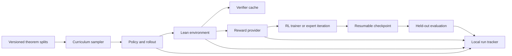

# Efficient Reinforcement Learning for Small Formal Reasoners

This project studies when reinforcement learning (RL) helps a small language model solve Lean theorems under a fixed compute budget. We will compare model readiness, Lean reward granularity, and theorem sampling. The main outcome is verified learning per generated token, Lean call, and GPU hour, alongside held-out solve rate. The target is one RTX 4090 and a model near the 250M–400M scale. These are study targets, not measured results.

## Research questions

- Does the same short RL probe help more after later checkpoints from one representation-building trajectory?
- Does Lean feedback from tactic prefixes improve learning over terminal verification when its provenance is recorded?
- Does sampling near the current competence frontier improve verifier-signal yield over uniform sampling?
- Under matched generated-token and Lean-call budgets, how does RL compare with verifier-filtered expert iteration?

See [the research plan](docs/research_plan.md) and [the protocol](docs/experimental_protocol.md) for comparisons and inference limits.

## Architecture

The diagram shows intended interfaces. No experiment implementation exists in this setup.

## Local setup

1. Install [uv](https://docs.astral.sh/uv/getting-started/installation/) and Python 3.12.
2. Install [elan and Lean](https://lean-lang.org/install/manual/). Lean is separate from the Python environment.
3. Run `uv sync` to install the repository's development tools.
4. Run `uv run pre-commit install` after you initialize or clone the Git repository.
5. Run `uv run pre-commit run --all-files` to check the current documents and metadata.

The Python project is not installable yet because the source modules have not been written. The Lean toolchain and mathlib revision must be pinned together when the first Lean fixture is added. Do not mix the original Lean 3 [MiniF2F repository](https://github.com/openai/miniF2F) with a Lean 4 verifier. A [Lean 4 MiniF2F port](https://github.com/google-deepmind/miniF2F) exists, but this project has not selected or pinned a benchmark revision.

## First milestone

The first implementation should load one small checkpoint, verify candidate proofs from a small Lean training set, record terminal rewards and costs, make one optimizer update, rerun held-out evaluation, and plot solve rate against cumulative Lean calls. Keep the initial run small and resumable. The intended smoke command is `uv run python scripts/smoke.py --config configs/rl/smoke.yaml --dry-run`; this command is **pending implementation**.

## Baselines and status

| Baseline | Planned entry point | Status |
| --- | --- | --- |
| No-RL checkpoint evaluation | `configs/eval/` | Not implemented |
| Supervised fine-tuning on formal traces | `configs/midtrain/` | Not implemented |
| Terminal reward, uniform sampling | `configs/reward/` and `configs/curriculum/` | Not implemented |
| Terminal reward, adaptive sampling | `configs/reward/` and `configs/curriculum/` | Not implemented |
| Process reward, uniform sampling | `configs/reward/` and `configs/curriculum/` | Not implemented |
| Process reward, adaptive sampling | `configs/reward/` and `configs/curriculum/` | Not implemented |
| Verifier-filtered expert iteration | `configs/rl/` | Not implemented |

The table is the canonical project status. Update it when a command works; do not write a second status file. The [protocol](docs/experimental_protocol.md) defines matched budgets and the [metrics](docs/metrics.md) define each output.

## Artifact locations

Keep source data and proof traces outside Git. Store run configs, checkpoint IDs, split manifests, JSONL events, verifier-cache metadata, and plots under `artifacts/<run-id>/`. Record the exact Lean, mathlib, model, and data revisions in each run. Keep short human summaries in `reports/` and link them to run artifacts. See [team workstreams](docs/team_workstreams.md) for ownership and [decisions](docs/decisions.md) for durable choices.
