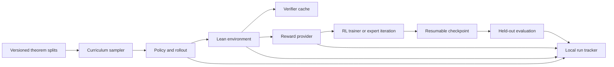

# Efficient Reinforcement Learning for Small Formal Reasoners

This project studies when reinforcement learning (RL) helps a small language model solve Lean theorems under a fixed compute budget. Manas's planned interactive comparison fixes `Qwen/Qwen2.5-0.5B-Instruct` and varies Lean reward attribution and prerequisite-aware curriculum. It uses no additional supervised fine-tuning (SFT) or continued pretraining. The user authorizes separate whole-proof GRPO and curriculum experiments. The current total ceiling is $95, including earlier runs. Historical budget ledgers remain unchanged. This pilot reuses TRL and the existing whole-proof checker. Anwesha's interactive Lean environment and Abhinav's interactive policy optimizer remain separate dependencies.

The current priority is correct mathematical execution and independent knowledge acquisition. The [local-action pilot](docs/results/06_local_action_pilot.md#local-action-correctness-pilot) measures verified witnesses; the [ordered RLP result](docs/results/08_controlled_rlp.md#ordered-arm-results) measures independently graded complete answers. Preserve both experiments and their different reward definitions. The user initially deferred Lean integration for the controlled RLP comparison. Its result now motivates a [proposed Lean-verified acquisition evaluation](docs/research_plan.md#lean-verified-acquisition-evaluation-proposal-2026-10-06). The [midterm reference](docs/team_workstreams.md#midterm-reference-rl-correctness-and-acquisition-2026-10-06) connects the experiments, grading corrections, and proposed next study. No new verifier integration or training follows from that documentation.

## Research questions

- Does prerequisite-aware curriculum improve held-out proof success at the same generated-token and Lean-call costs?
- Does tactic feedback improve learning over terminal reward in the same interactive environment?
- Do staged premise access and component-lemma training help when tested separately from theorem ordering?
- How does additional RL adaptation transfer from number theory to external undergraduate problems?

See [the research plan](docs/research_plan.md) and [the protocol](docs/experimental_protocol.md) for comparisons and inference limits.

For resuming Manas's work, read the historical [curriculum and RLP handoff](docs/team_workstreams.md#curriculum-and-rlp-handoff-2026-10-05) and the newer [midterm reference](docs/team_workstreams.md#midterm-reference-rl-correctness-and-acquisition-2026-10-06). They record the experiments, evidence limits, and proposed next steps. The status table below remains the source of truth.

## Architecture

The diagram shows intended interfaces. The data audit and local math probe are implemented. The Lean and RL interfaces remain planned. The expert-iteration branch is an earlier alternative, outside Manas's current RL-only comparison.

## Local setup

1. Install [uv](https://docs.astral.sh/uv/getting-started/installation/) and Python 3.12.
2. Install [elan and Lean](https://lean-lang.org/install/manual/). Lean is separate from the Python environment.
3. Run `uv sync` to install the repository's development tools.
4. Run `uv run pre-commit install` after you initialize or clone the Git repository.
5. Run `uv run pre-commit run --all-files` to check the current documents and metadata.

The Python project is not installable yet because the source modules have not been written. The Lean toolchain and mathlib revision must be pinned together when the first Lean fixture is added. Do not mix the original Lean 3 [MiniF2F repository](https://github.com/openai/miniF2F) with a Lean 4 verifier. A [Lean 4 MiniF2F port](https://github.com/google-deepmind/miniF2F) exists, but this project has not selected or pinned a benchmark revision.

## First milestone

The current deliverable is [the experiment plan](docs/research_plan.md), with controls in [the protocol](docs/experimental_protocol.md). It defines an unchanged-policy reference and the terminal/process reward by uniform/curriculum comparison. Premise unlocking and proof decomposition remain isolated extensions.

Execution depends on Anwesha's reconstructed Lean states and Abhinav's policy optimizer. After their interfaces arrive, the first run should measure unchanged-policy readiness before testing an optimizer update. The earlier proposed command `uv run python scripts/smoke.py --config configs/rl/smoke.yaml --dry-run` remains **unimplemented** and is not a launch instruction.

## Baselines and status

| Baseline | Planned entry point | Status |
| --- | --- | --- |
| Manas's RL-only experiment registration | `docs/research_plan.md` | Planned comparison documented; no runnable RL config or compute launch |
| Dataset preparation and overlap audit | `scripts/data/prepare_leandojo.py` | Original Nat probe preserved; broader pool curated on cpu-angad and archived privately in Drive; export recount passed; Lean replay pending |
| No-RL checkpoint evaluation | `scripts/eval/probe_qwen.py` | Base public-math pilot completed; original Instruct proof diagnostic completed with pinned Lean; see capability probe |
| Spot L40S sampling diagnostic | S3 `capstate/acq/formal_rl/qwen_l40s_pilot_20261003_retry4/` | Worker reports complete; instance terminated; independent final recount pending. Earlier setup failures preserved. No RL update |
| TensorBoard diagnostic | `scripts/monitor/track_tensorboard.py`; cpu-angad `tensorboard_pilot_20261003/` | Server serves recorded pilot curves and prerequisite readiness counters through an SSH tunnel; scalar endpoint verified; source records remain in S3 |
| Separate whole-proof GRPO pilot | `scripts/train/run_grpo_pilot.py`; `configs/rl/qwen_05b_whole_proof_grpo.json` | Both arms complete; worker exit 0; CPU recount passes; instance terminated. No accepted training or validation proofs and no groups with reward variation. Failed runs remain preserved |
| Prerequisite curriculum diagnostic | `scripts/data/prepare_prerequisite_curriculum.py`; `configs/rl/qwen_05b_prerequisite_grpo.json` | Readiness finishes with no accepted proof or mixed-reward group. Worker exit 0; CPU recount exits 0. GRPO arms and unseen-combination evaluation skipped; instance terminated |
| Syntax-assisted prerequisite retry | `configs/rl/qwen_05b_prerequisite_grpo_syntax.json`; same preparer and runner | Readiness finishes with no accepted proof or mixed-reward group. Worker and CPU recount exit 0. GRPO arms skipped; instance terminated |
| Assisted proof-completion study | `configs/rl/qwen_05b_completion_grpo.json`; same preparer and runner | Completed and CPU-recounted; GPU terminated. Assisted completion gives mixed rewards and nonzero gradients. No unassisted held-out success; one eligible task prevents an ordering comparison |
| Number-theory acquisition preparation | `scripts/data/prepare_prerequisite_curriculum.py --number-theory-bootstrap` | CPU reference replay completes with exit 0 under the pinned checker. Concrete quotient, remainder, and divisibility exercises supplement symbolic prerequisites. Evaluation remains fixed. This preparation does not train a model |
| RLP number-theory acquisition | `scripts/data/prepare_rlp_corpus.py`; `scripts/train/run_rlp_pilot.py`; `configs/pretrain/qwen_05b_number_theory_rlp.json` | Completed; worker exit 0. Final policy, tokenizer, optimizer, and EMA teacher are present in S3 `capstate/acq/formal_rl/number_theory_rlp_20261004_ondemand/runtime/out/`. CPU recount passes. Arithmetic responses lack parseable boxed answers before and after training; independent capability gain is unestablished |
| RLP primitive-first continuation | `configs/pretrain/qwen_05b_number_theory_rlp_continuation.json`; same preparer and runner | Completed; worker and CPU audit exit 0; instance terminated. Audit verifies curriculum order, token counts, evaluation answers, and checkpoint receipts. Final policy copied to cpu-angad and retained in S3. Assisted held-out score remains 11/48; validation remains 7/16. No measured accuracy gain. S3 `capstate/acq/formal_rl/number_theory_rlp_20261004_continuation/` |
| Supervised adaptation diagnostic | `configs/midtrain/qwen_05b_gsm8k_lora.yaml` | GSM8K LoRA and matched evaluation completed; no final-answer accuracy gain; this is not formal-trace training |
| RLP precision audit | `scripts/audit/audit_rlp_updates.py` | CPU diagnostic and behavior recount exit 0. Saved optimizer moments are BF16. Controlled updates demonstrate rounding loss. Evidence remains at CPU `artifacts/number_theory_rlp_v2/update_audit/`; previous results remain preserved |
| RLP midtraining precision correction | `configs/midtrain/qwen_05b_number_theory_rlp_fp32.json`; `scripts/train/run_rlp_pilot.py` | Worker and CPU recount exit 0; final checkpoint copied to cpu-angad and retained in S3. First real update confirms changed weights and FP32 moments. Held-out accuracy remains 11/48; validation changes from 7/16 to 6/16. No measured acquisition gain. Instance `<ec2-instance-id>` terminated. S3 `capstate/acq/formal_rl/number_theory_rlp_20261004_fp32_midtraining/` |
| Revised primitive RLP curriculum | `scripts/data/prepare_rlp_corpus.py --structured-primitives`; `configs/midtrain/qwen_05b_primitive_rlp.json` | Worker completed with exit 0. Final checkpoint and milestone checkpoints are in S3 `capstate/acq/formal_rl/primitive_rlp_20261005/runtime/out/`. CPU recount and failure analysis return exit 0. Final held-out performance deteriorates; see [failure analysis](docs/decisions.md#2026-10-05-examine-primitive-rlp-deterioration-on-cpu). Raw counts and diagnosis remain under CPU `primitive_midtraining_v1/audit_final/` and S3 `audit/`. No active project instance returned by the Stockholm EC2 query. |
| Structured RLP corpus admission | `scripts/audit/audit_rlp_corpus.py` | Completed on CPU; exit 0. Numeric targets pass; prospective support admission flags implicit domains. Distribution, template overlap, constant-answer baselines, and admission records are archived. See [the corpus audit](docs/results/07_rlp_corpus_audit.md#structured-rlp-corpus-audit). See the controlled preparation row for subsequent matched views and grader calibration. Further training remains pending. |
| Controlled mathematical RLP comparison | `scripts/data/prepare_rlp_corpus.py --controlled-mathematics`; `configs/midtrain/qwen_05b_controlled_rlp.json` | Ordered arm completed 432 optimizer steps. The blinded review and adjudicated score are complete. No fully correct answer appears across its five validation phases. The shuffled arm and the held-out comparison remain unscored. See [ordered-arm results](docs/results/08_controlled_rlp.md#ordered-arm-results). Artifacts are in S3 `capstate/acq/formal_rl/controlled_rlp_20261006/` and cpu-angad `artifacts/controlled_ordered_review_20261006/ordered_results_v2e/`. |
| Acquisition evaluation across saved policies | `scripts/eval/evaluate_acquisition.py`; `configs/eval/acquisition_probe_v1.json` | Completed on cpu-angad; worker, raw recount, and blinded-content recount exit 0. Early RLP has small item-level gains without improved recognition; final RLP has no demonstrated acquisition gain under the fixed limits. See [content results](docs/results/05_acquisition_evaluations.md#acquisition-content-evaluation). CPU output: `formal_rl/artifacts/acquisition_eval_v1/`; S3: `capstate/acq/formal_rl/acquisition_eval_v1/`. Failed initial launcher preserved. |
| Acquisition, proof semantics, and strategy evaluation | `scripts/eval/evaluate_acquisition.py`; `configs/eval/decomposition_probe_v2.json` | Completed on cpu-angad; inference, notation check, grade audits, and recount exit 0. Revised Astra grading gives no acquisition completion gain over the original. Partial progress, full correctness, disagreement, and truncation remain separate. See [decomposition results](docs/results/05_acquisition_evaluations.md#acquisition-proof-semantics-and-proof-strategy). CPU `artifacts/decomposition_eval_v2/`; S3 `capstate/acq/formal_rl/decomposition_eval_v2/complete.tar.gz`. |
| Knowledge/operator inventory and staged acquisition | `configs/eval/knowledge_inventory_v1.json`; `scripts/eval/evaluate_acquisition.py`; `scripts/eval/verify_local_operator.py` | Early and original inventory, adjudication, and recount complete; all exit 0. Early RLP remains the training start. Lean witness controls pass; direct probe exposes format and mathematical failures. See [inventory results](docs/results/05_acquisition_evaluations.md#knowledge-inventory-and-local-operations). CPU `artifacts/knowledge_inventory_v1/`; S3 `capstate/acq/formal_rl/knowledge_inventory_v1/complete.tar.gz`. Training and assistance fading remain pending; no new GPU launch. |
| Local-action correctness pilot | `configs/rl/qwen_05b_local_operator_grpo.json`; `scripts/train/run_grpo_pilot.py` | Pilot complete, exit 0; selected `policy_step_64`. Correct witnesses improve on supplied tasks; prose errors and weak composition transfer remain. See [results](docs/results/06_local_action_pilot.md#local-action-correctness-pilot). Instance `<ec2-instance-id>` is terminated. CPU `operator_pilot_v1/gpu_records/`; S3 `capstate/acq/formal_rl/operator_pilot_20261006/`. Independent acquisition and undergraduate capability remain unestablished. |
| Supervised fine-tuning on formal traces | `configs/midtrain/` | Earlier proposal; not implemented; outside the current main comparison |
| Terminal reward, uniform sampling | `configs/reward/` and `configs/curriculum/` | Not implemented |
| Terminal reward, adaptive sampling | `configs/reward/` and `configs/curriculum/` | Not implemented |
| Process reward, uniform sampling | `configs/reward/` and `configs/curriculum/` | Not implemented |
| Process reward, adaptive sampling | `configs/reward/` and `configs/curriculum/` | Not implemented |
| Verifier-filtered expert iteration | `configs/rl/` | Earlier alternative; not implemented; outside the current main comparison |

The table is the canonical project status. Update it when a command works; do not write a second status file. The [protocol](docs/experimental_protocol.md) defines matched budgets and the [metrics](docs/metrics.md) define each output.

## Repository map

| Path | Contents |
| --- | --- |
| [`configs/`](configs/README.md) | Frozen run configs by stage: `data/`, `eval/`, `pretrain/`, `midtrain/`, `rl/`. `model/`, `reward/`, and `curriculum/` are empty placeholders. |
| `scripts/` | Entry points by stage: `data/`, `train/`, `eval/`, `audit/`, `monitor/`. See [scripts by stage](#scripts-by-stage). |
| `tests/` | Unit tests. Run `uv run python -m unittest discover -s tests`. |
| [`docs/`](docs/research_plan.md) | Research plan, [protocol](docs/experimental_protocol.md), [metrics](docs/metrics.md), [decisions](docs/decisions.md), and [team workstreams](docs/team_workstreams.md). |
| `docs/results/` | Experiment records with counts, sources, and limits. See [experiment records](#experiment-records). |
| `artifacts/` | Local run outputs, outside Git. Most run artifacts live on cpu-angad and in S3; each record names its paths. |
| `src/formal_rl/` | Planned package skeleton. It contains no modules. |

## Scripts by stage

Run each script from the repository root. A script that imports a helper from another stage folder adds that folder to its import path.

| Stage | Script | Purpose | Configs |
| --- | --- | --- | --- |
| Data | [`prepare_leandojo.py`](scripts/data/prepare_leandojo.py) | Curate LeanDojo subsets and audit split overlap | `configs/data/leandojo_*.json` |
| Data | [`prepare_grpo_pilot.py`](scripts/data/prepare_grpo_pilot.py) | Prepare gold-free whole-proof prompts; holds the shared Lean checker loader | `configs/rl/qwen_05b_whole_proof_grpo.json` |
| Data | [`prepare_prerequisite_curriculum.py`](scripts/data/prepare_prerequisite_curriculum.py) | Prepare authored prerequisite, completion, and number-theory tasks | `configs/rl/qwen_05b_prerequisite_grpo*.json`, `configs/rl/qwen_05b_completion_grpo.json` |
| Data | [`prepare_rlp_corpus.py`](scripts/data/prepare_rlp_corpus.py) | Prepare RLP acquisition text without evaluation solutions | `configs/pretrain/`, `configs/midtrain/*rlp*.json` |
| Data | [`mathematical_rlp_data.py`](scripts/data/mathematical_rlp_data.py) | Authored mathematical records and matched views for controlled RLP | `configs/data/mathematical_rlp_review_v1.json` |
| Train | [`run_grpo_pilot.py`](scripts/train/run_grpo_pilot.py) | TRL GRPO runner for proof and local-action pilots | `configs/rl/*.json` |
| Train | [`local_operator_training.py`](scripts/train/local_operator_training.py) | Local-action mode with verified-witness reward | `configs/rl/qwen_05b_local_operator_grpo.json`, `configs/data/local_operators_v1.json` |
| Train | [`run_rlp_pilot.py`](scripts/train/run_rlp_pilot.py) | RLP runner through TRL | `configs/pretrain/`, `configs/midtrain/*rlp*.json` |
| Eval | [`probe_qwen.py`](scripts/eval/probe_qwen.py) | Local MLX math probe of the base model | `configs/eval/qwen_05b_probe.json`, `configs/midtrain/qwen_05b_gsm8k_lora.yaml` |
| Eval | [`evaluate_acquisition.py`](scripts/eval/evaluate_acquisition.py) | Free-response acquisition, decomposition, and inventory probes | `configs/eval/acquisition_probe_v1.json`, `decomposition_*.json`, `knowledge_inventory_v1.json` |
| Eval | [`grade_mathematical_responses.py`](scripts/eval/grade_mathematical_responses.py) | Blinded review packets and grade recounts | `configs/eval/mathematical_grading_v1.json`, `mathematical_grader_calibration_v1.json` |
| Eval | [`verify_local_operator.py`](scripts/eval/verify_local_operator.py) | Lean check of submitted witness expressions | `configs/eval/local_operator_probe_v1.json` |
| Audit | [`audit_proofs.py`](scripts/audit/audit_proofs.py) | Label GRPO proof failures from saved diagnostics | None |
| Audit | [`audit_rlp_updates.py`](scripts/audit/audit_rlp_updates.py) | Compare saved RLP weights and BF16 update rounding | None |
| Audit | [`audit_primitive_rlp.py`](scripts/audit/audit_primitive_rlp.py) | Audit saved primitive RLP records | None |
| Audit | [`audit_rlp_corpus.py`](scripts/audit/audit_rlp_corpus.py) | Audit structured RLP exports | None |
| Monitor | [`track_tensorboard.py`](scripts/monitor/track_tensorboard.py) | Export S3 run records to TensorBoard | None |

`audit_rlp_updates.py` needs `torch` and `track_tensorboard.py` needs `tensorboardX`. The training and inference environments on cpu-angad and the GPU hosts supply these packages; `pyproject.toml` does not declare them.

## Experiment records

Each record keeps the counts, artifact paths, and inference limits from its run. Read them in this order for the project history.

| Record | Experiments | Dates |
| --- | --- | --- |
| [Data preparation](docs/results/01_data_preparation.md) | LeanDojo Nat subset and broader number-theory pool | 2026-10-01 |
| [Qwen capability probe](docs/results/02_qwen_capability_probe.md) | Base-model math pilot, GSM8K LoRA, Instruct proof diagnostic | 2026-10-01 to 10-03 |
| [GRPO proof pilots](docs/results/03_grpo_proof_pilots.md) | Whole-proof GRPO, prerequisite readiness, assisted completion | 2026-10-03 to 10-04 |
| [RLP acquisition](docs/results/04_rlp_acquisition.md) | Saved RLP checkpoint, precision correction, primitive curriculum | 2026-10-04 to 10-05 |
| [Acquisition evaluations](docs/results/05_acquisition_evaluations.md) | Content probe, proof semantics and strategy, knowledge inventory | 2026-10-05 |
| [Local-action pilot](docs/results/06_local_action_pilot.md) | Verified-witness GRPO from early RLP | 2026-10-06 |
| [RLP corpus audit](docs/results/07_rlp_corpus_audit.md) | Numeric, split, and support audit of the primitive corpus | 2026-10-06 |
| [Controlled RLP](docs/results/08_controlled_rlp.md) | Controlled preparation and ordered-arm results | 2026-10-06 |

## Artifact locations

Keep source data and proof traces outside Git. Store run configs, checkpoint IDs, split manifests, JSONL events, verifier-cache metadata, and plots under `artifacts/<run-id>/`. Record the exact Lean, mathlib, model, and data revisions in each run. Keep short human summaries in `reports/` and link them to run artifacts. See [team workstreams](docs/team_workstreams.md) for ownership and [decisions](docs/decisions.md) for durable choices.
