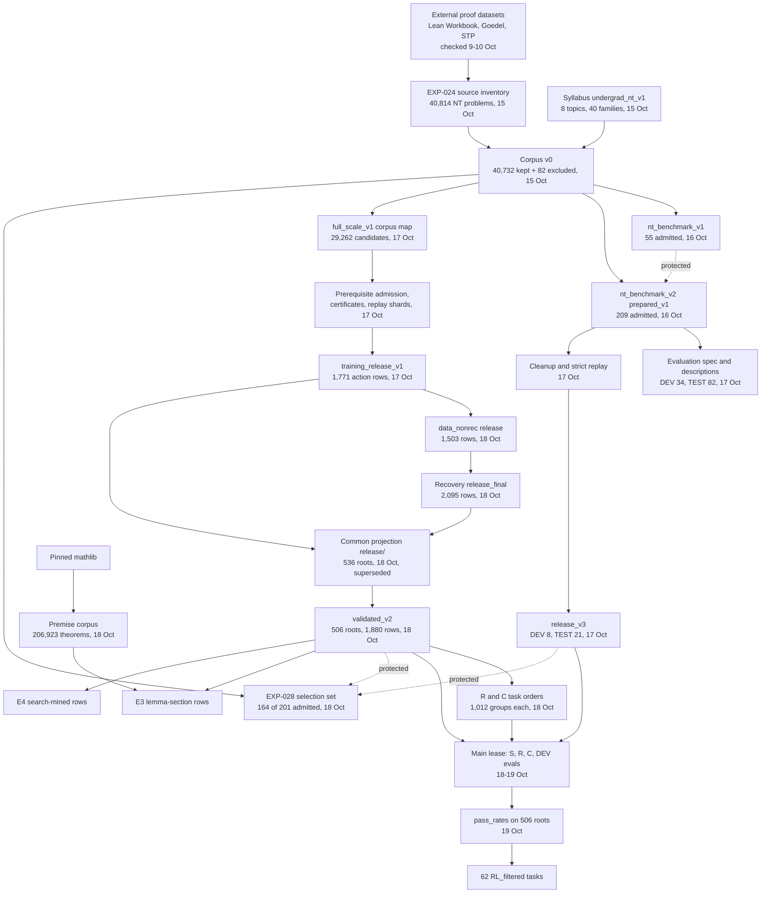

# Experiments

This is the experiment catalogue, protocol record, and decision log for this repository.
[README status](../README.md#status) owns current execution status.
The [TeX report](tex/project_report.tex) owns scientific narrative and interpretation.
The [reward inventory](REWARD_HACKING.md) owns exploit details.

## How to read this file

Start at the [experiment register](#experiment-register). It has one row per experiment ID, with links to the record, the outcome entries and the report section.
The parts of this file, in order:

1. Rules: the [catalogue rules](#catalogue-rules) and the [record contract](#record-contract).
2. The [experiment register](#experiment-register).
3. [Adopted inputs and next actions](#adopted-inputs-and-next-actions), a checkpoint last edited on 10 October 2026.
4. Historical setup, results summary, records of EXP-001 to EXP-013, interpretation and next steps.
5. [Later records](#later-experiment-and-audit-records) of EXP-014 to EXP-022, AUD-001 and AUD-002.
6. The [decision log](#decision-log).
7. Records of EXP-023 to EXP-030.
8. The [data handoff for Abhinav](#data-handoff-for-abhinav-20-october-2026-ist), 20 October 2026.
9. [README status text before condensing](#readme-status-text-before-condensing-20-october-2026), 20 October 2026.

Dated entries sit under the section that was last when they were written, not always under their own experiment:

- The EXP-019 midterm entries and the PPO readiness review follow the decision log.
- The 15 and 16 October entries for EXP-023, and the benchmark contract of 16 October, sit under the EXP-024 heading.
- The 17 and 18 October entries for EXP-025, EXP-026 and EXP-027 sit under the EXP-027 heading.
- The results of EXP-026 and EXP-027, dated 19 October, sit under the EXP-028 heading.

The register's Results column links these entries wherever they sit.
The decision log has two blocks. Entries from 20 October back to 11 October run newest first. Below them, entries from 24 September to 11 October run oldest first.
Some recount entries name scripts such as `scripts/p4_why.py` and `scripts/build_ledger.py`. These paths are inside the private run directory `.private/ops/report_recount_20261019_v1/`, not in this repository.
Line numbers cited in older notes refer to earlier versions of this file. Commit `8242e9f` holds the last version before this reading guide.

## Catalogue rules

An experiment asks a research question. A run is one execution, including an arm, seed, retry, or rescore.
Data builds, baselines, and audits also need records. They do not establish a training gain.

- Keep the existing experiment numbering. `EXP-001` refers to the original Experiment 1.
- Assign a new experiment ID for a new question. Never renumber records when the report order changes.
- Keep comparisons under one experiment. Give each execution a unique run ID and output directory.
- Keep historical output names. Add their experiment association here instead of renaming artifacts.
- Record each failed, stopped, skipped, and null run. Separate these outcomes from measured success or failure.
- Mark missing fields as `not recorded` and unchecked paths as `not inspected`. Never reconstruct them from memory.
- Keep dates inside entries. Do not create a new Markdown file for each session, plan, audit, or handoff.

The records below index documented evidence locations. This catalogue update does not recount results or verify remote artifact availability.
Historical locators retain the report's relative paths. Confirm their machine and durable storage from the original manifest before reuse.
Historical summaries remain below. Their presence does not certify their numbers.
Historical execution owners, seed-level run IDs, and exact commands are not fully indexed.
Local note paths under `artifacts/notes/` are outside Git and are unavailable in a clean public checkout.

## Record contract

Before a new run, complete its protocol in the relevant experiment entry.
Keep resolved execution details in the existing run directory, outside Git.
For historical runs, preserve the original record and list missing fields here.

| Record | Required content | Location |
| --- | --- | --- |
| Question | Research question, hypothesis or exploratory aim, inference boundary | Experiment entry here |
| Responsibility | Scientific owner, execution owner, reviewer; distinguish assigned work from authorship | Experiment entry here |
| Comparison | Arms, starting checkpoint, data exposure, seeds, baseline, controlled variables | Protocol here; resolved settings in run artifacts |
| Evaluation | Primary metric, numerator and denominator, unit of analysis, split, checkpoint selection rule, uncertainty method | Protocol here; per-item outcomes in run artifacts |
| Limits | Token, Lean-call, wall-time, memory, and GPU caps; approval reference for paid work | Protocol and resolved run record |
| Identity | Experiment ID, unique run ID, parent run or checkpoint, UTC timestamps, command, working directory | Existing run record |
| Versions | Git revision and dirty diff; model revision; config and data digests; Lean, mathlib, REPL, and scorer versions | Resolved run record and manifests |
| Inputs | Frozen split membership, exact and near-duplicate audit, excluded items, proof exposure | Data manifests and audit output |
| Outputs | Raw completions, Lean verdicts, error categories, checkpoints, logs, exit code, stop reason | Run directory |
| Recount | Script, command, source file and row or item IDs, exclusions, counted denominator, derived output | Run artifacts; concise evidence link here |
| Resources | Generated tokens, physical Lean calls, cache hits, wall and GPU time, peak memory | Existing run logs |
| Cost | Reservation, measured usage, invoice if available, and durable artifact receipt | Private run ledger and run artifacts |

Use the runners' existing files. `run_grpo_pilot.py` and `run_rlp_pilot.py` write `run.json`.
`run_lean_grpo.py` writes `run.json`, `steps.jsonl`, and `rollouts.jsonl`.
`run_sft.py` writes `run.json` after training, so it cannot document a failed launch by itself.
Keep that launch's command, log, exit code, and reservation in the existing operations ledger.
These requirements are documentation rules. The current runners do not automatically populate every field.

### Protocol and result updates

1. Register the question, owner, comparison, metric, evidence path, and limits before launch.
2. Freeze the config, splits, model, and verifier identity in the run record.
3. Record the run ID and output location under its experiment. Keep one writer per output.
4. Recount outcomes from raw records before updating a result or the README status.
5. Record the interpretation and limitation together. Put the scientific explanation in the TeX report.
6. Append protocol changes and corrections to the decision log. Preserve the original protocol and result.

Choose checkpoints and task mixes on the development split only.
Keep training, development, validation, and held-out test membership explicit.
For paired comparisons, match the starting checkpoint, data, sampling settings, scorer, and resource budget.
Record deviations and failed attempts before interpreting the comparison.
Label each reward component as Lean-verified or heuristic. A completed subgoal is not a complete proof.
Keep timeouts, crashes, truncations, and scorer errors distinguishable from rejected proofs in raw records.
If an endpoint counts them as failures, state that rule and retain their categories.
A corrected scorer needs a new rescore record linked to the original generation run.
Compare arms only under the same declared scoring protocol.

### Documentation ownership

| Content | Maintained source |
| --- | --- |
| Current execution status and navigation | `README.md` |
| Experiment catalogue, protocols, evidence index, next actions, decisions | This file |
| Scientific explanation, formal definitions, figures, conclusions | `docs/tex/project_report.tex` |
| Exploit mechanism, fix, residual risk | `docs/REWARD_HACKING.md`, linked to the audit entry here |
| Raw evidence, resolved settings, manifests, recounts, logs, costs | Existing run directories and private operations ledgers |
| Agent workflow | `AGENTS.md`; `CLAUDE.md` links to it |
| Dated notes and scratch handoff | Historical sources; no continuing project status |

Reuse these owners. A new document requires a distinct audience and durable purpose that no existing source serves.
Generated run reports stay with their run and appear in its evidence index.
Do not turn generated reports into another project narrative or status record.
Keep infrastructure identifiers in `.private/infrastructure.md`.
Public records use cpu-angad with paths relative to `formal_rl/`, or the existing redacted S3 prefix.
Preserve historical files and unique evidence. Consolidation does not authorize deletion.

## Experiment register

The original experiment numbers remain stable. Later records extend the catalogue.
Kinds distinguish research experiments, data builds, evaluations, and audits.
Current execution status appears in the README, not in this register.

| ID | Kind | Question or purpose | Record | Results | Report |
| --- | --- | --- | --- | --- | --- |
| EXP-001 | Data build | Can we prepare an isolated LeanDojo theorem subset? | [Record](#exp-001) | [Summary](#historical-result-summary) | [§4.1](tex/project_report.pdf#page=8) |
| EXP-002 | Baseline | Does GSM8K LoRA change informal math accuracy? | [Record](#exp-002) | [Summary](#historical-result-summary) | [§4.1](tex/project_report.pdf#page=8) |
| EXP-003 | Baseline | Can the unchanged Instruct model generate accepted Lean proofs? | [Record](#exp-003) | [Summary](#historical-result-summary) | [§4.1](tex/project_report.pdf#page=8) |
| EXP-004 | Experiment | Does family order change whole-proof GRPO learning? | [Record](#exp-004) | [Summary](#historical-result-summary) | [§4.2](tex/project_report.pdf#page=8) |
| EXP-005 | Experiment | Do prerequisite tasks produce an initial Lean success signal? | [Record](#exp-005) | [Summary](#historical-result-summary) | [§4.2](tex/project_report.pdf#page=8) |
| EXP-006 | Experiment | Does a proof prefix make curriculum comparison feasible? | [Record](#exp-006) | [Summary](#historical-result-summary) | [§4.2](tex/project_report.pdf#page=8) |
| EXP-007 | Experiment | Does RLP training improve independently generated answers? | [Record](#exp-007) | [Summary](#historical-result-summary) | [§4.3](tex/project_report.pdf#page=9) |
| EXP-008 | Audit and rerun | Are RLP updates lost through optimizer precision? | [Record](#exp-008) | [Summary](#historical-result-summary) | [§4.3](tex/project_report.pdf#page=9) |
| EXP-009 | Experiment | Does primitive-first RLP improve held-out answers? | [Record](#exp-009) | [Summary](#historical-result-summary) | [§4.3](tex/project_report.pdf#page=9) |
| EXP-010 | Evaluation | Which capabilities change across saved RLP checkpoints? | [Record](#exp-010) | [Summary](#historical-result-summary) | [§4.3](tex/project_report.pdf#page=9) |
| EXP-011 | Experiment | Can a Lean reward improve local witness generation? | [Record](#exp-011) | [Summary](#historical-result-summary) | [§4.4](tex/project_report.pdf#page=9) |
| EXP-012 | Data audit | Are the RLP answers and rule conditions valid? | [Record](#exp-012) | [Summary](#historical-result-summary) | [§4.3](tex/project_report.pdf#page=9) |
| EXP-013 | Experiment | Does ordered assistance differ from shuffled assistance? | [Record](#exp-013) | [Summary](#historical-result-summary) | [§4.3](tex/project_report.pdf#page=9) |
| EXP-014 | Experiment | Does proof SFT provide a useful starting checkpoint? | [Record](#exp-014) | In record | [§4.5](tex/project_report.pdf#page=10) |
| EXP-015 | Evaluation | Does the SFT checkpoint solve target theorems beyond a fixed tactic baseline? | [Record](#exp-015) | In record | [§4.5](tex/project_report.pdf#page=10) |
| EXP-016 | Data build | Can external statements support a number-theory evaluation pool? | [Record](#exp-016) | In record | [§4.5](tex/project_report.pdf#page=10) |
| EXP-017 | Data build | Can SFT, RL tasks, and development decisions use distinct admitted data? | [Record](#exp-017) | In record | [§4.5](tex/project_report.pdf#page=10) |
| EXP-018 | Experiment | Does informal reasoning between Lean steps improve the starting policy? | [Record](#exp-018) | Not run | [§4.5](tex/project_report.pdf#page=10) |
| EXP-019 | Experiment | Does Lean-reward GRPO improve held-out proof completion at matched cost? | [Record](#exp-019) | [Native parity](#native-parity-midterm-completion); [fixed mixture](#fixed-mixture-midterm-completion) | [§4.5](tex/project_report.pdf#page=10); [§4.6](tex/project_report.pdf#page=10) |
| EXP-020 | Exploratory pilot | Can alternating supervised proof practice with either hidden-target RLP or Lean-verified GRPO improve full proof completion? | [Record](#exp-020) | [Validation recount](#exp-020-validation-recount-11-october-2026) | [§4.5](tex/project_report.pdf#page=10) |
| EXP-021 | Experiment | Test verified proof distillation before another Lean RL stage | [Record](#exp-021) | [Decision log](#decision-log), 11 October | [§4.5](tex/project_report.pdf#page=10) |
| EXP-022 | Experiment | Does a learned value function help where within-prompt binary rewards rarely vary? | [Record](#exp-022) | Not run | [§4.5](tex/project_report.pdf#page=10) |
| EXP-023 | Experiment | Broader complete proofs, PPO and REINFORCE, an error-aware reward, and curriculum experiments | [Record](#exp-023) | [Final run](#handoff-final-curriculum-run-results-14-october); [held-out pass@k](#exp-023-held-out-passk-15-october-2026); [recount](#exp-023-saved-question-recount-outcome-15-october-2026) | [§4.7](tex/project_report.pdf#page=11); [§7.1](tex/project_report.pdf#page=16) |
| EXP-024 | Experiment | Does SFT on Lean-verified undergraduate number-theory data make the model solve more problems than the same amount of SFT on the old data? | [Record](#exp-024) | [Corpus v0](#exp-024-corpus-v0-outcome-15-october-2026); [screen](#exp-024-screen-part-2-outcome-15-october-2026); no training | Not in the report |
| AUD-001 | Audit | Which proof errors and available starting points inform task selection? | [Record](#aud-001) | In record | Section removed in commit `c612b21` |
| AUD-002 | Audit | Can scorer exploits or data exposure invalidate the reward? | [Record](#aud-002) | In record; [reward inventory](REWARD_HACKING.md) | [§5](tex/project_report.pdf#page=12); [§6](tex/project_report.pdf#page=12) |
| EXP-025 | Data build | Can the broader corpus provide reproducible benchmark and training inputs? | [Record](#exp-025) | [Expanded dataset](#exp-025-expanded-dataset-outcome-16-october-2026); [filtered release](#filtered-release-outcome-17-october-2026); [prerequisite release](#checked-prerequisite-release-outcome-17-october-2026); [full-corpus mapping](#full-corpus-mapping-outcome-17-october-2026) | [§8](tex/project_report.pdf#page=16); [Appendix A](tex/project_report.pdf#page=37) |
| EXP-026 | Prospective experiment | How do unchanged Qwen, SFT and SFT + RLVR differ in generalization? | [Revised protocol](#generalization-experiment-revised-framing-16-october-2026) | [R and E3](#r-result-and-e3-result-19-october-2026-ist); [dev_R](#dev_r-result-rl-shifts-s-toward-repeated-short-actions-19-october-2026-ist); [E7](#e7-result-r-on-the-selection-set-19-october-2026-ist) | [§8](tex/project_report.pdf#page=16); [§9](tex/project_report.pdf#page=22) |
| EXP-027 | Prospective experiment | Does curriculum improve familiar benchmark performance, generalization, or both? | [Protocol](#exp-027) | [C](#c-result-curriculum-order-raises-train-acceptance-and-narrows-the-policy-19-october-2026-ist); [dev_C](#dev_c-result-and-main-lease-end-19-october-2026-ist) | [§8](tex/project_report.pdf#page=16); [§9.4](tex/project_report.pdf#page=28) |
| EXP-028 | Prospective screen | Do step search, automation fallback, lemma retrieval, search-mined SFT and pass-rate-filtered RL raise held-out acceptance over S? | [Protocol](#exp-028) | [E0](#e0-result-18-october-2026-ist); [E2](#e2-result-and-lemma-data-18-october-2026-ist); [E5 and E3](#e5-result-and-the-e3-comparison-19-october-2026-ist); [E6](#e6-result-filtered-rl-on-the-selection-set-19-october-2026-ist); [RL_filtered](#rl_filtered-result-learning-on-the-62-filtered-train-tasks-19-october-2026-ist); [Kimina probe](#kimina-capability-probe-result-19-october-2026-ist); [why-analysis](#analysis-why-rl-raises-train-acceptance-without-a-held-out-gain-20-october-2026-ist) | [§9](tex/project_report.pdf#page=22); [§9.6](tex/project_report.pdf#page=29) |
| EXP-029 | Prospective experiment | Do the RL arms differ from S at 8 attempts on the screened 164-theorem selection set and on the 62 RL_filtered tasks? | [Protocol](#exp-029) | Not run; [stop](#exp-029-stop) | [§10](tex/project_report.pdf#page=33) |
| EXP-030 | Exploratory pilot | Do per-action Lean-error penalties make REINFORCE close more proofs than the terminal proof reward alone? | [Protocol](#exp-030) | Not run; [stop](#exp-030-stop) | [§10](tex/project_report.pdf#page=33) |

Results links the outcome entries. Report names the section of `docs/tex/project_report.pdf` in its build of 20 October 2026 and links that page.

## Adopted inputs and next actions

This checkpoint was last edited on 10 October 2026 (commit `81edb68`). It does not cover EXP-020 to EXP-030. For current status, see the [README](../README.md#status).

This is a protocol checkpoint, not a report of live machine state.
The decision log adopts `nt_pool_v2`, `nt_splits_v3`, and scorer `train_code_v11`.
The interleaved SFT config selects `nt_sft_v8` and its comments-removed counterpart.
The earlier `nt_sft_v5` pair remains the data-coverage baseline.
The data build note indexes `nt_rl_tasks_v3` for RL proof-prefix and whole-proof tasks.
Verify resolved launch inputs against these sources when a run is approved.

| Priority | Required action | Responsible role | Evidence or acceptance condition |
| --- | --- | --- | --- |
| Before GPU launch | Freeze the protocol and run IDs for EXP-018 and EXP-019; update stale lease inputs | Manas coordinates; execution owner recorded per run | Resolved config and launch command match the adopted inputs; cost approved for that launch |
| Before reusing scores | Re-score older subprocess evaluations with the adopted scorer | Evaluation owner: Manas | New rescore record links raw generations, old scorer, new scorer, and recount |
| Before citing results | Index raw evidence and recount the controlled RLP comparison | Evaluation owner: Manas | EXP-013 links the final paired regrade report and its input rows |
| Before updating the report | Reconcile the reward snapshot and catalogue with source artifacts | Scientific owner: Manas; editor assigned for the change | Report and reward inventory name their scorer version and evidence boundary |
| Before interpreting new data | Index external and in-house data builds mentioned in the scratch handoff | Data owner: Manas | Source manifest, split audit, Lean verdicts, and durable output receipt inspected |

### Unresolved evidence and documentation gaps

- Historical result values are not recounted by this catalogue edit. Keep them as historical summaries until their raw sources are inspected.
- EXP-001's historical table predates the later replay recorded in the README. Do not treat that table as current status.
- EXP-013's historical notes cover the ordered arm. The later paired review appears in the README and phase ledger.
- The phase ledger describes multiple prompt, baseline, and scorer corrections. Earlier results need version-specific review before reuse.
- The report and reward inventory describe an earlier scorer than the last adoption decision. Their open-item lists need source-based reconciliation.
- Historical records do not consistently index commands, owners, timestamps, resolved configs, and durable receipts. Do not invent these fields.
- Reservation ledgers do not establish invoiced cost. A historical budget does not authorize a new launch.

## Guidance sources

- [NeurIPS paper checklist](https://neurips.cc/public/guides/PaperChecklist): reproducible settings, evaluation, uncertainty, and compute reporting.
- [MLflow tracking](https://mlflow.org/docs/latest/tracking/): experiments group runs; runs associate parameters, metrics, and artifacts.
- [The Carpentries project organization](https://carpentries-lab.github.io/good-enough-practices/05-project_organization.html): consistent organization and descriptive file names.

These sources guide the record contract. This project keeps its existing runners and artifact stores.

## Historical setup

- Model: `Qwen/Qwen2.5-0.5B-Instruct`. Most later runs start from `checkpoint-118`, an early checkpoint of the primitive RLP run.
- Lean: `v4.10.0-rc1` with mathlib `29dcec074de168ac2bf835a77ef68bbe069194c5`.
- Budget: a $95 total ceiling for all GPU runs. The run ledgers record reservations, not invoices.
- Team: Manas owns data, curriculum, and evaluation. Anwesha owns the interactive Lean environment. Abhinav owns the policy optimizer.
- Artifacts: run outputs live on cpu-angad under `formal_rl/artifacts/` and in S3 under `capstate/acq/formal_rl/`. Bucket names and machine addresses are in the private note `.private/infrastructure.md`.

Two terms appear throughout:

- GRPO: the RL algorithm we use. For each prompt it samples a group of answers and rewards each answer relative to the others in its group. If every answer in a group gets the same reward, the group teaches nothing.
- RLP: a reward that measures how much the model's reasoning makes a hidden correct answer more likely. It does not check whether the reasoning is correct.

## Historical result summary

This retained summary predates the later replay and paired RLP review. It is not current project status.
The original statement that every count matches raw files is not verified by this edit.
"n/m" means n successes out of m items. See each record for source paths and verification gaps.

| # | Experiment | Date | Result |
| --- | --- | --- | --- |
| 1 | LeanDojo data subset | 10-01 | Nat subset: 706 train, 17 validation, 15 test theorems. Broader pool on cpu-angad: 2,658 / 43 / 38. Lean replay not done |
| 2 | Base model math probe + GSM8K LoRA | 10-01 | GSM8K 9/24 before, 8/24 after LoRA. MATH number theory 3/20 both. No gain |
| 3 | Instruct model proof check | 10-01, 10-03 | Lean accepted 0/63 local attempts. A GPU sampling run at four temperatures shows 0/273 in its exported records |
| 4 | Whole-proof GRPO, random vs. family order | 10-03 | 0/8 validation theorems in every phase. No group had reward variation, so no learning signal |
| 5 | Prerequisite curriculum GRPO (+ syntax retry) | 10-04 | 0/256 sampled proofs accepted. Training skipped |
| 6 | Assisted proof completion | 10-04 | Proof prefixes gave 2/64 accepted. Only one theorem qualified, so the order comparison was impossible. Unassisted held-out 0/16 |
| 7 | RLP number-theory training + continuation | 10-04 | Held-out 11/48 before and after. Validation 7/16 before and after |
| 8 | Precision audit + FP32 rerun | 10-04 | Saved optimizer state was BF16 and lost small updates. FP32 rerun: held-out 11/48, validation 7/16 to 6/16 |
| 9 | Primitive RLP curriculum | 10-05 | Held-out fell from 42/108 to 21/108. Validation peaked at 25/56 at checkpoint 118, from 16/56 at the start |
| 10 | Evaluations of saved checkpoints | 10-05 | Early RLP improved explained recognition (14/32 vs. 7/32) but not complete applications or proofs |
| 11 | Local-action pilot, Lean-verified reward | 10-06 | Validation 0/8 to 6/8; held-out 0/4 to 2/4. Error-free answers: 2/8 and 0/4 |
| 12 | RLP corpus audit | 10-06 | All 612 numeric answers correct. 160/448 training rules lack domain or zero conditions |
| 13 | Controlled RLP, ordered arm | 10-06 | 0/18 fully correct at all five checkpoints. Shuffled arm not yet scored |

## Historical experiment records

<a id="exp-001"></a>

### EXP-001: LeanDojo data subset

- Config: `configs/data/leandojo_*.json`.
- Code: [`scripts/data/prepare_leandojo.py`](../scripts/data/prepare_leandojo.py).
- Evidence locator: `artifacts/leandojo_nat_v1/frozen/; artifacts/leandojo_number_theory_v2/`. Moved on 15 October 2026 to cpu-angad `formal_rl/mac_artifacts_archive_20261015/` (same relative paths, checksum-verified).
- Historical record: Git commit `8fc8423`, `docs/results/01_data_preparation.md`.

We filtered LeanDojo Benchmark 4 to arithmetic and number-theory files and kept the official random splits. We removed training theorems that overlap validation or test text. Text checks do not prove the splits are independent. Script: `scripts/data/prepare_leandojo.py`. Configs: `configs/data/leandojo_*.json`.

<a id="exp-002"></a>

### EXP-002: Base model math probe

- Config: `configs/eval/qwen_05b_probe.json; configs/midtrain/qwen_05b_gsm8k_lora.yaml`.
- Code: [`scripts/eval/probe_qwen.py`](../scripts/eval/probe_qwen.py).
- Evidence locator: `local artifacts/qwen_05b_probe/comparison.json`. Moved on 15 October 2026 to cpu-angad `formal_rl/mac_artifacts_archive_20261015/` (same relative paths, checksum-verified).
- Historical record: Git commit `8fc8423`, `docs/results/02_qwen_capability_probe.md`.

We tested the base model on 24 GSM8K and 20 MATH number-theory questions, then trained a small LoRA on GSM8K. Validation loss fell from 0.701403 to 0.514280, but accuracy did not improve. Script: `scripts/eval/probe_qwen.py`.

<a id="exp-003"></a>

### EXP-003: Instruct model proof check

- Config: `configs/eval/qwen_05b_probe.json`.
- Code: [`scripts/eval/probe_qwen.py`](../scripts/eval/probe_qwen.py); [`scripts/audit/classify_proof_failures.py`](../scripts/audit/classify_proof_failures.py).
- Evidence locator: `local artifacts/qwen_05b_instruct_proof/summary.json; cpu-angad tensorboard_pilot_20261003/events/`. Moved on 15 October 2026 to cpu-angad `formal_rl/mac_artifacts_archive_20261015/` (same relative paths, checksum-verified).
- Historical record: Git commit `8fc8423`, `docs/results/02_qwen_capability_probe.md`.
- Gap: GPU sampling counts came from exported monitoring records; the historical note states that an independent recount was not done.

Each of 21 formal goals got three attempts. Lean accepted none. 23/63 responses hit the token limit. A later classification found that none of the 63 was well-formed Lean 4: 57 had a parse or file-structure error, 3 were empty, and 3 used `sorry` (`scripts/audit/classify_proof_failures.py`). A second run on an L40S GPU sampled the same goals greedily and at temperatures 0.3, 0.6, and 0.9: 0 of 273 attempts were accepted. Those GPU counts come from the exported monitoring records; the independent recount was never done.

<a id="exp-004"></a>

### EXP-004: Whole-proof GRPO

- Config: `configs/rl/qwen_05b_whole_proof_grpo.json`.
- Code: [`scripts/train/run_grpo_pilot.py`](../scripts/train/run_grpo_pilot.py).
- Evidence locator: `artifacts/whole_proof_grpo_20261003/`.
- Historical record: Git commit `8fc8423`, `docs/results/03_grpo_proof_pilots.md`.

Both arms ran 32 optimizer steps on identical theorems. The model never produced an accepted proof, so every group had the same zero reward and the gradients stayed at zero. Script: `scripts/train/run_grpo_pilot.py`.

<a id="exp-005"></a>

### EXP-005: Prerequisite curriculum GRPO

- Config: `configs/rl/qwen_05b_prerequisite_grpo*.json`.
- Code: [`scripts/data/prepare_prerequisite_curriculum.py`](../scripts/data/prepare_prerequisite_curriculum.py); [`scripts/train/run_grpo_pilot.py`](../scripts/train/run_grpo_pilot.py).
- Evidence locator: `artifacts/prerequisite_rl_v1/`.
- Historical record: Git commit `8fc8423`, `docs/results/03_grpo_proof_pilots.md`.

We wrote four stages of tasks: logic, arithmetic, divisibility, induction. Before training, we checked whether the model could solve any of them with lemma statements, lemma names, or no help. It solved none, so training was skipped. A retry with Lean 4 syntax templates also solved none.

<a id="exp-006"></a>

### EXP-006: Assisted proof completion

- Config: `configs/rl/qwen_05b_completion_grpo.json`.
- Code: [`scripts/train/run_grpo_pilot.py`](../scripts/train/run_grpo_pilot.py).
- Evidence locator: `artifacts/completion_rl_v1/`.
- Historical record: Git commit `8fc8423`, `docs/results/03_grpo_proof_pilots.md`.

We gave the model most of a proof and asked it to finish. Filling one missing expression worked 2/64 times. Only one theorem qualified for training, so both curriculum arms saw the same single task. The model never solved a held-out theorem without help.

<a id="exp-007"></a>

### EXP-007: RLP number-theory training

- Config: `configs/pretrain/qwen_05b_number_theory_rlp*.json`.
- Code: [`scripts/train/run_rlp_pilot.py`](../scripts/train/run_rlp_pilot.py).
- Evidence locator: `artifacts/number_theory_rlp_v1/; artifacts/number_theory_rlp_v2/audit_final/`.
- Historical record: Git commit `8fc8423`, `docs/results/04_rlp_acquisition.md`.

We trained with the RLP reward on number-theory text, first in textbook order, then primitives first. Scores did not change. The checkpoint is saved in S3 under `number_theory_rlp_20261004_continuation/`.

<a id="exp-008"></a>

### EXP-008: Precision audit

- Config: `configs/midtrain/qwen_05b_number_theory_rlp_fp32.json`.
- Code: [`scripts/audit/audit_rlp_updates.py`](../scripts/audit/audit_rlp_updates.py); [`scripts/train/run_rlp_pilot.py`](../scripts/train/run_rlp_pilot.py).
- Evidence locator: `artifacts/number_theory_rlp_v2/update_audit/; artifacts/number_theory_rlp_fp32_midtraining/`.
- Historical record: Git commit `8fc8423`, `docs/results/04_rlp_acquisition.md`.

Only 8,557,971 of 494,032,768 weights changed between checkpoints. The optimizer stored its state in BF16, which rounds away small updates. We reran in FP32. Updates then worked, but scores still did not improve. Script: `scripts/audit/audit_rlp_updates.py`.

<a id="exp-009"></a>

### EXP-009: Primitive RLP curriculum

- Config: `configs/midtrain/qwen_05b_primitive_rlp.json`.
- Code: [`scripts/train/run_rlp_pilot.py`](../scripts/train/run_rlp_pilot.py); [`scripts/audit/audit_primitive_rlp.py`](../scripts/audit/audit_primitive_rlp.py).
- Evidence locator: `primitive_midtraining_v1/audit_final/diagnosis/`.
- Historical record: Git commit `8fc8423`, `docs/decisions.md` and `docs/team_workstreams.md`.

We trained on 448 authored examples in dependency order, from witnesses to primes and congruences. Held-out accuracy halved by the end. Training scored a supplied answer prefix, while evaluation asked the model to write the answer itself. That mismatch is a possible cause, but no test isolates it. The RLP reward rose over the same run, so the reward and correctness moved apart. Script: `scripts/audit/audit_primitive_rlp.py`.

<a id="exp-010"></a>

### EXP-010: Evaluations of saved checkpoints

- Config: `configs/eval/acquisition_probe_v1.json; configs/eval/decomposition_probe_v2.json; configs/eval/knowledge_inventory_v1.json`.
- Code: [`scripts/eval/evaluate_acquisition.py`](../scripts/eval/evaluate_acquisition.py).
- Evidence locator: `artifacts/acquisition_eval_v1/; artifacts/decomposition_eval_v2/; artifacts/knowledge_inventory_v1/`.
- Historical record: Git commit `8fc8423`, `docs/results/05_acquisition_evaluations.md`.

We compared the original model, early RLP (`checkpoint-118`), and final RLP on recall, application, proof steps, and full proofs. The original completed 4/24 acquisition tasks; each RLP checkpoint completed 2/24. Final RLP hit the length limit on 26/80 responses. Two AI graders scored every answer; they disagreed on 44/321. Script: `scripts/eval/evaluate_acquisition.py`.

<a id="exp-011"></a>

### EXP-011: Local-action pilot

- Config: `configs/rl/qwen_05b_local_operator_grpo.json`.
- Code: [`scripts/train/local_operator_training.py`](../scripts/train/local_operator_training.py); [`scripts/eval/verify_local_operator.py`](../scripts/eval/verify_local_operator.py).
- Evidence locator: `operator_pilot_v1/gpu_records/out/`.
- Historical record: Git commit `8fc8423`, `docs/results/06_local_action_pilot.md`.

The model had to supply a witness, for example `k*l` for `c = a*(k*l)`. Lean checked the witness, and the reward was 1 or 0. After 64 steps, correct witnesses on validation rose from 0/8 to 6/8. The explanations around them often stayed wrong. Lean checks only the witness. Scripts: `scripts/train/local_operator_training.py`, `scripts/eval/verify_local_operator.py`.

<a id="exp-012"></a>

### EXP-012: RLP corpus audit

- Config: `configs/data/mathematical_rlp_review_v1.json`.
- Code: [`scripts/audit/audit_rlp_corpus.py`](../scripts/audit/audit_rlp_corpus.py).
- Evidence locator: `artifacts/rlp_data_audit_v1/final/`.
- Historical record: Git commit `8fc8423`, `docs/results/07_rlp_corpus_audit.md`.

Every numeric answer in the primitive corpus was correct. 160 of the 448 training rules left out conditions, for example that a modular inverse needs gcd(a, n) = 1. A constant answer solved every contradiction item, so some tasks had shortcuts. Script: `scripts/audit/audit_rlp_corpus.py`.

<a id="exp-013"></a>

### EXP-013: Controlled RLP

- Config: `configs/midtrain/qwen_05b_controlled_rlp.json`.
- Code: [`scripts/data/mathematical_rlp_data.py`](../scripts/data/mathematical_rlp_data.py); [`scripts/train/run_rlp_pilot.py`](../scripts/train/run_rlp_pilot.py); [`scripts/eval/regrade_controlled_rlp.py`](../scripts/eval/regrade_controlled_rlp.py).
- Evidence locator: `artifacts/mathematical_pretraining_v1/; artifacts/controlled_ordered_review_20261006/; artifacts/controlled_shuffled_review_20261009/`.
- Historical record: Git commit `8fc8423`, `docs/results/08_controlled_rlp.md`.
- Later review: `artifacts/notes/2026-10-09_phase0_ledger.md` (local historical note), first Update; recount script above writes `report.json`. Exact final report path is not indexed.

We built 72 training examples, each shown with decreasing help: full, partial, recognition, recall, independent. The ordered arm runs them in that order; the shuffled arm sees the same 432 presentations in random order. The ordered arm ran 432 steps and never produced a fully correct answer. Partial credit rose from 0.89 to 1.33, then fell to 0.72. Scripts: `scripts/data/mathematical_rlp_data.py`, `scripts/train/run_rlp_pilot.py`, `scripts/eval/grade_mathematical_responses.py`.

## Historical interpretation

1. Lean-checked rewards produce no learning signal when the model never succeeds. This blocked every whole-proof experiment.
2. A Lean-checked reward worked once the task was small enough for the model to sometimes succeed.
3. The RLP reward can rise while correctness falls. Correct training answers do not make the model's reasoning correct.
4. None of the curriculum experiments has yet given a fair comparison of ordered against shuffled training.
5. AI graders disagree often enough that correctness scores need a checker, which motivates Lean.

## Historical next steps

These are the earlier proposed steps, retained as history. They are superseded by the adopted inputs and next actions above.
Do not use this list as execution status.

1. Score the shuffled arm of the controlled RLP study.
2. Replay the training proofs in Lean. Measure how often the unchanged model finishes a proof when it starts 1, 2, or 3 steps before the end.
3. Check the unchanged checkpoints with Lean on fixed theorem statements, next to a baseline that uses no model.
4. Then train on Lean 4 proofs, run expert iteration, and compare curricula and rewards with GRPO. Section 11 of the report gives the design.

## Later experiment and audit records

<a id="exp-014"></a>

### EXP-014: Lean SFT on mathlib proofs

- Config: `configs/midtrain/qwen_05b_lean_sft_v1.json`.
- Code: [`scripts/data/build_sft_data.py`](../scripts/data/build_sft_data.py); [`scripts/train/run_sft.py`](../scripts/train/run_sft.py).
- Evidence locator: `cpu-angad sft_checkpoints/v2_final/; run prefix lean_sft_20261009_v2`
- Source record: `artifacts/notes/2026-10-09_phase0_ledger.md` (local historical note).
- Boundary or gap: The config records a failed initial lease and a changed batch size. Keep both launch records. The exact archived run.json location needs indexing.

<a id="exp-015"></a>

### EXP-015: Lean evaluation and tactic search

- Config: No single frozen evaluation config indexed.
- Code: [`scripts/eval/lean_eval_statements.py`](../scripts/eval/lean_eval_statements.py); [`scripts/eval/probe_nt_pool.py`](../scripts/eval/probe_nt_pool.py); [`scripts/eval/search_tactics.py`](../scripts/eval/search_tactics.py); [`scripts/eval/single_tactic_baseline.py`](../scripts/eval/single_tactic_baseline.py).
- Evidence locator: `cpu-angad val_eval_v4/; search_v3_sftfinal/; search_v3_fixed/; nt_probe/train200_v3_merged/summary.json`
- Source record: `artifacts/notes/2026-10-09_phase0_ledger.md` (local historical note).
- Boundary or gap: These evaluation populations and scorers differ. Keep separate run IDs. Re-score older subprocess verdicts before reuse; do not pool them with current REPL verdicts.

<a id="exp-016"></a>

### EXP-016: Number-theory statement pool

- Config: No standalone frozen build config indexed.
- Code: [`scripts/data/build_nt_pool.py`](../scripts/data/build_nt_pool.py); [`scripts/data/build_nt_states.py`](../scripts/data/build_nt_states.py); [`scripts/data/verify_external_proofs.py`](../scripts/data/verify_external_proofs.py).
- Evidence locator: `cpu-angad nt_pool_v2/`
- Source record: `artifacts/notes/2026-10-09_phase0_ledger.md` (local historical note).
- Boundary or gap: Pool admission and proof validity do not establish that the formal statement matches the source problem. Pin the source manifest and admission command.

<a id="exp-017"></a>

### EXP-017: Midsem splits and training data

- Config: Input versions appear in the decision log and interleaved SFT config.
- Code: [`scripts/data/build_nt_splits.py`](../scripts/data/build_nt_splits.py); [`scripts/data/build_nt_sft_data.py`](../scripts/data/build_nt_sft_data.py); [`scripts/data/build_syntax_sft.py`](../scripts/data/build_syntax_sft.py); [`scripts/data/build_nt_hole_tasks.py`](../scripts/data/build_nt_hole_tasks.py); [`scripts/audit/check_split_leakage.py`](../scripts/audit/check_split_leakage.py).
- Evidence locator: `cpu-angad nt_splits_v3/summary.json; nt_splits_v3_audit/leakage_check.json; nt_sft_v8/; nt_sft_v8_nocomments/; syntax_sft_v3/; syntax_code_v3/logs/data_check_v2.json; nt_rl_tasks_v3/tasks.jsonl`. The v5 data remains historical.
- Source record: `artifacts/notes/2026-10-10_data_build_report.md` (local historical note).
- Boundary or gap: Use the final outputs section of the source note. Earlier rebuilds remain historical. Similarity filtering does not establish semantic independence.

- Syntax expansion run: `exp017-syntax-v1`, CPU-only, owned and executed by Manas via Codex; reviewer not assigned. Inputs: `task_bank_v2`, its training exports, `nt_splits_v3`, and `nt_aug_v1`. Output: `cpu-angad syntax_sft_v1/`, then `nt_sft_v6/` and `nt_sft_v6_nocomments/`.
- Question: Can existing admitted training proofs provide more examples of Lean proof syntax, without adding held-out proofs? This build measures data coverage, not a training benefit. Compare syntax coverage with `nt_sft_v5`; preserve it as the historical baseline.
- Admission: exclude evaluation/dev files and evaluation premises; apply the existing statement similarity thresholds to validation, test, DEV, held-out proof problems, and miniF2F. Recheck each syntax theorem with scorer v11. Every cut must reconstruct the checked proof. Use the existing cut states and record that they are not re-traced.
- Limits: managed CPU service, four Lean workers, `MemoryMax=16G`, existing per-command timeout, at most 1,500 syntax theorems and four units per theorem. Existing held-out membership stays frozen. Forward-only SFT exclusions also remove base examples that hit held-out proof problems or DEV. Preserve failed checks and all earlier data versions.
- Failed launch: `exp017-syntax-v1` exited 127 before data processing because its interpreter path did not exist. No data outputs were created. Retry `exp017-syntax-v1-retry1` uses the interpreter from the completed in-house runner and a separate code/log directory. cpu-angad lacks the AWS CLI, so the Mac transports archive streams to durable storage without storing data locally.
- Retry 1 exited 1 before data processing: the frozen scorer deployment lacked `check_leakage.py`, which the in-house expansion added later. Retry `exp017-syntax-v1-retry2` includes that dependency explicitly. Its code/log directory is separate; no prior output is overwritten.
- Retry 2 exited 1 during reference checking. `Unique.bijective` uses `attribute [local simp] … in` before its declaration. The scorer left that incomplete command in the setup prefix. Extend `split_prefix` to keep it with the declaration, as it does for `open … in`. The reconstructed source stays identical. Regression check: `uv run python -m unittest discover -s tests -p test_syntax_sft.py`. Failed outputs remain in `syntax_sft_v1/` and `syntax_code_v1_retry2/`.
- Replacement run: `exp017-syntax-v2`, code in `syntax_code_v2/`, outputs `syntax_sft_v2/`, `nt_sft_v7/`, and `nt_sft_v7_nocomments/`. Recheck all candidates with the same limits and scorer v11 plus the scoped-attribute context fix. `run.json` records the exact scorer hashes. No failed proof enters the output.
- Pinned syntax source: [Lean v4.10.0-rc1 command parser](https://github.com/leanprover/lean4/blob/v4.10.0-rc1/src/Lean/Parser/Command.lean#L607) defines `in` as a trailing command parser. The context fix preserves that command boundary; it changes no proof acceptance condition.
- Run v2 exited 1 at `MulChar.inv_mul`: a line comment after a doc comment hid the declaration modifier from `split_prefix`. Keep trailing line comments with the declaration, then peel the doc comment. The full source remains unchanged. The regression check now covers both context failures. Preserve `syntax_sft_v2/` and its code/log directory; the queued readiness check did not run because the build failed.
- Run `exp017-syntax-v3` rechecks all candidates with both context fixes, unchanged acceptance checks, and unchanged limits. Its code is `syntax_code_v3/`; outputs are `syntax_sft_v3/`, `nt_sft_v8/`, and `nt_sft_v8_nocomments/`. The [pinned declaration modifier parser](https://github.com/leanprover/lean4/blob/v4.10.0-rc1/src/Lean/Parser/Command.lean#L61) identifies doc comments as part of a declaration.
- Readiness measurement correction: the first audit used `len(apply_chat_template(...))`, which counted dictionary fields in the installed Transformers version. Its token lengths and pass verdict are invalid. Preserve `logs/data_check.json` and the original check source. `verify_expansion_v2.py` reads `input_ids` explicitly, checks the IDs against encoding the rendered chat without extra special tokens, and writes `logs/data_check_v2.json`. Follow the [Hugging Face chat-template training guidance](https://huggingface.co/docs/transformers/main/chat_templating#model-training).
- Final evidence: `exp017-syntax-v3` returned exit 0. `exp017-data-check-v3-corrected` returned exit 0 with no readiness failures. Recount source: `syntax_code_v3/verify_expansion_v2.py`. Result: `syntax_code_v3/logs/data_check_v2.json`. All rows have matching arm membership and prompts; targets match after comment removal. No theorem spans training and loss evaluation. No statement hits the declared similarity thresholds. These checks do not establish semantic independence.
- Reference recount: `syntax_sft_v3/checks.jsonl` contains 1,236 checks. The accepted count is 1,194. The rejected count is 42. Both context regression theorems are accepted. `syntax_sft_v3/run.json` records the Lean version, the declared mathlib revision, input hashes, and scorer hashes. The environment lacks Git metadata, so this build does not independently establish the mathlib revision.
- Assembly: `nt_aug_v1/proofs.jsonl` supplies the tactic variants. The forward-only exclusion file removes 31 base SFT problems with held-out/DEV similarity hits. Source manifests, the exact runner, raw reference verdicts, paired datasets, and audit sources/results are preserved in the final archive. The remote receipt is `syntax_code_v3/logs/final_archive.receipt.json`; durable object key `capstate/acq/formal_rl/exp017-syntax-v3/final.tar.gz`. The external proof import remains a separate running job and supplies no rows to this release.

Coverage recount from `data_check_v2.json`, with each value counted from the actual dataset rows:

| Count | Historical v5 | Expanded v8 |
| --- | ---: | ---: |
| Training examples | 1,088 | 5,812 |
| Loss-evaluation examples | 65 | 245 |
| All examples | 1,153 | 6,057 |
| Distinct theorem names | 553 | 1,716 |
| Mathlib syntax continuations | 0 | 2,747 |
| Tactic-augmentation proofs | 0 | 2,211 |
| Maximum chat-template tokens | 1,809 | 1,809 |
| Examples over the 2,048-token limit | 0 | 0 |
| Case-analysis indicators | 320 | 1,800 |
| Witness/constructor indicators | 289 | 1,484 |
| Induction indicators | 77 | 166 |
| Contradiction indicators | 3 | 41 |

The syntax indicators use the existing `STRUCTURE` regexes on target proof text.
An example can match several indicators. These counts measure syntax coverage, not model competence.
Syntax targets require their original mathlib file context; they are not standalone competition proofs.
Existing cut states are not re-traced. No SFT or RL training runs in this data build.
- Source guidance checked 2026-10-10: [Theorem Proving in Lean, tactics](https://lean-lang.org/theorem_proving_in_lean4/Tactics/) describes tactic proof construction and structure. [Mathematics in Lean, logic](https://leanprover-community.github.io/mathematics_in_lean/C03_Logic.html) supplies terminology for case analysis and constructors. Training examples reuse pinned mathlib proofs, not copied tutorial text.

<a id="exp-018"></a>

### EXP-018: Interleaved number-theory SFT

- Config: `configs/midtrain/qwen_05b_nt_interleaved_sft_v1.json`.
- Code: [`scripts/train/run_sft.py`](../scripts/train/run_sft.py).
- Evidence locator: `Planned inputs: cpu-angad nt_sft_v8/ and nt_sft_v8_nocomments/. Output run IDs not assigned.`
- Source record: `artifacts/notes/2026-10-10_midsem_plan.md` (local historical note).
- Boundary or gap: Compare comments with comments removed using the same examples and starting checkpoint. Choose the arm on DEV. The dated plan predates the final splits; use the adopted inputs above.

<a id="exp-019"></a>

### EXP-019: Interactive Lean RL

- Config: `configs/rl/qwen_05b_lean_grpo_smoke.json` is a smoke config, not a frozen GPU protocol.
- Code: [`scripts/train/run_lean_grpo.py`](../scripts/train/run_lean_grpo.py); [`scripts/eval/pass_rate_map.py`](../scripts/eval/pass_rate_map.py); [`scripts/data/build_rft_data.py`](../scripts/data/build_rft_data.py).
- Evidence locator: `Planned inputs: cpu-angad nt_splits_v3/ and nt_rl_tasks_v3/. GPU output run IDs not assigned.`
- Source record: `artifacts/notes/2026-10-10_midsem_plan.md` (local historical note).
- Registered comparison: SFT start, real Lean reward, shuffled reward, and rejection-sampling fine-tuning (RFT), with matched generated-token budgets.
- Primary endpoint: fully completed proofs on the non-trivial validation population defined by the adopted split. Report the full population separately.
- Selection: choose the starting checkpoint and task mix on DEV. Keep held-out test and miniF2F outside adaptive decisions.
- Missing launch fields: frozen GPU configs, exact sampling count, seed list, run IDs, output paths, execution owner, reviewer, and launch approval.
- Boundary: CPU smoke evidence does not establish GPU training or a research result. Do not reuse a smoke config as the study protocol.

#### Tactic-level pilot amendment, 11 October 2026 IST

- Question: Does bounded feedback on Lean transitions improve unassisted proof completion over terminal-only interactive RL? This is exploratory.
- Responsibility: Manas owns the scientific protocol. Codex owns implementation and CPU execution. A separate agent reviews the policy objective and implementation. This does not replace the team's existing optimizer or interactive-Lean ownership.
- Entry point: `scripts/train/run_tactic_rl.py`. Configs: `configs/rl/qwen_05b_tactic_rl_pilot.json` and `configs/rl/qwen_05b_tactic_rl_terminal.json`.
- Method: on-policy REINFORCE with reward-to-go and a leave-one-out baseline. Each group samples independent trajectories from the same root. Policy parameters remain fixed during sampling. Sum token log probabilities, including sampled EOS, and average over trajectories. Sampling uses the full softmax distribution with dropout disabled. This pilot does not implement the AST/first-token method of [process-verified GRPO](https://arxiv.org/html/2606.20068v1). The baseline follows [RLOO](https://arxiv.org/html/2402.14740v2); implementation uses the established [PyTorch policy-gradient pattern](https://github.com/pytorch/examples/blob/main/reinforcement_learning/reinforce.py).
- Reward: the main reward requires full-proof acceptance through `verify_group`, including target and axiom checks. Changed displayed goals receive bounded heuristic exploration credit. Repeated displayed states, errors, and forbidden constructs receive no further credit. A sampled action is one bounded tactic block, which can contain nested tactics. Redundant facts and renaming can earn heuristic credit; that credit does not establish progress or efficiency.
- Training inputs: reuse `nt_rl_tasks_v3` and `nt_pool_v2`. Validate train membership, theorem headers, forbidden given text, and DEV exclusions before filtering. Alternate whole roots with top-level prefixes whose remaining length satisfies the config. Nested `prefix_have` tasks are excluded because their replay boundary differs. Record admitted task IDs and preserve assisted versus whole labels.
- Comparison: shaped and terminal-only arms use the same starting checkpoint, root order, seed, sampler, and resource ceilings. The starting checkpoint remains unresolved until DEV feedback is inspected. Current configs are implementation pilots, not approved GPU launches. Planned IDs are `exp019-tactic-shaped-s20261011-v1` and `exp019-tactic-terminal-s20261011-v1`, with distinct remote output directories. Match actual cost when interpreting an arm comparison; equal ceilings alone do not establish equal usage.
- Endpoint: unassisted full-proof completion, with generated tokens, physical Lean calls, wall time, and GPU time. DEV guides adaptive decisions. Validation and test do not. Training rewards are diagnostics, not the endpoint. Preserve the original registered comparisons above.
- CPU integration run: register `exp019-tactic-smoke-s20261011-v1`, service `rl-tactic-smoke-20261011-v1`, output `tactic_rl_smoke_20261011_v1/` on cpu-angad. Run the marked group `tests/test_tactic_rl_integration.py`, covering real Lean transitions, multiline replay, actual train-root reconstruction, a tiny optimizer update, and an analytic variable-length gradient check. This run does not train the research model. Cap host memory at 12 GiB, CPU at 400%, and runtime at ten minutes. One writer owns this output. Stream logs and preserve exit status in the existing durable run prefix.
- Evidence: unit checks are local subsecond checks. CPU integration outcomes remain pending at registration. CUDA memory, throughput, learned checkpoints, and proof improvement remain unverified. Keep the existing EXP-020 validation and DEV jobs unchanged.

<a id="aud-001"></a>

### AUD-001: Proof failures and curriculum inventory

- Config: Historical post hoc analysis; no single frozen config indexed.
- Code: [`scripts/audit/classify_proof_failures.py`](../scripts/audit/classify_proof_failures.py); [`scripts/audit/curriculum_inventory.py`](../scripts/audit/curriculum_inventory.py).
- Evidence locator: `Source paths are in the report section labelled sec:posthoc.`
- Correction, 20 October 2026: the current report has no label `sec:posthoc`. Commit `c612b21` removed that section; `git show c612b21^:docs/tex/project_report.tex` shows it.
- Source record: [`project_report.tex`](../docs/tex/project_report.tex).
- Boundary or gap: This is a post hoc diagnostic, not a registered curriculum-effect test.

<a id="aud-002"></a>

### AUD-002: Lean reward and engineering audit

- Config: Scorer adoption appears in the decision log.
- Code: [`scripts/eval/check_checker_attacks.py`](../scripts/eval/check_checker_attacks.py); [`scripts/eval/bench_lean_verifier.py`](../scripts/eval/bench_lean_verifier.py); [`scripts/eval/check_scoring_paths.py`](../scripts/eval/check_scoring_paths.py).
- Evidence locator: `cpu-angad trainer_checker_v1/; trainer_checker_v1/attacks_v11/summary.json; eng_audit_v1/`
- Source record: `artifacts/notes/2026-10-10_trainer_checker_report.md` (local historical note).
- Additional sources: `artifacts/notes/2026-10-10_engineering_audit.md` (local historical note) and [`REWARD_HACKING.md`](REWARD_HACKING.md).
- Boundary or gap: The reward inventory and report describe an earlier scorer snapshot. Use separate scorer-specific audit records. Attack controls do not establish an exhaustive security guarantee.

<a id="exp-020"></a>

### EXP-020: Alternating SFT with RLP and Lean GRPO

- Question: Can alternating supervised proof practice with either hidden-target RLP or Lean-verified GRPO improve full proof completion? This is an exploratory pilot.
- Config: `configs/midtrain/qwen_05b_interleaved_training_v3.json` for the portable-runtime retry. Preserve failed v1 and v2 configs and artifacts. Runner: `scripts/train/run_interleaved_training.py`.
- Responsibility: Manas owns the scientific protocol and evaluation. Codex executes the authorized engineering and lease. Team optimizer ownership remains Abhinav. Independent review is not recorded.
- Start and baseline: SFT v2 final. Both branches start from one shared additional SFT stage on `nt_sft_v8`. Preserve the initial and common SFT checkpoints as baselines. Refresh SFT between RL stages.
- Arms: alternating SFT/RLP and alternating SFT/Lean GRPO. Each branch runs successive curriculum stages. These arms use different data and objectives; their comparison does not isolate the RL algorithm.
- RLP: retain the original target-span likelihood information gain, EMA teacher, private target references, and FP32 optimizer. New handoffs require a completed parent and matching weights. The historical checkpoint pin remains intact. Use the reviewed `data_v2/ordered` corpus, advancing assistance levels with earlier-task replay and balanced template families.
- Proof RL: full Lean acceptance remains the binary reward. Begin with short proof-prefix completions and increase remaining proof length. Add whole proofs in the final stage, with their share capped at a quarter. Exclude DEV names before sampling. Store admitted task IDs. Do not use subgoal reduction as proof credit.
- Data boundaries: retain `nt_splits_v3`, its exact and near-duplicate exclusions, and the SFT proof holdout. Keep DEV and validation out of training. Do not open held-out test proofs or miniF2F proofs for adaptive decisions.
- Evaluation: fixed terminal checkpoints, without hints, on all number-theory validation statements. Report the non-trivial validation population as primary and the full population separately. Initial and common SFT use the same sampling settings. Use the adopted scorer with a 60-second final timeout. Keep unknown, capped, and failed cases in the denominator and retain their categories. No checkpoint selection on validation. No powered inference or seed-variability claim from this pilot.
- Limits: one L40S Spot instance; a nonrenewing lease; explicit per-stage and pipeline wall caps in the config. The private ledger reserves compute and auxiliary costs within the new USD 50 allocation. Full training follows a tiny real GPU round trip through all objectives. A failed dependent stage cannot supply another stage's model. Preserve failures and completed sibling branches.
- Evidence: `interleaved_training_stage_20261010_v1/` on cpu-angad; durable run prefix `interleaved_training_20261010_v1`. GPU records include `engineering_smoke/`, `training/<stage>/stage.json`, resolved configs, raw training logs, checkpoints, and validation candidates. Private operations store the lease receipt and cost reservation.
- Run IDs: `exp020-engineering-smoke-s20261010-v1`; `exp020-common-sft-s20261010-v1`; `exp020-rlp-s20261010-v1`; `exp020-grpo-s20261010-v1`. Each retry needs a new directory and run ID.
- Delivery: checkpoints, recounted evaluations, and presentation evidence are due Monday night, 12 October IST. Use 23:00 IST as the working cutoff. The presentation is Wednesday, 14 October. Efficient search using RL remains the second half of the project.

### EXP-020 validation recount, 11 October 2026

This recount reads recorded Lean verdicts. It does not rerun Lean or independently certify the scorer.
All model arms use eight unassisted samples per statement on the same frozen validation population.
A statement counts as solved when at least one sample is accepted.
The primary population excludes statements solved by the fixed standard-tactic baseline.

| Arm | Primary statements solved | Full validation statements solved | Raw verdict source under `interleaved_eval_20261010_v4/` |
| --- | ---: | ---: | --- |
| Initial SFT v2 | 0/392 | 2/420 | `initial/checked.jsonl` |
| Common additional SFT | 13/392 | 30/420 | `common_sft/checked.jsonl` |
| Terminal SFT/Lean GRPO | 6/392 | 23/420 | `grpo_3/checked.jsonl` |
| Terminal SFT/RLP | 15/392 | 33/420 | `rlp_3/checked.jsonl` |
| Fixed standard tactics | 0/392 | 28/420 | `single_tactic` rows in each arm's `checked.jsonl` |

- Recount command on cpu-angad, from the Formal-RL root: `sft_cpu_venv/bin/python3 interleaved_eval_20261010_v4/presentation_recount.py`. It returned exit code 0. The existing planted-outcome tests passed before the recount.
- Recount output: `interleaved_eval_20261010_v4/presentation_recount.json`. Durable script and output: `capstate/acq/formal_rl/interleaved_training_20261010_v4/presentation_recount/`.
- Sources: each arm's `checked.jsonl`, `candidates.jsonl`, `runs.jsonl`, `scoring.json`, and `completion.json`; `nt_splits_v3/validation_nontrivial.txt`; `nt_pool_v2/pool.jsonl`.
- Checks: each arm has 3,360 distinct model candidates and matching verdict keys. Every validation name has eight scored samples. The recount matches the earlier population summaries and records paired gained/lost names against common SFT. Timeouts remain in the denominators.
- Generation settings match across arms: seed 20261009, eight samples, a 1,024-token cap, temperature 0.6, top-p 0.9, repetition penalty 1.0, and BF16 vLLM generation. The later scoring invocation's generation defaults do not describe the already generated candidates.
- Scoring records name v11 plus context fixes, Lean `v4.10.0-rc1`, mathlib `29dcec074de168ac2bf835a77ef68bbe069194c5`, and a 60-second final verifier timeout.
- The terminal GRPO arm repeats the exact continuation `simp_all` in 1,637 of 3,360 candidates. Common SFT repeats it in 62 of 3,360. This describes output concentration; no ablation establishes its cause.
- Inference boundary: terminal branches receive additional SFT and use different RL data. The terminal comparison does not isolate RL or its algorithm. This is a single-seed validation result, not a held-out-test or efficiency claim. The first-GRPO comparison remains a separate DEV evaluation; do not choose a replacement checkpoint from these validation scores.
- The older TeX report predates this evaluation. Its claims that no unassisted proof succeeds and that the Lean GRPO trainer has not run do not describe EXP-020. Preserve its early experiment history; reconcile its scope before using it as a current presentation source.

## EXP-021

### Monday recovery protocol, 11 October 2026

This exploratory study tests verified proof distillation before another Lean RL stage.
Manas requests delivery by Monday night. The working cutoff is 12 October at 23:00 IST.
Execution owner: Codex under Manas's direction. Scientific owner and reviewer: Manas.
The deadline does not establish that any method improves the model.

- Start from the immutable EXP-020 common SFT checkpoint. Resolve its recorded weights digest before training. Do not select a start from validation scores.
- First compare independent whole-proof sampling with optimizer-disabled interactive tactics on the existing frozen DEV slice. Reuse EXP-019's evaluator; no reference proof enters its prompts. These inference budgets differ, so report tokens, Lean calls, and complete-proof coverage separately.
- Register CPU diagnostic `exp021-interactive-dev-s20261011-v1`, service `rl-monday-interactive-dev-20261011-v1`, output `monday_recovery_20261011_v1/interactive/`. The population is the existing DEV monitor's names. Use the existing tactic DEV config with a distinct run ID. Cap host memory at 24 GiB, CPU at four cores, and runtime at 8,400 seconds including checkpoint download. Peak includes one FP32 policy, bounded activations, and one Lean process. The managed runner streams records to the existing durable run namespace.
- Collect complete proofs on train membership only. Freeze collection names before generation. Exclude DEV, validation, test, and adopted duplicate exclusions. Use `probe_nt_pool.py`, the adopted scorer, explicit repetition penalty, and a recorded token budget. Intermediate tactic changes do not count as proofs.
- Build rejection-sampling fine-tuning (RFT) data with `build_rft_data.py`. Require nonempty training and loss-validation files. If no complete proof survives, preserve that null result; do not substitute validation proofs or claim RFT ran.
- Reuse `run_interleaved_training.py` with `configs/midtrain/qwen_05b_monday_recovery.json`. Save supervised continuation, RFT, and RFT followed by KL-regularized GRPO checkpoints separately. The Kullback-Leibler (KL) penalty limits deviation from the starting reference policy; its benefit is untested here.
- The supervised and RFT arms share the start and optimizer-step cap. Their target tokens differ. The RFT-to-GRPO comparison tests an added stage; it does not isolate RL from every continued-training effect or isolate KL. A terminal-only tactic control belongs to EXP-019 and remains a separate comparison.
- Choose a delivery checkpoint using DEV complete-proof coverage under fixed evaluation settings. Preserve the prepared frozen validation endpoint and held-out test. Do not adapt training from their outcomes. Count timeouts, caps, and unprocessed statements in the declared evaluation population.
- Deliver model weights and tokenizer, resolved configs, parent digests, raw Lean verdicts, resource records, and an updated TeX report. Keep mathematical explanation grading separate from Lean proof acceptance.
- GPU launch remains unapproved. Prepare a nonrenewing single-GPU lease and quote its cost before launch. CPU diagnostics and preparation may proceed. The prepared training config is not evidence of training or proof improvement.

Method source: [DeepSeek-Prover-V1.5](https://arxiv.org/html/2408.08152v1), sections on expert iteration, proof-assistant feedback, and inference. This supplies a method precedent, not a performance prediction for this model.

## EXP-022

### PPO versus GRPO protocol, 11 October 2026

Question: does a learned value function help where within-prompt binary rewards rarely vary?
This is an exploratory algorithm comparison, not a prediction of proof improvement.
Scientific owner and reviewer: Manas. Execution owner: Codex.

- Use the same immutable EXP-021 RFT parent, train-only task file, split exclusions, and checker in both arms. Resolve their digests before any launch. No additional SFT between the parent and either arm.
- Reuse `run_lean_grpo.py`; set `algorithm` to `ppo` or `grpo` with the paired comparison configs. Register distinct run IDs `exp022-{ppo,grpo}-s20261011-v1` and exclusive output directories before execution.
- Keep the same seeded prompt order and consecutive samples per prompt. The PPO loader disables TRL's default shuffle. Exact tokenized queries identify tasks; left padding and response tokens stay separate. Unknown or ambiguous query identity fails the run.
- Use the existing `score` function and full-proof axiom/target checks. The external reward is binary Lean acceptance. PPO's value function predicts returns; it is not a proof verifier. Its backbone starts from the parent and its scalar head starts untrained.
- Match temperature, full-distribution sampling, repetition penalty, response cap, rollout count, token ceiling, Lean-call ceiling, and wall ceiling. The pinned TRL PPO implementation cannot use the old top-p/repetition settings. The matched GRPO config uses the supported PPO settings. This changes sampling from EXP-021, so do not treat that historical run as the matched GRPO arm.
- Use one PPO epoch per batch. Report policy updates, value loss, accepted samples, generated tokens, physical Lean calls, wall time, and GPU time. Equal resource ceilings do not imply equal compute consumed; PPO also trains a critic. Budget checks stop after a completed rollout batch, with at most one batch of overshoot. Managed runtime and memory caps remain mandatory.
- Evaluate the frozen DEV population with identical unassisted whole-proof sampling and the unchanged parent baseline. Keep the full denominator, including timeouts and oversized inputs. Do not choose a checkpoint or curriculum from validation or test results. No checkpoint selection during this pilot; use its terminal checkpoint.
- Primary endpoint: statements with at least one complete Lean-accepted proof. Report paired gains/losses against the parent and between algorithms. One seed is a pilot; it cannot establish robustness. Report assisted-prefix training acceptance separately from whole-proof transfer.
- CPU verification covers planted accepted/rejected rewards, unknown-query rejection, and an actual tiny TRL policy/critic update. It does not establish actual Lean PPO training, GPU fit, critic accuracy, or mathematical learning. No new paid lease is approved.

Implementation source: [TRL 0.24 PPO trainer](https://huggingface.co/docs/trl/v0.24.0/ppo_trainer) and its [pinned source](https://github.com/huggingface/trl/blob/v0.24.0/trl/trainer/ppo_trainer.py). Reuse the library optimizer and advantage calculation.

## Decision log

Entries from 20 October back to 11 October run newest first. Below them, entries from 24 September to 11 October run oldest first.

- 2026-10-20 IST: Manas asks to fix the repository organization, so that newcomers can find code, configs, records and results. No code, config, test or report file moves or changes. The new `scripts/README.md` indexes every script with its docstring purpose, the experiments that name it and its importers. The new `configs/README.md` maps every config to its experiment and names the source of each mapping. The README gains a layout tree, a "Not in Git" section and status rows for EXP-003, EXP-012, EXP-029, EXP-030, AUD-001 and AUD-002, newest first. Five long status cells keep whole sentences only; their full text is in [README status text before condensing](#readme-status-text-before-condensing-20-october-2026). The register gains EXP-020 to EXP-024 and Results and Report columns, and a [reading guide](#how-to-read-this-file) explains the order of this file and its misfiled entries. The README appendix link now points to report page 37, where Appendix A starts; page 24 holds Table 12.
- 2026-10-20 IST: Manas asks for a detailed description of every dataset, how it was created, and a handoff with extremely detailed instructions for Abhinav. The new section [Data handoff for Abhinav](#data-handoff-for-abhinav-20-october-2026-ist) records them, and the README links it. Three read-only audits (records, builder code, archive) and read-only downloads of the small archives with SHA-256 checks support it; every checked hash matches. The audits find that a fresh clone cannot rebuild the chain, that `build_nt_benchmark.py verify` admits no candidate at `main`, and that every archived copy expires between 11 and 19 November 2026. No dataset is rebuilt, and nothing is written to the archive.
- 2026-10-20 IST: Manas asks to record the why-analysis, its motivation and setup, and the stop in this catalogue and in the report, with diagrams. The EXP-028 entry "Analysis: why RL raises TRAIN acceptance without a held-out gain, 20 October 2026 IST" and the stop entries under EXP-029 and EXP-030 record them. `docs/tex/project_report.tex` gains Sections `sec:oct19-setup` (the version 2.2 MDP as these runs use it, with a table and a diagram), `sec:oct20-why` and `sec:oct20-not-run`. `scripts/report/make_report_figures.py` gains `fig_oct20_why`. Nothing is committed.
- 2026-10-20 IST: Manas stops all experiments and asks for analysis only. Lease6 is not launched, and EXP-029 and EXP-030 do not run; see their stop entries. Manas then asks whether the missing held-out gain comes from the RL update or from the reward. A read-only analysis of saved records answers it in the EXP-028 analysis entry of 20 October. It adds four recount scripts, `p4_why.py`, `p4b_tests.py`, `p4c_format.py` and `p4d_train_format.py`; `p4d_train_format.py` traces two counts of the limits line below.
- 2026-10-20 IST: Manas approves the CPU work for one L4 lease within a total budget of about USD 50 and asks for the dense reward. Lease6 (one g6.4xlarge, 28 h, dry-run quote USD 49.51) supersedes the unlaunched lease5. `run_tactic_rl.py` accepts `error_feedback_v1` in environment v2 (`v2_feedback`), and its group records gain an `accepted` list. The EXP-029 amendment and the EXP-030 registration below record the program. Nothing is uploaded, approved for launch or launched; the guard role is not created.
- 2026-10-20 IST: Manas asks whether the action-token limit, the horizon and the discount are right, and proposes a fixed discount, a dense reward, and a longer horizon without a tactic limit. A read-only recount of the EXP-028 rollouts measures the limits (`.private/ops/report_recount_20261019_v1/scripts/p3_horizon_tokens.py`, output `out/p3_horizon_tokens.json`). On TRAIN (`pass_rates`, 2,024 S episodes), 917 of 11,890 S actions reach the 192-token limit, and 893 of them end as format errors. 468 S actions have more than 4 tactics and are refused before Lean runs them. Together, the two limits cause 1,358 of the 1,416 S format errors. On the selection set, 326 of 1,953 S actions reach the token limit. RL_filtered reaches it in 1 of 1,948 actions, and R in 20 of 1,963. 1,935 of the 2,024 TRAIN episodes use all 6 actions without a proof. S closes 84 proofs, and the share of open episodes that close a proof stays between 0.50% and 0.94% at each action from 1 to 6. No accepted proof uses more than 6 tactics. At a discount of 0.95, a proof closed by the last action earns 0.774 with 6 actions and 0.569 with 12. Environment v2 refuses every reward except the terminal proof reward. No configuration or lease change is made; the proposals wait for a decision.
- 2026-10-19 IST: Manas asks for an engineering and data readiness check before EXP-029, so that the only remaining action is to run it. Two read-mostly audits run; their findings, fixes and the resulting lease program are in the EXP-029 registration below. Decisions taken by the orchestrator and open to reversal: every arm runs 8 attempts per theorem as required stages, with second-seed 8-attempt evaluations as best-effort trailing stages; the benchmark v3 screening is dropped from this lease; the lease is on-demand only; the termination guard moves from the CPU host to an AWS scheduler. Nothing is uploaded, approved or launched.
- 2026-10-19 IST: Manas asks to add the 18 and 19 October results to the report, with checked numbers and figures. `docs/tex/project_report.tex` gains Section `sec:oct19-results`, one reading-date sentence, one Main findings item, one Limitations bullet and two bibliography entries. `scripts/report/make_report_figures.py` gains `fig_oct19_heldout`, `fig_oct19_rl_filtered`, `fig_oct19_curriculum` and `fig_oct19_actions`. Every value comes from the read-only recount in the entry "Report recount of the 18 and 19 October results, 19 October 2026 IST". An independent check found 501 numeric values supported, 0 wrong and 0 unsupported. It also found 5 wording overclaims, which are corrected: E3 and E5 start from B, the Kimina probe does not separate model from format and budget, R/C is one run per arm, and the promotion rule, not power, sets the 5-point bar.
- 2026-10-18 IST: Manas allows up to USD 40 of additional spend for EXP-028 follow-ups. Running leases keep their fixed time caps and cannot be extended. Each new launch still needs approval of its exact quote; the next use is chosen after the Kimina held-out result.
- 2026-10-18 IST: Manas approves EXP-028 Lease 4, a Kimina-only rerun with chunked saving, at USD 17.35 reserved for 5 h against a USD 20 ceiling, launched now in parallel because Lease 3's single-chunk probe may miss its cap. Spot fails with `InsufficientInstanceCapacity`; the on-demand fallback starts at 18:14:56 UTC with the guard armed; deadline 23:14:56 UTC.
- 2026-10-18 IST: Manas approves EXP-028 Lease 3 (Kimina-Prover-Distill-0.6B capability probe, rollout backend check and speed test) at its exact quote: USD 17.35 reserved for 5 h against a USD 20 ceiling, in parallel with the main lease and Leases 1 and 2. Spot fails with `InsufficientInstanceCapacity`; the on-demand fallback starts at 17:09:16 UTC with the guard armed; deadline 22:09:16 UTC.
- 2026-10-18 IST: Manas requests faster rollouts after measurement shows model generation takes 68-93% of wall time at about 50 tokens/s (main R 93%, Lease 2 pass rates 91%, Lease 1 E0 68%); Lean takes the rest. `run_tactic_rl.py` gains default-off `rollout: lockstep` (each sample owns an episode and REPL; one batched generate call per step; episodes step in `lean_workers` threads), `generation_backend: hf|vllm` and `vllm_memory_fraction`. Shared Lean counters now hold a lock and each lockstep episode writes its own REPL log. vLLM (pinned `vllm==0.11.0`, which resolves with torch 2.8.0 and transformers 4.57.1) is refused in training until a weight-sync path is validated on a GPU. Lockstep sampling uses a different random stream from the sequential loop, so its outcomes are valid draws but not identical to sequential ones. `scripts/eval/check_rollout_backends.py` must pass on a GPU (greedy match and paired sign-flip tests of log-probability, length and stop rate) before any lockstep or vLLM result counts. The three running leases keep the sequential code they synced at bootstrap; no speedup is measured yet.
- 2026-10-18 IST: Manas approves both EXP-028 leases at their exact quotes: Lease 1 (inference and SFT) USD 63.94 reserved for 22 h, and Lease 2 (RL) USD 66.68 reserved for 23 h, each with a USD 70 ceiling, in parallel with the main lease. Spot allocation fails with `InsufficientInstanceCapacity` for both; the on-demand fallbacks start at 13:59:55 and 14:00:43 UTC with guards armed on cpu-angad. Deadlines are 11:59:55 and 13:00:43 UTC on 19 October.
- 2026-10-18 IST: Manas requests the four literature remedies for low acceptance inside the existing framework. `run_tactic_rl.py` gains default-off config options: `step_candidates` (best-of-K step search), `automation_fallback` (fixed automation tactics after the policy, plus a root automation baseline), `task_filter` (training tasks by TRAIN pass rate from a completed training-state assessment, applied identically to frozen schedules) and `premise_retrieval` (BM25 lemma section in the shared observation). Search and automation are refused in training, because a selected or automation-completed action is not an on-policy REINFORCE sample; automation proofs are counted apart from policy proofs. New tools: `scripts/data/build_search_sft.py` (expert-iteration and repair rows from accepted search paths), `scripts/data/add_premises_sft.py` (adds the lemma section after an exact re-render check) and `scripts/data/build_premise_corpus.py` (Lean dump, not executed). Re-rendering reproduces all 1,880 current SFT prompts exactly; 544 of them already carry a last error. No run uses these options yet, and the running lease's frozen package is unchanged.
- 2026-10-18 IST: Manas approves the staged EXP-026/027 main lease `exp026-027-nt-clean-main-s20261018-v2` with a USD 110 ceiling. Manas amends allocation to one L40S on AWS, spot first, on-demand only if spot allocation fails. Manas allows the existing termination guard on cpu-angad for this lease only, as an exception to the AWS-only rule. A mid-run spot interruption ends the run without replacement. Spot allocation failed and the on-demand fallback runs; see [spot-first amendment and launch](#spot-first-amendment-and-launch-18-october-2026-ist).
- 2026-10-17 IST: Manas freezes curriculum and reward work while requesting a delegated SFT-parent audit and preparation of evaluation questions and expected answers. Reuse the existing EXP-025 package without changing split membership. Register `exp025-evaluation-spec-cpu-s20261017-v1`, owner/root writer, cpu-angad output `nt_benchmark_v2_20261016/evaluation_spec_v1/`. Export exact DEV/TEST statements and initial states, a shared answer contract, and private accepted reference answers. The source verdicts remain historical replay evidence. Semantic review flags do not silently repair or replace frozen questions. No model inference, training, paid GPU launch, or reward change follows from this request.
- 2026-10-16 IST: Manas corrects study ownership: Manas owns the curriculum experiment (EXP-027); Abhinav owns the generalization experiment (EXP-026). This supersedes the preceding assignment of both experiments to Abhinav. Abhinav delivers B/S/R lineage and generalization results. Manas owns prerequisite schedules, C training and R/C curriculum analysis. Share the frozen benchmark, S parent and matched R control through an explicit handoff. Anwesha retains Lean interaction and replay ownership. No experimental setting changes.
- 2026-10-16 IST: Manas corrects the preceding framing. The project has two major experiments: generalization across unchanged Qwen, SFT and SFT + RLVR (EXP-026), and curriculum effects on both familiar benchmark performance and generalization (EXP-027). The prior curriculum-only EXP-026 draft is superseded, not a third major study. Keep its controls and history; move the scientific emphasis to the two questions. Curriculum initially changes RL order while SFT stays fixed. The unchanged model is the existing Qwen2.5-0.5B-Instruct without project SFT, not a newly selected raw Base checkpoint. No execution is authorized by this amendment.
- 2026-10-16 IST: Manas requests curriculum experiments and a documented generalization case with an execution guide for Abhinav. Register [EXP-026](#exp-026) as a prospective order comparison from a common SFT parent. Keep the task multiset fixed, distinguish new instances from new skill combinations, and preserve EXP-023's null order result and failed efficiency gate. Scientific narrative is in the dated report section; semantic review, parent calibration and resolved launch settings remain prerequisites. Documentation does not authorize model runs.
- 2026-10-16 IST: Manas requests a Sol agent for pipeline robustness and assigns benchmark/data work to the root session. Implement the scoped handoff repairs and a maintained builder using existing corpus inputs. CPU preparation and reference checks run on the existing fleet under the limits below. No model training, inference or paid GPU launch is authorized through this work. See [EXP-025](#exp-025).
- 2026-10-16 IST: Manas selects the existing broader number-theory pool for the first benchmark version. Prioritize benchmark definition, expandable problems and measured difficulty before further training. The [benchmark contract](#benchmark-contract-broader-number-theory-16-october-2026) records this scope and proposed controls. This decision does not replace EXP-024's approved SFT protocol or authorize a model run.
- 2026-10-15 IST: Manas approves moving local data off the Mac. `artifacts/leandojo_nat_v1`, `artifacts/qwen_05b_instruct_proof` and `artifacts/qwen_05b_probe` (14,896 files, 3.7 GB) are copied to cpu-angad `formal_rl/mac_artifacts_archive_20261015/` with rsync (exit 0). `sha256sum -c` of the Mac manifest (`manifest_mac.sha256`, kept in that directory) exits 0 with no mismatch, and the remote file count is 14,896. The local copies are then deleted. `artifacts/notes/` and `artifacts/figures/` stay local as notes the catalogue cites. The EXP-002 configs `configs/eval/qwen_05b_probe.json` and `configs/midtrain/qwen_05b_gsm8k_lora.yaml` keep their historical local paths; fetch the data back before rerunning them. Access now goes through the `cpu-angad` SSH alias (private setup note in `.private/infrastructure.md`).
- 2026-10-15 IST: Manas asks for a detailed TeX diagram of the Lean-in-the-loop architecture. An Opus subagent wrote the standalone TikZ source `docs/tex/figures/lean_loop_architecture.tex` and its PDF (latexmk exit 0, no errors or overfull boxes). It shows the state, the token and step levels of the policy, Lean's REPL, solvers and kernel, every transition branch, the reward, the leave-one-out update and what each part supplies. Root checked the content against `run_tactic_rl.py` and the EXP-023 pipeline settings and labelled the numbers as EXP-023 settings. The main report does not include it yet; that change belongs to the report owner.
- 2026-10-15 IST: Manas approves the 3 open choices of the [EXP-024 protocol](#exp-024-protocol-undergraduate-number-theory-sft-14-october-2026): held-out topics 6 (quadratic residues) and 7 (arithmetic functions); evaluation with 12 actions, 384 action tokens and a 3,072-token prompt; 2 training seeds per arm. The syllabus stage starts.
- 2026-10-14 IST: Manas sets the goal before the 21 October midterm: answer undergraduate-level number-theory questions, including long-answer and unseen problem types, then study how that training generalizes. "Safety data" means robustness data: long-answer questions and unseen number-theory problem types. It does not mean retention data, leak checks or negative examples. Mathlib coverage check: the cpu-angad copy `lean_env_full/mathlib` contains Bézout (`gcd_eq_gcd_ab`), CRT, Fermat (`pow_card_sub_one_eq_one`), Euler (`pow_totient`), Wilson, orders, Euler's criterion, quadratic reciprocity, sums of two squares, Pythagorean triples, FLT n = 4, arithmetic functions and lifting-the-exponent results. Its revision against the pinned `29dcec07` was not confirmed, because the copy has no Git metadata or manifest.
- 2026-10-14 IST: Manas moves the midterm to Wednesday 21 October. Next phase: expand prerequisite, method, format, curriculum-check and safety data before SFT and RL, under one formal capability definition. See the [failure count outcome](#failure-count-outcome-14-october).
- 2026-10-13 IST: Report change (from the report session): section 7 of `project_report.tex` now shows the final curriculum (192 training tasks; 152 held-out tasks in 20 families; 670 exclusions), a paragraph "Cleaning the held-out set", and "The frozen plan for the final run", which follows the frozen pre-registration, including power for the 152-task panel labelled as an assumed model. Probe figure 20 is labelled "first template set". Earlier report notes, including the 192-task power wording, are also reflected. 16 pages; latexmk exit 0, no unresolved references. Not committed.
- 2026-10-13 IST: Report change (from the report session): `project_report.tex` now reports the clean 61-task held-out panel and the contamination removal, the parent baseline (6/61 solved, 8/488 accepted), the relabel-rule timing, readiness by final stage labels (Figure 20a redrawn), 186/386 v2.1 first-action format errors with the cause stated as untested, warm-start data v2, and the replacement demo set. 16 pages; latexmk exit 0, no unresolved references. Not committed.
- 2026-10-13 IST: Report change (from the report session): Manas asked for a short, simple, formal report with every finding, diagrams and graphs. `docs/tex/project_report.tex` is now 15 pages, about 5,500 words; the previous version had 25 pages. New sections: "Ways to obtain the reward without proof skill" and "Engineering faults". Pulled from EXP-023: S3 and held-out build, v2.1 format finding (partial count), v2.2 fixes, power analysis, equal-training gate, arm C, demo replacement. The report session states that no reported number changed; latexmk exit 0, no unresolved references. Not committed.
- 2026-10-13 IST: Manas replaces the Spot approval with one on-demand `g6.4xlarge` (1 L4, 16 vCPU, 64 GiB) lease in us-east-2 at the live USD 1.3232/h: 12-hour compute USD 15.88 plus storage and transfer USD 14.96, subtotal USD 30.84, reservation USD 37.01 with a 20% buffer. One attempt; no retry or replacement without new approval. The Spot approval is marked superseded.
- 2026-10-13 IST: Manas approves one paid GPU lease for the EXP-023 final curriculum run: `g6.4xlarge` (1 L4, 16 vCPU, 64 GiB) Spot in us-east-2, maximum USD 1.00/h, 12-hour nonrenewing lease, reservation USD 32.36 (subtotal USD 26.96 plus a 20% buffer; expected compute about USD 8.22 at the observed USD 0.67-0.68/h). One attempt; no retry or replacement without new approval. Launch only after the environment fixes, trainer patches and test suites pass. The EXP-023 USD 50.93 allocation was used by recovery v5 and does not cover this lease. Private quote and approval receipt: `.private/ops/curriculum_final_20261013_v1/`.
- 2026-10-13 IST: Manas asks for a simpler report with more diagrams. Six tables that repeated a figure are removed; their numbers stay in the text or figures. New TikZ diagrams show the Lean acceptance checks, formulations A and B, the two rewards, the data splits, SFT versus RL, the Experiment 3 failure points, the Experiment 11 task, the lesson decision tree and the S0 to S3 stages. No number changes.
- 2026-10-13 IST: Manas asks for more diagrams in the report. TikZ draws the MDP graph, the advantage example, the reverse curriculum, the experiment sequence, the training chain and the v1/v2.1 transitions. `scripts/report/make_report_figures.py` draws five data figures from recorded counts, with 95% Wilson intervals; it runs with `uv run --with matplotlib` and reads no remote file. Mermaid is not used: its renderer is not installed, and TikZ builds inside LaTeX.
- 2026-10-13 IST: Manas asks for a simple midterm report: the MDP formulation, each experiment, and why it failed. The detailed report is archived in Git commit `e3b7747`. `docs/tex/project_report.tex` is rewritten as a 14-page report. Its numbers are carried from the recount records in this file and the archived report; no experiment was rerun. The `latexmk` build returns exit 0 with no unresolved references.
- 2026-10-13 IST: Amend environment v2 to v2.1 after a verified literature review; see the v2.1 amendment under [Environment v2 MDP definition](#environment-v2-mdp-definition-13-october-2026). Manas chooses chunk actions of up to four tactics with first-error truncation, a Lean-file observation, and harness-owned backtracking, with policy backtracking kept as a separate ablation arm. Only scripted-REPL unit checks pass.
- 2026-10-13 IST: Adopt the environment v2 MDP definition for later tactic RL; see [Environment v2 MDP definition](#environment-v2-mdp-definition-13-october-2026). Manas chooses comment + tactic + backtrack actions, discount 0.95, and visible supplied lines with full reward. v1 configs stay reproducible. Only unit checks with a scripted REPL pass; no Lean integration run, model sampling, or launch occurs.
- 2026-10-12 IST: Register EXP-023 preparation for the amended 13 October deadline. Freeze broader Workbook TRAIN and DEV names before model sampling. Preserve the delivered mixed RL checkpoint. Compare ordered and shuffled copies of the same admitted task multiset; compare terminal and error-aware rewards separately from the one-action PPO/REINFORCE comparison. New GPU budget ceiling is USD50, with no paid launch approved. Preparation and a sampled training calibration cannot guarantee an RL gain.

- 2026-10-11 IST: Confirm EXP-021 collection from archived candidates, Lean verdicts, GPU identity, and resolved dependencies. The CPU check of the GPU's `runtime/out/input_record.json` returns exit code 0 and confirms no admitted training name overlaps DEV or frozen duplicate exclusions. Preserve `membership_receipt.json` in the same durable prefix. This establishes active collection, not training completion or improved proof accuracy.
- 2026-10-11 IST: Include a conservative compute bound for the unnecessary separate tactic lease inside EXP-021's original USD20 cap. Live inspection confirms that extra lease is shutting down. The [AWS termination documentation](https://docs.aws.amazon.com/AWSEC2/latest/UserGuide/terminating-instances.html) states that instance charges stop in that state; storage remains an auxiliary reservation. Tighten the recovery guard by ten minutes, without changing stage limits. The owned guard restart returns exit code 0 and confirms the earlier deadline is armed. Preserve `guard_adjustment.json`, the prior deadline, and the updated lease receipt in the existing run prefix. No new launch or renewal is authorized.

- 2026-10-11 IST: A resumed agent used stale context and launched an unnecessary separate EXP-019 lease before finding the already-running approved EXP-021 recovery lease. The extra run is `tactic_gpu_20261011_v1`; its termination request is accepted. Preserve its source, price query, approval interpretation, registry, bootstrap log, and termination receipt. Retract the interpretation that the latest acknowledgement authorized a separate launch. Do not count this run as completed training or release its reservation before confirmed termination. Future launch checks must inspect other active project leases and the latest canonical status, rather than checking the new run name alone. EXP-021 remains the active Monday recovery owner.

- 2026-10-11 IST: Manas approves the quoted single six-hour GPU lease with a USD20 total cap for EXP-021. Launch receipt `monday_recovery_20261011_v1/lease.json` records launch and an armed independent termination guard. Private operations ledger holds the price reservation; no renewal or second launch is authorized. The unique durable run prefix is `capstate/acq/formal_rl/monday_recovery_20261011_v1/`. Runtime output is `runtime/out/`; managed GPU service is `formal-rl-nt`. Host memory is capped at 56 GiB and service runtime at 20,400 seconds. CPU code staging uses a separate 512 MiB cap. GPU shutdown is scheduled before the independent six-hour deadline. Launch is not training completion.
- 2026-10-11 IST: Resolve EXP-021 collection to frozen train membership outside both DEV and `nt_splits_v3/excluded_from_training.txt`. Collect with seed 20261012, a 256-statement cap, eight samples, and a 256-token continuation cap. Collection wall cap is 4,800 seconds; failed collection remains archived. Build RFT from accepted complete proofs within its recorded generation budget. If either RFT training or loss-validation data is empty, run the supervised control and record the skipped dependent stages. If collection finds sometimes-successful theorem names with existing RL tasks, restrict the GRPO task file to those names; otherwise retain the registered curriculum and disclose that fallback. Preserve parent weights and resolved-plan records.
- 2026-10-11 IST: Include the existing EXP-019 shaped-reward and terminal-only tactic pilots inside the approved EXP-021 lease, without extending it. Each uses its unchanged registered caps and a separate `runtime/out/tactic_{shaped,terminal}/` output. Both start from RFT if it completes, otherwise from the immutable common SFT checkpoint. Their heuristic transition reward remains distinct from Lean-accepted full-proof reward. A run with no optimizer update does not establish a trained checkpoint. Frozen DEV evaluations use the same names for the initial, supervised, RFT, and RFT-plus-GRPO arms. Mathematical explanation quality remains a separate unresolved endpoint.
- 2026-10-11 IST: CPU diagnostic retry v2 completes with launcher exit code 0. Its optimizer-disabled evaluator records `status: completed` and no accepted proof. Source: `monday_recovery_20261011_v2/interactive/run.json`; durable records use the existing v4 namespace under `monday_recovery_v2/`. This null diagnostic does not support an interactive search benefit. Preserve all raw trajectories and do not replace the frozen DEV population.

- 2026-10-11 IST: EXP-021 CPU diagnostic v1 fails before model download when the first signed archive PUT returns HTTP 403. Preserve its source, registry, and service journal. The runner omitted the empty Content-Type header used by existing upload runners; urllib supplies a different header. Register retry `exp021-interactive-dev-s20261011-v2`, service `rl-monday-interactive-dev-20261011-v2`, output `monday_recovery_20261011_v2/interactive/`, with unchanged resource caps and explicit empty upload Content-Type. No evaluation outcome exists for v1.

- 2026-10-11 IST: Manas requests the improvement workflow and a deliverable model by Monday night. Register EXP-021 as exploratory recovery. Prepare train-only RFT followed by KL-regularized Lean GRPO with a supervised continuation control. Start with frozen DEV inference diagnostics. New paid launches require cost approval; no improvement is guaranteed by the deadline.


Add one dated line per decision. Do not edit old lines.

- 2026-09-24: Set up the repository. Use Lean 4 only.
- 2026-10-01: Freeze the Nat subset as a pipeline test. Probe the base model locally. Fix the Instruct model for RL.
- 2026-10-01: Curate the broader data pool on cpu-angad and archive it privately in Drive.
- 2026-10-03: Run a $10 frozen-model diagnostic on a Spot L40S, then a separate whole-proof GRPO pilot.
- 2026-10-04: Raise the budget ceiling to $64. Test prerequisite tasks with decreasing help, then assisted completion.
- 2026-10-04: Move to number-theory learning with RLP before proof RL. Rerun in FP32 after the precision audit.
- 2026-10-05: Run the primitive curriculum. Investigate its decline on CPU. Select `checkpoint-118` as the training start.
- 2026-10-05: Evaluate saved checkpoints with blinded AI grading and partial credit.
- 2026-10-06: Run the local-action pilot with a Lean-checked witness reward.
- 2026-10-06: Defer Lean, audit the RLP corpus, and prepare the controlled ordered-vs-shuffled comparison. Raise the ceiling to $95.
- 2026-10-06: Propose a Lean-verified evaluation as the next study.
- 2026-10-07: Reorganize scripts by stage, remove machine identifiers from the public repo, and merge the docs into this file.
- 2026-10-09: Expand the TeX report to cover all 13 experiments, add the GPU sampling run to Experiment 3, and add two post hoc audit scripts.
- 2026-10-09: Manas approved: extend the development set with LeanDojo random/test under the same selection rule; remove task-bank units that share a file with a development theorem from RL training; build the GRPO trainer with the Lean REPL reward in this repo (the optimizer is listed under Abhinav); GPU use within the 145 USD ceiling, each launch confirmed with its cost.
- 2026-10-10: Manas set the post-training direction: interleaved informal reasoning and Lean in one model (no separate translator in the RL loop), longer outputs accepted, and more Lean-verified samples through offline steps (SFT, distillation, expert iteration, proof-prefix tasks) and online steps (GRPO with Lean reward), after the engineering audit passes.
- 2026-10-10: Adopt nt_pool_v2 (4,306 Lean Workbook number-theory statements; drops 86 statements that use sqrt, pi, Real.*, or Complex.*) and nt_sft_v2; probe, pass-rate map, and GRPO trainer now share one REPL scorer (verify_group), after the engineering audit found a batch-file error-attribution bug and an implicit repetition penalty of 1.1 from the checkpoint generation config.
- 2026-10-10: Adopt nt_splits_v3 for the midsem RL study: exclude train statements with token Jaccard >= 0.85 to a validation or test statement and >= 0.7 to any miniF2F test statement, plus statements whose hypotheses prove False; hold out 25% of proved problems from SFT as the source of RL proof-prefix tasks; a 300-statement DEV slice for all decisions; primary metric on the 392 validation statements no single tactic proves, reported by nearest-train-similarity band.
- 2026-10-10: Adopt scorer v11 (train_code_v11) as the reward and evaluation check for every arm: axiom report read only at the target's #print axioms line, one-command parse check, FORBIDDEN extended with metaprogram commands and observe, and FORBIDDEN applied only outside Lean comments, so informal reasoning in comments cannot cause a rejection (12 of 1,153 nt_sft_v5 rows had been falsely rejected for the word observe). The old subprocess check in probe_start_depth.py is not used for new results; earlier results it scored are re-scored before reuse. The shuffled-reward arm replaces the Bernoulli random-reward arm. Lean timeout: 20 s for RL rewards and pass-rate maps, 60 s for final validation and test scoring.
- 2026-10-10: Establish stable experiment IDs and a single catalogue in this file. Keep current status in README, scientific narrative in the TeX report, and raw evidence in run artifacts. Preserve dated notes as history; create no new per-session Markdown records. Historical results remain un-recounted by this documentation change.
- 2026-10-10: Manas requested completion of the data expansion for Lean syntax. Reuse existing replay-accepted training proofs and tactic augmentation; build paired SFT data on CPU. Keep external proof import as a separate running job. No GPU launch or training is authorized by this data request.
- 2026-10-10: Adopt `nt_sft_v8` and `nt_sft_v8_nocomments` after the corrected readiness check and final archive confirmation. Use all loss-evaluation rows in the SFT config. Preserve the frozen splits, forward-only exclusions, failed builds, and invalid first token-length audit. Syntax coverage is measured; training benefit remains unmeasured.
- 2026-10-10: Manas chose both alternating SFT/RLP and alternating SFT/Lean GRPO, requested implementation of the new curriculum, and authorized L40S Spot work within a new USD 50 allocation. Prepare and check engineering before full training. Register EXP-020 as an exploratory pilot; retain efficient proof search using RL as the project's second half. Target Monday night for checkpoints and evaluation evidence.
- 2026-10-10: Focused engineering checks exposed two curriculum errors before launch: a row limit could repeat earlier RLP levels, and unrestricted whole-proof tasks could dominate the final GRPO level. Correct both while preserving the original reward objectives and split guards. GPU round-trip validation remains pending.
- 2026-10-10: Spot capacity rejected the fixed-zone requests and a larger-host request. A one-L40S `g6e.xlarge` Spot lease then launched, with its host service capped at 28 GiB. Preserve the same GPU, objectives, token limits, and wall limits. The private receipt records the actual price and independent termination deadline. Managed CPU unit `rl-interleave-eval-20261010-v1` waits for completed generation artifacts. GPU validation and full training remain pending at this checkpoint.
- 2026-10-10: The v1 lease failed before training because inherited dependency pins contained literal placeholders. The runner archived exit code 2 and shut down the instance. A live EC2 check confirmed termination. Repair pins from package metadata; CPU `uv pip compile` resolves the pinned training stack. No trained checkpoint came from v1. Preserve its receipt, lock, logs, and run prefix.
- 2026-10-10: Manas requested adequate samples, balanced distribution, and ordered practice. Register v2 before its retry. Remote `interleaved_training_stage_20261010_v2/sample_audit.py` writes `sample_audit.json`. It recounts 5,812 SFT training rows across 1,612 theorems; the validation set has 245 rows. Name overlap with SFT validation, DEV, and held-out pool splits is zero. Existing exact and near-duplicate admission checks remain the split contract; this recount does not replace them. SFT refreshes use distinct seeds and equal settings across branches. Preserve the admitted SFT source mix.
- 2026-10-10: The v2 data audit retains all GRPO prompts under the token cap. Successive stages admit 119, 296, and 605 tasks. The respective theorem counts are 119, 144, and 302. Budget one task pass with 60, 148, and 303 optimizer steps, two prompts per step, and eight completions per prompt. Present one task per theorem before another cut of that theorem. Keep wall and lease caps unchanged; record actual unique tasks and a resource stop separately from requested coverage. Whole tasks remain below a quarter of the final pool.
- 2026-10-10: RLP v2 uses 108 presentations per stage, balanced equally across nine template families. Each stage includes all 72 current examples plus 36 replay presentations. Replay spans earlier assistance stages, rather than drawing only from fully worked examples. The audited stage views and concept counts remain in `sample_audit.json`. These are curriculum counts, not evidence that the policy learned the concepts. Keep the original private-target reward.
- 2026-10-10: Retry IDs use `exp020-<stage>-s20261010-v2`, with a separate `exp020-engineering-smoke-s20261010-v2` and durable prefix `interleaved_training_20261010_v2`. Preserve each arm and stage directory. The private ledger reserves USD 1 for the terminated bootstrap, USD 24 for the new nonrenewing lease, and USD 4 for auxiliary costs. This is a conservative reservation, not a billed cost. The existing USD 50 approval authorizes the retry. Model improvement and sufficient statistical power remain unmeasured.
- 2026-10-10: The v2 GPU bootstrap installed the repaired dependency lock, then stopped before training because the Lean round trip reported an unknown `BigOperators` namespace. The original and staged runtimes pass that round trip on cpu-angad. Inspecting `inputs.tar.gz` found an absolute symlink for the Lean runtime, pointing outside the bundle. Preserve `verifier_diagnostic.json`, `archive_diagnostic.json`, GPU logs, and exit code 1 in the v2 records. Rebuild a v3 archive with linked files included; test the extracted bundle with its shipped REPL before another launch. No trained model came from v2.
- 2026-10-10: Manas repeated the requirement to check correctness and optimization before full training. V3 keeps the v2 sample counts and resource caps. Schedule ready stages across branches in turn, so one branch cannot consume the entire pipeline first. Run the GPU smoke test at production batch and completion limits; record GPU utilization and memory. Full training waits for inspection of that smoke evidence, with a bounded wait inside the existing lease. Preserve distinct v3 directories and IDs. This is engineering validation, not a proof of optimal performance or absence of every bug.
- 2026-10-10: V3 archive `inputs.tar.gz` includes the linked Lean files. Its extracted bundle has no external symlinks. Managed CPU check `rl-interleave-portable-roundtrip-20261010-v3` returns exit code 0: the known proof is accepted and the invalid proof is rejected. `portable_roundtrip_v2/run.json` records the actual Lean version and both verdicts. The original snapshot lacks Git metadata; verify its Lean sources against the pinned upstream Git tree instead. `mathlib_source_identity.py` writes `mathlib_source_identity.json` with no mismatches. Preserve the failed metadata lookup separately. The v3 private ledger reserves USD 30, including both terminated bootstraps and auxiliary costs; this is not an invoice.
- 2026-10-10: Capacity rejected the smaller v3 host requests. One L40S on `g6e.4xlarge` Spot then launched within the existing USD 2 hourly cap and USD 30 reservation. The service retains its 56 GiB host cap and unchanged GPU objectives. Its independent guard and nonrenewing lease remain armed. GPU smoke runs before full training; the runner waits for an engineering release artifact, with a bounded review wait. Managed CPU evaluation unit `rl-interleave-eval-20261010-v3` waits for generated validation candidates. `run_registry.json` indexes both jobs and the passing CPU runtime check. No full training or new model result exists at this checkpoint.
- 2026-10-10: The v3 GPU smoke completes SFT execution and both checkpoint handoffs. RLP records an informative update with changed parameters and FP32 optimizer moments. `engineering_review.py` recounts and checks the archived records on cpu-angad; managed unit `rl-interleave-engineering-review-20261010-v3` returns exit code 0. GPU memory samples stay below physical capacity for this workload. This validates execution on early tasks at production batch and output caps, not global optimization or later-task latency. A single SFT smoke step uses zero learning rate during warmup; it tests execution and checkpoint IO, not SFT learning.
- 2026-10-10: GRPO smoke has zero accepted completions among 32 samples across four training tasks. No informative GRPO group or nonzero gradient appears. CPU `smoke_task_diagnostic.py` accepts each sampled reference with the same verifier and context. The sampled model outputs contain wrong tactics and unknown lemma names. Preserve this null signal; it does not establish policy competence or proof RL learning. The planned common SFT preparation remains necessary. Report actual GRPO signal, failures, and curriculum coverage before claiming training benefit. Terminal vLLM evaluation has not run on this lease yet.
- 2026-10-10: Archive `review/engineering_review.json`, its script, and the task diagnostic before releasing the registered v3 full pipeline through `code/full_training.ready`. The release retains the existing wall, token, memory, lease, and budget caps. It starts with common SFT preparation and alternates ready branches. Its scientific aim remains exploratory; the smoke does not prove later stages will learn or complete their requested coverage. Managed CPU evaluation and durable checkpoint uploads remain active. No new model result or presentation improvement is claimed at release.
- 2026-10-10: The full v3 pipeline starts after release. Archived `training/common_sft/stage.json` resolves the registered production config, and `training/common_sft/training.log` records finite losses, nonzero gradients, and positive learning rates beyond warmup. This is execution evidence, not an evaluated proof improvement. Current model training, later GRPO signal, final coverage, and terminal evaluation remain separate evidence items. Resume from the README status and durable v3 run records; retain the two failed bootstraps and the null smoke outcome.
- 2026-10-10: Manas requested an audit of the RL study. Remote `interleaved_training_stage_20261010_v3/rl_study_review.py` freezes raw records in `rl_study_review/` and writes `review.json`. Its GRPO recount at step 60 finds 544 accepted assisted completions among 960 samples. It counts 31 mixed groups and 28 optimizer steps with nonzero gradients. All 119 admitted tasks appear. Binary rewards match their recorded Lean verdicts, and cumulative counts match the raw rows. Selected FP32 tensor values differ between common SFT and GRPO checkpoint 32. All six selected accepted completions pass replay; malformed Lean and `sorry` controls fail in each context. This uses the adopted scorer, not an independent verifier implementation. These checks establish a learning signal and parameter updates, not unassisted proof improvement. Preserve the earlier null smoke.
- 2026-10-10: The study audit completed its checks but failed its durable upload with `SignatureDoesNotMatch`. The Python request supplied a content type absent from the signed request. Match that header in the private audit and CPU evaluation upload scripts. Preserve the failed audit source and log. Managed unit `rl-interleave-study-upload-recovery-20261010-v3` validates the saved report and uploads it with exit code 0. A transfer check through the evaluation payload returns HTTP 200. Restart only the waiting evaluation watcher, preserving its empty prior directory. Its managed unit remains `rl-interleave-eval-20261010-v3`; the GPU protocol, resource limits, and lease do not change.
- 2026-10-10: Keep EXP-020 exploratory. Comparing either terminal branch with common SFT does not isolate RL: each terminal branch also receives extra SFT refreshes. Comparing RLP with GRPO does not isolate the algorithm because their training data differ. EXP-019's shuffled-reward and RFT comparisons remain registered, not executed by EXP-020. The next comparison should evaluate common SFT against the fixed first GRPO checkpoint before any refresh; a terminal causal comparison also needs the matched SFT-only refresh arm. Do not select tasks or checkpoints from validation outcomes. Claim useful proof learning only from unassisted Lean-accepted proofs on the frozen population. Claim efficiency only from success at matched generated-token and verifier-call budgets, with wall time and GPU time reported separately. Increased training reward or changed weights do not establish either claim. The frozen-model tactic search code is not a trained RL search policy; efficient search with RL remains the second half.
- 2026-10-10: Correct EXP-020 status after live EC2 reports `instance-terminated-no-capacity`. The v3 archive records completed common SFT, first RLP, first GRPO, and both first SFT refreshes. Their final model files remain archived. The second RLP stage has a saved checkpoint but its run status remains `training`; do not promote it to a completed handoff. Terminal proof evaluation remains pending. Manas requested subagent recovery preparation and current on-demand L40S pricing. Prepare a distinct retry that reuses completed stages and reruns the interrupted RLP stage from its completed SFT parent. No replacement GPU launch is approved by this pricing query. Keep the original curriculum, verifier limits, failed-run evidence, and scientific inference boundaries.
- 2026-10-10: Prepare EXP-020 recovery as `exp020-interleaved-s20261010-v4`, without a GPU launch. The runner now accepts `--resume-from` and imports completed objective boundaries with matching stage protocol, resolved config, final weights, tokenizer, and recorded SHA256. Preserve immutable v3 records and mark imports as reused. S3 object lengths and Safetensors headers are inspected; full model digests remain checked after restoration on GPU. Rerun interrupted `rlp_2` from completed `rlp_sft_1`, then retain the original later stages and fixed evaluation arms. Focused unit tests and private shell syntax checks pass. Distinct v4 source staging, CPU evaluation watcher, deadline guard, and costed launch approval remain pending. No training benefit is inferred from recovery checks.
- 2026-10-10: Manas accepted the recommended single on-demand L40S recovery after the regional Linux price quote. Authorize one nonrenewing `g6e.2xlarge` lease for `exp020-interleaved-s20261010-v4` within the existing new USD 50 total allocation. Reconcile the terminated Spot reservation from source-supported observations; preserve failed-lease and auxiliary reserves and include a tax buffer. Keep the lease at or below the quoted maximum duration and shorten it if the total reservation requires that. Preserve the frozen curriculum, verifier limits, and fixed evaluation arms. Stage distinct v4 outputs, deadline guard, and CPU evaluation watcher before launch. No additional GPU lease or automatic renewal is authorized.
- 2026-10-10: Launch the approved single on-demand `g6e.2xlarge` recovery as `exp020-interleaved-s20261010-v4`. Live EC2 confirms the instance is running and its purchase type is on-demand. The private launch command returns exit code 0. The distinct CPU evaluation watcher is active, and the independent deadline guard is armed. The conservative total reservation is USD 45.81, including prior Spot runtime, failed bootstraps, auxiliary costs, and a tax buffer. This is a reservation, not an invoice. The receipt records a nonrenewing deadline of 2026-10-11T04:56:28+00:00. Bootstrap, restored checkpoint digests, restarted RLP, and terminal proof evaluation remain separate evidence items; do not report training from instance state alone. Preserve all v3 records.
- 2026-10-10: Confirm recovery optimization from durable v4 evidence. Imported stages record `reused: true` after the GPU checks completed their full recorded model SHA256 comparisons. The second RLP stage now reports `training` with optimizer updates, and its first informative update records changed parameters with FP32 optimizer moments. The matching trainer log corroborates optimization. Source: `runtime/out/training/rlp_2/training/run.json`, `trainer.jsonl`, and `training.log` under the distinct v4 run prefix. These establish resumed execution, not useful proof learning. Later rounds and terminal proof evaluation remain pending.
- 2026-10-11 IST: Manas requested parallel evaluation to identify useful learning and guide changes. Register `exp020-dev-monitor-s20261011-v1` before launch. Codex owns execution; Manas retains scientific ownership. Reuse `probe_nt_pool.py` on CPU, separate from the GPU run and the existing validation scorer. Freeze 32 names from `nt_splits_v3/dev.txt` by SHA256 rank with salt `exp020-dev-monitor-v1/`; check their exclusion from both SFT files and the GRPO task bank. Compare common SFT, first GRPO, second GRPO, second RLP, final GRPO, and final RLP. Generate two unassisted samples per name with a 512-token diagnostic cap, temperature 0.6, top-p 0.9, repetition penalty 1.0, and identical CPU generation settings. These settings do not change the registered final evaluation. Primary feedback is statements with at least one Lean-accepted sample, with all frozen names retained in the denominator. Preserve paired gains/losses, pending checks, timeout categories, generated tokens, raw candidates, and checker records. Use the existing pinned Lean/mathlib pair and 60-second verifier timeout. Bound the service to 24 GiB, 600% CPU, and four hours; load one checkpoint at a time and stream results to the existing durable run prefix. No new GPU lease or training change. DEV feedback is exploratory and can guide a separately recorded follow-up; validation and test cannot. Extra SFT remains a confound for later branch comparisons. RLP mathematical responses require independent grading; their likelihood reward is not proof correctness.
- 2026-10-11 IST: The registered DEV service `rl-interleave-dev-20261011-v1` is active on cpu-angad. Output is `interleaved_dev_eval_20261011_v1/`; durable records use the existing v4 prefix under `dev_monitor/`. Actual membership checks confirm no selected name overlaps either SFT file or the GRPO task bank. The fixed baseline starts first; paired feedback remains pending. The focused planted-outcome check passes fixed-denominator, null-effect, and outside-population cases. Root independently recounts `grpo_3/training/rollouts.jsonl` against the frozen task-bank kinds: zero whole-proof acceptances among 1,216 whole samples. Accepted training samples are assisted prefixes. RLP second and third rounds repeat Lean fragments across all 18 mathematical prompts in each baseline/after phase; mathematical grades remain pending. This repetition already appears before the RLP updates, so it does not establish an RLP-caused failure. Recount source and results are archived as `dev_monitor/training_feedback_recount.py` and `training_feedback.json`. Training completion and all fixed evaluation generation markers are archived; the GPU run exit receipt records code 0. CPU validation scoring continues separately. Useful unassisted proof learning remains unverified. Preserve the failed bootstraps, Spot interruption, null smoke, and existing final evaluation settings. The RLP trajectory token field resets at SFT parents; use raw per-stage records for cumulative cost.
- 2026-10-11 IST: Supersede the pending-validation status after inspecting completed EXP-020 scoring and recounting raw verdicts with `interleaved_eval_20261010_v4/presentation_recount.py`. The recount returns exit code 0 and matches all recorded population summaries. The primary endpoint is 0/392 for initial SFT, 13/392 for common additional SFT, 6/392 for terminal SFT/GRPO, and 15/392 for terminal SFT/RLP. The fixed standard-tactic baseline is 0/392. Report common SFT's observed gain and terminal GRPO's lower coverage; do not attribute the terminal differences exclusively to RL. Save the script and JSON in the existing run artifacts and durable prefix. CPU DEV monitoring continues, and no new training or checkpoint selection follows from validation. The earlier report's status claims remain historical.
- 2026-10-11 IST: Manas approved implementation of the EXP-019 tactic-level pilot. Reuse the pinned REPL and full-proof scorer. Add bounded heuristic transition credit and a terminal-only control, with on-policy REINFORCE and a leave-one-out baseline. Preserve EXP-020's existing evaluations. CPU integration run `exp019-tactic-smoke-s20261011-v1` failed its multiline-action case; the pinned REPL returned `expected end of input` for a bare sequence. Preserve the failed logs under the existing durable prefix's `tactic_smoke/`. The [Lean tactic-language reference](https://lean-lang.org/doc/reference/latest/Tactic-Proofs/The-Tactic-Language/) supports grouping a sequence as one tactic. Wrap the sampled block in one `first` branch, preserve relative indentation, and retain the original sampled token IDs for policy gradients. Close the owned REPL pipes after process termination. Register distinct retry `exp019-tactic-smoke-s20261011-v2`, service `rl-tactic-smoke-20261011-v2`, output `tactic_rl_smoke_20261011_v2/`, durable suffix `tactic_smoke_v2/`, with the unchanged CPU caps. CPU checks do not establish proof learning. A new paid lease needs its own cost approval.
- 2026-10-11 IST: CPU integration retry `exp019-tactic-smoke-s20261011-v2` records exit code 0. Real goal splitting, complete-proof replay, multiline action grouping, actual train-root reconstruction, and the tiny Torch/analytic-gradient checks pass. Evidence: `tactic_rl_smoke_20261011_v2/checks.log` and `exit.json`, archived under `tactic_smoke_v2/`. The portable mathlib environment lacks Git metadata. Reuse its existing `mathlib_source_identity.json` receipt and reject revision mismatches or nonempty source mismatches. Add the required `--mathlib-identity` input and record the actual Lean binary version. Register `exp019-tactic-smoke-s20261011-v3`, service `rl-tactic-smoke-20261011-v3`, output `tactic_rl_smoke_20261011_v3/`, durable suffix `tactic_smoke_v3/`. This expanded check runs the actual trainer command from the immutable SFT v2 checkpoint on a bounded training-only task subset. It is an engineering smoke, not checkpoint selection or evidence of proof learning. Host cap becomes 24 GiB to include the model, gradients, and possible Adam state. CPU and runtime caps remain unchanged. Preserve both earlier runs.
- 2026-10-11 IST: The expanded CPU run `exp019-tactic-smoke-s20261011-v3` completes with exit code 0. The command is `python -m unittest discover -s tests -p "test_tactic_rl*.py" -v`; its full log records 18 passing tests. The actual trainer command loads SFT v2, samples its bounded group, and records the source receipt, input digests, token usage, physical Lean calls, and null rewards. No research-model optimizer update occurs. A separate planted tiny-policy test verifies the update direction and null-group behavior. Durable `tactic_smoke_v3/` contains the source archive, complete check log, exit receipt, raw trainer rollouts, steps, and run record. GPU memory and proof learning remain unverified. Both prospective arm configs now use a stricter twenty-minute training cap for a proposed nonrenewing one-hour lease. Live AWS price-query evidence and the prospective reservation remain private; no launch is approved or performed. Checkpoint selection remains unresolved.
- 2026-10-11 IST: Add optimizer-disabled interactive DEV evaluation through `--evaluation-names`, with `configs/eval/qwen_05b_tactic_dev.json`. Evaluation accepts statement names from the DEV membership file, constructs unassisted roots without reference proofs, and records the full population before sampling. Keep oversized, capped, and pending roots in that population. Update proof acceptance records immediately, including successes before a later group deadline. This mode uses the same transitions and whole-proof scorer as training and never exports trained weights. Register CPU verification `exp019-tactic-smoke-s20261011-v4`, service `rl-tactic-smoke-20261011-v4`, output `tactic_rl_smoke_20261011_v4/`, durable suffix `tactic_smoke_v4/`, with the same expanded CPU caps. Check both trainer and evaluation commands on the immutable SFT checkpoint before declaring this mode checked. Existing EXP-020 monitoring remains separate.
- 2026-10-11 IST: CPU verification `exp019-tactic-smoke-s20261011-v4` completes with exit code 0. Its full log records 19 passing tests, including actual trainer and optimizer-disabled DEV commands. Durable `tactic_smoke_v4/` preserves the source archive, raw train/evaluation rollouts, run records, check log, exit receipt, and updated registry. The research-model smoke remains a null update; the planted tiny-policy check establishes update direction, not mathematical learning. The independent `tactic_start_recount.py` recounts the completed common-SFT and first-GRPO DEV records from their raw checker rows, retaining the frozen denominator; neither contains an accepted sample. Source and recount are archived under `tactic_smoke_v4/`. Freeze common SFT as the shared starting baseline for the two tactic-reward arms. This is a controlled baseline choice, not a claim that it is the best checkpoint. Later EXP-020 DEV comparisons remain pending. A proposed nonrenewing one-hour on-demand L40S lease has a private live price quote and prospective reservation that fits the existing conservative allocation. New training still needs launch-specific approval. Preserve the failed and null runs; do not claim proof improvement or search efficiency.

- 2026-10-11 IST: Inspection of completed EXP-021 stage receipts and archived weight/tokenizer objects confirms the supervised control, RFT, and RFT-plus-GRPO checkpoints. The runner exit receipt reports success. Frozen DEV summaries report no accepted model proof for these arms or their shared start; do not claim an improvement before an independent raw-verdict recount. Both tactic pilots report completion without optimizer updates. Inspected raw tactics use Markdown Lean fences and receive format_error before any tactic execution. This input-contract failure blocks an inference about tactic competence. Preserve the null runs and their original source.
- 2026-10-11 IST: Correct the tactic action reader to accept raw code or one complete canonical Lean code fence, without repairing the body. Reject incomplete fences, extra blocks, surrounding prose, and forbidden constructs. Keep full-proof target/axiom acceptance and all caps unchanged. Preserve raw sampled text and original token IDs for likelihood replay; record the revised action format in new run records. Existing SFT/proof prompts use Lean fences; the [CommonMark specification](https://spec.commonmark.org/0.31.2/#fenced-code-blocks) defines code-block contents as literal text. CPU regression reproduces the original format failure before the correction. The focused command `python -m unittest test_tactic_rl test_tactic_rl_integration.TacticIntegration.test_single_lean_fence_reaches_full_proof_check -v` returns exit code 0 after the correction, including real multiline proof acceptance and rejection controls. Sources, red/green logs, and exit receipts are archived in `monday_recovery_20261011_v1/action_parser_check/`; CPU outputs are `monday_tactic_action_20261011_v1/{red,green}/`. This is an engineering result, not a trained corrected policy.
- 2026-10-11 IST: Manas requests a simple implementation and a useful curriculum. Keep the current algorithms and repair the action boundary before adding methods. The GRPO runner can select train problems with mixed sampled success; the tactic pilot alternates shuffled whole roots and short assisted completions. It does not implement or validate a strict progression from easier tasks to harder tasks. Prefix acceptance and increased heuristic reward do not establish curriculum usefulness. Judge usefulness by unassisted complete DEV proofs at recorded token and Lean-call costs. Corrected tactic training and that comparison remain pending; no new paid launch is authorized by this source correction.

- 2026-10-11 IST: Manas adopts the midterm question: Can verified demonstrations and solvable training tasks make RL improve our small prover? Add the question and its proposed comparison to docs/tex/project_report.tex. A decisive comparison starts after verified-proof supervision and compares continued SFT with GRPO under matched compute and identical evaluation settings. Complete, unassisted Lean-accepted proofs on unseen theorems are the endpoint. Preserve EXP-021 as exploratory recovery with its additional-training confound; this framing does not establish improvement or authorize a new paid launch.

- 2026-10-11 IST: Manas requests a reward modification and proposes Lean-grounded local feedback. Implement the scoped interactive arm `error_feedback_v1` in `run_tactic_rl.py`, with `configs/rl/qwen_05b_tactic_rl_feedback.json`. Keep the existing terminal-only and goal-text bonus modes available for comparison. The new arm assigns -0.2 to format, syntax, forbidden code, and unresolved-name failures; -0.1 to type and tactic failures or rejected complete-proof replay; zero to valid unfinished transitions, repeated states, unclassified diagnostics, and infrastructure failures; and +1 only to existing whole-proof acceptance. Reuse the first-error classifier; diagnostic classes and penalty weights are heuristic. An unresolved identifier is not necessarily an invented library lemma. Changed goal text, fewer goals, and declaration existence receive no positive reward. This is local validity feedback, not a strategic progress estimator or potential-based shaping. Errors still terminate episodes. Retrieval, error repair, and the proposed new curriculum remain outside this change. The [Lean REPL documentation](https://github.com/leanprover-community/repl) supplies structured messages and proof states; [ReProver](https://github.com/lean-dojo/ReProver) treats premise retrieval as a separate component. Register engineering check `exp019-feedback-check-s20261011-v1`, owner Codex, managed CPU service `rl-tactic-feedback-check-20261011-v1`, output `tactic_reward_feedback_20261011_v1/`, durable EXP-021 suffix `reward_feedback_check_v1/`. Peak remains two Lean processes times 4 GiB plus tiny Torch/test overhead below 1 GiB. Cap host memory at 12 GiB, CPU at four cores, and runtime at 180 seconds. Run `python -m unittest test_tactic_rl test_proof_failure_classes test_tactic_rl_integration.TacticIntegration.test_real_local_feedback_and_complete_proof_reward -v`. The unit tests fail on the absent reward helper before implementation and pass after implementation. Real Lean checks remain pending at registration. This check loads no research checkpoint and authorizes no GPU launch. Compare trained feedback and terminal-only arms from the same starting checkpoint, task mix, and evaluation settings before claiming proof benefit.

- 2026-10-11 IST: Engineering check `exp019-feedback-check-s20261011-v1` fails its real malformed-tactic case. Lean returns `<input>:2:9: unexpected end of input; expected ...`; the generic diagnostic classifier leaves this message unclassified and the reward remains zero. Preserve its source, complete log, exit receipt, and registry under `reward_feedback_check_v1/`. Add a failing unit case for this exact diagnostic. Normalize the REPL input location and handle unexpected end of input in the local reward reader; preserve the generic classifier owned by the existing audit. Register retry `exp019-feedback-check-s20261011-v2`, service `rl-tactic-feedback-check-20261011-v2`, output `tactic_reward_feedback_20261011_v2/`, durable suffix `reward_feedback_check_v2/`, with the same command, memory, CPU, and runtime limits. Do not change the integration expectation or discard the failed run.

- 2026-10-11 IST: Retry `exp019-feedback-check-s20261011-v2` passes the registered command with exit code 0. Its complete log records 24 passing tests. Real Lean fixtures distinguish unresolved identifiers, incompatible types, and malformed syntax; a redundant true hypothesis receives zero credit, and the completed proof receives its terminal reward after full-proof replay. The feedback reader also leaves unclassified and infrastructure failures neutral. Sources, full log, exit receipt, and registry are archived under EXP-021 `reward_feedback_check_v2/`. Preserve v1's failure alongside it. The change leaves earlier reward modes, the sampler, optimizer, task admission, target/axiom checks, and resource ceilings available or unchanged. This check loads no research checkpoint. No corrected or feedback-trained research policy, retrieval intervention, repair policy, or proof-success gain is established. Manas's current objective is RL improvement in complete-proof success; defer search efficiency. The next trained comparison uses feedback versus terminal-only reward with a common starting checkpoint and fixed evaluation settings. A new paid lease requires a separate quote and launch approval.
- 2026-10-11 IST: Recount EXP-021 raw DEV checker rows with the existing failure classifier's new `--arm` mode. Preserve its earlier broad syntax classifier and the failed fetch/analysis receipts. Registered audit `exp021-proof-failures-s20261011-v1` uses a 512 MiB managed CPU cap and a one-minute runtime cap. Source and raw records are retained in `proof_failure_diagnostic_20261011_v1/`; durable suffix is `proof_failure_diagnostic/` under the existing EXP-021 prefix. Each model arm contains 64 attempts across 32 statements and no accepted proof. Exclusive first-error counts (syntax, name/type, proof construction, timeout): initial (4,18,41,1), supervised control (8,22,34,0), RFT (1,18,45,0), RFT-plus-GRPO (3,17,43,1). `classifier_v2.py`, arm `*_summary_v2.json`, and `summary_v2.json` preserve the computation. Planted parser/type/proof/unknown/timeout checks pass. These locations do not establish mathematical error, later-error absence, or the cause of failed learning. Token truncation may coexist. Tactic pilots failed at the separate Markdown input boundary.
- 2026-10-11 IST: Manas approves preparing PPO and requests syntax-versus-semantics diagnosis. Register EXP-022 and add the pinned TRL adapter plus matched sampling configs. Tiny CPU tests verify reward delivery and changes to policy and critic parameters. Keep the result separate from research-model training. PPO can test a different baseline estimator; it does not repair syntax, resolve unknown lemmas, or guarantee a useful signal when complete proofs are absent. Actual Lean PPO execution and a costed GPU launch remain pending.
- 2026-10-11 IST: Final CPU command `python -m unittest discover -s tests -p test_lean_ppo.py -v` returns exit code 0. It checks the reward bridge, actual tiny policy/critic updates, resource-cap stopping, and checkpoint/tokenizer/record saving with planted verdicts. Preserve the initial missing-adapter failure and the later invalid generation-config save failure. Set `do_sample=True` before saving; do not relax the check. Durable `proof_failure_diagnostic/` now contains the raw DEV checker files, final summaries, failed and passing logs, `ppo_exit_v4.json`, `audit_registry.json`, and `source_final.tar.gz`. Upload returns exit code 0; inspected summary, exit receipt, final check log, source archive, and registry objects are nonempty. The registry records that the catalogue registration followed the audit execution. The report builds with no unresolved references; existing underfull boxes and float-placement warnings remain. These are engineering and diagnostic results, not proof learning.

- 2026-10-11 IST: Manas requests a ready dataset, resource-aware settings, more basic-math coverage, optional GSM8K RLP, and Lean-in-the-loop training. Register data preparation `exp019-data-ready-s20261011-v1`, managed service `rl-tactic-data-ready-20261011-v1`, output `tactic_feedback_ready_20261011_v1/`, durable EXP-021 suffix `tactic_feedback_ready_v1/`. Reuse the frozen pool, task bank, split receipts, and common-SFT parent. Validate all supplied task rows before filtering. Apply the existing statement Jaccard threshold to DEV; replay every admitted root with pinned Lean and count actual chat-template tokens. Keep failures and excluded names in the archived manifest. Remove reference suffixes and unused answer/proof fields from the training package. This checks task construction, not policy competence. Cap CPU memory at 8 GiB and runtime at 1,200 seconds.

- 2026-10-11 IST: Register preparation extension `exp019-data-ready-s20261011-v2`, service `rl-tactic-data-ready-20261011-v2`, output `tactic_feedback_ready_20261011_v2/`, durable suffix `tactic_feedback_ready_v2/`. Add authored elementary train tasks across eight proof families, with explicit parameter variants and full-proof Lean verification. Preserve rejected candidates. Freeze a basic-rich comparison bank from verified basic roots, the same number of hash-ranked existing whole roots, and admitted short prefixes. Both reward arms use this identical bank. Freeze the existing DEV statement subset without supplied proofs. Preparation includes focused reward/repair tests and a bounded actual common-SFT CPU command. Cap host memory at 24 GiB, CPU at four cores, and runtime at 1,800 seconds; the model command has a separate 600-second wall cap. CPU checks do not establish GPU throughput or proof learning.

- 2026-10-11 IST: Add opt-in `max_repair_attempts=1` to the interactive trainer after Manas identifies missing intermediate correction. Keep zero retries as the historical default. A rejected Lean or malformed-format action can request one retry from the last verified state; the bounded diagnostic enters the next prompt. Rejected text stays outside the proof path, while its sampled token likelihood and penalty remain in the trajectory. Forbidden code, repeated states, infrastructure failures, and rejected full-proof replay terminate. The same episode, token, prompt, and Lean-call caps still apply. Both comparison arms and their DEV evaluations receive the same retry allowance. New unit cases fail before implementation and pass afterward; real Lean checks remain pending at registration. The [LeanDojo interaction implementation](https://github.com/lean-dojo/LeanDojo/blob/main/src/lean_dojo/interaction/dojo.py) supplies an existing state/error interface pattern; this project retains its pinned REPL and complete-proof verifier.

- 2026-10-11 IST: Prepare optional GSM8K RLP separately from the Lean reward comparison. Reuse the existing controlled hidden-solution likelihood-gain loader. Pin the [official GSM8K source](https://github.com/openai/grade-school-math), retain its MIT license and source snapshot, download official train only, and carve internal DEV by salted question hash. Keep solutions in private scorer files. Arithmetic operation and calculation-step flags describe source coverage, not acquired knowledge. Internal templates can overlap; do not claim semantic independence. The bounded pilot must match the controlled loader's single-pass presentation count and reserve scorer context for prompt, private solution, and sampled reasoning. Config `configs/midtrain/qwen_05b_gsm8k_rlp_preparation.json` leaves training unauthorized. Transfer to complete Lean proofs remains unverified; compare any warm-up with an identical no-warm-up Lean arm.

- 2026-10-11 IST: Initial data preparation completes with exit code 0. Its row-count script `prepare_data.py` records 2,442 ready tasks across 2,212 names after the existing DEV similarity threshold excludes 58 names and 15 prefix roots fail the interactive replay boundary. Preserve every failed root in `data_check/roots.jsonl`; do not call source-bank construction proof competence. Expansion script `expand_data.py` accepts 128 authored elementary references across eight families through the complete-proof verifier. Its archived `basic_manifest.json` counts 2,570 task rows across 2,340 theorem names. Parameter variants share templates. The source audit flags divisibility, modular arithmetic, gcd, primality, equality, inequality, quantifiers, and conjunction; these flags are heuristic coverage, not model knowledge.

- 2026-10-11 IST: The v2 command `python -m unittest test_tactic_rl test_tactic_rl_integration.TacticIntegration.test_real_local_feedback_and_complete_proof_reward test_tactic_rl_integration.TacticIntegration.test_real_error_repair_uses_last_verified_state_and_excludes_failed_tactic -v` passes 23 checks with exit code 0. Real Lean rejects a missing name, keeps the verified state and proof path, accepts the replacement proof, and terminates after retry exhaustion. After these checks, the preparation wrapper fails before the research-model command because fleet system Python 3.10 lacks `hashlib.file_digest`. Preserve the service failure and source. Replace that wrapper call with the existing chunked SHA256 pattern. Register separate unchanged-policy-cap retry `exp019-feedback-model-smoke-s20261011-v2`, service `rl-tactic-model-smoke-20261011-v2`, output `tactic_feedback_model_smoke_20261011_v2/`, durable suffix `tactic_model_smoke_v2/`. Host memory remains 24 GiB, CPU four cores; model wall cap remains 600 seconds. Bound its managed service to 720 seconds. No paid launch.

- 2026-10-11 IST: Final data packaging `exp019-data-ready-s20261011-v3` fails with exit code 1 because both the managed runner and child reserve the same output directory. Preserve its source and failure under `tactic_feedback_ready_v3/`. The child must require the reserved directory and exclusively create its input tree. Retry `exp019-data-ready-s20261011-v4` uses a distinct output, managed service `rl-tactic-data-ready-20261011-v4`, unchanged 4 GiB memory and 180-second runtime caps, and durable suffix `tactic_feedback_ready_v4/`. This package completes with exit code 0. Its `finalize_data.py` recounts 128 unique scheduled roots, split equally between whole and prefix tasks. Every elementary family receives four scheduled roots. Four independent trajectories per root give a ceiling of 512 trajectories per arm; actual completed trajectories remain unmeasured. The basic-rich pilot contains 330 task rows; the full expanded bank remains available. Match both arms from common SFT, seed, data, sampler, optimizer, retry allowance, and caps; vary reward mode only. This is a single-seed exploratory pilot without a power claim.

- 2026-10-11 IST: GSM8K source preparation pins revision `3101c7d5072418e28b9008a6636bde82a006892c`, with official train source and MIT license archived. `expand_data.py` recounts 7,473 unique source questions, divided into 7,099 train and 374 internal DEV items. No official test download. `prepare_gsm_pilot.py` freezes 128 train presentations and 32 DEV items across three calculation-step bands, with private solutions and separate scorer-context reserves. The existing `run_rlp_pilot.py --inspect-data` command completes with exit code 0, loads no model, and confirms matching public/private IDs and token limits. The frozen pilot matches the controlled loader's required single-pass step count. Likelihood reward is not answer correctness. The optional warm-up is excluded from the paired Lean launch quote and needs a separately registered matched comparison.

- 2026-10-11 IST: Manas prohibits further training and requests high-school prerequisites before Lean RL. Keep the immutable common-SFT parent. The already-started CPU engineering smoke made optimizer updates before this instruction; its export remains isolated and cannot become the training parent. No subsequent optimizer command or paid launch is authorized. Register preparation `exp019-highschool-data-s20261011-v1`, owner Codex, managed service `rl-highschool-data-ready-20261011-v1`, output `highschool_prerequisites_20261011_v1/`, durable suffix `highschool_prerequisites_v1/`. Reuse separate train shards at the existing pinned `EleutherAI/hendrycks_math` revision, rather than the combined train/test mirror linked by the [authors](https://github.com/hendrycks/math). Archive the source card and license. Freeze subject/level quotas, text-only diagram exclusions, tokenizer limits, normalized-question grouping, and train-to-DEV lexical exclusions in `configs/data/highschool_prerequisites_v1.json`. Reuse existing GSM train/internal DEV and the controlled RLP loader. Reserve 4 GiB host memory, two CPU cores, and 480 seconds for data preparation; no weights or optimizer. Prepare an inference-only diagnostic through the existing acquisition evaluator, without executing it. No competence threshold is established: report per-subject results and capped/malformed responses before deciding whether a warm-up is needed. Competition difficulty levels are not school grades. Dataset coverage, hidden-answer likelihood, and formal proof success remain separate measurements.

- 2026-10-11 IST: High-school preparation v1 fails before source download. The service records exit code 1; a repeated transport request returns `AuthorizationQueryParametersError` for a signing-region mismatch. Preserve the source and service failure. Reuse the existing preparation runner's explicit S3 client region. Register retry `exp019-highschool-data-s20261011-v2`, service `rl-highschool-data-ready-20261011-v2`, output `highschool_prerequisites_20261011_v2/`, durable suffix `highschool_prerequisites_v2/`, with unchanged data filters and resource caps. This is data preparation only.

- 2026-10-11 IST: High-school preparation v2 passes the transport boundary, then fails with exit code 1 on a source `Level ?` label. Preserve unclassified source rows without inventing a difficulty. Exclude them from the already declared level-stratified pilot. Register retry `exp019-highschool-data-s20261011-v3`, service `rl-highschool-data-ready-20261011-v3`, output `highschool_prerequisites_20261011_v3/`, durable suffix `highschool_prerequisites_v3/`, with unchanged quotas, context limits, duplicate threshold, and resource caps. The corrected parser does not admit an unclassified item into training.

- 2026-10-11 IST: After Manas requests delegation, assign independent read-only curriculum and throughput reviews. The curriculum reviewer finds a missing `pilot/manifest.json`: `--inspect-data` bypasses the manifest read that training requires. Confirm the requirement in `run_rlp_pilot.py`. Add that manifest to future builds and register packaging correction `exp019-highschool-package-s20261011-v4`, service `rl-highschool-package-20261011-v4`, output `highschool_prerequisites_20261011_v4/`, durable suffix `highschool_prerequisites_v4/`, with 4 GiB memory, two cores, and 180 seconds. Reuse frozen v3 data without changing membership, order, targets, or limits. Preserve v3 and both earlier failures. Separately prepare the existing answer scorer with isolated `math-verify[antlr4_13_2]==0.9.0`, under `exp019-prerequisite-grader-ready-s20261011-v1`, service `rl-prerequisite-grader-ready-20261011-v1`, output `prerequisite_grader_ready_20261011_v1/`, durable suffix `prerequisite_grader_ready_v1/`, capped at 2 GiB, two cores, and 180 seconds. Check known correct and incorrect answers plus frozen reference parseability. No model inference or optimizer runs. The [Math-Verify documentation](https://github.com/huggingface/Math-Verify) supports a specified ANTLR runtime; [uv target installation](https://docs.astral.sh/uv/reference/cli/#uv-pip-install) keeps grading dependencies separate from the training environment.

- 2026-10-11 IST: High-school v3 data preparation and the corrected v4 package both record exit code 0. `prepare_highschool.py` counts 3,114 eligible core MATH training items in `bank/math_core_train.jsonl`. It counts 7,099 GSM training items in `bank/gsm_train.jsonl`. The frozen pilot contains 296 train presentations in `pilot/train.jsonl`. The separate diagnostic contains 116 DEV items in `pilot/validation.jsonl`. Each MATH subject/difficulty cell contributes eight training presentations and four DEV items; GSM supplies the initial arithmetic block. File order survives `controlled_positions`, and GRPO sets `shuffle_dataset=False`. Source difficulty labels are not school grades. Numeric stage labels overlap between sources; interpret stage counters with source and family metadata. Exact duplicate grouping, lexical train-to-DEV exclusions, diagram markers, unclassified difficulty, and context exclusions remain in `excluded.jsonl`; these do not establish semantic independence. The existing `run_rlp_pilot.py --inspect-data` command records no model load and no optimizer update. `finalize_highschool.py` checks the exact training manifest path and frozen row counts, then archives the corrected package. Durable object inspection confirms the package and training manifest under `highschool_prerequisites_v4/` in the existing EXP-021 prefix. The no-model grader preparation exits 0: known-answer positive/negative cases pass, and every frozen reference parses and self-checks. Evidence remains under `prerequisite_grader_ready_v1/`. The model diagnostic has not run; do not claim enough prerequisite knowledge, mathematical learning, or transfer to Lean.

- 2026-10-11 IST: The earlier isolated actual-policy CPU smoke records two optimizer updates in `tactic_model_smoke_v2/training/steps.jsonl`. Raw actions include one rejected tactic followed by an accepted repair; these are training trajectories, including prefix assistance, without a matched pre-update evaluation. The training child completes, but its wrapper exits 1 during a TLS upload failure. Preserve the separate `service_exit.json`; checkpoint archival remains unverified. Exclude the engineering export from future parent selection. Keep immutable common SFT. No optimizer command runs after Manas's stop instruction.

- 2026-10-11 IST: Review the delegated throughput findings against source. Tactic generation waits synchronously for Lean, and RLP candidate reward scoring is serial. Existing BF16 computation, FP32 master weights, action-at-a-time gradient replay, bounded verifier workers, grouped RLP generation, SDPA, and checkpointing remain implemented. No GPU benchmark runs. Batching independent trajectories or scorer inputs remains proposed because it must preserve isolated proof states, original sampled likelihoods, target masks, and physical-call accounting. The tactic `gpu_seconds` field uses CUDA-run wall time, not measured active GPU execution. Use separate generation, verifier, scorer, and optimizer timing in a future authorized measurement; do not claim optimal throughput. [PyTorch profiling](https://docs.pytorch.org/docs/2.8/profiler.html) supplies the established measurement tool. Training and paid launches remain stopped.

- 2026-10-11 IST: Manas requests a two-page TeX setup brief with a diagram and ordered next work. Reuse saved assessments before planning another baseline. Inspect `knowledge_inventory_v1` and `acquisition_eval_v1` run records: they assess the original and primitive-RLP checkpoints, not the immutable common-SFT parent. Preserve their exploratory scope and separate recognition, application, and recall. The existing recovery DEV proof assessment is complete. The old interactive baseline fails format checks before Lean, so it does not assess behavior after the parser correction. The new high-school diagnostic remains prepared but unrun. Order remaining work as coverage audit, inference-only gap assessment, prerequisite decision, hardware measurement, separately approved matched reward training, and fixed-budget proof evaluation. A claim against continued SFT needs a matched continued-SFT control, which the prepared reward pair does not implement. The companion source is `docs/tex/training_setup.tex`; the main report links it. Its diagram describes verification boundaries, not a proof of implementation soundness or learning. No inference, optimizer update, or paid launch follows from this document request.

- 2026-10-11 IST: Manas authorizes the next assessments through subagents. Register `exp019-highschool-diagnostic-common-sft-s20261011-v1` under EXP-019 before launch. Manas owns the scientific question; Codex's `frozen_math_assessment` agent owns execution, and root reviews the raw evidence. Ask which prerequisite weaknesses remain in immutable common SFT, using the frozen high-school DEV diagnostic and the unchanged prepared acquisition evaluator. Output is `highschool_diagnostic_common_sft_20261011_v1/`; service is `rl-highschool-diagnostic-common-sft-20261011-v1`. The prepared command, source snapshot, model receipt, resolved config, and timestamps belong in its remote operations record. Use greedy inference, four CPU threads, batch four, 1,024 prompt tokens, 256 completion tokens, and the existing 1,800-second inference limit. Cap the managed wrapper at 8 GiB, 400% CPU, and 1,920 seconds for inference, grading, and archival. Grade with the prepared Math-Verify environment; retain parse failures, capped responses, scorer errors, and unattempted tasks. Report per-subject correctness over the frozen population, plus the attempted denominator. Use DEV for the prerequisite decision, not checkpoint selection from held-out tests. Compare older mathematics probes descriptively because their checkpoints and tasks differ. This run loads no optimizer and updates no weights; mathematical scores do not certify Lean competence. No paid launch is authorized.

- 2026-10-11 IST: Register `exp019-corrected-parser-dev-common-sft-s20261011-v1` under EXP-019 before launch. Codex's `corrected_lean_assessment` agent owns execution, with root review. Assess immutable common SFT through the corrected interactive parser on the saved recovery DEV names. Output is `corrected_parser_dev_common_sft_20261011_v1/interactive/`; service is `rl-corrected-parser-dev-20261011-v1`. Reuse the existing pool, exclusions, checker, model receipt, and pinned Lean/mathlib pair. Use `configs/eval/qwen_05b_tactic_comparison_dev.json`: two attempts per root, depth eight, 1,024 prompt tokens, 64 action tokens, 32,768 generated tokens, 832 physical Lean calls, one repair per trajectory, and a 900-second policy limit. Cap the managed wrapper at 24 GiB, 400% CPU, and 1,080 seconds. The saved baseline used a longer limit and no repair, so this run does not isolate the parser correction causally. Report complete unassisted proof success, valid unfinished actions, format and Lean failures, generated tokens, physical calls, capped attempts, and untouched population members. Preserve the selected theorem denominator; count unattempted roots separately. The estimated peak remains below the managed memory cap. The two assessments together reserve 32 GiB and eight CPU cores after the agents inspect shared host availability. Outputs have distinct writers and incremental durable uploads. No optimizer, training, or GPU lease runs.

- 2026-10-11 IST: Prepare the continued-SFT control through Codex's `comparison_preparation` agent, with root review. The candidate is `configs/midtrain/qwen_05b_tactic_continued_sft_comparison.json`, reusing `run_sft.py`; it does not enforce compute or token equality. Register data preparation `exp019-continued-sft-projection-s20261011-v1`, output `continued_sft_projection_20261011_v1/`, one writer, at most 2 GiB and one CPU core, with no model or optimizer. Reuse accepted reference records and `build_nt_sft_data.py` to project the comparison's admitted training names. Preserve original banks and list missing references. Source inspection of `build_nt_splits.py` establishes that `heldout_proof_problems` holds proofs out of the original SFT parent while admitting those statements to the RL train pool; these are not the pool's validation or test names. A candidate continued-SFT arm exposes these training references explicitly, while keeping the original parent and its exclusions unchanged. Exclude actual DEV, pool validation/test, and excluded training names from all candidate training inputs. Keep the builder's disjoint loss-validation names outside a proposed common train subset. Freeze reference-backed names and corresponding RL task IDs in the projection manifest, rather than claiming a partial reference set matches the full existing RL bank. Record accepted-reference provenance, split checks, tokenizer limits, and unknown fields. Equal step counts do not establish equal compute; optimizer, schedule, supervision, and state exposure differ. GPU throughput and budget matching require separately approved hardware measurement. No training or paid launch follows from this preparation.


- 2026-10-11 IST: The delegated frozen mathematics assessment completes with service and launcher exit code 0. Root independently recounts `highschool_diagnostic_common_sft_20261011_v1/{responses,graded}.jsonl` and compares the saved `recount.json`. All 116 frozen items have unique responses and graded outcomes. The scorer accepts one answer. It cannot parse 111 responses under the unchanged final-answer contract. Completion caps affect 32 responses; cap and parse flags overlap. GSM8K contributes 32 items with no accepted answer. MATH contributes 84 items with one accepted answer. No pending outcome or scorer error remains. Generated tokens total 18,464. The saved `recount.py` records zero training updates. Output-format flags are heuristic, and generated code is not executed. Source inspection confirms GSM8K requires its final numeric marker and MATH requires a boxed answer. A root-reviewed algebra response computes the correct value without boxing it; reviewed counting and number-theory responses contain mathematical errors. These examples establish that parse failure alone cannot distinguish mathematical correctness from incorrect reasoning or unfinished output. They are selected diagnostic cases, not a representative estimate. Preserve raw outcomes, scorer source, private keys, and the durable archive under `highschool_diagnostic_common_sft_v1/`.

- 2026-10-11 IST: The delegated corrected interactive Lean assessment completes with service and launcher exit code 0. Root independently recounts `corrected_parser_dev_common_sft_20261011_v1/interactive/rollouts.jsonl` against `run.json` and the saved `recount.json`. All 32 selected DEV theorems receive their two unassisted attempts. All 64 trajectories terminate. No trajectory completes a proof. Lean accepts six unfinished transitions; these are verified state changes, not complete proofs or established strategic progress. Raw actions contain 74 Lean rejections. Format failures affect 54 actions. Terminal outcomes contain 35 Lean rejections and 29 format failures. Generated tokens total 5,860. Physical Lean calls total 144, including initial-state calls. The run records zero optimizer updates. The registered Lean 4.10.0-rc1 and mathlib `29dcec074de168ac2bf835a77ef68bbe069194c5` pair remains fixed. No trajectory remains partial or unattempted, and no depth cap is exhausted. The corrected interface permits proposals to reach Lean, but this run establishes no proof-success improvement. Historical retry and runtime differences prevent an isolated parser-effect claim. Preserve the source, parent receipt, names, raw outcomes, and saved `recount.py` under durable suffix `corrected_parser_dev_common_sft_v1/`.

- 2026-10-11 IST: Continued-SFT projection and tokenizer-only checks complete without loading model weights or an optimizer. Root checks the actual augmented source pool and raw output rows. `continued_sft_projection_20261011_v1/data/sft_train.jsonl` contains 132 distinct training names. Its disjoint loss-validation file contains eight names. Proposed RL task names equal the projected SFT training names. Actual DEV, pool validation/test, and recorded forward exclusions remain outside both allocations. The saved-parent tokenizer audit reports no row above the unchanged 2,048-token context cap. The candidate remains a partial reference-backed subset, not a replacement for the full existing bank. Actual sampled theorem/state exposure, optimizer settings, schedules, and compute budgets remain unmatched. Do not call it an equal-compute causal control. Manas's training stop remains active. Next, separate final-answer format failures from mathematical errors on DEV before deciding prerequisite warm-up; the strict mathematics score alone does not justify that decision. Hardware measurement and every paid launch remain subject to separate cost approval. Neither inference run measures RL learning or L40S throughput.


- 2026-10-11 IST: Manas requests the frozen interface-by-premise intervention and a subsequent small success-only RL curriculum experiment through subagents. This authorizes scoped diagnostic work, curriculum preparation, and a tiny optimizer check after the frozen diagnostics and learning-signal assessment; it does not authorize a paid GPU launch or restarting the broader interleaving recipe. Keep immutable common SFT. Codex root owns integration and review; `corrected_lean_assessment` owns environment controls, `frozen_math_assessment` owns the frozen diagnostic, and `comparison_preparation` owns curriculum preparation. Existing target-specific axiom checks and host-built JSON are inspected before changing either. Preserve the distinction between diagnostic interventions, externally supervised starting states, RL-only parameter updates, and complete unassisted proof success.

- 2026-10-11 IST: Register `exp019-environment-controls-s20261011-v1`, output `environment_controls_20261011_v1/`, managed service `rl-environment-controls-20261011-v1`, owner Codex's environment agent, root reviewer. Reuse the pinned Lean 4.10.0-rc1/mathlib `29dcec074de168ac2bf835a77ef68bbe069194c5` pair and `LeanEpisode` with the existing final `verify_group` acceptance path. A sequential no-model/no-Torch fixture exercises known correct complete and incomplete proofs, unavailable names, incompatible types, malformed and cut-off actions, accepted unchanged states, failed-then-correct repair, and indirect incomplete or unauthorized axiom dependencies. Keep theorem statements and imports under host control. Retain raw categories, state identity, proof paths, final acceptance, physical verifier calls, and case outcomes. Distinguish truncation metadata from syntax errors and infrastructure errors from mathematical rejection. Cap the managed job at 4 GiB, two CPU cores, and 180 seconds; one writer, incremental durable records. These positive and negative controls establish the tested interface behavior, not general implementation soundness or learning. No optimizer or paid compute runs.


- 2026-10-11 IST: Register frozen diagnostic `exp019-tactic-burdens-dev-common-sft-s20261011-v1`, output `tactic_burdens_dev_common_sft_20261011_v1/`, service `rl-tactic-burdens-dev-20261011-v1`, execution owner Codex's diagnostic agent, root reviewer. Target 40 states: all 32 saved initial DEV theorem states, six saved model-accepted unfinished states rebuilt from their accepted paths, and two independently authored short-proof DEV cut states. Freeze actual state IDs, source paths, assistance, task-family metadata, exact/near-duplicate checks, and eligible theorem membership before sampling. Reached states can share an original theorem, so report strata separately and cluster paired comparisons by theorem. Reference-prefix assistance is diagnostic supervision; it is not unassisted end-to-end proving. Exclude these diagnostic states and authored DEV families from curriculum training. Keep the same immutable common-SFT parent and registered Lean/mathlib pair.

- 2026-10-11 IST: The frozen diagnostic varies output instructions and premise information in a factorial comparison. A uses the current next-tactic request. B requests raw Lean tactics without prose or fences. C adds checked declaration names/types to A. D adds exactly the same declaration cards to B. The host already builds JSON, and the same raw-or-single-closed-fence parser applies to every arm. Record candidate-card selection and witness availability; assistance without a verified useful witness is curated premise information, not a guaranteed oracle. Exclude target declarations, aliases, and dependencies that expose the target; keep reference continuations private. Sample eight actions per state/arm, with a planned primary population of 1,280. Freeze temperature 1, top-p 1, top-k 0, seed 20261011, 64 action tokens, 1,536 prompt tokens, generation batch four, and interleaved arm ordering. The shared context cap differs from the prior assessment, so A is a baseline within this protocol rather than a historical replication. Record actual randomness and batching in resolved settings. No optimizer runs.

- 2026-10-11 IST: Complete primary next-action sampling before continuation tests. Every next action receives a valid/invalid category, truncation metadata, full-proof acceptance, and source-state identity. Valid unfinished actions receive at most two further model actions under the same assistance and generation settings; unsuccessful initial actions remain in completion denominators. Complete actions require final proof and axiom validation. Main generated-token cap is 81,920; main physical Lean-call cap is 3,200. Combined continuation caps are 163,840 generated tokens and 6,400 physical Lean calls. Apply limits before operations and retain pending or capped population members. Cap policy runtime at 7,200 seconds, managed wrapper at 7,560 seconds, host memory at 24 GiB, and CPU at four cores. These limits are declared before launch from prior CPU timing evidence; never extend them to obtain a completed matrix. One writer and incremental durable uploads. Environment controls must finish before model inference. A separate length-budget comparison remains a preparation artifact, not part of this factorial intervention. Primary endpoints are next-action acceptance and fixed-budget episode completion, with assistance-specific denominators and paired state-level differences. Report verifier errors and timing separately. The pilot supplies no statistical-power guarantee and no learning result.


- 2026-10-11 IST: Register no-model curriculum preparation `exp019-tactic-curriculum-prepare-s20261011-v1`, service `rl-tactic-curriculum-prepare-20261011-v1`, output `tactic_curriculum_ready_20261011_v1/`, execution owner Codex's curriculum agent, root reviewer. Reuse accepted training reference proofs and verified whole/prefix_top reset states from the existing bank. Admit at most 12 training theorems and 48 starts, with original roots and short/middle/longer remaining proofs represented for each admitted theorem. Reference continuations stay in private validation records; public policy data contains only admitted statement, prefix and verified state. Cap construction at 8 GiB, one CPU core and 1,200 seconds, one writer, incremental archive. Record split exclusions, exact and lexical near-duplicate checks, missing strata and rejected states. Exclude the frozen diagnostic's selected DEV theorems and reserved authored DEV templates. Existing references lack mathematical-family tags; record operational grouping and do not claim semantic family independence without further evidence. Both proposed arms share parent, task pool, success-only reward, interface, algorithm and resource budgets. Uniform samples all admitted starts. The reverse schedule initially samples shorter suffixes, then admits earlier starts and original roots. Different exposure means this is a starting-distribution comparison, not an order-only effect. Prefix construction uses reference-proof supervision despite RL-only parameter updates. Main pilot excludes RLP and local error penalties. Model signal assessment and optimizer execution need separate registered runs after frozen controls/diagnostics; no paid launch is authorized.


- 2026-10-11 IST: Environment controls v1 exits 1 because the unauthorized-axiom fixture is ill-typed and fails before dependency checking. Preserve the fixture, raw Lean error and failed service record; this failure does not establish a verifier defect. Correct the fixture against the actual pinned `Lean.ofReduceBool` type, without altering the axiom allowlist or acceptance rule. Register retry `exp019-environment-controls-s20261011-v2`, output `environment_controls_20261011_v2/`, service `rl-environment-controls-20261011-v2`, unchanged 4 GiB memory, two cores and 180-second runtime cap. Reuse the same selected no-model controls and authored DEV prefix validations. Root reviews complete terminal outputs before the frozen model job proceeds.


- 2026-10-11 IST: Environment controls v2 complete with launcher/service exit code 0. Root reads the full focused unittest output and raw action records. Correct complete proof receives terminal acceptance; incomplete proof remains unfinished. Rejected name, type and syntax actions preserve the verified state and proof path. A cut-off fence fails before Lean. An accepted no-op remains separately recorded. The failed-then-correct repair closes the goal without including the rejected tactic in its final path. Raw final axiom reports contain `sorryAx` for the indirect incomplete proof and `Lean.ofReduceBool, Lean.trustCompiler` for the unauthorized-axiom proof; both close interactive goals but final replay rejects their dependencies. Both authored diagnostic DEV prefixes have accepted reference replay, checked declaration types, and target absence in the original imported environment. Evidence is `environment_controls_20261011_v2/checks/{controls,control_repl,dev_fixtures}.jsonl`, pins and command log, with v1 failure preserved. The selected cases use the actual parser and final verifier with one shared REPL process; this does not test the production memory envelope or universal soundness. Timeout and EOF retain separate fields, but costly timeout attacks were not induced. Frozen-model execution is cleared under its registered limits.

- 2026-10-11 IST: Add opt-in `--task-order` and `--assessment-only` to `run_tactic_rl.py` for the scoped curriculum study. The default sampler and optimizer remain unchanged. A schedule must name admitted task IDs and contain exactly the registered group count; repeats express explicit exposure. Reject unknown or duplicate bank IDs and conflicting DEV/schedule modes. Save the planned schedule and input digest, while actual groups remain in raw steps. Frozen training-state assessment validates the same training splits/exclusions, creates no optimizer and exports no checkpoint. Focused tests first fail for the absent modes, then `uv run python -m unittest discover -s tests -p test_tactic_rl.py` returns exit code 0. Source inspection confirms update calls are disabled in assessment mode. The existing learner remains an on-policy leave-one-out policy gradient; do not rename it GRPO or claim equivalence to a TRL implementation. Actual model signal and optimizer behavior remain subsequent measurements.

- 2026-10-11 IST: The registered frozen diagnostic service is active. Root independently reads its managed service state, launcher and immutable input manifest; SSH returns exit code 0. The source and common-SFT parent remain frozen, and execution records zero optimizer updates. The registered no-model curriculum construction completes with launcher exit code 0 and an inactive successful service. Its manifest reports prepared output, but root review of raw reconstruction, reference replay, schedule exposure and policy row fields remains pending. The signal assessment and tiny optimizer check follow completed frozen diagnostics; neither has launched. The prospective paid pilot is not launch-ready: reservation reconciliation, launch-specific approval, matching managed launcher, checkpoint durability and held-out composition evaluation remain unresolved. Existing reservation ledgers are not invoices and cannot establish actual remaining cash. Keep the USD 50 ceiling, old failed/null records and broader training stop.

- 2026-10-11 IST: Root reviews the completed curriculum package with its saved `package/private/root_review.py`; SSH and the script return exit code 0. `root_review.json` recounts 48 unique policy starts across 12 training theorems. Every raw reconstruction matches its frozen state and every private continuation receives final acceptance. No prompt exceeds the unchanged context limit, and public task/pool rows contain no reference continuation or answer fields. Both schedules expose each selected theorem four times. The uniform schedule draws starts uniformly with replacement; its realized labels are one 8, two 16, longer 17 and whole 7, with 32 unique starts. The reverse schedule exposes every label 12 times and all 48 unique starts. Thus exposure differs and the comparison does not isolate order. The one-block signal schedule covers all 12 admitted theorems once. Preserve original completed archives; archive root review separately. Pins match the registered pair. Lexical duplicate exclusions remain insufficient to establish semantic family independence, and held-out local acquisition/composition evaluation remains unresolved. This establishes prepared verified data, not model competence or RL learning.

- 2026-10-11 IST: The private launch proposal and read-only budget reconciliation remain incomplete execution preparation. Historical reservation records are not invoices. The proposed lease does not fit the currently unreserved allocation, and termination guard failure logs do not establish billing stop times. Completed trainer jobs likewise do not establish instance shutdown. Do not release an earlier Spot reservation twice, merge the separately recorded allocation, reuse the old launcher unchanged, or start paid training. Continue the registered CPU diagnostic and prepare the conditional training-state signal assessment. No optimizer has launched in this study.

- 2026-10-11 IST: Register `exp019-tactic-curriculum-transfer-prepare-s20261011-v1`, owner Codex environment agent, output `tactic_curriculum_transfer_ready_20261011_v1/`, service `rl-tactic-curriculum-transfer-prepare-20261011-v1`. Prepare standalone context projections from existing prerequisite TASKS: validation equality_substitution, one_mul and double_divisible; final-only heldout equality_and_divisibility, sum_and_transitivity and scaled_sum. Preserve source roles; never use composition outcomes for checkpoint or curriculum selection. Do not admit custom tally/twice contexts through the global-header interface. Reuse context reconstruction and final proof replay, keep proofs in private controls and policy rows proof-free, and record target absence, pins, split membership and exact/lexical exposure checks. Earlier SFT exposure or mathematical-family overlap that cannot be checked remains unresolved and blocks a clean generalization claim. Fixed local/composition panels supplement, rather than replace, the original unassisted DEV roots; assisted factorial states are not that endpoint. Cap construction at 4 GiB, one CPU core and 300 seconds, one writer and incremental durable output. No model, optimizer or paid launch. The exact private wrapper is `.private/ops/tactic_curriculum_transfer_20261011_v1/prepare_cpu.py`; its focused verification is the actual context/reference replay command under those caps. Preserve any failed projection without relaxing acceptance or duplicate gates.

- 2026-10-11 IST: Register frozen training-state assessment `exp019-tactic-curriculum-signal-common-sft-s20261011-v1`, owner Codex curriculum agent, output `tactic_curriculum_signal_common_sft_20261011_v1/`, service `rl-tactic-curriculum-signal-20261011-v1`. Use the completed package signal schedule and immutable common-SFT parent through `--assessment-only --task-order`, never DEV mode. Freeze twelve planned groups with four trajectories each, depth four, 64 action tokens, 1,024 prompt tokens, seed 20261011, success-only reward and no repair. Preserve null, all-success, mixed, resource-capped and unobserved groups. Apply 12,288 generated-token and 432 physical Lean-call ceilings, 1,200 policy seconds, and a managed cap of 24 GiB, four CPU cores and 1,380 seconds. No optimizer or checkpoint export. A separately bounded monitor may activate this service only after the frozen factorial service ends successfully and all planned primary/continuation outcomes resolve; incomplete or failed parent runs block it without retries or cap extensions. Signed transport lifetime must cover the declared waiting and assessment duration. Assessments establish frozen sampling signal, not learning. The concrete command is `python3 .private/ops/tactic_curriculum_signal_20261011_v1/assessment_cpu.py`; conditional setup needs root source review before activation.

- 2026-10-11 IST: Evaluation-panel construction v1 fails before its first Lean control because the wrapper invokes `checker.LEAN`, the pinned binary directory, as an executable. The managed service and launcher return exit code 1 with `PermissionError`. Preserve v1 source, traceback and failed archive. Reuse the existing verifier pattern `checker.LEAN / "lean"`; do not alter verifier acceptance, exposure thresholds or resource caps. Register `exp019-tactic-curriculum-transfer-prepare-s20261011-v2`, service `rl-tactic-curriculum-transfer-prepare-20261011-v2`, output `tactic_curriculum_transfer_ready_20261011_v2/`, same 4 GiB, one CPU core and 300 seconds. The private wrapper remains the existing owner path but stages a distinct retry source. Record technical `DEV_evaluation` mode separately from validation/final-only panel roles; the technical mode does not authorize composition-driven selection. No model or optimizer ran.

- 2026-10-11 IST: Root reviews the complete conditional source and revised fixed-denominator signal report. Source/embedded-runner syntax and registered configuration checks return exit code 0. The authorized conditional launcher returns exit code 0; root independently reads the live monitor as active/running with `conditional/status.json` equal to waiting and no model or optimizer loaded. The factorial parent remains active. The signal child is not started. The monitor requires successful terminal service status and complete raw primary/continuation outcomes; failed, resource-capped or incomplete parent runs block it without retries. Individual max-token outcomes remain observed fixed-budget outcomes. Source and durable registry are frozen. The follow-on stages only the registered optimizer-disabled CPU assessment; it grants no training or paid-launch permission.

- 2026-10-11 IST: Evaluation-panel construction v2 completes with launcher/service exit code 0. Root independently reads the full terminal status, package manifest and all raw control verdicts. Every projected context reconstructs, target absence is checked before introduction, and every private reference passes final proof replay. Public policy rows contain no reference proof or suffix. The package separates validation and final-only membership/configuration; its technical evaluator mode stays `DEV_evaluation`, while final-only composition scores cannot guide selection. No exposure flags appear against the current curriculum under unchanged lexical thresholds. The augmentation bank is body-only and yields no extractable theorem headers, so the scan does not audit its proposition overlap. Earlier SFT exposure, multiline/unnamed prompt coverage and semantic family independence remain unresolved. `clean_generalization_claim_allowed` stays false. Preserve v1 failure and v2 controls under distinct durable suffixes; no inference, optimizer or trained checkpoint follows from data construction. Hashing temporarily reads one complete source file, in addition to streamed row processing; the actual source sizes remain below the declared service cap and no process peak is claimed.

- 2026-10-11 IST: Manas replies "launch" and approves one L40S under a separate USD12 ceiling, without renewal. Historical USD50 and USD20 ledgers remain unchanged. Register lease `exp019-tactic-curriculum-gpu-s20261011-v1` and diagnostic `exp019-tactic-curriculum-signal-gpu-common-sft-s20261011-v1`, owner Codex comparison_preparation, reviewer root. Private approval, budget, registry and lease receipts reside in `.private/ops/tactic_curriculum_20261011_v1/`. The lease receipt records launch at `2026-10-11T13:07:37+00:00`, deadline `2026-10-11T16:07:37+00:00`, and guard armed; assessment startup awaits runtime evidence. Final termination remains unverified.

  Ask whether immutable common SFT produces completed proofs and mixed-success groups on the verified public short-state curriculum. Reuse `configs/eval/qwen_05b_tactic_curriculum_signal.json`, `--assessment-only --task-order`, the frozen signal schedule, common-SFT parent and existing Lean/mathlib pins. Retain its sampling, token, verifier-call and policy limits; the managed assessment cap is 1,380 seconds. Store distinct GPU outcomes in `runtime/out/gpu_signal/`, including raw successes, mixed groups, generated tokens, physical Lean calls and hardware timing. CPU outputs remain separate; changed hardware prevents interpreting timing differences as learning. The optimizer stays disabled because the tiny optimizer experiment is not frozen and the CPU factorial remains incomplete; no trained checkpoint follows.

- 2026-10-11 IST: Correct the GPU startup uncertainty after root reads durable `runtime/out/gpu.txt` and `runtime/out/gpu_signal/run.json`. These receipts identify NVIDIA L40S and a completed CUDA run in `training_state_assessment` mode, with the optimizer disabled. The diagnostic preserves Lean `v4.10.0-rc1` and mathlib `29dcec074de168ac2bf835a77ef68bbe069194c5`; its hardware and outputs remain separate from CPU results. Raw outcome recount remains pending; completion does not establish model learning. Instance shutdown remains unverified until the launch owner records the final state.

- 2026-10-11 IST: Root reviews `tactic_curriculum_gpu_stage_20261011_v1/terminal_recount.py`, its stdout and exit status; durable provenance resides in `tactic_curriculum_20261011_v1/recount/`. The script counts distinct final `(group, sample)` records from `runtime/out/gpu_signal/rollouts.jsonl` and complete returns from `runtime/out/gpu_signal/steps.jsonl`. 3/48 sampled short-state trajectories complete final Lean replay, rather than receiving credit for unfinished transitions. 2/12 complete groups contain mixed successes; the remaining groups contain no successes. The recount, signal and pipeline exit successfully; `run.json` records no optimizer updates and the recount reports no missing artifacts. Self-shutdown is observed as `shutting-down`; `terminated` confirmation remains pending, and these frozen outcomes establish neither learning nor whole-root transfer or high-school prerequisite coverage.

- 2026-10-11 IST: Manas narrows the next learning question to fixed short tasks before any uniform/reverse curriculum comparison. Root owns integration, `tactic_objective_review` owns the disposable update check, `frozen_math_assessment` owns diagnostic recounts, and `curriculum_review` owns split review. Prepare `configs/rl/qwen_05b_tactic_fixed_short.json` and remote `tactic_fixed_short_ready_20261011_v1/`; retain earlier curriculum proposals as unlaunched history. Reuse the immutable common-SFT parent, public one-block signal states, pinned verifier, STEP prompt, full-softmax sampling and terminal-only proof reward. This is the current REINFORCE learner with a leave-one-out baseline, not GRPO. Do not add RLP, local penalties, premise cards, adaptive sampling or optimizer comparisons. A fixed schedule repeats the original signal order, counts attempted trajectories including null groups, and never changes after training starts. The config remains a preparation candidate: one observed mixed group per successful state does not establish repeatable mixed outcomes under the intended training hardware. Repeat the frozen prescreen before final admission; freeze membership before optimization and preserve excluded and null observations.

  Compare fresh completions from the frozen parent and trained checkpoint under identical evaluation settings. The primary target is completion on the existing validation elementary panel, disjoint from RL training by parent theorem; retain fresh practiced-state completion as task fitting and earlier starts of training theorems as within-theorem transfer. The separate final-only composition panel cannot guide task selection or checkpoint selection. Existing `run_tactic_rl.py --evaluation-names` supports whole-root panel evaluation with no optimizer. Keep task-level outcomes and cluster uncertainty by theorem; a single seed and small panel support an exploratory pilot, not a reliable population effect. Earlier SFT exposure and semantic family independence remain unresolved. A name found in a prepared SFT bank does not establish that the common checkpoint consumed that row. No clean unseen-family claim or paid launch follows from this preparation. Freeze a validation-based checkpoint rule and all evaluation budgets before the actual learning run.

- 2026-10-11 IST: Register disposable engineering update check `exp019-tactic-update-smoke-common-sft-s20261011-v1`, output `tactic_update_smoke_common_sft_20261011_v1/`, execution owner `tactic_objective_review`, reviewer root. Replay the predeclared first complete mixed GPU group, group 1, without dropping failed trajectories, changing rewards, or adding reference tokens. Load a separate in-memory copy of the common-SFT model; perform one task-loss update and no checkpoint export. Observe nonzero task advantages and task gradients, a trainable parameter change, and generation through that same updated model object. Verify action-token likelihood boundaries and retain sampled EOS and token-limited actions as the current learner does. Prior GPU BF16 samples replayed on CPU FP32 are an off-policy engineering check, not an on-policy training or learning result. Cap execution at 24 GiB, four CPU cores and 1,200 seconds; limit post-update generation to one prompt and the unchanged action-token cap. Preserve source parent files, use one output writer and the managed fleet runner, and archive source, raw-input provenance, command, observations and exit code. Source review precedes activation. This CPU check grants no new GPU lease or pilot-training approval.

- 2026-10-11 IST: Prepare paired validation config `configs/eval/qwen_05b_tactic_fixed_short_dev.json`, with eight fresh samples per validation theorem, four action steps, no repair and unchanged action/context caps. Resolve distinct parent/final run IDs and output directories before execution. Baseline and trained evaluations must use identical hardware, precision, seed and environment. Predeclare the final completed training checkpoint as the evaluated checkpoint; do not select intermediate snapshots or alter task membership from the learning curve. A capped or failed training run without a completed export remains a failed or incomplete pilot. Report per-theorem paired outcomes and both attempt-level completion and theorem-level any-sample success. The small validation panel supports a descriptive pilot; no power guarantee or training-seed uncertainty is established. Final-only composition evaluation follows the frozen selection rule and stays separate. Reuse [PyTorch's optimizer documentation](https://docs.pytorch.org/tutorials/beginner/basics/optimization_tutorial.html) for the distinction between task-gradient computation and parameter updates; source inspection establishes this learner's sampled-token target boundaries and single-model generation path.

- 2026-10-11 IST: Root reruns the completed factorial's `tactic_burdens_dev_common_sft_20261011_v1/terminal_recount_v1.py`; recount and SSH return exit code 0 with empty stderr. All planned primary and continuation outcomes resolve. Fixed-budget complete proofs are A 4/320, B 4/320, C 2/320 and D 0/320. All successes occur in the authored verified-prefix stratum; the original and policy-reached strata produce no complete proofs in any condition. Continuations add no completed proof. The registered limits remain unchanged, and no optimizer ran. These observations do not isolate a unique internal limitation, and token-capped output remains a confound. The complete source, raw-input digests, recount and exit receipt reside under that existing run, with durable copies. The private lease registry now confirms the L40S terminated; cancel only its owned deadline guard. Invoiced cost remains unknown.

- 2026-10-11 IST: Root reviews the complete fixed-task preparation sources and runs its focused schedule/config/split check on CPU; SSH and the check return exit code 0. `tactic_fixed_short_ready_20261011_v1/root_review.json` counts the frozen starts and roles from files; config ceilings match the declared group reservations. The package and review source archive at `capstate/acq/formal_rl/tactic_fixed_short_ready_20261011_v1/package.tar.gz`; a metadata read confirms the durable object exists. This prepares candidates, not an admitted learning distribution or a trained model. Root reviews the disposable CPU update source against GPU staging receipts and authorizes the registered engineering check once. Its launch command returns exit code 0, with managed execution under the registered caps; terminal update evidence remains pending. Do not launch the fixed-task training pilot or another GPU lease from that engineering authorization.

- 2026-10-11 IST: Disposable update check completes. Root reads full `tactic_update_smoke_common_sft_20261011_v1/out/result.json`, `smoke.log` and `service_exit.json`; SSH, child and managed service return exit code 0. The original mixed batch produces nonzero task advantages and finite task gradients. An observed trainable parameter changes, and a forward hook observes generation through the same updated model. The staged trainer matches the archived GPU trainer; the common-SFT parent digest remains unchanged. No checkpoint exports. The generated continuation reaches the unchanged action-token limit and is not scored as a proof, so this supplies no fresh completion gain. Preserve the selected historical GPU-BF16/CPU-FP32 off-policy interpretation. Durable result, log and service receipt reside under `capstate/acq/formal_rl/monday_recovery_20261011_v1/tactic_curriculum_update_smoke_v1/`. The fixed-task pilot remains unlaunched; repeated mixed-outcome prescreen and launch-specific approval remain next. No curriculum or optimizer comparison follows from this mechanics check.

- 2026-10-11 IST: Manas says "do it" for repeated frozen sampling followed by the bounded fixed-task learning pilot. Execute on the existing CPU fleet, with no new GPU lease or cloud spend. Register `exp019-tactic-fixed-short-prescreen-s20261012-v1`, using `configs/eval/qwen_05b_tactic_fixed_short_prescreen.json`, and pipeline output `tactic_fixed_short_run_20261011_v1/`. Root owns integration and decisions; `comparison_preparation` owns managed execution; `tactic_objective_review` independently reviews sampler, data and evaluation boundaries. Reuse the original public signal order repeated three times under CPU FP32; groups share an exact reset task, public prefix, state and prompt. Require complete fixed denominators and at least one exact state with mixed outcomes in two complete groups. Count all-zero, all-one, mixed, unobserved and capped groups without filtering. If the registered prescreen fails or is incomplete, stop this pilot without changing limits, rewards or selection thresholds.

  On a passed prescreen and reviewed source, retain the entire prepared pool and its original training order repeated four times. Do not adapt the pool, schedule, assistance or difficulty during training. Reuse `exp019-tactic-fixed-short-s20261011-v1` for the previously unlaunched training candidate. Both frozen parent and completed final checkpoint receive fresh practiced-state and validation-panel evaluations under matched CPU FP32 settings. Resolve distinct parent/final run IDs and output directories inside the pipeline before launch. Evaluation seed changes to 20261013, separate from prescreen and training; this supersedes the prospective evaluation config and preserves the earlier preparation archive. Use the completed final checkpoint without intermediate selection. The final-only composition panel remains excluded from admission and checkpoint selection; run its paired assessment after the primary comparison under matching settings. Preserve original-root and earlier-start evaluation as separate outcomes; do not infer those from short-task completion.

  Keep each stage's existing config limits, one model at a time, managed 24 GiB memory and four-core caps. The prescreen policy limit is 1,800 seconds; the whole pipeline has an independent 10,800-second managed ceiling. Preserve failed, capped and null stages. Archive incremental raw outcomes and the completed checkpoint with parent/config/data/verifier provenance. No retries, limit extensions, paid resources, curriculum comparison or RLP changes. Evidence may establish task fitting or descriptive transfer to RL-parent-disjoint short tasks; historical SFT exposure, semantic family independence and training-seed uncertainty remain unresolved. Official [PyTorch REINFORCE example](https://github.com/pytorch/examples/blob/main/reinforcement_learning/reinforce.py) confirms the established sampled-log-probability update pattern; reuse the inspected learner rather than replacing its algorithm.

- 2026-10-11 IST: Managed CPU pipeline activation returns exit code 0. Root's exact service query returns exit code 0 with `ActiveState=active` and `SubState=running`; the raw prescreen record confirms `training_state_assessment`, CPU execution and no optimizer updates. Service `rl-tactic-fixed-short-20261011-v1` owns output `tactic_fixed_short_run_20261011_v1/`; logs are `service.log` and stage-specific logs. The local launch receipt is `.private/ops/tactic_curriculum_signal_20261011_v1/fixed_short_registry.json`; the durable registry resides under `capstate/acq/formal_rl/tactic_fixed_short_run_20261011_v1/`. Root and `tactic_objective_review` review the full managed source against `run_tactic_rl.py` and find no blocking mismatch. Root releases downstream execution bound to source archive SHA256 `9a8193f5af7c59cda43ba656859d8e344bde7565e1fe6d0cef009e36f3d51c9a`; training still requires the registered complete prescreen gate. Runtime stage ID `exp019-tactic-fixed-short-train-s20261011-v1` maps to the registered candidate `exp019-tactic-fixed-short-s20261011-v1`; preserve the frozen source and both identifiers. Interim samples do not establish admission or improvement. No new GPU lease starts.

- 2026-10-11 IST: The first release transport fails with a quoting `SyntaxError` before writing. Corrected transport writes the reviewed release once, returns SSH exit code 0 and receives HTTP 200 for its durable upload. Root reads the saved release and rechecks the exact service; SSH and service query return exit code 0. The service remains active in the optimizer-disabled prescreen. Execution ownership continues with `comparison_preparation`; it monitors terminal gate and stage outcomes without retries or changed caps. The launch and source review do not establish proof improvement.

- 2026-10-11 IST: Manas requests parallel execution for earlier results. Register a scheduling amendment under EXP-019, output `tactic_fixed_short_parallel_20261011_v1/`, with `comparison_preparation` owning execution and `tactic_objective_review` independently reviewing the handoff. Preserve the original optimizer-disabled prescreen and its complete repeated-mixed criterion. Preserve the serial release by atomic rename before it can authorize downstream stages. Stop the original controller only after sampling finishes and it waits for review without a model child. Run frozen-parent practice and DEV assessments in one worker concurrently with the unchanged prescreen, then with a single sequential training worker if admission passes. Keep settings, seeds, task membership, sample counts, proof validation and per-stage limits unchanged. Both checkpoints use the same matched evaluation conditions. Final-only composition assessments wait for completed primary comparisons and do not select checkpoints or tasks.

  The two workers each use four model threads and a managed 24 GiB memory ceiling. They share the original pipeline's absolute deadline rather than receiving another full wall-time budget. Use distinct output directories and stage run IDs; never adopt concurrently written serial paths or restart sampled stages. The original source and raw prescreen remain immutable inputs to the amendment. The question remains whether fixed-task terminal-reward RL improves fresh complete-proof outcomes over its frozen parent. Parallel execution changes scheduling, not the comparison or learning objective. This amendment is registered before launch; activation and actual outcomes remain pending. Official [PyTorch multiprocessing guidance](https://docs.pytorch.org/docs/2.14/notes/multiprocessing.html) recommends bounded thread allocation to avoid CPU oversubscription.

- 2026-10-11 IST: The original prescreen exits successfully with the full registered population, and `prescreen_gate.json` records admission. The original serial controller is inactive. Parent practice and DEV run records report `completed` under the separate parallel parent worker. The learning worker starts from the immutable parent under CPU FP32 and the unchanged fixed-task config. Its live run record reports optimizer updates; these do not establish more completed proofs. Preserve the worker's separately archived source and provenance. The paired trained-checkpoint practice and DEV assessments remain pending. No final-only composition result or RL benefit claim is available yet.

- 2026-10-11 IST: Manas confirms the Tuesday, 13 October deliverable: a trained model and evaluation results. This supersedes the earlier preparation-only interpretation. Root owns the delivery and canonical records. `comparison_preparation` owns the current bounded run, checkpoint archive and terminal receipts. `tactic_objective_review` reviews the comparison and claim boundaries. `frozen_math_assessment` audits existing data readiness without new model inference. The delivery target is distinct from a research claim that RL improves proof completion; a completed model can have a null or negative comparison.

  | Milestone (IST) | Work and dependency | Required output |
  |---|---|---|
  | Sunday night, 11 October | Finish the current fixed-task pilot and its registered matched evaluations under the existing absolute deadline. Independently recount completed raw trajectories, retain missing/capped attempts, and inspect terminal stage exits. | Trained checkpoint if the run completes, paired practice/DEV/composition outcomes, source/config provenance and durable receipts. |
  | Monday morning, 12 October | Review paired DEV outcomes by theorem before choosing follow-up work. Audit recoverable SFT exposure records and retain unresolved exposure labels. | A written verdict on task fitting, transfer evidence and remaining uncertainty; a fixed follow-up protocol. |
  | Monday afternoon and evening, 12 October | If DEV completion improves, prioritize a registered replication with a fresh training seed from the same parent and matched budgets. If gains are confined to practice, prioritize disjoint DEV coverage and composition diagnostics. If DEV is flat or worse, inspect sampled failure categories and informative updates before proposing one targeted change. | A bounded, separately registered follow-up or a documented decision to preserve the completed pilot. No automatic cap extension or rerun of the same failed run. |
  | Tuesday, 13 October | Freeze the deliverable checkpoint under the declared selection rule, complete its matched evaluation, and package the recorded training command and data/environment manifests. Keep final-only outcomes outside task or checkpoint selection. | Saved weights and tokenizer, evaluation tables with denominators and per-theorem outcomes, raw Lean traces, provenance, and a presentation-ready account of results and limits. |

  Define the Monday branch before the trained-checkpoint DEV result is available. A higher completed-proof count on the unchanged DEV population motivates replication; it is not a statistical success claim. Inspect per-theorem gains and losses rather than treating repeated samples as independent theorems. The current validation panel is small and earlier SFT exposure is unresolved. Describe transfer as disjoint from the current RL training names with unknown earlier exposure unless stronger evidence becomes available. A future curriculum experiment may use the prepared verified starts, but it must retain a matched fixed-task control and evaluate original theorem starts separately. Prepared GSM8K/MATH RLP and SFT/RLP interleaving remain separate experiments rather than additions to the current run.

  Current CPU execution remains authorized. A new GPU lease requires its own concrete price, remaining-budget check and launch approval. A capped or failed run without a completed export does not meet Tuesday's trained-model target; retain its evidence and report the delivery risk before proposing a distinct recovery run. The trainer supports loading saved model weights into a new training run. It writes an optimizer state at completion but has no inspected optimizer-state loader, so do not promise exact interrupted-run resumption. The existing final evaluation will establish that the exported checkpoint reloads; do not add a redundant model-load job.


- 2026-10-11 IST: The fixed-task CPU pilot and all registered paired evaluations complete. Root independently recounts the last raw transition for each `(group, sample)` in every stage and compares its terminal acceptance with `run.json`. The read-only recount returns SSH exit code 0 with empty stderr. Both managed workers are inactive with `Result=success` and `ExecMainStatus=0`. Every stage exit is 0. Training completes the fixed 48 groups and 192 trajectories, with 19 optimizer updates. These training counts establish execution, not proof improvement. The final checkpoint reloads through the registered fresh evaluations. The immutable parent remains the comparison baseline.

  | Fresh evaluation | Parent completed proofs | Trained completed proofs | Population per checkpoint |
  |---|---:|---:|---|
  | Practiced prefix states | 9/48 | 15/48 | 12 states, four attempts each |
  | DEV elementary whole theorems | 10/24 | 12/24 | Three theorems, eight attempts each |
  | Final-only composition | 0/6 | 0/6 | Three theorems, two attempts each |

  The DEV equality-substitution task changes from 4/8 to 7/8. The multiplication task changes from 6/8 to 5/8. The divisibility task remains 0/8. Thus the same DEV theorem names have at least one success before and after training. Higher aggregate sampled completion does not establish broader theorem coverage, training-seed robustness or a population effect. Practice includes supplied proof prefixes; its result measures proof finishing. Final-only composition shows no success under its registered budget and remains outside task or checkpoint selection. Earlier SFT exposure and semantic family independence remain unresolved.

  Evidence resides in `tactic_fixed_short_parallel_20261011_v1/{parent,learning}/`, including raw `rollouts.jsonl`, `steps.jsonl`, resolved configs, stage summaries and exits. The trained artifact is `learning/train/final/`. Its weight SHA256 is `d7d5bd6cd59f1f0634829543ebf815bfbd781cb936e37c007202e6266233f896`. The archive receipt is `completion/archive.json`; optimizer upload returns HTTP 200. Optimizer state is preserved at `learning/train/optimizer.pt` on the fleet and copied to durable storage. This artifact does not add exact optimizer/RNG resumption to the trainer. The registered absolute deadline and all per-stage limits remain unchanged; no paid resource or retry starts.

  The predeclared Monday branch is now a proposed fresh-training-seed replication from the same parent, with the same task distribution, interface and budgets. Preserve this completed candidate and its null composition result. Register the replication before sampling; do not use final-only results to tune it. Tuesday's target remains the trained model and matched evaluation package. A positive generalization claim is a separate evidential requirement.


- 2026-10-11 IST: The execution owner saves `completion/recount.py`, `recount.json`, `recount.stdout` and `recount.exit.json` under the completed parallel run. The saved recount exits 0 and reproduces root's independent raw counts. Root reads all paired task outcomes and stage completion fields; the objective-review agent independently reads the durable recount. Resolved evaluation configs match except run ID. Input digests and environment records match. No planned attempt is missing, unresolved or censored. Action-token limits remain recorded outcomes rather than excluded attempts. A root metadata read initially requests an incorrect exit-receipt filename and fails without mutation; directory inspection identifies `recount.exit.json`, and the corrected read exits 0. This transport lookup failure does not change the experiment. The DEV sample-count gain is concentrated in an already-solvable theorem. One training seed and one evaluation seed do not separate a repeatable policy effect from sampling variation.


- 2026-10-11 IST: Manas requests a literature review and a considered next-run design before another launch. Scope is read-only source/code/runtime investigation plus this existing decision record. No training launch, paid resource, reward change or curriculum implementation is authorized by this review. Root owns synthesis and records. `tactic_objective_review` owns primary-source review of reverse, mixed and demonstration-based curricula. `frozen_math_assessment` owns primary-source review of formal proof RL, retrieval and decomposition. `comparison_preparation` owns current service status and implementation/resource constraints. The research question is which bounded experiment most clearly tests improved verified proof completion for the current small model, with efficient search deferred. Review assumptions about starting-state difficulty, reward contrast, policy updates, reference exposure and original-start transfer. Prefer complete primary methodology and limitations over headline benchmark scores. Deliver a source-to-decision mapping and a runnable-study specification with unresolved launch inputs explicit; do not claim a globally optimal recipe. The completed pilot remains immutable. Root's live query finds both pilot workers inactive and successful, plus the historical `rl-interleave-eval-20261010-v3` service active; its actual workload is under read-only inspection.


- 2026-10-11 IST: Primary-source review completed for the next EXP-019 decision. Root reviews the helpers' findings against source sections and local implementation. This is a targeted methods review, not an exhaustive review or an optimality claim. The following ledger records paraphrases rather than borrowed benchmark numbers. Historical outcomes above remain unchanged.

  | Primary source and inspected section | Finding relevant to this project | Decision and transfer limit |
  |---|---|---|
  | [DeepSeek-Prover-V1.5](https://arxiv.org/html/2408.08152), sections 2.2–2.3 and 3 | Binary verified-proof RL selects training prompts with moderate success under the starting prover. Inference search uses a separate exploration mechanism. | Use repeatedly achievable training tasks. Do not import search novelty as a training reward. Its specialized pretraining, SFT and larger model prevent direct budget or capability comparisons. |
  | [Formal Mathematics Statement Curriculum Learning](https://arxiv.org/html/2202.01344), sections 4–6 | Expert iteration searches for successful proofs and retrains on them. Varied mathematical statements can supply a difficulty curriculum. | Reuse the task-difficulty principle. This is not evidence for policy-gradient learning without supervised bootstrapping. Auxiliary statements without proofs do not mean the entire method needs no proof supervision. |
  | [LeanDojo/ReProver](https://arxiv.org/html/2306.15626), sections 4–5 and Appendix A | Supervised tactic generation, accessible-premise retrieval and best-first search form the prover. Premise access and evaluation splits matter. | Preserve namespace and availability controls. Retrieval remains a separate intervention, not an explanation for RL gains. |
  | [R3](https://arxiv.org/html/2402.05808v2), sections 3.2–3.4 and Appendix A | The final method mixes reference-prefix depths. Rigid reverse stages are a separate baseline. | Mixed verified starting states are the first curriculum candidate. The paper also changes the learning environment through SFT initialization, PPO and partial answer rewards; its results do not validate our terminal-only learner. |
  | [Reverse Curriculum Generation](https://arxiv.org/html/1707.05300), sections 3–5 | Starts with occasional success supply training signal. Progress is evaluated on the original starting distribution. | Measure difficulty through training rollouts and preserve original-start evaluation. Robotic random-state expansion does not construct valid Lean states; use verified reference prefixes. |
  | [Reverse Forward Curriculum Learning](https://arxiv.org/html/2405.03379), section 4 | Per-demonstration assistance decreases after repeated success, followed by expansion toward original starts. | Separate proof finishing from reaching finishable states. Its off-policy actor–critic and demonstration replay are not interchangeable with our on-policy updates. |
  | [AdaBack](https://arxiv.org/html/2506.18110v2), section 2, section 5 and Appendix C | Per-problem prefix assistance adapts from rollout rewards, with some no-prefix episodes. Saturated tasks and sparse revisiting limit its benefit. | Consider competence-based assistance after a static schedule comparison. Lean cuts must occur at verified tactic boundaries, not arbitrary rationale-token positions. No preferred success threshold is assumed universal. |
  | [Teaching LLMs to Reason with RL](https://arxiv.org/html/2403.04642v1), Appendix D | Backtracking and prioritized level replay do not outperform default PPO in the reported GSM8K experiment. | Preserve this counterexample to universal curriculum benefit. A matched curriculum control is necessary; the paper's proposed failure mechanism remains a hypothesis. |
  | [Process-Verified RL via Lean](https://arxiv.org/html/2606.20068), sections 3–5 and Appendices H/J | Combines outcome and tactic feedback. Its failure example contains accepted tactics that make no useful strategic progress. It disclaims a formal optimality guarantee for its shaping. | Defer process reward to a separate ablation. Its first-error absorbing assumption does not describe an environment that lets the policy repair from the last accepted state. |
  | [Back to Basics: REINFORCE Style Optimization](https://arxiv.org/html/2402.14740v2), RLOO method and limitations | A leave-one-out baseline supports actor-only policy gradients. The examined RLHF setting differs from interactive intermediate-reward environments. | Retain our current learner to isolate the curriculum intervention. The paper does not establish that this optimizer is best for Lean. |
  | [Reinforcement Learning from Prediction](https://arxiv.org/html/2510.01265v2), section 2.2 | Predictive information gain supplies a reward for generated thoughts. | Hidden-answer likelihood remains a proxy for independently generated proof success. Defer RLP to a matched reward comparison instead of adding it to the curriculum intervention. |
  | [Invalid Action Masking](https://arxiv.org/html/2006.14171v3), masking analysis | State-dependent action masks change the sampled policy distribution; optimization must account for that distribution. | Keep action-space masking distinct from hiding reference continuations and excluding prompt tokens from loss. Free-form Lean semantic validity is not supplied by a token mask. |

  Implementation review: `run_tactic_rl.py:128–140` implements REINFORCE with a leave-one-out baseline. `action_logprob` trains on sampled action tokens, including EOS. Prompt tokens and returned Lean states are context, not loss targets. Generation and optimization use the same model. Current terminal-only settings give identical-return groups no task update. This method is not PPO or GRPO. The frozen parent remains `monday_recovery_20261011_v2/model`; its earlier SFT history remains part of the method.

  `prepare_tactic_curriculum.py:30–44` fixes depth exposure in the reverse schedule but samples depths independently in the uniform schedule. The prepared comparison therefore changes exposure as well as order. It can test a starting-distribution intervention, but cannot isolate ordering. No curriculum code changes during this review.

  Recommended sequence, proposed rather than launched:

  1. Run one fresh-training-seed replication of the fixed-short pilot from the immutable parent. Reuse `configs/rl/qwen_05b_tactic_fixed_short.json`, its fixed task sequence, terminal reward, interface, environment pins and per-stage ceilings. Register a distinct seed, run ID and output directory before launch. Evaluate parent and candidate under the same fresh evaluation settings. Preserve a null result; do not repeat seeds until one passes. A GPU transfer would change numerical execution, so either retain CPU for this replication or label and control that transfer explicitly.
  2. Prepare the first curriculum comparison from the existing verified training starts. Reuse available repeated training measurements; perform bounded calibration only for missing starts. Count all-zero, mixed and all-one groups. Use measured completion as the difficulty estimate; saved proof-block count remains a proxy. Freeze the admitted pool and its exposure before the comparison. Keep original theorem starts represented. Assistance comes from training references; the policy never sees their hidden continuations.
  3. Compare a mixed schedule with an ordered schedule made from the same exact multiset of starting states. The mixed arm shuffles that multiset. The ordered arm follows the preregistered difficulty ranking. Both start from the same parent and use matched training seeds, reward, learner, interface and resource ceilings. Generate fresh on-policy actions for every update. Reuse start states, not old action trajectories. If a cap prevents complete exposure, retain the run and report realized exposure; do not claim the order-only comparison completed.
  4. Evaluate fresh completions on the fixed DEV panel, earlier starts of training theorems and disjoint original theorem starts. Report these populations separately. Keep retries, tokens, tactics and verifier limits matched across checkpoints. Select checkpoints on DEV alone. The already-inspected final-only panel must not become a tuning target. Reserve a new untouched final panel for any broader claim after changing the protocol. Audit prior SFT overlap and mathematical families before calling a panel independent.

  The first curriculum candidate is static mixing, not a new adaptive controller. This choice reuses the prepared state bank and isolates scheduling. AdaBack-style assistance is the next method to consider if static mixing supplies useful completion signal but transfer remains limited. Accepted-step bonuses, RLP, retrieval, new SFT and optimizer changes stay outside this comparison. Reference-derived resets constitute curriculum supervision even when all new parameter updates use RL.

  Open launch inputs are the replication run record, curriculum calibration and frozen schedules, evaluation split audit, and resource/cost allocation. No configuration is represented as ready until those inputs are resolved. The existing small DEV panel cannot establish broad number-theory generalization. The review does not diagnose missing mathematical knowledge, Lean fluency or an optimization defect. Profiling records do not separate prefill, decoding and update time, so no generation bottleneck is asserted. Preserve the existing trained artifact and evaluation package for Tuesday regardless of the next result. A new paid GPU lease requires a cost-specific approval under the repository rule; this review makes no launch request.

  Runtime check at 2026-10-11 15:48:50 UTC: both `rl-tactic-fixed-short-parallel-{parent,learning}-20261011-v1` services return `ActiveState=inactive`, `Result=success`, `ExecMainStatus=0`. The historical `rl-interleave-eval-20261010-v3` watcher remains active and has no child process. Its inspected wrapper polls old generation completion markers before invoking scoring. The remote query exits 0; `pgrep` exits 1 because no children match. This is a waiting artifact watcher, not active model training or Lean scoring. No service or cloud resource changed during the review.


- 2026-10-11 IST: Manas narrows EXP-019 to easy-to-medium complete Lean proofs, binary terminal rewards, short proofs and masked proof completion. Hard-problem and search-efficiency work moves to the second half of the semester. Adopt the output contract: return the fixed theorem plus a validated proof, or report that no proof was found within the budget. An informal question first needs a reviewed formal statement; Lean acceptance does not establish that translation's fidelity. Keep the terminal reward at one for complete proof/axiom acceptance and zero otherwise. Use no length penalty or local-validity bonus. Short reference proofs and fixed generation limits control the initial task scope; neither establishes shortest-proof optimality. Undiscounted terminal reward-to-go credits every generated action in its trajectory, with a leave-one-out baseline. Prompt and environment tokens remain outside the action loss. Reference suffixes remain private and are not teacher-forced into this RL loss.

  Register preparation run `exp019-leandojo-short-prepare-s20261011-v1`, execution owner/root writer Codex, output `leandojo_short_proofs_20261011_v1/package/`, managed service `rl-leandojo-short-prepare-20261011-v1`. Select from the original Mathlib proof bank `task_bank_v2/bank.jsonl`, intersected by theorem ID with `artifacts/leandojo_number_theory_v2/frozen/train.jsonl`. Exclude official validation/test source files and `rlvr_verifier/dev_set_v2_files.txt`. Reuse the unchanged source pins and official split exclusions. Config `configs/data/leandojo_short_proofs.json` admits at most 64 parent theorems, with one to six reference blocks and at most 2,048 reference characters. Balance selection across configured elementary families and reference-length bands. Preserve each admitted whole theorem plus available one-/two-block suffix tasks; do not require four depths. Public records exclude hidden continuations, premise annotations and remaining-proof structure hints. Private references retain original proof text for replay. Source context metadata excludes traced tactics.

  Preparation uses `scripts/data/prepare_short_proof_subset.py`, no model and no optimizer. Its serialized input cap is 256 MiB; estimated Python peak is below 1.5 GiB. Enforce 2 GiB, one CPU and 120 seconds for selection. Root is the sole output writer; reserve a fresh directory and archive outputs to durable storage. Selection status stays `selected_pending_native_replay` until a separate bounded replay establishes compatibility. Before selection, focused synthetic tests cover original short roots without four depths, hidden-reference isolation, official-training and evaluation-file exclusion, and rejection of short suffixes from long parent proofs. Native-context trainer support is owned by the objective-review agent in `run_tactic_rl.py` and its tests. It must use the original source prefix before the target and the existing bank verifier, never a renamed library target under full Mathlib imports. No model inference, training or paid lease is part of this preparation.


- 2026-10-11 IST: Register native replay `exp019-leandojo-short-replay-s20261011-v1`, managed service `rl-leandojo-short-replay-20261011-v1`, output `leandojo_short_proofs_20261011_v1/replay_v1/`. Root owns the sole writer. Reuse the immutable selected package. Run the focused native-context integration case, then replay each private reference continuation through `LeanEpisode.reset/step` and unchanged final bank verification. Record actual prompt size, state comparison, terminal binary reward, errors and per-item outcomes. Keep every selected item in the replay denominator; do not backfill failures. Readiness requires every selected reference to complete through this path and every initial prompt to fit the existing prompt cap. No policy inference or optimizer update. Estimate two Lean processes at four GiB each plus source/tokenizer below one GiB; enforce 12 GiB, one CPU and 1,200 seconds. Preserve each replay record incrementally in durable storage. This check establishes driver/data compatibility, not task learnability.

- 2026-10-11 IST: Native replay v1 fails its all-selected readiness requirement. Its `replay.jsonl` retains every selected task and its failure. Inspection identifies two implementation defects. First, a masked reference prefix followed by one placeholder cannot represent multiple remaining goals. The native reset now creates the original root, executes the supplied prefix in tactic mode, and caches every returned goal. Second, `split_prefix` mistakes a complete attributed lemma for a standalone attribute. It removes available premises and supplies extra declarations to final verification. Fix standalone-attribute detection in `bench_lean_verifier.py`; preserve the single-declaration check. The new synthetic regression fails before the parser fix and passes after it. The official [Lean attribute reference](https://lean-lang.org/doc/reference/latest/Attributes/) confirms that an attribute modifier belongs to its following declaration; this is a source-boundary correction, not a reward change.

  Register retry `exp019-leandojo-short-replay-s20261011-v2`, service `rl-leandojo-short-replay-20261011-v2`, output `leandojo_short_proofs_20261011_v1/replay_v2/`. Root owns this fresh output. Replay the same immutable package and every original selection with unchanged acceptance, prompt, resource and timeout limits. The updated focused integration case explicitly exercises a masked prefix with multiple goals. Include the Lean error and resulting state in each retry record. Preserve v1 and its failed verdict. No model inference, optimizer update or paid lease is authorized by this replay.

- 2026-10-11 IST: Native replay v2 completes with exit 0. A direct recount of `leandojo_short_proofs_20261011_v1/replay_v2/replay.jsonl` gives 51 accepted continuations among 51 selected starts. The same recount of v1 gives 42 accepted continuations among 51 starts. The selected public bank contains 32 distinct parent theorem IDs, each with an original start. These are reference replay outcomes, not model samples. No selected task was dropped or backfilled between versions. All initial prompts fit the unchanged cap. The v2 service is inactive with `Result=success` and `ExecMainStatus=0`; its summary records `model_inference=false`. The isolated native integration test passes, including multiple remaining goals, a valid completion, target-self-use rejection and indirect `sorryAx` rejection. It emits existing unclosed-pipe ResourceWarnings from final verification; those warnings remain unresolved.

  The public package remains immutable with its original `selected_pending_native_replay` selection manifest. The separate v2 summary is the subsequent compatibility verdict. Do not rewrite the selection snapshot. Rebuilt state text matches stored state text for 47 of 51 starts after whitespace normalization. The policy uses the live verified state, never the cached reference-bank state. Text equality was diagnostic, not the registered admission condition. Preserve this difference for calibration rather than asserting identical historical state rendering. Final whole-proof replay passes for every continuation. This check does not establish decoding feasibility within the action-token cap, success variation within policy groups, mathematical difficulty, prior SFT independence, or learning improvement. The fixes do not retrospectively diagnose earlier model-learning failures.

  Current method: use `goal_change_v1` with `exploration_bonus=0.0`, as in `configs/rl/qwen_05b_tactic_fixed_short.json`, to retain binary terminal rewards. `advantages` propagates undiscounted terminal return to earlier sampled actions, with the other trajectories as a leave-one-out baseline. `action_logprob` includes sampled tactic tokens and EOS, while excluding prompt tokens from prediction targets. Hidden reference continuations do not enter this loss. This is the existing actor-only learner, not a new GRPO/PPO implementation. The objective-review agent independently reviews the selector, source splitter and loss path; root checks the source and command outputs.

  Focused local checks return exit 0: `uv run python -m unittest discover -s tests -p test_short_proof_subset.py -v` (3 tests), `uv run python -m unittest discover -s tests -p test_syntax_sft.py -v` (6 tests), and `uv run python -m unittest discover -s tests -p test_tactic_rl.py -v` (25 tests). The new splitter regression first fails on the previous implementation. Fleet command `python -m unittest -v test_tactic_rl_integration.TacticIntegration.test_native_bank_scoped_context_reset_and_complete_replay` passes in the pinned environment; exact executable and output reside in v2 `integration_exit.json` and `integration.log`. Managed replay command and its exit reside in `launcher.json`; source snapshot, raw outcomes and summary are archived together. Local file-scoped pre-commit checks pass for the changed code, tests and selection config.

  Next, calibrate this new bank with the immutable parent under `--assessment-only`. Use the official validation/test ZIP exports with `--eval` for exclusions, the package's public `bank.jsonl`, `context_rows.jsonl` and `excluded_files.txt`, and the unchanged source receipt. Repeated samples must come from each exact live starting state under fixed information and limits. Count all-zero, mixed and all-one groups before freezing the learning pool. Keep original theorem starts in evaluation. Treat the new bank as a small capability pilot, not sufficient evidence of broad number-theory competence. Freeze ordering after calibration; keep shorter proofs as selection/budget constraints rather than adding a length reward. No policy inference, training or paid GPU lease runs in this preparation turn.

- 2026-10-11 IST: Apply the prior lessons to native LeanDojo calibration under EXP-019. The question is whether identical live starting states repeatedly produce both complete successes and failures under the frozen parent. This is exploratory training-pool calibration, not a learning test or held-out benchmark. Root owns execution and each fresh output; the comparison-preparation agent reviews the native interface and denominator rules. Keep hidden-answer RLP, additional SFT, progress bonuses, retrieval, repair and adaptive sampling outside this run. Prior proxy-reward gains did not establish independent proof success. Prior all-equal return groups did not supply comparative task advantages. Reference replay establishes compatibility rather than policy competence. Original theorem starts remain distinguishable from supplied-prefix starts. Historical SFT exposure remains unresolved.

  Register `exp019-leandojo-short-calibration-s20261014-v1` and `exp019-leandojo-short-calibration-s20261015-v1`. The outputs are respectively `leandojo_short_calibration_20261011_s20261014_v1/` and `leandojo_short_calibration_20261011_s20261015_v1/`. Each uses one managed CPU service named `rl-leandojo-short-calibration-s<seed>-v1`. Root is the sole writer per output. Reuse the immutable `monday_recovery_20261011_v2/model` and `leandojo_short_proofs_20261011_v1/package/`, the v2 replay verdict, original source pins, public context rows and evaluation-file exclusions. No new lease or infrastructure change. The source archive and resolved command/config accompany each run.

  Config `configs/eval/qwen_05b_leandojo_short_calibration.json` specifies one pass over the 51 public starting states, in the same bank order for both seeds. Each state gets four sampled trajectories per seed. Use `run_tactic_rl.py --assessment-only --bank ... --train ... --eval ... --eval ... --exclude-files ... --task-order ...`. The runtime resolves the seed and run ID in its own config. Preserve CPU FP32 generation with CUDA hidden, the existing STEP prompt, temperature one, no top-k/top-p filtering, four tactic actions per episode, 64 generated tokens per action, 1,024 prompt tokens, zero repairs and binary terminal reward. The [official Transformers generation reference](https://huggingface.co/docs/transformers/main_classes/text_generation) confirms that `max_new_tokens` bounds generated tokens independently of prompt length; reuse the existing generator without new sampling code.

  Each run reserves at most 52,224 generated tokens and 2,040 Lean calls, computed from the config as groups × trajectories × action limit and groups × trajectories × (depth + six native setup calls). Model runtime is capped at 1,800 seconds. The complete service is capped at 1,980 seconds, with four CPU cores and 24 GiB per service. Estimated peak per process is below 18 GiB: FP32 weights below two GiB, action logits below one GiB, reserved activations six GiB, two Lean workers eight GiB, and source/tokenizer below one GiB. Two independent sampling processes may run concurrently. Live inspection finds sufficient free memory and prior model/replay services inactive. Stream each run's raw records to durable storage. The directory reservation fails if the output already exists.

  Preserve complete all-zero, mixed and all-one groups, plus partial, censored and unobserved groups. A child exit zero is not proof of complete calibration: require trainer status `completed`, all planned groups, and all planned trajectories. Do not extend a capped run or silently treat unobserved tasks as failures. Before declaring repeated signal, match initial live prompt tokens across seeds and require mixed outcomes in both complete groups for that exact starting state. Require both planned passes to complete before declaring the bank calibrated. This conservative admission rule is a protocol choice, not a claim of an optimal threshold. Do not automatically launch training. A null or incomplete result remains a result and determines the next bounded intervention.

  The existing private `assessment_cpu.py` gains a native-bank mode; legacy evidence and outputs remain intact. It reuses the managed runner and group recount. Verification for this routine launch is a syntax check of the transport and embedded runner, followed by inspection of the launched model records. No new test suite or gate harness is introduced.

- 2026-10-11 16:29:19 UTC: Both registered native calibration services are active. The launch commands `python3 .private/ops/tactic_curriculum_signal_20261011_v1/assessment_cpu.py --leandojo-short 20261014` and the corresponding seed `20261015` command each return exit 0. A live remote query of the services and their `out/run.json` records returns exit 0. Both records report `mode=training_state_assessment`, `device=cpu` and `phase=sampling`, with no optimizer updates. These are launch observations, not completion or learning results. The first completed sampling group has equal zero rewards; retain it without adaptation or an inference about the rest of the bank. Its raw record is in seed 20261014 `out/steps.jsonl`. Both runs keep their hard limits and automatic durable uploads. Runtime logs emit the existing Transformers `torch_dtype` deprecation warning; no API migration is included in this calibration.

  The syntax check parses the modified transport and its embedded runner with Python `ast.parse`; both pass with exit 0. The README now points to the calibration config and marks execution as running. Next inspection must read each run's `out/run.json`, `group_success.json` and `launcher.json`, then compare the recorded initial prompts for common task IDs. Do not infer a complete result from `systemctl Result=success` while the service remains active. The status record will stay pending a raw-outcome recount. No training, checkpoint update or new GPU lease started in this turn.

- 2026-10-11 16:52:10 UTC: Both native calibration runs finish with `assessment_complete=true`, trainer status `completed`, and exit 0. Both services are inactive with `Result=success`. A current read of `out/steps.jsonl` and `out/rollouts.jsonl`, retaining the last row per `(group, sample)`, independently recounts the outcomes below. All planned starting states and trajectories are observed. No optimizer updates occur.

  | Sampling seed | Verified completions / observed trajectories | Complete groups | All-zero groups | Mixed groups | All-one groups |
  | --- | --- | --- | --- | --- | --- |
  | 20261014 | 8/204 | 51 | 46 | 5 | 0 |
  | 20261015 | 2/204 | 51 | 49 | 2 | 0 |

  Evidence is `leandojo_short_calibration_20261011_s<seed>_v1/{out/rollouts.jsonl,out/steps.jsonl,out/run.json,group_success.json,launcher.json}`. The existing assessment runner produces `group_success.json` from the raw files. The current independent query returns exit 0. Initial `prompt_ids` match across both seeds and all samples for all 51 starting states. Joining complete groups by `task_id` identifies two states with both zero and one returns in both seeds: `Nat.not_even_iff` (`b392652de99cbaa10a9c4f746bf2e17a8b0c545d2e2af6d8f4e26958e9f1cea0:k0`) and `Nat.not_even_one` (`e31436a397ef2b2dcbbf350beabb3e7e69fda36f753a717bcd0226806573c542:k0`). Both start from the original theorem, without a supplied proof prefix. Their group returns are respectively `[0,0,1,0]` / `[1,0,0,0]` and `[0,0,1,1]` / `[0,0,0,1]` for the two seeds.

  The repeated-signal criterion is met for these parity tasks. This establishes reward variation available to the learner, not RL improvement or generalization. The broad selected bank remains mostly unsuccessful under these sampling limits. Do not diagnose missing mathematics, syntax knowledge or optimization failure from this calibration alone. No new training launches during this status check. A narrow learning pilot and independently evaluated transfer remain the next decision.

- 2026-10-11 IST: Manas requests an actual monitored RL run and a 500M Qwen model that produces number-theory proofs for the midterm by tomorrow night. Use 12 October at 23:00 IST as the working delivery cutoff. Reuse the prior SFT, interleaving, recovery, fixed-task RL, verifier corrections and completed native calibration. Preserve the existing trained stepwise checkpoint as a fallback. This request authorizes the scoped CPU run below. A new L40S lease still needs its cost-specific approval; no new cloud lease starts here.

  Register `exp019-native-parity-train-s20261016-v1`, owner Codex under Manas's direction, service `rl-midterm-native-20261011-v1`, output `midterm_native_rl_20261011_v1/`. Reuse `scripts/train/run_tactic_rl.py` and `configs/rl/qwen_05b_tactic_native_parity.json`. Start from immutable EXP-020 common SFT in `monday_recovery_20261011_v2/model`; carry its existing parent receipt into the run plan. Freeze an alternating schedule of the original starts of `Nat.not_even_iff` and `Nat.not_even_one`, repeated twelve times. These roots were selected by the completed calibration. They are practice tasks, not independent evaluation evidence.

  Keep the existing STEP prompt, FP32 CPU policy, full-distribution sampling, four trajectories per group, four actions per trajectory, 64 generated tokens per action, and binary full-proof reward. Use no supplied reference prefix, repair, progress bonus, RLP or SFT stage. The first stage caps runtime at 1,800 seconds, generated tokens at 24,576, and physical Lean calls at 960. Host peak is bounded by FP32 parameter/gradient/Adam storage below 8 GiB, activations up to 6 GiB, Lean up to 8 GiB, and source/tokenizer below 1 GiB. Run one model at a time in a managed 24 GiB/four-core service, with an 8,400-second pipeline cap and an 8,580-second outer service cap. Archive raw records incrementally. Root owns the fresh directory and service; no other writer is assigned.

  After training, preserve the final weights and tokenizer separately from the unchanged parent. Run fresh paired parent/final assessments with seed 20261017. Use the existing public native bank filtered to `k == 0` with empty `given_steps`, then the unchanged elementary DEV panel. Record distinct run IDs `exp019-native-parity-{parent_roots,final_roots,parent_dev,final_dev}-s20261017-v1`. Root assessments keep the original action limits and a 1,800-second cap; DEV keeps the existing group size and 900-second cap. DEV theorem coverage selects the delivery checkpoint; a tie or lost DEV theorem preserves the parent. The earlier stepwise checkpoint remains a separate fallback, not an arm in this matched comparison.

  Count complete proofs, sampled attempts, theorem coverage, tokens, Lean calls and optimizer updates from the raw files. Preserve all failures, censored groups and unobserved attempts. A process exit of zero does not establish complete denominators or a trained export. The native root population is a training-domain diagnostic. Historical SFT exposure and DEV family independence remain unresolved. Preserve the registered test and final-only composition populations. No learning, robustness or broad number-theory claim is made at registration. Existing source and checker identity accompany the run; accepted demonstration paths will require fresh final replay before delivery.

  The launcher `python3 .private/ops/midterm_native_20261011_v1/launch_cpu.py` returns exit 0 and records `status: started`. A live service query confirms `ActiveState=active`, `SubState=running`; `train/run.json` reports `status: running`, `phase: sampling`, `device: cpu`. It records the pinned Lean/mathlib pair. These observations establish active RL sampling, not an optimizer update, completed training or a proof improvement. The existing trainer writes every group to `train/steps.jsonl` and every tactic to `train/rollouts.jsonl`; the managed runner streams both to the unique durable prefix. Preserve the unchanged parent and prior stepwise checkpoint throughout the run.

- 2026-10-11 IST: Register fresh demonstration replay after the native parity comparison. Runs `exp019-midterm-native-parent-demo-replay-v1` and `exp019-midterm-native-final-demo-replay-v1` use service `rl-midterm-native-demo-20261011-v1`, with Codex owning `midterm_native_rl_20261011_v1/completion/demos/{parent,final}/`. Reuse the exact scorer, action parser and original file context from the completed frozen root assessments. Export original theorem starts only, with no supplied proof prefix. Preserve the fixed statement, complete model proof, model source, generating group/sample, pinned Lean/mathlib pair and fresh replay verdict. Replay the two checkpoints sequentially without a model or optimizer, under 8 GiB/two CPU cores, a 600-second limit per export and a 1,220-second service limit. Archive each completed export and the replay registry. These selected demonstrations do not estimate proof accuracy. The earlier stepwise fallback replay completed separately and remains a distinct source; its elementary equality and multiplication proofs do not establish broad number-theory competence.

### Native parity midterm completion

- 2026-10-11 IST: The registered CPU RL run and all paired assessments complete. Managed service `rl-midterm-native-20261011-v1` returns `Result=success`, `ExecMainStatus=0`, and becomes inactive. Reuse the existing on-policy REINFORCE learner with a leave-one-out baseline. Binary Lean-accepted full-proof reward remains the only active reward component. This follow-up adds no SFT stage or hidden-answer likelihood reward.

  The read-only command `python3 midterm_native_rl_20261011_v1/recount.py midterm_native_rl_20261011_v1` returns exit 0 on the remote host. Its output is `midterm_native_rl_20261011_v1/completion/recount.json`. The reused counter recovers planted positive and negative counts, preserves the planned denominator, preserves the parent on a coverage tie, and rejects a missing attempt in a purportedly completed run. The receipt is `completion/metric_validation.json`. Every registered stage covers its complete planned denominator, with no missing, unresolved or censored attempts. Action-token limits remain recorded in the recount; they are not relaxed.

  | Matched assessment metric | Common SFT parent | Native parity RL final |
  | --- | ---: | ---: |
  | Accepted original-root attempts, n = 128 per checkpoint | 5 | 7 |
  | Original-root theorem coverage, n = 32 per checkpoint | 4 | 4 |
  | Accepted elementary DEV attempts, n = 24 per checkpoint | 11 | 11 |
  | Elementary DEV theorem coverage, n = 3 per checkpoint | 3 | 2 |

  Original roots remain a training-domain diagnostic, not a held-out benchmark. The observed increase in accepted root attempts does not cover a new theorem. DEV loses `PrereqRL.validation_double_divisible`: the final produces no accepted attempt where the parent produces an accepted attempt. This is a sampled coverage regression in one paired seed, not an established population effect or a diagnosed mechanism. Historical SFT exposure and DEV family independence remain unresolved. The test and final-only composition populations remain untouched by this follow-up.

  Seven optimizer updates are recorded in `train/steps.jsonl`, with matching `train/run.json` counts. Forty accepted training trajectories are recorded across the changing policy; the planned training denominator is 96. This training total is not a frozen-checkpoint accuracy estimate. The exported weights differ from the unchanged parent, as recorded in `completion/checkpoint_identity.json`. The final weights, model config and tokenizer are stored in `midterm_native_rl_20261011_v1/train/final/` and the existing durable run namespace. Per-stage raw records retain generated tokens, physical Lean calls, wall time and GPU time. No GPU lease starts.

  Fresh demonstration replay completes under service `rl-midterm-native-demo-20261011-v1`, with `Result=success` and `ExecMainStatus=0`. The final exports four complete native proofs in `completion/demos/final/demo.tar.gz`. The unchanged parent exports four complete native proofs in `completion/demos/parent/demo.tar.gz`. Both archives contain the complete original file contexts and `replay.json` with model and trajectory provenance. The theorem names are `Nat.even_add_one`, `Nat.succ_mod_two_eq_zero_iff`, `Nat.not_even_one`, and `Nat.succ_mod_two_eq_one_iff`. No supplied proof prefix enters these demonstrations.

  The exported-file check uses the project's environment-local pinned toolchain: `lake env lean -j1 -M2048 <exported-file>`, with the unchanged 20-second call limit. Each exported file returns exit 0, reports `TARGET_ABSENT`, and has only the scorer's allowed axioms. The full output is `completion/exported_file_checks.json`. An initial availability check fails before invoking Lean because `lake` is absent from the default SSH path. Inspection of the existing checker identifies its environment-local toolchain; no installation, toolchain change or relaxed limit is used. The source pair remains `leanprover/lean4:v4.10.0-rc1` with mathlib `29dcec074de168ac2bf835a77ef68bbe069194c5`.

  Apply the registered selection rule: preserve the common SFT parent in `monday_recovery_20261011_v2/model/` for this comparison. Keep the native RL final as a trained checkpoint with validated proof demonstrations and a recorded DEV coverage regression. Preserve the earlier stepwise model and its separate fresh replay archive under `midterm_demo_stepwise_20261011_v1/`; it is not an arm in this matched comparison. These artifacts meet the narrow midterm target of a small model producing some complete number-theory Lean proofs. They do not establish broad proof competence or an RL gain in theorem coverage. The next learning question is whether training can improve variable-containing proofs without losing the parent's DEV coverage; an independent evaluation is required before a generalization claim.

### Fixed-mixture midterm follow-up

- 2026-10-12 IST: Manas requests an RL improvement for the midterm, with prior results examined before another run. Register an exploratory reliability comparison under EXP-019. Codex owns execution and the sole writer for `midterm_mixed_rl_20261012_v1/`. The independent endpoint review finds no source-supported reason to replace sequence log probability with a token mean. It identifies equal-return groups and sampling variation as questions to test. Retain the existing on-policy REINFORCE learner with a leave-one-out baseline. The [official TRL description](https://huggingface.co/docs/trl/v0.24.0/en/rloo_trainer#computing-the-loss) supports the sequence-level formulation; its RLHF setting does not validate interactive Lean performance.

  Start from the unchanged common SFT parent `monday_recovery_20261011_v2/model/`. Reuse the completed frozen-parent prescreen in `tactic_fixed_short_run_20261011_v1/prescreen_summary.json`. Admit each practice state with at least two mixed groups in that prescreen. Freeze the resulting schedule before new sampling. The exact states are `lean_workbook_24770:prefix_top:4`, `lean_workbook_30845:prefix_top:5`, and `lean_workbook_37144:prefix_top:7`, repeated in source order. These supplied-prefix training starts have variable-containing goals. They are not unassisted evaluation tasks. Preserve the original practice bank and its excluded names. Do not train on DEV targets or proofs.

  Config `configs/rl/qwen_05b_tactic_mixed_followup.json` registers training seed `20261018` and run `exp019-mixed-train-s20261018-v1`. It retains the earlier fixed-task group's sampling, prompt, action, episode, reward, learning-rate and clipping settings. The training budget remains 48 groups, four trajectories per group, four actions per trajectory, 64 action tokens, 1,024 prompt tokens, 49,152 generated tokens, 1,728 Lean calls and 3,600 seconds. No additional SFT, reference-policy term, progress reward, repair, retrieval or adaptive sampling is added. Binary Lean-accepted complete-proof reward is the only active reward.

  Before training, repeat frozen DEV assessments for the parent, earlier fixed-task final and native parity final using paired seeds `20261019` and `20261020`. Each stage retains the existing three-theorem membership and eight attempts per theorem. The earlier checkpoints are diagnostics of sampling variation, not a selection menu. After training, assess the new final on those same paired seeds. Resolved run IDs use `exp019-mixed-<stage>-s<seed>-v1`; distinct directories hold `parent_dev_a`, `fixed_dev_a`, `parity_dev_a`, `parent_dev_b`, `fixed_dev_b`, `parity_dev_b`, `train`, `final_dev_a`, `final_dev_b`, `parent_roots`, `final_roots`, `parent_practice`, and `final_practice`.

  Freeze success before launch: the final must produce strictly more aggregate accepted DEV attempts than the parent across both fresh seeds. It must lose no parent-covered DEV theorem in either seed. Require actual optimizer updates and changed exported weights. Select the final only if this criterion holds; otherwise retain the parent. This criterion measures reliability on the small DEV panel. It supersedes the earlier breadth criterion for this separately registered run because the parent can already cover every DEV theorem. It does not alter the outcome or selection of the earlier native parity run. Report both fresh seeds separately, with all failures, truncations, censored groups and missing attempts. Do not infer a population effect or statistical significance from this exploratory panel. Historical SFT exposure and family independence remain unresolved.

  Secondary paired diagnostics use all original native roots with seed `20261021` and all original practice starts with seed `20261022`. Preserve original contexts, sampling settings and resource limits within each pair. Count complete-proof attempts and theorem coverage, including any losses. Native roots are a training-domain diagnostic. Practice assessment supplies the original prefixes. Neither population establishes held-out generalization. Preserve final-only composition and held-out test populations without new access.

  Use managed service `rl-midterm-mixed-20261012-v1`, one CPU model at a time, CPU FP32, four cores and 24 GiB. Peak estimate is FP32 Adam state below eight GiB, activations at most six GiB, Lean at most eight GiB, and source/tokenizer below one GiB. The pipeline cap is 18,000 seconds; the service cap is 18,180 seconds. Existing per-stage caps remain binding. A fresh directory reservation enforces one writer. Stream completed raw rows and final checkpoint files to the unique durable run namespace. Record source/config digests, immutable parent identity, resolved commands, pinned Lean/mathlib pair, physical Lean calls, generated tokens and resource times. No new paid lease or infrastructure change is authorized or started.

  Reuse the managed launcher and terminal counter. Verification is a focused source-syntax check before launch, live managed-service inspection, and a raw terminal recount after completion. Validate the counter's changed aggregation and selection rule on planted positive, negative and missing-attempt cases before writing numerical claims. Fresh complete-proof replay and compilation remain necessary for any new demonstration artifact. Registration does not establish an active run, completed export or proof improvement.

- 2026-10-12 IST: `python3 .private/ops/midterm_mixed_20261012_v1/launch_cpu.py` returns exit 0 and records `status: started`. The focused source-syntax check returns exit 0 with `Managed follow-up source syntax: PASS`. A live service query records `ActiveState=active` and `SubState=running`. The first `parent_dev_a/run.json` records CPU sampling with no optimizer updates. These checks establish an active frozen assessment, not training completion or RL improvement. The parent and both earlier RL exports remain unchanged.

- 2026-10-12 IST: Register completion replay `exp019-mixed-completion-replay-v1` under service `rl-midterm-mixed-demo-20261012-v1`. Codex owns `midterm_mixed_rl_20261012_v1/completion/`. Launch only after the main pipeline reports completed stages. Reuse the existing strict proof exporter on `parent_roots`, `final_roots`, `final_dev_a` and `final_dev_b`. These are original theorem starts with no supplied proof prefix. Replay selected accepted paths under the unchanged scorer, then compile each exported file with the pinned environment-local Lean toolchain. Preserve full stdout, stderr, exit code, allowed-axiom check and model/trajectory provenance. A selected demonstration does not estimate accuracy. Use no model or optimizer, eight GiB, two CPU cores and a 3,000-second service cap. Each export retains its 600-second cap; each compilation retains 20 seconds and 2,048 MiB. Stream completion receipts and proof archives after each finished stage. Keep any failed replay in the same record rather than dropping its theorem.

- 2026-10-12 IST: The managed follow-up completes its fresh prior-checkpoint DEV stages and enters training. Live inspection of `train/run.json` and `train/steps.jsonl` confirms CPU sampling and an actual optimizer update from a mixed complete-proof return group. This is training progress, not a final-checkpoint accuracy estimate. A fresh assessment recovers the theorem missed by native parity in the earlier paired seed. Preserve both observations; the earlier single-seed loss does not establish forgetting. The training schedule, selection rule and limits remain unchanged. Counter validation in `completion/metric_validation.json` recovers planted positive, negative, paired-gain and paired-loss outcomes, rejects a missing attempt in a completed fixture, and preserves the parent on ties, coverage loss, no update or unchanged weights. Supplemental source metadata is `completion/source_identity.json`; the immutable launch archive remains the source of truth.

- 2026-10-12 IST: Fixed-mixture v1 fails during checkpoint serialization. The training group loop reaches `status: completed`, but the training child returns exit 1 with `SafetensorError: No space left on device`. The outer service records `Result=exit-code`, `ExecMainStatus=1`, and `status: failed`. No usable trained weights are present. The trainer writes its group-completion status before checkpoint serialization; the wrapper's exit/export requirement correctly rejects this attempt. Retract the progress message that called the checkpoint exported. Preserve `train.log`, `train_exit.json`, raw training traces, baseline assessments and the failed launcher receipt. Do not treat this as a negative learning result or as a delivered model.

  Register storage retry `exp019-mixed-train-s20261018-v2`, service `rl-midterm-mixed-20261012-v2`, logical output `midterm_mixed_rl_20261012_v2/`. Codex remains the sole writer. The new output resolves to a fresh directory on the remote home filesystem, linked from the project root. Existing data, models and Lean environment remain read-only inputs. Use the same immutable parent, source learner, training seed, frozen schedule, caps and final comparison. Reuse the completed v1 baseline assessment files with their original run IDs; copied evidence is not a new evaluation. Fresh training and final assessments get v2 run IDs. Preserve the failed v1 without deletion.

  Require nine GiB free on the destination before reservation. Bound retry output to eight GiB, including model weights, optimizer state and traces. Model weights require approximately two GB and FP32 optimizer tensors approximately four GB; keep the original 24 GiB memory and four-core service limits. The retry retains all existing timeouts, generation caps, reward and evidence rules. Stream raw records and export files to its distinct durable namespace. No new lease starts and no infrastructure capacity changes. Reuse the registered completion replay under `exp019-mixed-completion-replay-v2` and service `rl-midterm-mixed-demo-20261012-v2` after the retry pipeline completes. The completion cap and strict exported-file checks remain unchanged.

- 2026-10-12 IST: The storage guard rejects the original destination and accepts the retry destination; receipt `midterm_mixed_rl_20261012_v1/completion/storage_failure.json`. `python3 .private/ops/midterm_mixed_20261012_v2/launch_cpu.py` returns exit 0. Live service inspection confirms an active CPU training child under the new output alias. The raw counter revalidates on planted cases in v2 `completion/metric_validation.json`. Baseline reuse is explicit in `storage.json` and `completion/effective_baseline_configs.json`; copied baseline configs keep their original execution IDs. Initial preparation config hashes precede this reuse. Actual baseline hashes and raw config records remain authoritative. The source archive, model and verifier identities remain unchanged scientific inputs; no failed-run trace is deleted.

- 2026-10-12 IST: The retry training child returns exit 0 and records checkpoint `final`. Live inspection confirms `train/final/model.safetensors` and an active `final_dev_a` stage. Training groups and the export both complete; frozen final assessment and improvement remain pending. Completion identity now compares actual saved tensor values, one pair at a time, under the existing eight-GiB completion limit. A planted metadata-only serialization change returns no parameter change; a planted tensor-value change returns parameter change. The updated counter and its validation receipt stay with the v2 completion artifacts. This tightens export verification without changing the registered success metric, learner, seed or schedule.

### Fixed-mixture midterm completion

- 2026-10-12 IST: The storage retry completes every registered training and assessment stage with child exit 0. The main managed service returns `Result=success` and `ExecMainStatus=0`. The final checkpoint is `midterm_mixed_rl_20261012_v2/train/final/`, with model, tokenizer and configuration files. The unchanged learner uses REINFORCE with a leave-one-out baseline, not PPO. The counter is the run's `recount.py`; its full output is `completion/recount.log` and structured result is `completion/recount.json`. The counter digest is `34c56110da36d7da0b69ea68fabf65646889304d97e226eb201005ed69f8b087`. Its planted-case validation remains in `completion/metric_validation.json`.

  | Frozen assessment | RL accepted attempts | Parent accepted attempts | RL theorem coverage | Parent theorem coverage |
  | --- | ---: | ---: | ---: | ---: |
  | DEV seed 20261019 | 13/24 | 9/24 | 3/3 | 2/3 |
  | DEV seed 20261020 | 13/24 | 9/24 | 3/3 | 3/3 |
  | Original native roots | 15/128 | 9/128 | 7/32 | 4/32 |
  | Original supplied-prefix practice starts | 16/48 | 8/48 | 7/12 | 5/12 |

  26/48 aggregate DEV attempts pass for the final. The matched parent passes 18/48. Both seeds use the same three DEV theorems, not six distinct theorems. No parent-covered theorem is lost in either seed. All registered assessment attempts are present and resolved; no groups are censored. The raw counter preserves token-limit outcomes. These are frozen assessments, separate from changing-policy training returns.

  15 optimizer updates occur in the raw training record. `completion/checkpoint_identity.json` confirms an actual tensor-value change, first at `model.embed_tokens.weight`. The parent model SHA-256 is `4fda2d76482a47c7525502a1314c8dd565ddbffde511a09e12cc278d988ba112`. The final model SHA-256 is `b57f4d22ca4461f61477641ed2752d2fe5a92cffa0474a3d16c2733a000240d6`. The registered criterion selects the final checkpoint. This exploratory result supports higher sampled reliability on this DEV panel. It does not establish statistical significance, held-out generalization or a benefit across all checkpoint families. Historical SFT exposure and family independence remain unresolved.

  Some per-theorem attempt counts decline despite preserved coverage. `Nat.not_even_one` declines from 4/4 to 2/4 on the native panel. `lean_workbook_plus_22007:prefix_top:3` declines from 3/4 to 1/4 on supplied-prefix practice. Preserve these outcomes; do not infer uniform improvement or a mechanism from this single training seed.

  Seven selected native proofs pass fresh strict replay and `lake env lean -j1 -M2048` standalone compilation within the unchanged 20-second call limit. Each reports `TARGET_ABSENT` and only allowed axioms. They are `Nat.even_add_one`, `Nat.succ_mod_two_eq_zero_iff`, `Nat.not_even_one`, `Nat.two_not_dvd_two_mul_add_one`, `Nat.succ_mod_two_eq_one_iff`, `Int.natAbs_inj_of_nonneg_of_nonneg`, and `Int.natAbs_inj_of_nonpos_of_nonpos`. Exact original-context files, replay receipts and archive are in `completion/demos/final_roots/`. The matched parent produces four validated native demonstrations under `completion/demos/parent_roots/`. Demonstration selection uses the first accepted recorded trajectory per theorem; it is not a new accuracy estimate.

  Completion service `rl-midterm-mixed-demo-20261012-v2` fails at the first full-context standalone DEV file. Its result remains failed, even though the native exports pass and DEV-a's three proof paths pass replay. Preserve the root `finish_launcher.json`, service log and partial `completion/exported_file_checks.json`. The latter remains `status: running` because the wrapper stops on failure; its individual native checks are completed. See the separate [export investigation](#fixed-mixture-export-investigation) for the memory control and portable exports. The failed storage v1 also remains preserved. No paid GPU lease starts.

### PPO readiness review

- 2026-10-12 IST: Manas requests review of the prepared PPO plan and delegates independent work. Root owns source review and documentation. The endpoint reviewer inspects the protocol and pinned library sources. The PPO validation agent owns the bounded CPU checks. The current fixed-mixture learner remains REINFORCE with a leave-one-out baseline. EXP-022 generates proof completions and scores them afterward; it does not implement interactive tactic PPO.

  The remote command `sft_cpu_venv/bin/python3 -m unittest discover -s tests -p test_lean_ppo.py -v` returns exit 0. Three existing tests run without skips. The separate command `sft_cpu_venv/bin/python3 reproduce.py` returns exit 0 and reproduces boundary defects rather than correcting them. Artifacts reside in `midterm_mixed_rl_20261012_v2/completion/ppo_review/validation_v2/`: `existing_tests.log`, `boundary_repro.log`, `observations.json`, `exit_records.json`, source snapshots and the registry. The managed check uses eight GiB, two CPU cores and 120 seconds. It loads a tiny synthetic model, with no Qwen inference or Lean process.

  Unequal adjacent prompt widths reject a valid registered query. The collator in `scripts/train/lean_ppo.py` stores the latest width in mutable `reward.context_length`. The [Accelerate 1.15.0 loader](https://github.com/huggingface/accelerate/blob/v1.15.0/src/accelerate/data_loader.py#L598-L600) collates the next batch before yielding the current batch. The equal-width control succeeds. Both increasing-width and decreasing-width fixtures raise `ValueError: unregistered prompt passed to Lean reward`. The original tests use equal-width prompts and do not exercise this path.

  An internal generated PAD can misalign scoring and policy loss. The bridge removes every PAD position and retains subsequent tokens. The [pinned TRL PPO source](https://github.com/huggingface/trl/blob/v0.24.0/trl/trainer/ppo_trainer.py#L514) stops the policy mask at the first PAD. The planted internal-PAD response sends later suffix tokens to the scorer while excluding them from that mask. The normal EOS-then-PAD control stays aligned. This is a synthetic reward-boundary defect; it does not establish that a Qwen rollout encountered it or estimate proof performance.

  Keep the paid PPO pilot pending until both boundary defects are corrected and checked. Preserve the matched-parent, data and evaluation protocol. Interpret a future result as a comparison of the configured algorithms. Their advantage construction, normalization and KL treatment also differ, so a gain would not identify the critic as its cause. PPO does not guarantee successful proof exploration. No public learner edit or new GPU lease occurs during this review.

  The first validation wrapper fails during its upload with `SignatureDoesNotMatch`, after its existing tests return exit 0. Preserve `validation_v1/`. The distinct v2 wrapper uses the established empty Content-Type upload header and completes with service exit 0. Neither attempt changes the learner, configs or resource limits.

### Fixed-mixture export investigation

- 2026-10-12 IST: The main v2 training/evaluation pipeline completes, but registered completion replay fails at the first standalone DEV file. Its native Lean replay accepts the proof. Standalone compilation returns exit 1 with an excessive-memory message and no stdout. Preserve the failed completion service and original files. Do not raise the registered `-M2048` threshold or the 20-second compilation timeout.

  Register `exp019-mixed-import-control-v1`, owned by the completion monitor, under `midterm_mixed_rl_20261012_v2/completion/import_control_v1/`. Compile the original DEV library header without a theorem or proof. Reuse the pinned toolchain, `lake env lean -j1 -M2048`, 20 seconds, eight GiB and one CPU core. This control tests whether context loading alone fails. If it does, a separate portable-export check may narrow imports while preserving each statement and generated tactic body. Original full-context export failures remain failures; no metric, training setting or evidence limit changes.

- 2026-10-12 IST: The import-only control returns exit 1 with the same excessive-memory message. It contains no theorem or generated proof. Its source and full result remain in `completion/import_control_v1/`. This reproduces the failure without a model proof; it does not isolate which import causes it.

  Register `exp019-mixed-portable-dev-replay-v1`, owned by the completion monitor, under `midterm_mixed_rl_20261012_v2/completion/portable_DEV_v1/`. Reuse the accepted original DEV-a exports. Export and replay DEV-b with the existing strict exporter, preserving its original context and 600-second cap. Create separate portable copies with the frozen header `import Mathlib.Algebra.Group.Nat`, `import Mathlib.Algebra.Divisibility.Basic`, `set_option maxHeartbeats 400000`, and `open Nat`. Inspection of the pinned module dependencies finds the required arithmetic lemmas and tactics. The [Lean tutorial](https://leanprover-community.github.io/mathematics_in_lean/C02_Basics.html) describes modular imports; source inspection determines this specific header.

  Require the text from each theorem declaration through its target guard, generated tactic body and axiom print to remain byte-identical. Preserve original files and record hashes and header changes. Compile each portable file with `lake env lean -j1 -M2048`, the unchanged 20-second timeout, target-absence guard and allowed-axiom check. Use eight GiB, two CPU cores and a 900-second managed-service cap, with no model or optimizer. Archive proof files and full receipts to the distinct durable namespace. This checks artifact portability; it does not rescore accuracy or replace the failed full-context completion result. Stop on a failed check without changing the header or caps.

- 2026-10-12 IST: The registered portable check returns service exit 1 and stops on its first DEV-b file. Fresh original-context DEV-b export and strict replay return exit 0 for all three selected proofs. The portable copies preserve each reached theorem-to-end suffix byte-for-byte, recorded in `completion/portable_DEV_v1/manifest.json`.

  Three portable DEV-a files return exit 0, report `TARGET_ABSENT` and use only allowed axioms. They prove `PrereqRL.validation_double_divisible`, `PrereqRL.validation_equality_substitution`, and `PrereqRL.validation_one_mul`. Their generated tactic bodies remain unchanged. Full stdout, stderr, commands and exits are in `completion/portable_DEV_v1/checks.json`; exact files and the archive remain in that directory. These provide portable demonstrations of the same three DEV statements, not additional theorem coverage.

  The portable DEV-b `validation_double_divisible` file returns exit 1 with `unknown identifier 'dvd_add'`. Its failed elaboration reports `sorryAx`, and the scorer rejects the file. The frozen smaller header does not support this seed's different generated tactic body. The remaining two DEV-b portable files are not produced or checked because the wrapper stops on failure. Preserve `registry.json`, service log, failed source, original accepted replay and `portable.tar.gz`. Do not change the header, memory threshold or timeout to obtain a pass. This failure limits portability of this frozen header; it does not replace the original-context replay outcome or change the recorded model accuracy.

## EXP-023

### Expanded number-theory preparation, 12 October 2026

Manas requests broader complete proofs, PPO and REINFORCE, an error-aware reward, and curriculum experiments based on the previous runs. This is an exploratory study. The delivery deadline is amended to 13 October at 23:00 IST for this new work. Earlier run deadlines and outcomes remain unchanged. The total new GPU budget ceiling is USD50. This ceiling is not paid-launch approval. Each proposed lease still requires its actual cost and launch approval.

Scientific owner: Manas. Root owns integration, configs, protocol and current status. The data reviewer owns `prepare_nt_tactic_expansion.py` and its tests. The PPO validator owns the reward-boundary fix and its tests. The method reviewer owns the one-action PPO adapter and its tests. Each launched run requires a unique output and one writer. Preserve the delivered mixed RL checkpoint and all failed runs.

The existing working model does not establish the requested breadth. Reuse prepared TRAIN Workbook roots and prefixes with accepted selected reference proofs. Actual candidate statements include divisibility of powers with its original hypotheses, coprimality under powers, prime congruences, modular inverses and Bézout identities. Keep every prefix with its parent theorem. Freeze explicit TRAIN and DEV names before sampling. Preserve existing exclusions and exact/near-duplicate controls. Do not relax exclusions to fill a quota. The broader native bank lacks some requested families, and informal GSM8K/MATH answers do not supply Lean proofs.

Preparation reuses `task_units`, `state_at` and `verify_group`. Admit complete training references and available prefixes under the existing pinned Lean/mathlib pair and call limits. Public policy inputs contain no reference continuation. Private training references remain separate. DEV inputs contain whole roots without supplied proof prefixes. Historical SFT exposure remains unresolved; newly reserved DEV names do not establish unseen pretraining or SFT content. Rejected, missing and unprocessed candidates remain recorded. A preparation receipt establishes data readiness, not model success.

The intended sequence is: admit data, run a frozen training-only capability calibration, prepare a supervised warmstart if needed, freeze a common parent, execute bounded RL comparisons, then assess fixed DEV roots. Reuse `run_sft.py` and existing verified-proof builders if a warmstart is necessary. Record that stage separately. The [DeepSeek-Prover-V1.5 method](https://arxiv.org/html/2408.08152v1) selects achievable training prompts after supervised preparation; this is a method precedent, not a performance prediction for this model.

The interactive comparison retains `run_tactic_rl.py`. Compare binary terminal reward with `error_feedback_v1`, with identical repair allowance, starting checkpoint, task multiset, sampling and resource ceilings. Positive reward requires complete proof acceptance. Invalid-action penalties are heuristic. Valid unfinished goals receive no positive progress reward. Record syntax, formatting, name resolution, failed tactics, repeated states and complete-proof outcomes separately. A higher reward or fewer errors without more complete proofs does not meet the learning endpoint.

The curriculum comparison uses ordered and shuffled versions of the same frozen task multiset. Available short supplied-prefix starts precede longer continuations and whole roots in the ordered arm. Shuffle that same multiset in its paired arm. Reference length is an ordering proxy, not a validated educational level. Changing starting-state frequencies would test a different intervention. Resolve schedules from admitted starts before optimization. Do not adapt them from DEV outcomes.

The method comparison uses a separate one-action contract. PPO and REINFORCE receive the same `STEP` goal prompt, frozen root order and complete tactic-block allowance. Both use `LeanEpisode.reset()` and `.step()` for parsing, tactic wrapping, state transitions, closure and complete-proof replay. Use no repair, no heuristic reward, full-distribution sampling and no PPO KL penalty in this comparison. Match prompt identity, response token boundaries, action caps and physical resource records. PPO uses the pinned library optimizer and critic; do not implement a new PPO algorithm. The existing whole-proof PPO scorer is not an interchangeable reward adapter. This reduced task does not establish PPO across multiple Lean transitions. Interactive REINFORCE remains a separately labeled experiment.

Primary evaluation counts complete proofs from the initial DEV goal under fixed attempts per theorem. Keep the full denominator, including caps and timeouts. Report per-topic coverage and paired gains/losses against the common parent. Select only on DEV. Recheck retained elementary DEV coverage. Assess changed mathematical hypotheses and composition tasks separately when their frozen source groups are ready. Renaming a theorem is not an understanding test. Library lemma application and tactic automation remain allowed and must be reported; independent fixed-tactic baselines identify proofs solved by existing automation. Natural-language explanation quality is not certified by Lean acceptance.

The intended delivery claim requires complete proofs on the registered broader DEV tasks, including a reviewed modular-inverse or Bézout/composition task, and improved sampled completion against the common parent without losing retained elementary DEV coverage. Formatting metrics remain secondary. No preparation or reward test guarantees this endpoint. Pedagogical labels require mathematical review of the actual statements and proof obligations; reference length alone does not justify an undergraduate claim.

Preparation and focused unit checks use the existing CPU fleet with bounded memory, no model where unnecessary, and no paid lease. Register the data preparation as `exp023-nt-data-ready-s20261012-v1` under `nt_expanded_ready_20261012_v1/` before launching it. Its resolved config, source snapshots, checker identity, raw reference verdicts and rejection records belong in that run. A new GPU run remains pending until data admission, focused adapter checks, executable configs, a budget-enforced managed runner and a launch-specific quote are reviewable. Keep rental, upload and retention limits explicit. Do not claim interruption-safe optimizer recovery from the current final-only export path.

The [frozen selection config](../configs/data/nt_expanded_tactic_v1.json) specifies the candidate roles. Preserve original whole roots and reject redundant TRAIN prefix queries before any model samples. Keep rejection IDs in the preparation manifest. Source selection is not fresh replay readiness.

The [training calibration config](../configs/eval/qwen_05b_nt_expanded_calibration.json) reserves an optimizer-disabled assessment on the unchanged common SFT parent. Freeze four named whole roots and four shortest admitted prefixes from different parents before sampling. The candidate run is `exp023-expanded-parent-calibration-s20261024-v1`, under `nt_expanded_parent_calibration_20261012_v1/`. It uses the existing CPU fleet, a 24 GiB memory cap, four CPU cores, and a 1,800-second model wall cap. The managed service has a 1,980-second cap. Preserve the complete planned denominator when a cap prevents observation. Two mixed terminal-reward groups from distinct theorem parents would establish sampled reward variation for this calibration, not future learning.

If that calibration lacks the registered reward variation, prepare the [conditional supervised warmstart](../configs/midtrain/qwen_05b_nt_expanded_warmstart.json). Project accepted TRAIN continuations onto the exact `STEP` observation and raw tactic-block action format; a full theorem declaration is not an action target. Keep DEV proofs out of every training and loss-validation row. Audit complete target tokenization before using the projection. Its theorem-level loss-validation split belongs to TRAIN-source preparation, not the proof DEV panel. This warmstart has a nominal optimizer-step cap and an external wall cap. Its weights become the same immutable parent for every RL arm. Report warmstart gains separately from RL gains.

The interactive pilot has four registered config candidates: [terminal ordered](../configs/rl/qwen_05b_nt_terminal_ordered.json), [terminal shuffled](../configs/rl/qwen_05b_nt_terminal_shuffled.json), [feedback ordered](../configs/rl/qwen_05b_nt_feedback_ordered.json), and [feedback shuffled](../configs/rl/qwen_05b_nt_feedback_shuffled.json). Each task appears twice in the frozen multiset. For ordered exposure, sort by remaining reference blocks, then task ID; shuffle the identical multiset for the paired arm. The nominal group count assumes the candidate distinct-state bank. If actual admission differs, stop and append a protocol amendment before changing schedules. Reward arms use the same repair allowance. Each arm starts independently from the frozen common parent; do not continue one arm into another.

The method pilot has separate [one-action PPO](../configs/rl/qwen_05b_nt_one_action_ppo.json) and [one-action REINFORCE](../configs/rl/qwen_05b_nt_one_action_reinforce.json) configs. Both consume the ordered multiset. Match group size, action cap, sampling distribution, initial backbone, and resource ceilings. PPO adds a newly initialized scalar critic head. Record its initialization and PPO epochs. One-action and interactive scores must remain separate because their action budgets differ. The focused contract test run is `exp023-one-action-contract-s20261012-v1`, under `nt_expanded_ready_20261012_v1/method_tests/`, with a tiny CPU model and planted Lean responses. It cannot establish Qwen proof capability.

Assess every final candidate and the frozen parent on the same original broader DEV roots, with fixed seeds and attempt counts. Retain the original elementary DEV population as a separate retention panel. Choose a delivery candidate by complete DEV theorem coverage first, accepted attempts second, and retained elementary coverage as a required condition. Ties select the parent. Report all losses and null arms. A later extension of the selected candidate is a new exploratory run with its own optimizer initialization, output, caps and comparison against that candidate. It is not an uninterrupted continuation of the original optimizer.

Delivery eligibility additionally requires strictly more accepted broader DEV attempts than the common parent and no loss of its broader DEV theorem coverage. The required elementary retention condition applies in each paired evaluation seed. If no candidate qualifies, retain the parent and record the failed expanded endpoint. Do not select on shaped reward or training success.

12 October preparation correction: data v1 fails with child exit code 1 at `lean_workbook_plus_39175:whole:0`. Its reference replay is accepted, but reconstructed goal text differs from the frozen input. Preserve `nt_expanded_ready_20261012_v1/data/` as failed. The bounded diagnostic compares the same header, empty supplied proof and unchanged imports. `trace_state` prints `Nat.fib`; `LeanEpisode.reset()` prints `fib`, matching the existing frozen policy observation. The receipt is `data/package/private/state_diagnostic_v2/diagnostic.json`. This is a reconstruction-method mismatch, not a failed mathematical reference. Register retry `exp023-nt-data-ready-s20261012-v2` under `nt_expanded_ready_20261012_v1/data_v2/`. Reconstruct through the actual policy episode reset, keep the original frozen state-match gate and all replay, exclusion and prompt limits, and close the episode before reference verification. Do not change theorem headers, expected source states, hypotheses, namespace options or membership to obtain a pass. Fresh retry admission remains pending.

12 October timing amendment: the sum of GPU training and paired DEV wall caps exceeds the proposed single-lease stage limit. Run paired DEV assessment on the existing CPU fleet after GPU export, with one checkpoint loaded at a time. Use the same CPU hardware, FP32 inference, seeds and panel caps for every checkpoint and the parent. Preserve GPU training precision separately. Register `exp023-expanded-paired-dev-s20261025-v1` under `nt_expanded_paired_dev_20261012_v1/`, with a 24 GiB memory cap, four CPU cores, and a managed aggregate cap of 28,200 seconds including bounded transport. Each panel retains its original 900-second cap. This is a timing amendment before assessment, not a relaxed proof or resource gate. No new CPU lease is requested. GPU stages export and shut down before CPU selection; no selected-candidate GPU extension is included in this lease.

12 October SFT loss-split amendment: the existing fixed name-hash threshold produces an empty loss-validation set for the selected TRAIN parents. Before model sampling, allocate the minimum salted hash `sha256('exp023-warmstart-loss-v1/' + name)` to the SFT loss diagnostic. This selects `lean_workbook_plus_65403`, now explicit in the warmstart config. Keep all of its starts out of SFT training. The loss diagnostic does not select RL checkpoints or task mixes. Later RL membership remains separately frozen, so this temporary SFT split is not held-out proof generalization or curriculum validation. Preserve the failed threshold calculation in the projection receipt. No DEV proof enters either SFT partition.

Register the dependent projection as `exp023-training-plan-s20261012-v1`, under `nt_expanded_ready_20261012_v1/training_plan/`. Its inputs are the successfully prepared data v2 package, frozen configs and unchanged common-parent tokenizer. The private helper prepares exact ordered/shuffled schedules, calibration IDs, STEP/tactic SFT rows and a complete-chat token audit. Use a managed 2 GiB memory cap, one CPU core and 120 seconds, with no model, Lean process or optimizer. Its manifest must refuse an unprepared source, changed admitted count, changed multiset, empty SFT loss partition or target truncation. Actual projection remains pending at registration.

12 October projection retry: the first projection exits before reading inputs because its output path is a dangling transport alias. Preserve `training_plan_job/` and its failure receipt. Register `exp023-training-plan-s20261012-v2`, under `nt_expanded_ready_20261012_v1/training_plan_v2/`. Pass the fresh physical destination to the helper. Keep the source data, projection gates and resource caps unchanged. Dependent calibration and GPU staging must use the prepared v2 projection.

Register the independent automation baseline as `exp023-fixed-tactic-dev-s20261012-v1`, under `nt_expanded_ready_20261012_v1/automation_baseline/`. The method reviewer owns its private adapter. Reuse the fixed `TACTICS` list and `verify_group`. Try each tactic independently on every original broader DEV root, with no model, reference prefix or reference continuation. Preserve all planned attempts, including censored outcomes. Use the same pinned verifier, target-absence and allowed-axiom checks, a serial worker, 20-second proof calls and 120-second setup calls. Cap physical Lean calls at 160 and the child wall at 2,400 seconds, with an 8 GiB memory cap and one CPU core. Preparation is authorized; run after parent calibration or when the shared-host memory check permits it. Automation coverage does not establish the model's mathematical understanding or an educational difficulty level.

12 October data readiness: retry v2 completes with child exit code 0 and service result `success`. The remote `data_v2/recount.py` command returns exit code 0. It counts 56 accepted reference replays from 56 verification rows. It counts 56 normalized state matches from those same rows. The admitted TRAIN package contains 48 starts from 23 parents. The separate DEV package contains 8 whole roots without supplied prefixes. All requested roots remain present. The source input hashes equal failed v1. Preserve `data_v2/recount.json`, `launcher.json` and the immutable prepared package. These results establish data and verifier readiness, not learned proof capability.

12 October GPU pilot clarification: the discarded CUDA PPO pilot consumes the first frozen ordered TRAIN start through a private one-row task file. Its pool, parent, verifier and action contract remain the registered ones. This avoids preparing all study starts inside the pilot wall cap. Every actual arm still uses the entire frozen TRAIN bank and its registered schedule. Pilot weights never seed an arm.

Temporary GPU storage has a proposed 30-day expiry to bound new storage spend. Keep the selected checkpoint on the existing CPU fleet after paired selection. Account for its final transfer within the same total download cap. Record its hashes, tokenizer, resolved config and selection provenance. Prefix expiry requires explicit launch approval and must not erase that retained CPU checkpoint. No lifecycle rule or paid lease has been created.

12 October executable-path correction: the live automation baseline fails before its first proof call. `load_checker` supplies a Lean binary directory, but the adapter passes that directory to `--version`. The one-action PPO driver shares this error. Preserve baseline v1 and its fully censored denominator. Correct both checks to execute `checker.LEAN / 'lean'`, and add an executable-path assertion to the existing focused PPO fixture before correcting the driver. Earlier passing mock checks did not exercise this boundary. Register `exp023-fixed-tactic-dev-s20261012-v2`, under `nt_expanded_ready_20261012_v1/automation_baseline_v2/`, with unchanged membership, verifier gates and resource caps. Freeze GPU source only after the corrected focused check completes. CUDA integration remains unverified.

12 October projection readiness: projection v2 completes with child exit code 0 and a prepared manifest. Its immutable files are under `training_plan_v2/`; failed v1 remains preserved. The ordered and shuffled schedules use the same admitted start multiset. The complete-chat audit records no truncated target. The SFT loss diagnostic retains the explicitly registered TRAIN parent. Parent calibration consumes the exact frozen v2 schedule.

12 October parent calibration: the remote `nt_expanded_parent_calibration_20261012_v1/recount.py` command returns exit code 0. It counts 0 accepted whole-root proofs from 16 planned attempts. It counts 3 accepted supplied-prefix proofs from 16 planned attempts. All planned attempts are observed. The two mixed groups belong to different supplied-prefix parents. The child completes with exit code 0 and no optimizer updates or model export. These results establish assisted TRAIN reward variation, not broader unassisted capability. They do not measure DEV or RL gains.

12 October warmstart amendment: successful supplied-prefix groups do not suppress supervised preparation when the frozen calibration produces no whole-root proof. Add that TRAIN-based trigger to the previous insufficient-variation condition before any optimization. This is a post hoc operational amendment prompted by the calibration, not a predeclared prediction or proof that the parent cannot solve other roots. The unchanged registered warmstart cap and accepted TRAIN targets apply. Freeze its final weights as the same parent for every RL arm. Keep the original parent and calibration. Report SFT outcomes separately; do not claim an SFT proof gain without a matched comparison. DEV membership, selection criteria, schedules and reward gates remain unchanged.

Register bounded asset preparation as `exp023-gpu-assets-s20261012-v1`, under `nt_expanded_gpu_assets_20261012_v1/`. Its private owner is the GPU coordinator reviewer. Stream an environment-only archive from the existing run assets and reuse admitted public data, projection files and pinned runtime assets. Exclude historical learner code. Use a managed 512 MiB memory cap, two CPU cores, 900 seconds and at most 5 GiB additional home storage. No GPU lease or cloud lifecycle change is authorized by this preparation. Source freeze also requires the corrected PPO executable-path check.

12 October asset retry: asset v1 fails before reading archive members because the system Python rejects a `Path` filename in streaming tar output. Preserve its failed manifest and traceback. Register `exp023-gpu-assets-s20261012-v2`, under `nt_expanded_gpu_assets_20261012_v2/`. Reuse the project interpreter and explicit string filenames. Keep the same resource caps and aggregate additional-disk bound. No cloud copy or paid lease starts in either preparation attempt.

12 October asset compatibility correction: asset v2 also fails before reading members because streaming tar output rejects `compresslevel` on the existing Python 3.10 interpreter. Preserve both failures. Use the documented gzip file object with tar streaming, string paths and an incremental SHA-256 implementation supported by that interpreter. The actual tiny archive write/read and hash check returns exit code 0. Register `exp023-gpu-assets-s20261012-v3`, under `nt_expanded_gpu_assets_20261012_v3/`, with unchanged caps and aggregate additional-disk bound. Map calibration files from the actual completed launcher, provenance and `out/` records. Do not fabricate a calibration receipt or reuse historical learner code.

12 October method readiness: the executable-path assertion fails before the correction, with exit code 1. After the correction, `python3 -m unittest discover -s tests -p test_tactic_ppo.py -v` passes all six focused CPU tests with exit code 0. Preserve `method_tests/red_version_path/` and `method_tests/green_v5/`, including their raw output, source identities and exits. The corrected driver executes `checker.LEAN / 'lean'`. These tests cover the tiny PPO update and action contract; they do not establish Qwen or CUDA readiness.

12 October automation result: the physical-home `automation_baseline_job_v2/recount.py automation_baseline_v2` command returns exit code 0. It counts 0 proved roots from 8 original DEV roots. It counts 72 Lean rejections from 72 permitted tactic attempts. It counts 8 blocked `exact?` outcomes from the remaining scheduled pairs. All 80 planned pairs return outcomes without censorship or timeouts. Nine fixed tactics reach the verifier; `exact?` is forbidden before Lean. The run uses 75 physical Lean calls and completes with child exit code 0. Keep the exact physical paths in `command.json`; no `/mnt/data` transport alias exists for this retry. This baseline measures permitted fixed automation, not model performance or educational level.

12 October final preparation: asset v3 completes with child exit code 0 and an inactive managed service whose result is `success`. Its `asset_manifest.json`, `prepare.log` and `service_receipt.json` record the completed CPU operation. The environment archive includes the pinned runtime and excludes historical learner code. The data archive maps admitted TRAIN data, supervised rows, schedules, calibration records and verifier files to the coordinator's actual paths. The current learner and config archive is separately frozen. Preserve all source and archive hashes in the run manifests. The private staging plan lists every destination object and remains `ready=false` until approved cloud copies pass verification. No cloud staging, lifecycle change or paid lease occurs during preparation.

12 October deadline and wall-limit correction: the earlier launch-fit check covered the GPU service but omitted paired CPU assessment. The corrected proposal requires 75,900 seconds before the delivery deadline. This includes the nonrenewing lease, termination confirmation, paired CPU assessment and staging/export margin. The supervised stage now has an exact external 1,800-second deadline. RL and PPO retain their internal caps and existing bounded cleanup allowance. The focused runtime assertion reproduces the previous warmstart mismatch before correction. Its corrected check and both private `--plan` commands return exit code 0. These checks establish executable planning, not GPU integration or proof improvement.

Register the dependent selected-proof export as `exp023-selected-proof-export-s20261025-v1`, under the paired CPU run's `completion/selected_proofs_v1/`. The method reviewer inspects the existing native exporter; root confirms its source. Reuse that exporter with the frozen code and selected broader DEV panel for each evaluation seed. A dedicated transport alias supplies its existing environment lookup; keep the actual output in CPU home storage. Its flags remain `--code`, `--run` and `--output`. Preserve the selected checkpoint receipt because temporary evaluation model caches are removed. Use a separate managed 8 GiB cap, two CPU cores and 3,000 seconds. Each exporter has a 600-second limit. Each standalone file retains `lake env lean -j1 -M2048`, a 20-second limit, target-absence checks and allowed-axiom checks. No model or optimizer loads in this stage. Preserve complete proof files, fresh replay outcomes, compilation output, exits and hashes with incremental durable copies. Stop on the first failure and retain partial outcomes. A zero-file export is not proof delivery. Fresh replay acceptance and standalone compilation acceptance remain separate results. Previous full-context memory failures remain preserved; do not substitute the failed historical portable header or raise the compilation cap to obtain a pass. This stage remains planned until selection produces actual accepted proofs.

12 October launch approval: Manas authorizes the prepared overnight run with “ok do it overnight”. Record the launch-specific authorization and quote identity in the private approval receipt. The approved reservation is USD47.37. The hard budget remains USD50. This covers the single nonrenewing Spot lease, reviewed staging and temporary-prefix retention. No replacement or on-demand fallback is authorized. Approved cloud staging is running under its managed CPU service; the GPU lease remains pending until that operation completes. Preserve the staging receipts and later lease/guard receipts in the same run. Prepare automatic CPU assessment and selected-proof export within the registered limits so continuation does not require another user response. Training benefit remains unmeasured.

12 October launch failure: approved cloud staging completes with exit code 0 and a validated staging receipt. Temporary-prefix expiry is applied. The subsequent `launch.py --launch` command fails with exit code 1 and provider error `InsufficientInstanceCapacity`. The selected zone has no capacity for the requested L40S Spot instance. Preserve `launch.log`, `launch_attempt.json` and the provider inventory in the private run artifacts. The provider error also reports default SDK retries despite the launcher's single-attempt contract. This operational limitation needs correction before any separately approved future launch. Do not erase the failed attempt marker or retry through a different zone. No training starts; paired CPU assessment and selected-proof export remain unstarted. The export adapter remains prepared but unexecuted. Expanded DEV capability and RL gains remain unmeasured.

12 October resource closure: the fresh provider inventory returns exit code 0 and records no instance for this attempt's client token. It records no volume with this launch's exact name tag. The guard query records no running session, managed service or payload directory. Preserve `launch_result.json` and `guard_absence_receipt.json` in the private run artifacts. No GPU service starts, and no replacement follows. Staging storage remains under the approved prefix expiry; this closure is not a zero-cost invoice claim.

12 October alternate-zone authorization: Manas selects the quoted AWS alternative after the failed launch. This selects one new attempt within the existing approved reservation and hard budget. Register `exp023-expanded-gpu-launch-s20261012-v2`, owned by the GPU coordinator, with separate private quote, authorization, attempt, lease and outcome receipts. Preserve all v1 launch artifacts. Reuse the staged code, data and training output prefix because the first attempt allocated no GPU and produced no training output. The EXP-023 question, matched comparisons, frozen splits, selection criterion and stage limits remain unchanged. Select the eligible alternate zone through existing networking. Disable automatic SDK retries for this request. Keep the independent termination guard and absolute lease deadline. No subsequent retry, renewal or provider fallback is authorized. GPU allocation and training remain pending until live receipts establish them.

12 October alternate-zone failure: `launch_retry_v2.py --launch` returns exit code 1 with `InsufficientInstanceCapacity`. Its provider error reports no SDK retries. The subsequent provider inventory returns exit code 0 and records no instance for the attempt's client token. It records no volume with the attempt's exact name tag and no runtime output objects. The guard query records no running session, managed service or payload directory. Preserve `launch_retry_v2.log`, the separate authorization, quote and attempt records, and `launch_retry_v2_result.json` in private run artifacts. No CUDA check or training starts. No further attempt follows.

12 October dependent handoff status: preserve the private `handoff_runner.py` as an unverified draft. No CPU watcher, evaluator or export service starts. The draft does not yet enforce equality between the terminal pipeline's eligible exports and the durable export manifest. An upload heartbeat's `synced` receipt is an accounting snapshot, not a final-sync attestation. Before any future handoff runs, require provider termination, a successful durable exit, terminal pipeline status and matching export identities. Use conservative retained-storage accounting after termination. The existing evaluator must verify each downloaded model's bytes and SHA-256. The private evaluator's run-ID mismatch also remains unresolved. The prepared export adapter preserves the existing proof gates, but actual export and compilation remain unrun.

12 October on-demand authorization: Manas replies “ok” to the refreshed on-demand quote and its disclosed budget excess. This authorizes one on-demand L40S attempt with an updated total reservation ceiling of USD50.93. Register `exp023-expanded-gpu-launch-s20261012-v3`, owned by the GPU coordinator, with separate private quote, authorization, attempt, lease, guard and outcome records. Preserve both failed Spot attempts. Reuse the staged training inputs and unchanged EXP-023 comparisons, verifier gates, selection rule and resource limits. Remove Spot purchasing options and automatic SDK retries from this request. Use existing networking; do not create a network or another lifecycle rule. Keep the nonrenewing lease and independent termination guard. No subsequent attempt, renewal or provider fallback is authorized. Allocation, CUDA integration and training remain pending until live evidence establishes them. The CPU handoff proceeds only after the registered terminal records and model identities exist.

12 October on-demand allocation: the provider allocates the v3 instance at 2026-10-11T21:57:40Z. The separate lease receipt records `launched_guard_armed`. Its absolute termination deadline is 2026-10-12T09:57:40Z. Root reads the actual lease and reviews the minimal launcher diff. The request removes Spot purchasing options and retains one SDK attempt, separate receipts, existing networking and the original training caps. The refreshed reservation remains USD50.93. Preserve `launch_on_demand_v3.py`, its quote and approval, and `lease_on_demand_v3.json` privately. Startup and CUDA integration remain unconfirmed at this allocation update. This establishes resource allocation, not training success or proof improvement. Automatic CPU handoff preparation continues without changing the frozen training inputs.

12 October runtime milestone: durable `runtime/out/gpu.txt` identifies the L40S. The frozen bootstrap's CUDA assertion precedes `run_pipeline.py`, whose durable `pipeline.json` now records a running supervised warmstart. This establishes CUDA availability and entry into training. Optimizer progress and later RL stages require their own live records. Root reads the GPU and pipeline snapshots and the installation log; preserve those receipts privately. The automatic CPU waiter launches with exit code 0 and runs as `rl-nt-expanded-handoff-20261012-v1`. Its `handoff.json` records `waiting_gpu`, with evaluation unstarted. Root reads the managed runtime check's full output and exit code 0; it confirms the actual CPU runtime, original service limits and withheld release. Root reviews both handoff sources. They require terminal GPU records, matching export identities and provider-confirmed termination, with conservative storage and transfer accounting. Later paired assessment and selected-proof export remain unstarted. These operational results do not establish proof capability or an RL gain.

12 October CUDA pilot failure: the supervised warmstart completes with stage exit code 0. Its durable run record stores `global_steps=128`, and its final checkpoint identity is preserved in `shared_parent.json`. The subsequent discarded PPO pilot fails with exit code 1 before generating tokens or scoring samples. Its actual error is `AttributeError: 'PolicyAndValueWrapper' object has no attribute 'gradient_checkpointing_disable'`. The pipeline records `failed_cuda_pilot` and launches no RL arms. The original failure trap writes the failed exit, uploads the remaining records and enters shutdown. Preserve the actual pilot records, traceback, completed SFT parent and final upload receipt under the failed run. Provider termination remains pending at this update. This run establishes supervised training and a PPO compatibility failure; it establishes no RL gain or broader proof completion. The CPU waiter correctly withholds evaluation and export.

12 October checkpointing correction: register the focused CPU reproduction as `exp023-ppo-gradient-checkpointing-s20261012-v1`, under `method_tests/ppo_gradient_checkpointing_v1/`, owned by the method reviewer. The previous tiny update tests disabled gradient checkpointing. The updated test uses a tiny random Qwen2 model with the actual enabled setting and pinned TRL. Its RED phase reproduces the missing method and returns exit code 1. The minimal correction forwards the wrapper's checkpointing calls to its policy. Its GREEN phase returns exit code 0 at the same boundary. Preserve both phase sources, versions and full logs. The GREEN output also reports a non-finite policy loss; this prevents a numerical-readiness claim. Determine whether this affects updates or an undefined diagnostic before proposing another paid run. The CPU Torch version differs from the GPU version. No new CUDA check, proof evaluation or paid retry follows this correction.

12 October failed-run closure: fresh provider inventory confirms termination and no remaining owned volume. Preserve the completed supervised parent, its identity and final sync records in the failed v3 run. The original CPU waiter exits with code 1 through its unchanged release predicate after observing the failed GPU exit and confirmed termination. Its record keeps `evaluations_started=false`; no assessment or export service starts. Root reads the full closure receipt and service output. Closure does not establish an invoice or zero cost.

12 October numerical diagnosis: register `exp023-ppo-numerical-diagnosis-s20261012-v1`, owned by the method reviewer, under `method_tests/ppo_numerical_diagnosis_v1/red/`. The strengthened real PPO update test returns exit code 1 at its finite-policy-loss assertion. Root reads its complete trace, parameter diagnostic and exit record. A sampled PAD-first response has no valid policy tokens. The pinned reduction divides its masked numerator by a zero denominator. The value mask remains nonempty. This locates the observed non-finite policy loss; finite updated parameters do not establish numerical readiness. Preserve the actual sampled sequences, weights and failure. Manas then says “figure it out”. Continue the scoped correction and prepare a recovery proposal using the saved supervised parent. Keep the sampling distribution, reward semantics, method comparisons, resource caps and proof gates unchanged. A new paid launch remains subject to the repository cost-specific approval rule.

12 October numerical correction: preserve the numerical RED and initial GREEN sources. The final source runs under `method_tests/ppo_numerical_diagnosis_v1/green_v2/`. The fleet command `python3 -m unittest discover -s tests -p test_lean_ppo.py -v` returns exit code 0. Root reads its complete output and exit receipt. The real update test explicitly observes PAD-first and EOS-first samples. Its empty scalar policy reduction contributes zero loss with zero gradient; all nonempty and axis reductions retain the pinned implementation. The substitution lasts for this trainer call and restores on return or exception. Core whitening stays unchanged and still rejects a wholly empty rollout. The production callback preserves raw logs, then rejects non-finite policy or value loss before export. Planted non-finite losses fail without a checkpoint. Invalid empty responses keep zero reward. The sampled token arrays match the preserved RED; the fixture corrects its artificial empty-text reward. Preserve this deviation rather than claiming unchanged fixture rewards. Source references are [pinned TRL core](https://raw.githubusercontent.com/huggingface/trl/v0.24.0/trl/core.py) and [pinned PPO trainer](https://raw.githubusercontent.com/huggingface/trl/v0.24.0/trl/trainer/ppo_trainer.py). This establishes the focused CPU software correction. CPU Torch differs from the planned CUDA runtime; the discarded CUDA pilot remains required. No proof capability or training benefit follows from this check.

12 October recovery preparation: register `exp023-expanded-gpu-recovery-s20261012-v4`, owned by the GPU coordinator, as prepared and unapproved. Its private read-only quote refreshes provider prices and recomputes an aggregate USD48.89 reservation. Root independently recomputes that total from the recorded components. This includes a rounded upper bound for the ended lease, a nonrenewing recovery lease, its termination margin, and shared storage, transfer and request allowances. The approved aggregate ceiling remains USD50.93. Reuse the completed v3 supervised parent through an explicit immutable receipt; preserve the original calibration diagnosis and warmstart records. Every arm and the discarded CUDA pilot use that same parent. Keep the registered splits, ordered/shuffled task multiset, rewards, proof gates, stage limits and DEV selection rule. Give the recovered stages distinct run IDs and fresh outputs. Preserve failed v3 outputs and source archives. Keep aggregate storage and transfer accounting across attempts. The recovery GPU upload cap is tighter to retain room for the unchanged CPU accounting bound. Reuse the existing temporary-prefix expiry and networking. Prepare separate recovery sources, guard, upload ledger and CPU handoff. No rental, renewal, fallback or scientific result is authorized or reported by this preparation entry.

12 October recovery export correction: root inspects the actual saved PPO test artifact and finds `training_args.bin`. The prior model manifest includes this auxiliary file, while the existing uploader excludes it. The recovery coordinator now excludes unuploaded auxiliary state from the model download manifest. It preserves excluded file identities and reasons in the export record, with the actual binaries unchanged. Resolved configs and run provenance remain recorded. Keep weights, tokenizer, model-config, critic and proof requirements unchanged. The same focused preparation check reads the actual saved filenames and confirms model-manifest/uploader parity. The original coordinator remains preserved. The primary reference is [Transformers save implementation](https://raw.githubusercontent.com/huggingface/transformers/v4.57.1/src/transformers/trainer.py).

12 October recovery staging: root reviews the actual recovery coordinator, uploader and launcher changes, bootstrap, immutable parent receipt and aggregate ledger. The `launch_recovery_v4.py --plan` command returns exit code 0. It confirms the saved warmstart metadata, frozen source and existing placement. Root corrects an outdated placement-field concern after reading the current quote; its placement fields already exist. The refreshed aggregate reservation remains USD48.89. Source and metadata staging runs within the existing approved temporary storage policy. The `cloud_stage_recovery_v4.py` command returns exit code 0. Root reads its full output, exit receipt and checksummed object records. Existing model and environment objects remain in their original locations. Existing lifecycle coverage is confirmed without modification. The staged recovery inputs are ready; no GPU lease or new guard starts. The launcher continues to require a quote-bound launch approval. Separate recovery CPU handoff preparation remains pending at this update. Preserve the source archive, actual staging receipt, plan output and source identities privately.

12 October recovery handoff preparation: register `exp023-expanded-paired-dev-s20261025-v2` and dependent `exp023-selected-proof-export-s20261025-v2`, owned by the endpoint reviewer, under the fresh recovery CPU output. Preserve all v1 sources and failed-run closure. Root reviews the actual recovery launcher diff, unchanged runner, and evaluator/exporter changes that affect run IDs only. The `handoff_cpu_recovery_v4.py --plan` command and focused source check return exit code 0. Root reads the full receipt, source mappings and diffs. The plan reports a pending lease. Actual launch still requires the approved armed lease. The restored shared parent maps to its original durable objects; model URLs exclude unuploaded auxiliary state. Inventory includes both attempts, while the global accounting snapshot already includes prior uploads and retained outputs. Keep the original CPU caps, verifier checks, complete-panel criterion, no-loss selection rule and standalone proof checks. No watcher, model evaluation or export starts. The handoff task initially remains idle because root uses a message instead of a task restart; root corrects that orchestration error and completes preparation. Recovery source staging and both preparation checks are complete. Cost-specific GPU approval remains the sole execution blocker. These results establish readiness of the prepared software paths, not CUDA training or proof improvement.


12 October final-run readiness audit: Manas requests a curriculum review, GRPO documentation and a premortem before the final presentation run. Root owns the catalogue and status; independent reviewers own the curriculum audit, failure-mode audit and GRPO report update. This is an audit, not launch authorization. Correct the earlier statement that cost-specific approval is the sole blocker: scientific readiness remains unresolved. Preserve the staged recovery and its historical source identities. No schedule, task bank, reward, verifier limit, learner or paid lease changes during this audit.

The actual `training_plan_v2/ordered_task_ids.json` starts with `lean_workbook_2743:whole:0`. Its coprimality proof uses a `simpa` with several named lemmas. The next starts include assisted simplification, polynomial normalization, congruence reasoning, a coprimality induction step and a modular-inverse continuation. `prepare_training_plan.py` ranks remaining top-level reference blocks, then task ID, and repeats each start consecutively. It does not encode syntax prerequisites, goal-form prerequisites or a mastery criterion. Earlier tasks do not recur after progression. The ordered and shuffled schedules have identical planned multisets; wall caps can still produce different realized exposure. Root reads the actual fleet tasks, private references, token audit and schedule files under an explicit metadata memory cap. The reader returns exit code 0. This is a metadata audit, not a model run or fresh proof replay.

The TRAIN parent `lean_workbook_plus_10700` is vacuous under its recorded hypotheses. Applying its universal assumption at zero gives both strict positivity of `f 0 0` and equality to zero. The actual supplied state contains this conjunction; its reference closes with `aesop`. Keep these immutable records, but do not use this theorem's completion as evidence of number-theory competence. Excluding its starts or changing the ordering requires an explicit amendment, new frozen run artifacts and updated denominators. Do not silently alter the staged schedule.

The available frozen calibration assesses the common parent before the completed supervised warmstart. The recovery validates and reuses the new weights but does not measure their proof rewards before the arms. The discarded CUDA pilot requires successful execution and a rollout; it does not require an accepted proof or mixed proof rewards. Therefore a passing pilot establishes execution, not an achievable curriculum. The next recommended observation is optimizer-disabled assessment of the saved warmstart on the existing frozen TRAIN calibration. Inspect accepted complete proofs, supplied-prefix completions and error types separately. A structure-first amendment should distinguish proof syntax and goal forms, lemma applications, short compositions and original whole goals. Choose achievable starts from training evidence; preserve DEV and held-out exclusions. This progression remains proposed.

The premortem identifies these remaining failure modes. A PPO pilot error still returns before every independent REINFORCE branch. Batch-level advantage whitening can fail when the entire rollout has too few valid policy tokens; the existing empty-microbatch scalar correction does not change that operation. An entirely unsuccessful terminal REINFORCE group has no policy update; heuristic error penalties can generate updates without accepted proofs. CPU panel and transport maxima leave no worst-case allowance for evaluation overhead. Strict selected-proof export can fail on zero broader proofs or on standalone compilation, even after completed training and evaluation. Incremental uploads remain bounded and can fail separately. These are source-grounded risks, not new observed GPU failures. Preserve the current caps and strict proof checks. Review branch isolation, evaluation overhead and original-context proof delivery before approving the final run. Keep the certified elementary EXP-019 demonstrations as a separate presentation fallback. No broader or undergraduate result is guaranteed.

The documentation subagent updates the existing GRPO lineage in `docs/tex/project_report.tex`. It distinguishes early whole-proof and prerequisite studies, assisted completion, local witnesses, interleaved GRPO, recovery GRPO and interactive REINFORCE. Later completed GRPO receipts correct the report's old global no-GPU statement by its historical scope. Saved verifier outcomes, additional-SFT confounding and the untested cause of `simp_all` concentration remain explicit. The expanded PPO crash supplies no RL learning result. The report update introduces no new numerical result.


12 October structure-first implementation authorization: Manas says “Yes do it” and requests intact stage ordering, encoded proof skills, enough samples and uniform occurrence. This authorizes the curriculum and preparation amendment, including optimizer-disabled CPU assessment. It does not approve a new costed GPU lease. Root selects interactive REINFORCE with the existing Lean state/action loop as the primary method. Preserve the prepared PPO comparison and every older protocol as historical artifacts. Uniform occurrence means equal sampled trajectories per admitted theorem; supplied-prefix multiplicity must not increase a parent's total exposure. A matched shuffled control must receive the identical planned task multiset. Explicit structure, lemma application, composition and original-root stages replace the unsupported inference from reference length alone. Verify actual coverage before asserting that these stages exist. Keep DEV and held-out exclusions, binary complete-proof acceptance and heuristic error penalties distinct. Resource-capped realized exposure remains reported, rather than relabeled uniform.

Register `exp023-expanded-warm-calibration-s20261024-v2`, owned by the warm-parent reviewer, under `nt_expanded_warm_calibration_20261012_v2/`. Assess the saved completed supervised parent from the failed expanded GPU attempt, with its immutable model receipt. Reuse the original frozen TRAIN calibration order and assessment-only config; do not fit an optimizer or select from DEV. Keep the existing memory, core, token, verifier and wall limits. Restore one model into bounded CPU home storage, account for its download under the existing aggregate transfer ceiling, and stream records to durable storage. Preserve the original common-parent calibration and all failed attempts. This run measures sampled starting capability on CPU; it does not establish CUDA execution or an RL gain. Launch, completion and per-task outcomes require their actual receipts.


12 October warm-parent assessment completion: the optimizer-disabled CPU run `exp023-expanded-warm-calibration-s20261024-v2` completes with child exit code 0. Root reads the complete source recount, raw-result summary and managed receipt, then runs an independent bounded reader on both calibrations. The reader validates acceptance on a planted positive and rejected case and returns exit code 0. It requires terminal proof acceptance and accepted complete-proof replay. It observes every planned attempt and identical frozen task order. After supervised training, whole-root acceptance is 13/16; the previous common parent is 0/16. Supplied-prefix acceptance is 15/16; the previous common parent is 3/16. The raw source is `nt_expanded_warm_calibration_20261012_v2/out/rollouts.jsonl`; its `recount.py`, `recount.json`, `receipt.json`, source archive and download ledger preserve provenance. The actual Lean and mathlib pair remains pinned in the receipt. No optimizer update or model export occurs. These are TRAIN examples after supervised exposure, not held-out generalization or an RL gain. Mixed proof rewards establish sampled starting signal; they do not guarantee the final training outcome. The restored parent cache remains available for the paired assessment and its bytes count against the aggregate CPU model transfer ceiling.

12 October final-run amendment: register the amended data replay as `exp023-nt-data-ready-s20261012-v3` and its projection as `exp023-training-plan-s20261012-v3`, under the existing preparation root with fresh v3 outputs. The curriculum reviewer owns code, exclusion tests, proof replay, skill metadata and schedules. Register the proposed GPU coordinator as `exp023-expanded-gpu-recovery-s20261012-v5`, owned by the GPU preparer, and its fresh paired CPU assessment and proof-export continuation. Preserve every v4 source, staged object and historical comparison. Both new arms use the same saved supervised parent and the same error-feedback reward through the existing interactive REINFORCE learner. The sole comparison is ordered versus shuffled structure-first training. The PPO/REINFORCE method comparison and terminal/feedback reward comparison are dropped from this final proposal, rather than reported as executed. The discarded CUDA pilot uses original whole TRAIN roots that exhibited reward variation, and never seeds the arms. Cost-specific lease approval remains pending.

The amended training population excludes `lean_workbook_plus_10700`, while recording its prior supervised exposure in the common parent. Explicit assisted structural primers supply an accepted local fact for the target and practise goal closure, introductions or witness reconstruction where the goal permits it. Their acceptance is reported separately and cannot support mathematical capability claims. Genuine proof-prefix applications and compositions precede original whole goals. Missing stage coverage uses explicitly marked review of an already introduced start. Stage prerequisites are declared dependencies, not measured mastery. Earlier-stage review preserves original-root introduction at the last stage. Every complete parent round in each arm contains the same parent set. The shuffled control permutes each parent's task occurrences and the parent order within balanced rounds, preserving the complete task multiset. No supplied answer or proof reference enters DEV inputs. Fresh primer-state construction is distinct from exact comparison with a prior stored state; the projection must audit these meanings separately. The final frozen counts and readiness require actual replay and projection receipts.

The larger sample plan keeps hard physical resource ceilings and uses distinct v5 IDs. Per-arm time allowances increase because the final proposal has fewer arms and more complete parent rounds; this is a prospective protocol amendment, not a relaxed failed-run gate. Preserve censored groups, capped tails and raw trajectory indices. Report actual trajectories per parent as well as planned occurrence. A partial round does not become uniform through dropping outcomes. Reduce the number of CPU evaluation panels to allow overhead inside the original aggregate ceiling; preserve every panel timeout, completeness criterion and proof gate. The selected model still requires a measured DEV gain without retained elementary coverage loss. Native replay and standalone compilation remain separate delivery requirements.


12 October final curriculum freeze: the amended projection is `exp023-training-plan-s20261012-v4`, under `nt_expanded_ready_20261012_v1/training_plan_v4/plan/`. Preserve v3 replay and projection artifacts. Root reads the full v4 test, preparation and recount outputs, then independently counts both schedules from actual task IDs. Both complete schedules contain 352 groups. Each arm plans 1,408 trajectories over 22 theorem parents. Every parent receives 64 planned trajectories, including 24 original whole-goal attempts. Every complete round contains each admitted parent once. The shuffled arm preserves the exact task multiset. The configured introduction phases use 1/3/4/8 balanced rounds for structure/application/composition/whole; earlier review remains inside later phases. Counts by selected task stage are 131 supplied-answer structure groups, 45 application groups, 44 composition groups and 132 whole groups. This allocation reduces supplied-answer practice relative to v3 without increasing the total group budget. It is not a measured sample-sufficiency result.

A focused failing test exposed a review cursor that skipped composition. The corrected cursor carries across phases and passes the focused check. The final projection suite returns exit code 0. The recount returns exit code 0 and preserves every admitted continuation's accepted replay. The state audit distinguishes exact comparisons of original states from fresh constructed primer states. The earlier v3 `state_matches` interpretation for new primers is superseded, not rewritten. Verified reference operations do not force the model to use those operations. Constructor, case-split and induction primers remain absent. The curriculum defines introduction order, not mastery-based promotion. Runtime occurrence records must preserve time-capped tails and distinguish supplied-answer, genuine-prefix and unassisted whole completions.

12 October exporter method-test record: record `software-fixture-exp019-repair-export-v1` retrospectively under `nt_expanded_ready_20261012_v1/method_tests/export_repair_v1/`, owned by the warm-parent reviewer. The local run registry precedes the managed launch, but the canonical catalogue entry follows completion. This misses the catalogue-before-launch rule; do not relabel it preregistered. The existing exporter rejects an accepted trajectory when a previous tactic fails and a repair succeeds. The new private v5 copy omits only unchanged-state rejected or format-error actions with an explicit nonterminal repair marker and no replay. It preserves raw step contiguity, complete final acceptance, fresh replay and proof axioms. It retains the raw trajectory in the export record. The original helper remains unchanged.

The method test uses an actual earlier accepted DEV action with a clearly planted failed action; it runs no model inference or optimizer. The original helper fails with exit code 1 and the expected failed-tactic error. The repaired rejection fixture and repaired format-error fixture each export a proof after fresh Lean replay with exit code 0. An unrepaired failure remains rejected with exit code 1. Root reads the full logs, runner, receipt and replay artifact. This verifies exporter behavior, not a new generated proof or accuracy result. The test keeps the pinned Lean/mathlib pair and runs under the registered managed CPU caps. The final CPU continuation maps this reviewed helper into its own evaluation directory. No paid v5 GPU lease starts.


12 October final v5 preparation completion: root reviews the frozen v4 archive identity, actual final curriculum, private coordinator, launcher, CPU handoff and repair-aware exporter. The preparer stages source and metadata under the existing temporary retention policy. `cloud_stage_recovery_v5.py` returns exit code 0; root reads its full output, exit receipt and object records. Saved model and environment objects remain in their existing locations. The stage records ready inputs and complete warm-parent calibration. Root runs `launch_recovery_v5.py --plan` and `handoff_cpu_recovery_v5.py --plan`; both return exit code 0. They report frozen source, completed staging and a pending lease. The exact sources, config resolution, object identities and full command outputs remain in the private v5 run artifacts. The live quote and independent Decimal recomputation agree on USD48.89 aggregate reservation, including the earlier ended attempt. This is not an invoice. No cost-specific approval, launch attempt or paid v5 lease exists. Next action: obtain approval for this single nonrenewing L40S rental with its quoted cost, then execute the existing launcher and CPU continuation. Preserve the deadline, physical caps, unique output paths, strict DEV selection and standalone proof checks. No successful RL gain or undergraduate proof capability is claimed before evaluation.


12 October v5 paid launch authorization and execution: Manas replies “okay go ahead” to the disclosed single L40S rental and aggregate reservation. Root records the approval against the exact quote in `approval_recovery_v5.json`, then executes `launch_recovery_v5.py --launch` without another preflight. The launcher returns exit code 0 and `launched_guard_armed`. Its private lease receipt records the allocation and absolute shutdown deadline. Root executes the prepared `handoff_cpu_recovery_v5.py --launch`; it returns exit code 0. The CPU continuation owns the fresh `nt_expanded_paired_dev_20261012_v3/` output and managed service `rl-nt-expanded-handoff-20261012-v3`. A read-only service check returns exit code 0 and confirms active/running status, the waiter cap and `waiting_gpu`. This is launch evidence, not a CUDA pilot or learning result. The continuation waits for synced exports and provider-confirmed termination before starting paired CPU assessment. Proof selection and standalone export remain conditional on their original gates. No retry, replacement rental or protocol change is authorized. Bootstrap and CUDA pilot results remain pending at this record.


12 October v5 initial execution: a bounded read-only provider/runtime query returns exit code 0. The provider reports running; `runtime/out/gpu.txt` identifies the NVIDIA L40S. Root reads the complete `runtime/out/pilot/run.json` and `runtime/out/pipeline.json`. The discarded pilot reports completed status and CUDA execution; its pipeline stage returns exit code 0 and its trainer records an optimizer update. The coordinator starts `feedback_ordered` from the immutable supervised parent, not the discarded pilot weights. The shuffled arm remains scheduled. Root uses these artifacts to update execution status; no DEV gain, generalization or final model selection is asserted. The independent guard and CPU continuation remain responsible for bounded termination, paired evaluation and conditional proof export. Continue from the v5 private lease, runtime pipeline and paired CPU run records, rather than repeating preparation or opening another rental.


12 October v5 tracking authorization: Manas requests “track and repor” for the running final experiment. Register `exp023-runtime-monitor-s20261012-v1`, owned by the GPU preparer, under the fresh `nt_expanded_paired_dev_20261012_v3/monitoring/` directory. Reuse the existing managed CPU and signed-URL transport procedures. If the existing handoff watcher lacks training metrics, add a separate read-only tracker, rather than changing or restarting training, its guard or evaluation. Track pipeline stage, trainer counts, phase, recorded failures, source upload timestamps and CPU assessment/export status. Record snapshots every five minutes through the presentation deadline, with a 128 MiB memory cap and one quarter CPU core. Preserve snapshots incrementally in the current durable run prefix. Do not claim automatic chat notifications from a filesystem tracker.

Register `exp023-progress-recount-s20261012-v1`, owned by the warm-parent reviewer, under the distinct `nt_expanded_paired_dev_20261012_v3/progress_recount_v1/` output. Audit actual raw training groups, trajectories, complete-proof acceptance and theorem exposure without model inference or optimizer updates. Keep the 128 MiB memory cap, one quarter CPU core, 300-second bound and bounded serial metadata transfer. Use the actual frozen v4 task metadata to separate supplied-answer structure practice, genuine-prefix completions and unassisted whole proofs. Require final accepted status, terminal completion and accepted full replay for proof counts. Record asynchronous source upload timestamps; do not assume a transaction across runtime files. This is a progress recount, not paired evaluation or evidence of an RL gain. Root owns canonical documentation. Both operations preserve training, output ownership, compute reservation and verifier gates.


12 October first v5 progress recount: `exp023-progress-recount-s20261012-v1` completes with exit code 0. Root reads the full runner, recount, service output and exit receipt. The reader independently reconstructs every reported counter from the captured raw files; the acceptance predicate passes chosen positive and negative cases. The ordered files upload near 10:11:58 UTC; the reader finishes at 10:13:57 UTC. Conditional object reads preserve individual identities, but these files are not one atomic snapshot. The source is `nt_expanded_paired_dev_20261012_v3/progress_recount_v1/`, with raw files, `runner.py`, `recount.json`, `snapshot_receipt.json`, service output and exit receipt preserved in durable storage.

The uploaded ordered records contain 105 completed groups and 38 optimizer updates. They contain 420 distinct trajectories; the reconstructed counters match the captured trainer counters. Supplied-answer structure acceptance is 224/260 attempts. Genuine-prefix acceptance is 142/160 attempts. No unassisted whole trajectory appears in this snapshot; this is absence of sampled whole attempts, not measured whole-proof failure. No censored group or recorded trainer error appears. Parent exposure contains four complete balanced rounds followed by a partial round. Keep every partial-round outcome; do not relabel the temporary inequality a schedule failure. Shuffled training records remain absent at the observation time. These are saved TRAIN verifier outcomes, not a fresh Lean replay, paired evaluation or RL improvement. There is no matched baseline for these evolving training samples.


12 October persistent v5 tracking activation: the separate monitor launcher returns exit code 0. Root reads its complete source, registry and focused check, then runs a live service/snapshot read with exit code 0. The managed service `rl-nt-expanded-monitor-20261012-v5` is active/running under the registered memory, CPU and deadline limits. It owns `nt_expanded_paired_dev_20261012_v3/monitoring/` and records `snapshots.jsonl`, `latest.json`, accounting and service output. Individual timestamped snapshots and the latest record stream to the same durable CPU run prefix. The actual durable first-snapshot check returns exit code 0. Missing or failed polls remain explicit in snapshots. The tracker changes no training process, checkpoint, reward, guard or evaluator. Automatic chat notifications are not configured.

The snapshot observed at 10:20:39 UTC contains the ordered trainer record uploaded at 10:18:02 UTC. That record reports 154 completed groups, 60 optimizer updates and 616 observed trajectories. Root executes a bounded CPU metadata calculation from that exact snapshot: recorded training wall time is approximately 19 minutes, and mean generated tokens per observed trajectory is approximately 25. These quantities explain the actual size of this short-tactic workload; they are not a full proof evaluation or evidence of model improvement. The prior raw recount remains the source for category-specific saved acceptance counts. Continue tracking the whole-proof stage, shuffled arm, provider termination, paired CPU assessment and qualifying proof export through the existing run records.


12 October supplemental composition protocol: Manas requests new theorem combinations to test possible overfitting while the approved v5 run continues. Register `exp023-composition-prepare-s20261012-v1`, owned by the curriculum preparer, under `nt_composition_ready_20261012_v1/`. Register `exp023-composition-exposure-s20261012-v1`, owned by the exposure reviewer, under `nt_composition_exposure_20261012_v1/`. Register `exp023-composition-endpoint-s20261025-v1`, owned by the endpoint preparer, under `nt_composition_eval_20261012_v1/`. Root owns catalogue integration. These are exploratory final-only evaluations, not new training or checkpoint selection. Preserve the main experiment, guard, DEV endpoint and selection rule. No GPU rental, retry or new training is authorized.

The proposed panel contains four original whole-goal compositions and eight component controls. Its families combine coprimality with common divisors and multiplication, coprime cancellation with addition, prime-power divisibility with greatest-common-divisor divisibility, and product divisibility with transitivity. The frozen private manifest records every proposition, component relationship and reference derivation. The proposed compositions are `a*b ∣ n*k` from coprimality and both common-divisor premises; `a ∣ c+d` from coprimality, `a ∣ b*c` and `a ∣ d`; `p ∣ Nat.gcd a b` from primality, `p ∣ a^2` and `p ∣ b`; and `a*c ∣ n` from `a ∣ b`, `c ∣ d` and `b*d ∣ n`. Lean must accept each complete reference and a concrete consistent premise instance before admission. Record target absence, proof axioms, the pinned Lean/mathlib pair and original verifier limits. A reference derivation does not establish that all valid proofs require its steps. Preserve accepted alternative proofs.

Measure the existing nine permitted fixed tactics before policy evaluation. Report automation coverage without excluding cases because automation succeeds. Keep reference proofs outside the proof-free policy pool and prompts. The independent exposure audit compares propositions and available normalized forms against actual current TRAIN starts, accessible supervised banks and earlier evaluation populations. Record exact, near and family flags separately, with source identities, scanned rows and bytes. Distinguish confirmed consumed inputs from possible source-bank membership. Textual normalization does not establish semantic independence. Historical inputs that cannot be traced and pretraining exposure remain unknown. New construction establishes exclusion from the current frozen training run, not universal novelty. Preserve every rejected case and audit failure.

Construction uses a managed CPU service capped at 4 GiB, one core and 600 seconds. Exposure auditing streams sources under 2 GiB, one core and 600 seconds. Freeze panel, code and exposure receipt identities before policy sampling. Reuse the current native Lean evaluation and reviewed exporter rather than a new scorer. Assess the immutable supervised parent, ordered terminal model and shuffled terminal model with identical settings. Prospectively fix seeds 20261025 and 20261026, four attempts per root and seed, four actions per attempt, 128 generated tokens per action, 1,024 prompt tokens and no repair. Keep the original 20-second verifier and 120-second setup limits. Separate component and composition denominators, accepted attempts and theorem coverage. Preserve censored outcomes and completeness failures. Fresh replay and standalone compilation remain distinct proof-delivery gates.

The supplemental waiter starts inference after the main CPU evaluation and proof export reach terminal receipts, or a main failure is recorded and no main child remains active. It does not change or restart the main pipeline. Serial model inference uses 24 GiB and four cores, with 900 seconds per model/seed panel, a 120-second supervisor allowance per panel, bounded transport and an aggregate service maximum of 10,800 seconds. The waiter uses 128 MiB and one quarter core through the presentation deadline. Reuse verified model caches and load one model at a time. Preserve the cumulative 20 GiB CPU download and 80 GiB combined upload ceilings, including earlier downloads, main outputs, conservative GPU upload reservations and bounded exporter/monitor reservations. Supplemental uploads have a 256 MiB cap; raw outputs have a 128 MiB cap and model cache a 4 GiB cap. Refuse inference when the actual aggregate ledger or disk feasibility cannot meet these limits. Durable incremental receipts and unique output ownership are mandatory. Results never alter the selected checkpoint, task mix, reward or curriculum. Preparation and evaluation remain pending until their actual receipts exist. Primary method references: [Lean tactics](https://lean-lang.org/theorem_proving_in_lean4/Tactics/) and [compositional generalization](https://arxiv.org/abs/1711.00350).

12 October supplemental proof-delivery clarification, before sampling: preserve all policy outcomes before invoking the reviewed exporter for each fixed role and seed. Keep its original 600-second maximum and each standalone Lean check's 20-second maximum with `-M2048`. Every command also respects the remaining aggregate 10,800-second service allowance. Do not extend that allowance to obtain proof delivery. Record fresh replay, literal proof files and standalone verdicts separately from sampled acceptance. No accepted proof means no delivered proof for that role; it does not invalidate or erase its measured zero acceptance. Delivery failure does not alter assessment denominators or checkpoint selection. Charge source staging and completed waiter uploads against the supplemental transfer cap. Charge construction and audit transfers, with explicit conservative reservations where exact overwrite history is unavailable, against the aggregate ledger. Bind the main evaluator and supplemental evaluator identities before sampling. No main process or frozen training input changes.

12 October exposure audit retry registration: the first managed audit fails before corpus scanning because importing `prepare_leandojo.py` requires unavailable `ijson`. Preserve its source, failed receipt, full output and exit code. Register `exp023-composition-exposure-s20261012-v2`, owned by the same exposure reviewer, under `nt_composition_exposure_20261012_v1/retry_v2/`. Root reads the utility source; its declaration-header and normalization functions do not require that parser. The retry extracts those exact functions from the hashed source with Python's standard AST module. Do not change their semantics, duplicate their implementation or change shared packages. Keep the original memory, core, byte and wall ceilings, frozen panel and source inventory. The endpoint launcher binds the distinct completed retry receipt; the failed receipt remains intact. Model sampling remains blocked until a completed matching audit exists. This is an import correction, not a relaxed exposure gate.

12 October exposure topic correction registration: the v2 audit completes, but its prime-topic pattern also matches the substring in `coprime`. Retract interpretation of that topic count. Preserve the v2 source, receipt and exact/near outcomes. Register `exp023-composition-exposure-s20261012-v3`, owned by the same reviewer, under `nt_composition_exposure_20261012_v1/retry_v3/`. Correct the prime-topic pattern with word boundaries and chosen prime/coprime controls, then rescore the same frozen inputs. Keep every threshold, source, byte limit and resource ceiling. The endpoint binds the reviewed v3 receipt before sampling. The approved 20 GiB download ceiling covers model payloads, as named in the original quote and main ledger. Record bounded metadata transfers separately; do not claim their unrecorded historical total is zero.

12 October supplemental construction completion: the managed construction child returns exit code 0. Root reads its source, full terminal receipt, preparation output, accounting and saved recount. Root also runs an independent bounded reader of reference, consistency and automation rows; it returns exit code 0. The panel contains four composition goals and eight component controls. Complete reference acceptance is 12/12. Consistent premise instances are 4/4. The permitted fixed-tactic baseline solves 0/12 roots across 108 attempts. Its chosen positive reference and rejected `rfl` control agree with their expected verdicts. These are fresh task-construction checks, not policy outcomes. The source and raw rows remain under `nt_composition_ready_20261012_v1/`, with `construct.py`, `recount.py`, `recount.json`, `terminal_receipt.json` and private reference/automation rows. The frozen public pool contains no reference proof body or supplied prefix. Current TRAIN comparisons contain no detected raw or normalized exact overlap; the independent historical audit remains required. The scorer enforces target absence and allowed axioms, but these preparation rows do not store literal axiom lists. Preserve that distinction. Historical upload overwrite totals are unknown; the closure records a source-derived conservative bound rather than measured cumulative usage.

12 October main GPU terminal observation: root reads the complete private read-only status receipt, including actual pipeline, export, sync and provider responses. Both v5 REINFORCE arms complete and export with exit code 0. The pipeline reports `gpu_stages_finished`, synced outputs and the fixed parent plus both terminal model manifests. The provider reports instance-initiated termination. This is completed training and export, not paired proof improvement. The independent guard remains active until its original deadline, and its confirmation receipt remains absent. The unchanged CPU handoff therefore still waits for that receipt even though the provider already reports termination. Record this latency explicitly; do not substitute an absent receipt or weaken the handoff gate. Main evaluation and supplemental sampling remain unstarted at this observation. The runtime stage-allocation field describes introduction phases; actual supplied-answer, prefix and whole exposure remains owned by the occurrence records.

12 October final exposure rescore completion: `exp023-composition-exposure-s20261012-v3` completes with exit code 0. Root reads the corrected source, terminal command, frozen identities and a bounded complete summary of every source and per-root exact/near flag. Its independent reader verifies summed source counters and current-input flags, then returns exit code 0. The source scans 308,696 physical rows over 232,076,470 bytes. These are scan units, not unique theorems. Current registered RL and warmstart inputs show no detected exact or near match. The coprime-cancellation and product-transitivity composition roots each have a textual near match to an older final-only evaluation proposition. The prime-power component has textual near matches in earlier SFT banks, including the common parent's configured bank. Preserve these cases and their roles. Bank membership does not establish individual optimizer consumption. Every root shares inspected mathematical topics; this is not a family-held-out benchmark. The prior RLP bank has no extractable Lean statement or goal state, so its semantic exposure remains unresolved. Pretraining exposure and semantic independence remain unknown. Source and failed/superseded receipts stay under `nt_composition_exposure_20261012_v1/`; the endpoint binds `retry_v3/receipt.json`. No model outcome is used to redesign the panel or select a checkpoint.

12 October supplemental endpoint queue activation: root reviews the final evaluator, launcher, exporter reuse, source/category check and all-attempt transfer receipts. The category check includes chosen accepted, rejected and censored rows; invalid native acceptance stays rejected. The source check returns exit code 0. Root records reviewed auxiliary reservations in the private run metadata and includes their provenance in the endpoint registry. `launch_cpu.py --launch` returns exit code 0 and `queued`. A live service/receipt read returns exit code 0 and confirms `rl-nt-composition-wait-20261012-v1` active/running under 128 MiB and one quarter core. Its fresh output is `nt_composition_eval_20261012_v1/`, with `wait.json`, then separate evaluation, result and proof-delivery artifacts. A bounded durable read confirms the first waiting receipt and absence of sampled stages. The waiter preserves the main pipeline's priority and requires terminal main evaluation/export evidence with no active main child. Supplemental policy outcomes remain pending. Resume from this registry and the main guard/handoff records; do not launch another writer, rent another GPU or tune on this panel.

12 October immediate evaluation authorization: Manas requests the evaluations and results for validation, test and OOD. Register `exp023-early-provider-confirmation-s20261012-v1`, owned by root, under the distinct `early_termination_v1/` control prefix and CPU `nt_expanded_paired_dev_20261012_v3/early_termination_v1/`. Read the exact approved instance state through the provider's read-only API. Require explicit terminated status; do not treat absence as confirmation. Preserve the original guard and its receipt ownership. Publish a separate provider-confirmed receipt, preserve the original handoff transport, change its termination GET URL and restart the waiting handoff only while model evaluation remains unstarted. The unchanged handoff still requires completed training, synced exports, matching model manifests and provider-confirmed termination. This removes the scheduled receipt delay without reducing any scientific gate. Existing models, seeds, data, scores, selection and resource limits remain frozen. The original evaluator remains the sole writer; no GPU rental or new optimizer starts. Control metadata uses the existing orchestration reservation, with bounded files and private infrastructure values outside tracked documents. Primary references: [AWS DescribeInstances](https://docs.aws.amazon.com/AWSEC2/latest/APIReference/API_DescribeInstances.html) and [systemctl restart](https://raw.githubusercontent.com/systemd/systemd/main/man/systemctl.xml).

Register `exp023-paired-dev-recount-s20261025-v1`, owned by the endpoint reviewer, under `nt_expanded_paired_dev_20261012_v3/recount_final_v1/`. Reuse the frozen acceptance predicate with chosen positive and negative controls. Read completed stable native panels directly; do not duplicate raw traces inside the evaluator's recursively counted output. Retain per-file identities, the recount script and results under a one-MiB metadata allowance. The managed recount uses 128 MiB, one quarter core and 300 seconds, with no model or Lean process. Report accepted attempts, theorem coverage, errors, censored or missing outcomes and explicit denominators for every fixed role and seed. Final-only tests never alter DEV selection. DEV and exploratory compositions do not establish family-held-out OOD. Resolve existing TEST population and its exposure controls before registering any additional inference.

12 October full validation and TEST assessment registration: Manas requests validation, TEST and OOD results after the original run. Register `exp023-posttraining-populations-s20261027-v1`, owned by the population evaluator, under the fresh `nt_posttraining_eval_20261012_v1/` output. Reuse the immutable `nt_splits_v3/validation_nontrivial.txt` and `test_nontrivial.txt` populations against `nt_pool_v2/pool.jsonl`. The inspected populations contain 392 validation roots and 433 TEST roots. Freeze their full identities and sorted membership before sampling. The native runner requires at least two samples; use its supported group size of two with fixed seed 20261027. The proposed one-sample assessment is superseded before execution. Do not change the native runner, reward, main DEV selection, composition protocol or checkpoints. Assess the immutable supervised parent and both terminal RL models. Report accepted attempts and theorem coverage across two attempts with per-item error and censor categories. Preserve every planned root and unobserved attempt. Incomplete panels supply a completion record and conservative observed-success bound, not a complete-population accuracy estimate.

Use the original whole-goal interface with four actions, 128 action tokens, 1,024 prompt tokens, no repair, the pinned Lean/mathlib pair, 20-second verifier and 120-second setup limits. Set each new panel's token and Lean-call reservations from its actual population and two samples before launch. Give each model/seed/population a distinct run ID. Load one model, assess its validation and TEST panels, persist outputs, then free it. Each panel has a prospective 7,200-second wall allowance and 120-second supervisor allowance. The aggregate service allowance is 50,000 seconds, including at most 3,000 seconds of model transport, and is clamped to the presentation deadline. This is a new larger-population protocol, not an extension of a failed small-panel timeout. Use 24 GiB and four cores, a four-GiB cache, 512 MiB raw-output ceiling, four-GiB upload reservation and 64-MiB per-object cap. A 128-MiB, one-quarter-core waiter queues after terminal main evaluation/export and composition receipts with no active dependency child. Do not run concurrent model evaluation services. Refuse inference when actual completed ledgers cannot admit this reservation inside the existing cumulative 20-GiB model-download, 80-GiB upload and 32-GiB retained-output ceilings. Reuse verified local model caches. Source identities, resolved configs, commands, resource counts and raw failures stream to the existing durable prefix.

Before inference, use existing normalized exclusion utilities for a bounded exact/near comparison against all current TRAIN starts. Stream configured SFT banks for exact name membership. Record source identities, current-training flags and inaccessible or unextractable historical fields. Preserve any flagged root; a training overlap blocks its clean held-out interpretation, not its inclusion in the recorded population. Record overlap with the smaller DEV selection panel. Historical semantic and pretraining exposure remain unresolved. Validation and TEST use different historical difficulty filters, which prevents interpreting their rate difference as a distribution effect. Both come from the Workbook source distribution; neither supplies substantiated OOD performance. Report new compositions as exploratory transfer, with their recorded family and exposure limitations. TEST and composition outcomes never choose models, task mixes or hyperparameters. Root owns catalogue/status integration and the requested comparison table. No new paid GPU lease is authorized.

12 October main evaluation release execution: the private release helper obtains explicit terminated state from the provider and publishes its separate receipt. Its waiter restart returns exit code 0. Root reads the complete release output, live service state, handoff record and evaluator record. The unchanged managed evaluator is active/running under its original memory/core limits and starts the supervised parent on broader DEV. The handoff records confirmed termination, completed synced GPU stages and evaluation started. Preserve the original transport and its guard-owned receipt URL in the early-termination control record. The guard remains unchanged. All proof outcomes remain pending until complete native records and recounts exist.


12 October paired DEV endpoint completion: the unchanged main evaluator completes all twelve panels with child exit code 0. The managed `recount.py` command returns exit code 0 and reports complete paired results with no recount error. Root reads its terminal receipt and the full bounded panel summary. Chosen accepted, zero-accepted and censored controls pass. No planned trajectory is missing or censored. These are the current run's native whole-proof replay verdicts; the recount does not perform another Lean replay.

| Fixed model | Broader DEV accepted attempts | Broader DEV theorem coverage | Retention accepted attempts | Retention theorem coverage |
| --- | ---: | ---: | ---: | ---: |
| Supervised shared parent | 0/64 | 0/8 | 24/48 | 2/3 |
| Ordered REINFORCE terminal | 0/64 | 0/8 | 20/48 | 2/3 |
| Shuffled REINFORCE terminal | 0/64 | 0/8 | 21/48 | 2/3 |

The denominators aggregate both registered seeds. The reference population and per-seed counts remain in `nt_expanded_paired_dev_20261012_v3/recount_final_v1/recount.json`; the exact script and command remain in `recount.py` and `receipt.json`. The retained easy theorems are equality substitution and multiplication by one. All broader attempts fail to complete a proof. The registered gain/no-loss criterion selects the supervised parent, with no eligible RL candidate. This is no demonstrated broader DEV improvement. The observed retention attempt rate is lower for both RL terminals; this does not establish a statistical difference or its cause.

The selected broader proof exporter exits with code 1 and reports `Zero-file or incomplete export is not proof delivery`. Root reads its exit receipt and traceback. Preserve this delivery failure. It does not invalidate the complete native assessment or create a delivered number-theory proof. The dependent composition service starts after the main services become inactive or failed and runs serially on the CPU fleet.

12 October full-population queue execution: preparation finishes with child exit code 0. Root reads both actual private source files and the CPU audit. The audit preserves two TEST roots with textual near matches to current TRAIN; no validation root has a detected exact/near current-TRAIN match. Configured SFT banks show no evaluation-name match, but semantic exposure remains unknown. Preserve the audit and prepared source identities. Before sampling, a distinct final source receipt records conservative charging of the full composition upload reservation and requiring child exit zero as well as native panel completeness. These corrections do not change any population or verifier gate. `launch_cpu.py --queue` returns exit code 0. Root independently verifies the final source identities, queued receipt and active managed waiter. The waiter observes composition inference and does not overlap it. Assessment outputs remain under `nt_posttraining_eval_20261012_v1/`; full validation, TEST and exploratory composition outcomes remain pending. Resume from these outputs and managed services. No new training or paid GPU lease starts.


12 October parallel failure diagnosis registration: Manas requests parallel agents to explain the failed proof-gain result. Register `exp023-failure-diagnosis-s20261012-v1`. Root owns integration; the learning-signal reviewer owns reward/optimizer analysis; the curriculum reviewer owns realized exposure and transfer analysis; the proof-verification reviewer owns serialization and delivery analysis. Read frozen saved evidence without changing training, data, rewards, selection or verifier gates. The comparison uses the immutable shared parent and both terminal models, with per-stage proof outcomes and raw failure categories. Current evaluation continues under its existing owner. No new paid lease, model generation or Lean replay is authorized by this diagnostic task.

The curriculum reviewer alone restores existing final GPU records into CPU `nt_failure_diagnosis_20261012_v1/raw_training/`; the learning reviewer then reads the same immutable copy. Use the actual `recovery_v5/runtime/out/` objects and preserve their size, ETag and local SHA identities. The restore limits are 32 MiB aggregate, 16 MiB per object, 128 MiB managed memory, one quarter core and 300 seconds. Root mints bounded signed GET metadata using the existing Boto3 procedure; raw logs never pass through Mac storage. Diagnostic summaries remain under the same unique run, with one writer per reviewer-owned JSON file. No new Markdown report is created. Separate direct code/data mismatches from causal hypotheses and name the smallest test that can falsify each hypothesis. Root checks helper findings against source artifacts before recording the conclusion.


12 October parallel failure diagnosis completion: all reviewers finish their scoped audits without model inference, Lean replay, training changes or gate changes. The managed shared raw restore returns exit code 0. The managed learning and curriculum audits return exit code 0. Root reads their sources, terminal receipts and actual bounded output summaries. Acceptance controls pass. Recorded rewards, returns, advantages, updates and token counts reconcile with the saved learner records. Recorded losses and gradient norms are finite. This rules out globally absent proof reward and observed non-finite updates in this run; it does not establish a cause of held-out failure.

| Changing-policy TRAIN stage | Ordered accepted attempts | Shuffled accepted attempts |
| --- | ---: | ---: |
| Supplied complete answer | 482/524 | 452/524 |
| Assisted application | 168/180 | 156/180 |
| Assisted composition | 107/176 | 103/176 |
| Whole theorem | 155/528 | 127/528 |

These are training observations with one permitted diagnostic repair. They are not final checkpoint accuracy. Both schedules preserve equal parent occurrence and the same multiset. Application starts cover 9/22 parents. Composition starts cover 11/22 parents. Both intermediate stages cover 6/22 parents. The requested stage is unavailable in 83 groups, so those groups reuse an earlier start. Advancement follows the frozen introduction schedule rather than measured mastery. Supplied-answer structure contexts contain `curriculum_fact` with the complete target proposition. Closing these contexts does not require discovering the underlying argument. The component controls also expose missing prerequisite applications, so failure cannot be attributed exclusively to composition.

The reward audit finds a concrete diagnostic blind spot. The parse classifier omits `expected term` and tab diagnostics. Actual syntax-invalid actions receive zero local penalty and positive relative advantages in recorded failure-only groups. Some optimizer updates therefore distinguish less-penalized failures rather than completed proofs. Ordered failure-only groups account for 70/180 optimizer updates. Shuffled failure-only groups account for 88/195 optimizer updates. This follows the implemented leave-one-out baseline and is not itself a REINFORCE implementation error. It does not prove that the blind spot causes final proof failure. Training offers one repair; fixed endpoint evaluation offers none. All checkpoints share that endpoint condition. This does not test the entire trained repair loop.

Correction to proof-delivery interpretation: some fresh export failures check altered proof text. The exporter calls `.strip()` before `tactic_block`; native evaluation passes the original action text. For multiline actions, this removes first-line indentation before dedenting and changes the relative indentation of later tactics. Root independently compares all saved export records. The two multiline exported bodies differ from their native bodies and fail fresh replay. The two single-line bodies match and pass fresh replay. Preserve native acceptance counts and failed delivery status separately. This serialization bug occurs after assessment and cannot explain zero combined-proof completion. Standalone checking uses the existing `-M2048` cap; its saved memory failure is separate. The logs do not isolate import memory from proof elaboration. No formatting fix or memory-limit change is implemented during diagnosis.

The current evidence supports prerequisite gaps, assistance dependence and potentially misdirected diagnostic feedback as hypotheses for failed transfer. It does not isolate training deterioration from the starting checkpoint's limitations. Changing-policy early/late observations and CPU/GPU calibration differences do not supply a matched forgetting test. The smallest discriminating next observation uses the existing fixed evaluator on the same TRAIN propositions for parent and terminal checkpoints, with matched assistance and repair settings. Any later reward ablation needs its own registered comparison and paid-launch approval when applicable. No new optimizer run follows from this audit.

Diagnostic artifacts remain under `nt_failure_diagnosis_20261012_v1/`: `restore_receipt.json`, `curriculum.json`, `curriculum_receipt.json`, `learning.json`, `learning_exit.json`, the executed audit sources and `durable_receipt.json`. Root confirms the bounded metadata uploads and object existence, with exit code 0. The exact original GPU raw records remain in durable storage. Formatting evidence remains in the original composition completion replay records. Source preservation and the file-scoped documentation check own the final record; no new Markdown report or competing status file is created.


12 October matched diagnostic registration: Manas asks to understand the failure more precisely. Register `exp023-matched-training-assessment-s20261028-v1`, with root owning integration and the diagnostic preparer owning private launch/evaluation sources. The question is whether frozen terminal models lose independent completion relative to their shared parent, and how much supplied-answer continuation changes measured completion. Reuse the existing native `--assessment-only` mode; no optimizer or checkpoint export runs. Preserve the unchanged 66-row task bank. A frozen 44-ID schedule interleaves one whole start and one answer-supplied structure start for each current TRAIN parent. Root independently verifies matching parent sets and matching theorem headers. The given prefix changes local assistance, although it preserves the target. This is TRAIN diagnosis, not generalization evidence or missing-syntax isolation.

Freeze seed 20261028 before sampling. Each fixed model receives the same schedule, four attempts per start, four actions, 128 action tokens, 1,024 prompt tokens and one bounded diagnostic repair. A repair consumes the same action budget. Preserve the pinned Lean/mathlib pair, 20-second verifier and 120-second setup limits. Separate whole and supplied-answer counts, per-parent wins/losses and repair offers/usage. The existing DEV scorer cannot score TRAIN IDs unchanged. Reuse the native acceptance predicate with planned task/group/sample identities, and preserve every censored, failed or unobserved outcome. Require child exit zero, completed native status and complete planned outcomes before reporting a complete panel. Do not treat changing-policy TRAIN observations as a frozen-checkpoint baseline.

Preparation is CPU-only and does not sample models. Queue admission remains pending root review of actual sources and ledger. After admission, one managed service waits for the full-population assessment and all its children to terminate. Do not interrupt or overlap that assessment. Prospective inference limits are 24 GiB, four cores, 3,600 seconds per model, 120 seconds supervisor allowance per model, at most 3,000 seconds transport and 14,400 seconds aggregate service, clamped to 13 October 23:00 IST. Raw outputs have a 64-MiB ceiling, uploads a 256-MiB reservation and cache a four-GiB ceiling. Carry actual full-population transfers and earlier reservations into the existing cumulative 20-GiB model-download, 80-GiB upload and 32-GiB retention ceilings. Refuse admission if those ceilings cannot hold the new run. No paid GPU lease, training amendment, reward ablation, proof-export fix or verifier-limit change is included.

An independent inference review finds that the matched diagnostic can reveal sampled deterioration, assistance dependence or limited transfer. It cannot identify the reward or curriculum as the causal mechanism. A single fixed seed remains exploratory; equal seeds do not imply equal random draws after trajectory lengths differ. Root reads the actual native assessment mode and corrects an internal shorthand to `training_state_assessment`. The full-population assessment continues. Its parent TEST panel reaches its original wall cap and remains incomplete despite child exit zero. Preserve that incomplete result; no timeout extension or restart follows.


12 October matched diagnostic queue activation: the managed preparation returns exit code 0. Root reads the actual private launcher and coordinator, native task-order contract, CPU task pairs, prepared receipt and frozen input identities. A distinct final source receipt preserves the prepared sources and records separate repair offers/usage plus failed admission receipts. It changes no sampling setting, acceptance gate or resource ceiling. `launch_cpu.py --queue` returns exit code 0. Root independently reads the queued registry and active managed waiter. The waiter records empty sampled stages and zero model downloads while the full-population service remains active. The diagnostic has not started inference. Its service is `rl-nt-matched-wait-20261012-v1`; outputs remain under `nt_matched_diagnostic_20261012_v1/`. Runtime admission still recomputes terminal transfer, output and disk accounting before loading models.

The completed diagnostic will report sampled parent-versus-terminal changes on identical TRAIN targets, separately from supplied-answer closure. It cannot identify the reward classifier or ordering as the causal mechanism. Continue full validation/TEST first, then this serialized diagnostic. No new training or proof-export fix is implemented. Correction to an earlier chat summary: the curriculum coverage denominators refer to theorem parents, not distinct mathematical families. The catalogue's parent terminology remains unchanged.


12 October deeper failure audit registration: Manas requests a proper investigation separating Lean integration from model and training failures. Register `exp023-deep-failure-audit-s20261012-v1` under CPU `nt_deep_diagnosis_20261012_v1/`. Root owns the protocol, synthesis, catalogue and status. The model-failure reviewer owns `model_failures.json`; the training reviewer owns `training_mechanism.json`; the Lean-boundary reviewer owns `lean_boundary.json`. Reuse the completed prior diagnosis and frozen sources. No new training, paid GPU or active evaluation source change occurs. Model inference remains owned by the already-queued matched diagnostic.

The model audit reads the completed paired DEV, retention and composition panels plus the completed parent and ordered full validation panels. Exclude active and incomplete TEST from final-rate comparisons. Stream action and terminal-trajectory records separately. Count parsing/format, unresolved-name, type/tactic, proof-construction, repetition, cap, setup, backend/internal-exception and unclassified outcomes without assigning unclassified errors to the model. Preserve source identities, planned denominators and existing classifier blind spots. Search pinned library sources before treating an unavailable identifier as an invented name. Chosen category controls and raw denominator reconciliation belong to the single audit command.

The training audit traces sampled tokens, differentiable log probabilities, dropout, EOS/PAD handling, leave-one-out baseline, return-to-go, repair credit and numerical records. Distinguish positive absolute proof reward from positive relative advantage. Separate a failed action that later repairs successfully from a failed trajectory and a group with no proof. Clipping is a measurement, not a causal diagnosis. The Lean audit traces native complete-proof/axiom acceptance through serialization, fresh replay and standalone compilation. Prepare unchanged-limit probes for exact native text and import-only versus proof memory, but do not launch Lean while full-population or matched inference is active. Any probe execution needs a separate serialized run record before launch.

Each static reviewer uses one managed audit capped at 128 MiB, one quarter core and 300 seconds. Sources remain in `.private/ops/nt_deep_diagnosis_20261012_v1/`; outputs, logs and receipts remain on the CPU fleet. Root creates the fresh shared parent directory once. Reviewers own separate files and preserve failures. New diagnostic metadata uploads have a two-MiB ceiling within the existing control reservation. Reuse the experiment catalogue, structured artifacts and main report; create no new Markdown file. Maintain a structured claim ledger with observed findings, hypotheses, competing explanations and falsifying checks. The sufficient outcome is a source-grounded diagnosis that separates generator failure, verification noise, training signal defects and unresolved causal questions.


13 October Lean boundary reproduction registration: register `exp023-lean-boundary-reproduction-s20261012-v1`, owned by the Lean reviewer for source/results and root for transport/launch, under `nt_deep_diagnosis_20261012_v1/runtime_probe_v1/`. This is a targeted reproduction without model sampling or optimizer updates. Preserve the static audit and every original native outcome. The managed waiter waits for terminal full-population and matched diagnostic records, inactive dependency services and empty owned cgroups. It uses 128 MiB and one quarter core through the unchanged presentation deadline. Runtime uses 8 GiB, two cores and 900 seconds, with four-MiB raw and eight-MiB cumulative upload ceilings. Charge preceding actual downloads and conservative output reservations before admission. No new model download occurs. No active evaluation is interrupted or overlapped.

The runtime first identifies exception number four in the exact pinned REPL environment. Positive True, redundant-tail and unavailable-name controls distinguish normal rejected actions from interface diagnostic loss. It then compares each saved native body with its altered exported body under the unchanged native verifier. Standalone import-only and unchanged accepted-proof controls use the original `-M2048` and 20-second limits. Native calls keep 20-second verification and 120-second setup maxima. Selected parent gcd/lcm and ordered gcd-divisibility validation paths provide additional fresh replay and standalone delivery controls within the same aggregate cap. They are selected demonstrations, not a fresh accuracy estimate or an OOD claim. Every failed or capped check remains recorded. No limit, checker, template, reward or model changes to obtain a pass.

Semantic qualification from root's raw read: `lean_workbook_27865` asks for a subset whose sum is divisible by n, but does not require the subset to be nonempty. The accepted parent path chooses the empty set. Preserve its valid formal acceptance while excluding it from any claim of substantive number-theory reasoning. The historical single-tactic screen does not certify semantic difficulty. The parent's gcd/lcm calculation and congruence-addition proofs, and the ordered model's gcd-divisibility application, remain distinct basic number-theory examples. These current checkpoints can sometimes apply relevant lemmas; the observed failures do not establish that the Qwen architecture cannot prove number theory.

Primary source boundary: [pinned Lean exception definitions](https://raw.githubusercontent.com/leanprover/lean4/v4.10.0-rc1/src/Lean/Exception.lean) distinguishes user-facing errors from internal control exceptions. [TRL leave-one-out documentation](https://huggingface.co/docs/trl/v0.23.0/en/rloo_trainer) defines advantage relative to the other samples. A positive relative advantage does not mean a failed trajectory receives positive absolute reward. Existing source-audit artifacts retain excerpts and exact source references. Runtime exception mapping remains pending before attribution.


13 October deeper audit findings: the model, training and Lean static reviewers complete their bounded managed audits with exit code 0. Root reads the source artifacts and independently reconciles raw validation trajectory denominators, accepted native full replays and distinct theorem IDs. The reconciliation returns exit code 0. Output owners remain `model_failures.json`, `training_mechanism.json`, `training_mechanism_warmstart.json`, `training_mechanism_internal_errors.json` and `lean_boundary.json` under `nt_deep_diagnosis_20261012_v1/`. Their structured controls, input identities, claim boundaries and falsifying checks remain preserved. These are saved-record and source audits, not new model inference or fresh Lean replay.

Completed full-validation panels each contain 784 attempts on 392 roots. Parent acceptance is 5 attempts on 3 roots; ordered acceptance is 1 attempt on 1 root. The terminal categories reconcile exactly: parent/ordered syntax or structure 186/127, unresolved name 136/80, type or elaboration 126/77, proof construction 227/214, opaque internal error 63/210, repeated state 6/46, redundant tactic after closure 19/12, unknown rejection 13/11, prompt cap 1/3 and Lean resource limit 1/1. Ordered additionally has one format rejection and one forbidden-construct rejection; parent has one forbidden-construct rejection. Valid changed-state trajectories are 40/88. This is a behavior shift, not proof of catastrophic forgetting or an architecture limit. The category assignments locate the first diagnostic; they do not explain its cause.

The source audit finds matching warmstart and RL prompt formats, raw unfenced targets, no recorded warmstart truncation and dropout disabled during generation and differentiable replay. Original sampled token IDs feed sequence log probabilities. The leave-one-out estimator can assign positive relative weight to a failed trajectory; no failed trajectory has positive absolute total reward. Runtime label tensors, generation logits and policy KL were not saved, so their numerical integrity or drift is not established. No PPO arm completed in this comparison.

The internal-error recount independently confirms ordered/shuffled TRAIN counts of 186/183 exact first diagnostics `internal exception #4`, all with zero immediate reward. In groups with no proof, 98/114 such actions have positive relative advantage. The classifier intentionally treats unclassified or infrastructure errors as zero, so losing an ordinary underlying diagnostic can change the reward ordering and remove useful repair information. Whether exception four represents tactic elaboration aborts in this exact runtime remains pending. This is a candidate feedback defect, not measured reward exploitation or a demonstrated cause of endpoint loss. A causal reward ablation needs the same parent, tasks, order, generation budget and evaluator, with diagnostic recovery as the changed factor.

The export source strips leading whitespace before dedenting. Root reconstructs the saved native and export text for all four composition deliveries. The two multiline bodies change indentation and their saved fresh replays fail; the two single-line bodies retain their text and pass saved fresh replay. This downstream defect cannot explain zero combined-goal native acceptance. Standalone memory failure remains separate from native proof acceptance and awaits unchanged-limit import-only and proof controls.

Preserved preparation failures: initial runtime metadata preparation fails before output creation because two export records have null proof paths. The next attempt fails before output creation because the pool-probe source was assumed to be in `scripts/data/`; the frozen source inventory locates it in `scripts/eval/`. Do not invent a proof file for rejected exports. Preserve their native action and export text from the audit. Static durable upload initially fails with HTTP 400; retry uses the established explicit S3v4 signing configuration. No verifier gate, resource cap or scientific result changes to address these transport errors.


13 October durable audit and reproduction queue: static artifact upload returns exit code 0 and preserves the failed first transport attempt in `durable_static_receipt.json`. Root independently reads `runtime_probe_v1/queue_launch_exit.json` and `wait.json`; the queue command returns exit code 0, the managed waiter is active, and the reviewed runtime source identities match. The queue source and launch receipt are preserved in durable storage. The waiter reports full-population evaluation running and the matched diagnostic waiting, with no model download or Lean reproduction started. Service: `rl-nt-deep-lean-wait-20261012-v1`. Runtime logs will belong to `runtime_probe_v1/service.log`. The existing deadlines, caps and sequential dependencies remain unchanged. Next: finish full-population assessment, then matched whole-versus-assisted assessment, then read exact Lean exception and proof-delivery reproductions. No training fix or causal claim is complete.


13 October simple saved-record analysis registration: Manas requests a detailed explanation and simple analysis of the current failure. Register `exp023-simple-failure-analysis-s20261013-v1` under the fresh `nt_deep_diagnosis_20261012_v1/simple_analysis_v1/`, owned by the model reviewer for code/results and root for synthesis. Compare only the completed parent and ordered validation panels on the identical frozen theorem population. Count theorem-set intersection and differences, first-action outcomes, and descriptive associations between generated `simp_all` text and complete proof, repetition or opaque exceptions. Preserve all attempts and distinguish theorem-level sampling from aligned random draws. Controls use chosen synthetic counts and negative cases. One managed saved-record job uses 128 MiB, one quarter core, 300 seconds and a one-MiB raw cap. It performs no model inference or Lean replay and does not read active TEST. New metadata upload fits within the existing static two-MiB reservation, after its previous receipt charge. No training source, reward, verifier gate or evaluation limit changes.

Report scope: append a dated analysis to `docs/tex/project_report.tex` and preserve historical sections. The report distinguishes measured behavior, source-supported implementation defects and untested causal hypotheses. Root owns the TeX source and status; no new Markdown report is created.


13 October existing Lean-loop integration registration: Manas confirms that the requested environment audit covers reset, verified goal updates, rejected-action rollback, error feedback and complete-proof verification. Register `exp023-loop-environment-audit-s20261013-v1` under the fresh `nt_deep_diagnosis_20261012_v1/loop_environment_v1/`. The Lean reviewer owns source transport, queue and test outputs; root owns catalogue and report. The frozen assessment archive has no tests directory; preserve that failed path inspection. Copy the existing repository `tests/test_tactic_rl_integration.py` unchanged, freeze its identity, and point its scripts path to the immutable assessment source. The current learner and frozen learner have the same source identity. Run the seven named existing environment methods, excluding actual policy-training tests. Synthetic fixtures test the environment and do not estimate model accuracy.

The single selected integration command covers goal splitting and complete replay, scoped-context reset and forbidden-axiom rejection, one Lean fence, local-feedback rewards, multiline indentation, no-op/forbidden actions and failed-action repair rollback. Do not adapt expectations to obtain a pass. Any opaque exception or penalty discrepancy is a result. Require actual test execution and no skips before reporting a pass. Existing integration memory estimates require 12 GiB; preserve that cap with two cores, 900 seconds, four-MiB raw and eight-MiB upload ceilings. Queue after terminal full-population, matched diagnostic and targeted Lean reproduction records, inactive dependency services and empty owned cgroups. Carry prior reservations and retained output into the existing aggregate ceilings. No model download, optimizer update, source fix, paid GPU or verifier-limit change occurs. Keep the original presentation deadline.


13 October simple-analysis execution and report update: the registered simple comparison executes under artifact run ID `exp023-simple-validation-diagnosis-s20261012-v1`, linked to registration `exp023-simple-failure-analysis-s20261013-v1`. Preserve the artifact's immutable ID rather than rewriting it. Its managed command returns exit code 0; chosen set and association controls pass. Root reads the source and independently recounts the first-action outcomes from raw validation rows, returning exit code 0. Parent first actions stop/advance/complete in 739/40/5 attempts; ordered first actions stop/advance/complete in 696/88/0 attempts. Both denominators are 784. The proved theorem sets have no shared member in these samples. Those sampled differences do not establish deterministic forgetting.

Ordered generated trajectories contain `simp_all` text in 311 of 784 attempts. Among those trajectories, four show a repeated state. Among the 473 without that text, 42 show a repeated state. Text presence is not verified tactic execution. This descriptive check does not support blaming that tactic alone for repeated-state failure. All per-theorem outcomes remain in `simple_analysis_v1/result.json`, with the source, controls, identities and receipt.

The main TeX report now contains a dated appendix `app:currentloop`. It explains the implemented RLVR loop, reset and rollback contracts, complete-proof reward, simple comparisons, diagnostic loss, curriculum limits and serialization. Historical sections remain unchanged. The initial build reports an overflowing revision identifier; changing its formatting to the existing breakable path macro resolves that layout issue without changing the revision. The final `latexmk -pdf -quiet -cd -interaction=nonstopmode -halt-on-error` build returns exit code 0. Root reads the final log: no unresolved or duplicate references and no overfull boxes. The existing report PDF is updated. TeX tools were not found on the CPU fleet, so this document build uses the installed Mac TeX toolchain; saved-record analysis remains remote. This is a focused source/evidence review, not certification of the historical report.


13 October Lean-loop queue and focused report review: root reviews the queue source and reads the actual managed launch receipt. The original waiter starts before root notices that its evidence gate accepts any reported test count. Stop only that owned waiter before inference, preserve its source and launch, and register the amendment requiring exactly all seven selected tests with zero test-command exit and no skips. The unchanged tests and frozen learner retain their identities. The amended source uses a fresh wait receipt and service `rl-nt-loop-environment-wait-20261012-v2`. Amendment launch and root's focused service/receipt read return exit code 0. The waiter is active; full assessment runs, matched assessment waits and targeted reproduction waits. No integration runtime result exists. Preserve this as queue execution, not environment verification.

An independent targeted appendix audit finds that “one update per sampled group” overstates the source contract. Root corrects it to “at most one update per sampled group” and states that zero-relative-weight groups skip optimization. The final report rebuild returns exit code 0. Original audit findings and resolution remain under `report_audit_v1/`; historical sections are outside this focused audit. Initial and reviewed document snapshots are separate durable artifacts. A metadata transport attempt sends JSON to Python source stdin and fails before writing its receipt; the corrected command sends JSON to the reviewed Python command's data stdin. Preserve the transport failure without changing the analysis or gate. All model and fresh Lean integration outcomes remain governed by their existing records.


13 October environment repair registration: Manas requests fixes for proof export, lost Lean diagnostics and incomplete curriculum coverage, plus a primary-source comparison with capable small provers. Root owns curriculum admission and catalogue/status. The exporter reviewer owns the maintained `scripts/eval/export_tactic_proofs.py` and its focused tests, derived from the historical exporter while preserving every frozen version. The Lean reviewer owns diagnostic recovery in `scripts/eval/bench_lean_verifier.py` and the smallest focused tests. The literature reviewer owns cited comparison findings without model downloads or document edits. Parallel work changes disjoint outputs.

The implementation boundary is reversible source fixes and focused verification for the existing environment. Active evaluations, frozen checkpoint/source snapshots, historical raw outcomes, budgets and pins remain unchanged. Reproduce each behavior before fixing it. Root's scheduler fix targets `.private/ops/nt_expanded_ready_20261012_v1/prepare_training_plan.py` and its existing test file: reject declared complete schedules when an intermediate stage is missing; reject stale or invalid application labels; preserve equal parent occurrence and identical ordered/shuffled task multisets. This admission repair does not fabricate intermediate proofs or claim complete current coverage. Preparing additional starts requires separate fresh Lean evidence.

Design qualifications: the earlier coverage denominator is theorem parents, not mathematical families. Failed attempts may legitimately have positive leave-one-out advantage; do not replace the estimator to suppress this behavior. Recover underlying diagnostics before assigning ordinary syntax/type penalties, and preserve genuinely unresolved or infrastructure failures separately. Shared-parent comparisons and seed replication remain proposed larger experiments. Equal declared token, Lean-call and wall-time ceilings are distinct from equal realized usage. Register and report both, because algorithm throughput can differ. No new paid lease, large SFT, pass-rate-map sampling or algorithm-comparison training is authorized by this source repair.


13 October diagnostic repair verification registration: register `exp023-repl-diagnostic-repair-s20261013-v1` under fresh CPU `nt_environment_repair_20261013_v1/`, owned by the Lean reviewer for code, isolated source, queue and outcomes; root owns admission and catalogue. The maintained patch is `patches/lean_repl_v4.10.0_rc1_diagnostics.patch`, against upstream REPL commit `37f85172abcf9e160089518913cb4114241a6970`. It catches the named tactic-abort exception within CoreM, recovers only newly logged severity-error diagnostics, and rethrows all other or unlogged exceptions unchanged. Python response rendering already preserves detailed Error.message causes; no hidden retry, arbitrary internal-error penalty or extra physical Lean call is added.

A serial original-versus-patched reproduction will first inspect the unchanged binary's response on a chosen elaboration-error tactic, then build the patch in a fresh isolated checkout of the same revision. The same tactic must remain rejected but return its underlying cause. The original proof snapshot must remain reusable for a valid tactic. Keep a positive complete-proof control and unresolved-error behavior separate. If the original fixture does not reproduce the opaque error, preserve that result and do not claim RED/GREEN repair verification. No source, binary or mathlib path used by current evaluations is replaced.

Queue only after terminal full-population, matched assessment, targeted reproduction and existing loop-integration records, inactive owned services and empty owned cgroups. Prospective limits: 12 GiB, two cores and 900 seconds aggregate; isolated build at most 300 seconds; native verification 20 seconds and setup 120 seconds. Raw records four MiB, new upload eight MiB, isolated build retention one GiB. Carry preceding transfer reservations and retained output into existing cumulative ceilings before admission. Freeze the patch, exact source revision, verifier identities and commands. No policy sampling, optimizer update, model download, paid GPU or deadline extension occurs. This registration authorizes preparation and queued CPU verification; patch deployment still requires a verified result.


13 October Python repair checks: the maintained exporter reproduces the multiline defect before the fix and passes its focused CLI/file/archive checks after preserving raw indentation. The historical exporter and frozen CPU copies remain unchanged. New exports must explicitly select `scripts/eval/export_tactic_proofs.py`; no active launcher changes. The exporter checks substitute the verifier and therefore do not establish fresh Lean replay. The inherited non-bank training-state-assessment export path still expects evaluation-name inputs; this separate path remains outside the indentation repair.

Root's scheduler regression first fails because missing application/composition starts and invalid application labels are accepted. The future scheduler now rejects missing intermediate starts, stale labels, whole-goal labels and supplied-answer labels. Complete schedules still preserve equal parent occurrence and ordered/shuffled task multisets. Its future preparation run ID changes to `exp023-training-plan-coverage-s20261013-v1`, preventing a corrected projection from being presented as historical v4 evidence. The existing incomplete task package remains incomplete; no additional reference task is fabricated or relabelled as verified.

Known parser diagnostics also reproduce zero feedback penalties before correction. Root repairs the classifier for expected-term, expected-token, forbidden-tab and unexpected-end diagnostics. The reward consumer then applies its existing syntax penalty. Opaque internal diagnostics remain unclassified; do not infer an ordinary cause or assign them an arbitrary penalty. A Python editing attempt fails with an unterminated string before changing the classifier; the patch tool applies the same intended small change. Preserve this failed edit attempt without treating it as a behavior check.

Focused commands return exit code 0: `uv run python -m unittest discover -s tests -p test_export_tactic_proofs.py -v`; `uv run python -m unittest discover -s tests -p test_proof_failure_classes.py -v`; `uv run python -m unittest discover -s tests -p test_tactic_rl.py -v`; `uv run python -m unittest discover -s tests -p test_lean_scoring.py -v`; and the existing private training-plan unittest file. These are sub-second local checks without model, dataset or Lean execution. Before claiming deployment, read the separately queued real Lean results.

13 October comparable-prover source record: [Kimina-Prover-RL-0.6B](https://huggingface.co/AI-MO/Kimina-Prover-RL-0.6B) is an RL-trained Lean prover initialized from a distilled model. Its nominal family name is not an exact 500M parameter count; the official card reports a larger rounded stored model size. Its search and supervision budgets differ from ours. [Lean-Qwen0.5B](https://arxiv.org/html/2502.08908v1) uses Qwen2.5-0.5B and GRPO with reference-tactic comparison rewards, then LeanDojo proof search. It is not a replication of our complete-proof reward. [ReProver](https://github.com/lean-dojo/ReProver) uses ByT5 tactic generation and premise retrieval, with Lean 4 models released. Its supervised/retrieval system supplies an environment analogue, not evidence for our RL gain. Root opens each primary source; benchmark headline rates are not imported into our experimental results.

Reusable interface contract from [LeanDojo's implementation](https://raw.githubusercontent.com/lean-dojo/LeanDojo/main/src/lean_dojo/interaction/dojo.py): distinguish ordinary Lean errors, completed proofs, abandoned proofs and process/protocol crashes. Borrow the outcome distinctions and original-context discipline without changing the pinned Lean/mathlib pair. Stronger supervised initialization, accessible-premise retrieval and increased search are later controlled experiments; none is implemented by these environment repairs.


13 October patch queue execution and adoption boundary: preparation and managed queue launch return exit code 0. Root reads the actual patch, queue, reproduction driver and managed launch receipt. Root's focused service/status read returns exit code 0. The diagnostic-repair waiter is active under `rl-nt-repl-diagnostic-repair-wait-20261013-v1`; its status is waiting, with no runtime record, clone, build or reproduction yet. Preserve the pending state. The driver requires an original opaque-error reproduction before building; a non-reproduction exits distinctly and cannot become a pass. The original and patched requests must reject the invalid action and full proof, preserve reuse of the original state, and accept the valid proof control. Source and patch identities are frozen with the queue. The patch is not installed in any active path.

Adoption boundary: the maintained export CLI and future projection checks are implemented and tested. Parser rewards change only in future source packages. The upstream diagnostic patch remains prepared, uncompiled and unverified until the isolated comparison completes. Current checkpoints and verdicts continue to use their frozen source identity. These repairs do not retrospectively establish RL improvement or complete the larger seeded comparison. Filling curriculum gaps and measuring parent pass rates remain data/experiment work, not an accomplished software repair.


13 October patch-format correction: the file-scoped trailing-whitespace hook removes a blank context-line prefix in the unified diff. Root reduces the maintained patch to nonblank minimal context without changing any added or removed Lean code. The file-scoped hooks then return exit code 0. `git apply --check -` against the pinned CPU REPL checkout returns exit code 0, without applying the patch. The maintained patch SHA is `d1f98b555956f489b8868fbf7189ae56e9f5554df053c0dda2f00f4426bdad76`; the already-queued frozen patch retains its original valid format and SHA `8b91793cc67ad48dddbd9a56ccad27beef2e545c252bf59e82f76b853fd5e973`. Both describe the same Lean source change. No formatter rule, test expectation or live source is relaxed. Compilation and diagnostic recovery remain pending.

The report adds source-backed comparisons with the nominal Kimina RL model, the exact Qwen2.5-0.5B reference-reward study and ReProver. It records the repair/adoption boundaries and the proposed shared-parent causal study. The report build returns exit code 0; its final log has no unresolved or duplicate references and no overfull boxes. No external benchmark rate is entered as a project measurement. Existing test outcomes and software fixes establish behavior checks, not improved model proof performance.


13 October full-run prerequisite hold: Manas instructs that all identified repairs must be verified before a proper full run. Continue reversible source/data preparation and queued isolated verification, but do not launch new training from incomplete readiness. The remaining prerequisites are real diagnostic-patch compilation/reproduction, fixed-environment integration, fresh proof-export replay and honest verified intermediate curriculum coverage. Pure Python checks alone cannot satisfy these prerequisites. Shared-parent, resource accounting, repeated-seed comparisons and DEV-only selection belong to the subsequent registered study; no new cost-specific training approval is implied. Root keeps readiness in the existing README status row.

The additional non-bank TRAIN-assessment exporter incompatibility is now reproduced and repaired in `scripts/eval/export_tactic_proofs.py`. It uses native TRAIN admission plus saved `evaluation_task_ids.json`, rather than missing DEV evaluation-name metadata. It rejects unknown or duplicate task IDs and retains original-start-only export. Supplied-prefix closure does not become an exported unassisted proof. The existing behavioral CLI command first returns exit 1 on the missing metadata cases, then exit 0 after the correction. Root reviews the actual branch and reruns `uv run python -m unittest discover -s tests -p test_export_tactic_proofs.py -v`; all eight tests pass. The substituted verifier means real Lean export replay is still pending. No historical source or active launcher changes.


13 October curriculum-gap preparation registration: register `exp023-curriculum-gap-static-s20261013-v1`, owned by the model reviewer, under `nt_deep_diagnosis_20261012_v1/curriculum_gap_static_v1/`. Inspect only the accepted TRAIN references, existing prefix tasks, config labels and saved cut receipts. Identify honest missing intermediate starts versus parents requiring new teacher decompositions or separate prerequisite drills. Reuse the actual source splitter; do not turn a no-op, a complete-target supplied hypothesis or a renamed whole goal into an application/composition task. The read-only managed inspection uses 128 MiB, one quarter core, 300 seconds and at most one-MiB output. It performs no policy or Lean calls, does not change source references and makes no fresh-verification claim. Its completion condition is a per-parent preparation requirement that the existing builder can verify later, not a claim of complete curriculum coverage.

13 October fixed-environment verification registration: register `exp023-fixed-environment-s20261013-v1` under fresh CPU `nt_fixed_environment_20261013_v1/`. The Lean reviewer owns preparation and runtime records; root owns source review, admission and status. Reuse the seven existing environment integration methods and the corrected exporter against the frozen parent and ordered composition assessments. A fresh Python snapshot includes the repaired classifier and exporter. An isolated root points only its REPL path at the separately verified patched checkout; pinned Lean, mathlib and checker assets retain their identities. Original runs and active binaries remain unchanged. Activation requires a successful diagnostic-repair record, the recorded patched binary identity, terminal dependency records, inactive owned services and empty owned cgroups. No launch precedes source review.

The integration check requires actual execution of every selected method, zero exit and no skips. Each stored accepted proof must pass fresh native export replay. Exported files also undergo the existing standalone delivery check, retaining its memory and time limits. Native replay does not override a failed standalone check. Readiness requires every required outcome to pass. This check estimates no model accuracy and performs no sampling or optimization. Limits are 12 GiB, two cores and 2,400 seconds aggregate; integration 900 seconds, each export 600 seconds, each standalone invocation 20 seconds. Native calls retain 20 seconds and setup retains 120 seconds. Bound fresh source at two MiB, raw records at four MiB and new uploads at eight MiB. Carry prior reservations into cumulative transfer and retention ceilings. Preserve failures without changing expectations, exclusions or the presentation deadline.

The TRAIN exporter amendment is stored as a separate source snapshot and receipt under the existing diagnostic-repair `source_review/train_export_amendment/` prefix. The orchestration upload returns exit 0 and confirms object sizes. Its receipt states that the verifier is substituted in the unit checks, real Lean replay is pending and deployment is false. The first transport attempt fails before uploading because the project unit-test interpreter lacks boto3; the existing orchestration interpreter performs the transport without changing project dependencies. Earlier source snapshots remain unchanged.

13 October curriculum-gap inspection completion: the managed static inspection records `Result=success`, `ExecMainStatus=0` and an inactive service in `curriculum_gap_static_v1/execution_exit.json`. Root reads the actual source embedded in its registry and independently recounts the per-parent stage sets from `result.json`; the recount returns exit 0 and confirms the incomplete stage coverage. The inspection preserves original source identities and identifies duplicate-whole states, evaluation overlap, incomplete combinator prefixes and existing learner filters. It supplies no newly verified start. New teacher decompositions remain preparation work, with original theorem goals and admission limits preserved. Metadata and the execution receipt are stored under the registered durable prefix; the transport returns exit 0 and confirms stored object sizes.

Fixed-check source review requires environment verification to be reported separately from overall full-run readiness. Passing environment checks cannot clear the unresolved curriculum or model-capability prerequisites. Raw standalone logs must ship for every possible export from the frozen panels, not merely the first file. The preparer derives that bound from each frozen evaluation-name input. No import, memory, timeout, reward-estimator or proof-acceptance change follows from this review.

13 October corrected environment check queue execution: source-only preparation returns exit 0 and stores the fresh source archive and registry. Root reads both preparer and worker, including the separate environment/full-run status fields, every selected integration method, lexical run aliases, strict export replay and unchanged standalone verdict. The frozen checker inserts the target-absence guard into each delivered proof. A failed remote text search reports that `rg` is unavailable; the Python fallback reads the actual checker implementation without changing it. The reviewed waiter launch returns exit 0. Root reads `queue_launch_exit.json`, `wait.json` and the actual service status; that focused check returns exit 0. Service `rl-nt-fixed-environment-wait-20261013-v1` is active, status is waiting and no runtime record exists. The diagnostic repair and other dependency jobs remain pending behind the running full assessment. No fixed-environment test or proof export has executed yet. The worker source SHA is `e37769fc45c7103ee70308c0b410d605c8e4d99a98f376a5406c02365f00ed1a`. Both environment verification and full-run readiness remain false. No new training or paid GPU lease starts.

### Handoff: environment repairs before the full run, 13 October

Goal: verify every identified environment repair and complete an honest curriculum before preparing new full training. Software fixes do not establish RL improvement. Current readiness is blocked. No new paid GPU lease or training starts. Access details remain in `.private/infrastructure.md`; existing private operations scripts own transport and launch procedures. Do not copy infrastructure identifiers into tracked records. The Mac remains an orchestration and source-editing host.

Current source work:

| Output | Implemented behavior | Evidence and remaining boundary |
| --- | --- | --- |
| `scripts/eval/export_tactic_proofs.py`, `tests/test_export_tactic_proofs.py` | Preserve relative indentation before normalization; export native TRAIN assessments using saved task IDs; exclude supplied-prefix closures and rejected repair actions | Focused CLI tests pass with a substituted verifier. Actual native and standalone delivery are queued. Historical exporters and active run sources remain unchanged |
| `scripts/audit/classify_proof_failures.py`, `tests/test_proof_failure_classes.py`, `tests/test_tactic_rl.py` | Classify the diagnosed parser messages so the existing syntax penalty applies | Focused classifier and reward-consumer checks pass. Unknown internal errors remain unknown; positive leave-one-out advantage alone is not an estimator bug |
| `.private/ops/nt_expanded_ready_20261012_v1/prepare_training_plan.py`, `test_training_plan.py` | Reject missing intermediate stages and invalid application labels; preserve equal parent occurrence and identical ordered/shuffled multisets | Focused tests pass. The admitted task package remains incomplete. Do not bypass exclusions, relabel whole goals, or pad proofs with no-ops |
| `patches/lean_repl_v4.10.0_rc1_diagnostics.patch`, `tests/test_lean_scoring.py` | Recover newly logged Lean errors when the named tactic-abort exception occurs; keep other exceptions unchanged | Python response tests and patch application check pass. Patch compilation and original-versus-patched reproduction remain pending. No installed binary is replaced |
| `.private/ops/nt_deep_diagnosis_20261012_v1/fixed_environment_check.py`, `prepare_fixed_environment_check.py` | Check corrected Python sources with the isolated repaired binary, existing integration methods and saved proof exports | Preparation and managed waiter launch return exit 0. Runtime verification has not begun. `environment_checks_passed` is separate from `full_run_readiness` |

Focused commands executed during this repair work, each returning exit 0:

```sh
uv run python -m unittest discover -s tests -p test_export_tactic_proofs.py -v
uv run python -m unittest discover -s tests -p test_proof_failure_classes.py -v
uv run python -m unittest discover -s tests -p test_tactic_rl.py -v
uv run python -m unittest discover -s .private/ops/nt_expanded_ready_20261012_v1 -p test_training_plan.py -v
```

These sub-second checks use no model, dataset or Lean runtime. The earlier scoring check is recorded above. Do not substitute these checks for the pending integration results.

Live record refresh at `2026-10-12T20:36:21Z` returns exit 0. All paths below are relative to CPU `~/formal_rl_runs/`. Preserve the serial dependency chain and each existing writer.

| Job | Record at refresh | State | Managed service or waiter |
| --- | --- | --- | --- |
| Full validation and TEST assessments | `nt_posttraining_eval_20261012_v1/evaluation.json` | Running | `rl-nt-posttraining-eval-20261012-v1` |
| Frozen TRAIN assessment | `nt_matched_diagnostic_20261012_v1/wait.json` | Waiting | `rl-nt-matched-wait-20261012-v1` |
| Original Lean boundary reproductions | `nt_deep_diagnosis_20261012_v1/runtime_probe_v1/wait.json` | Waiting | `rl-nt-deep-lean-wait-20261012-v1` |
| Existing environment integration audit | `nt_deep_diagnosis_20261012_v1/loop_environment_v1/wait_v2.json` | Waiting | `rl-nt-loop-environment-wait-20261012-v2` |
| Isolated diagnostic repair comparison | `nt_environment_repair_20261013_v1/wait.json` | Waiting | `rl-nt-repl-diagnostic-repair-wait-20261013-v1` |
| Corrected environment and proof delivery | `nt_fixed_environment_20261013_v1/wait.json` | Waiting, verification false | `rl-nt-fixed-environment-wait-20261013-v1` |

The original integration audit uses frozen historical code. Its outcome does not certify the corrected environment. The final corrected check requires diagnostic repair verification and the recorded patched binary identity before activation. Read each terminal `run.json` and child output; an active waiter is not a test pass. Native replay cannot override a failed standalone file check. Standalone `-M2048` and time limits remain unchanged. A remaining memory or delivery failure requires diagnosis, not a larger limit to obtain a pass.

Curriculum preparation lives in `nt_deep_diagnosis_20261012_v1/curriculum_gap_static_v1/`. `result.json`, `registry.json`, `analysis.log`, `execution_exit.json` and `durable_receipt.json` are present. The managed inspection exits successfully. Root's independent recount confirms the incomplete application and composition coverage. Its embedded source, original reference identities and per-parent exclusions provide the preparation inputs. This is saved-record inspection, not fresh Lean verification. The model reviewer checkpoints drafts in `teacher_candidates.json` with adjacent `teacher_candidates_checkpoint_receipt.json` and stops further teacher work. Root confirms the actual JSON file and reads its unverified status, pins and unresolved-parent metadata. The unresolved parents are `lean_workbook_3290`, `lean_workbook_35627`, `lean_workbook_39627` and `lean_workbook_plus_55225`. Late finite-case cuts may exceed the unchanged prefix limit; the proposed `lean_workbook_283` composition also needs pedagogical review. Original headers, reference hashes and source identities remain in the checkpoint. No teacher draft is admitted or Lean-verified by this handoff.

Durable source records remain under the existing recovery CPU prefix: diagnostic-repair `source_review/`, its separate `train_export_amendment/`, fixed-environment `source/` and registry, and curriculum-gap metadata. Preserve their receipts and cumulative accounting. The separate TRAIN exporter amendment stores source and tests; it explicitly records no deployment and no real Lean verification. Carry existing download, upload and retained-output ceilings into every continuation. Use home-backed fresh outputs because the earlier data filesystem filled. Do not reset reservations or overwrite historical run directories.

Resume in this order:

1. Refresh the existing job records and service/cgroup state. Read completed outcomes and failed logs. Do not start a duplicate writer or interrupt the full assessment.
2. Read the original boundary and integration outcomes, then the isolated diagnostic comparison. Require genuine original error reproduction, patched build success, recovered cause, reusable state and unchanged proof rejection/acceptance controls.
3. Read the corrected environment results and every proof-delivery log. Require all selected tests to execute without skips. Preserve any native replay or standalone failure; diagnose the failed path before adoption.
4. Review teacher candidates against their original TRAIN references and pinned mathlib source. Register fresh serial Lean verification before execution. Regenerate intermediate starts with the existing builder, replay original proofs and reference suffixes, and rerun all original overlap, prompt, state and proof limits. Do not turn a supplied answer into proof competence. Rebuild schedules only after genuine coverage passes the existing admission checks.
5. Explicitly package the corrected exporter, classifier and verified isolated REPL for future runs. Do not silently switch an active binary, launcher or historical assessment source. Record resolved identities and the adopted environment.
6. Prepare the subsequent study from one shared frozen parent. Check the parent pass-rate map before RL. Use matched task pools and budgets, repeated seeds, DEV-only checkpoint selection, and separate parent, expert-iteration and shuffled-reward controls. Current completed feedback arms are REINFORCE; PPO proof-training success is not established. Obtain cost-specific approval before any new paid launch. Preserve the presentation deadline of 13 October, 23:00 IST.

Report ownership remains `docs/tex/project_report.tex`; its existing dated appendix contains the prior analysis and repair boundaries. This handoff does not rebuild the report or create a competing status file. README remains the sole current status record. The workspace contains pre-existing tracked and untracked changes; preserve them. No commit or push is requested. No memory file is updated.

Handoff checkpoint transport: teacher drafts and their checkpoint receipt are stored under the registered curriculum-gap durable prefix. `teacher_candidates_durable_receipt.json` carries the preceding static upload charge and records that Lean verification and training admission are false. Transport returns exit 0 and confirms stored object sizes. The model reviewer stops further teacher work; the already-managed CPU evaluation and verification queues continue. This transport adds no model or Lean execution.

### Environment v2 MDP definition, 13 October 2026

Question: does a fuller state and a self-loop transition raise the share of groups with mixed outcomes for the same frozen parent? This entry defines the environment. It reports no model result.
Owner: Manas owns the definition. Claude implements it under Manas's direction. Anwesha owns the interactive Lean environment. On 13 October Manas reports that she approves the v2 definition and asks to align it with DeepSeek-Prover. A literature review of that alignment is in progress.

Defects in v1, read from `scripts/train/run_tactic_rl.py` and the `STEP` prompt in `scripts/eval/search_tactics.py`:

- The observation is the goal text only. The policy does not see the theorem statement or the proof written so far.
- A supplied prefix is applied in `reset()` without a trace in the observation.
- Every Lean error ends the episode with reward 0. A REPL crash also gives reward 0.
- The discount is 1. The step index is not in the state, so the time limit makes the process non-Markov.

Environment v2, selected by `"environment_version": 2`:

| Element | Definition |
| --- | --- |
| State | Theorem header, supplied proof lines, accepted policy steps, current goals, last action result, steps remaining |
| Observation | The whole state as text. The oldest policy steps are hidden only when the prompt cap requires it |
| Action | Optional `--` comment lines, then one tactic block or `backtrack k` |
| Valid tactic | Append the step; read the new goals from Lean |
| Goals closed | Replay the full proof in file context with `verify_group`; the episode ends |
| Lean error, unchanged goals, cycle on the current path, malformed or forbidden action, invalid backtrack | Self-loop: the verified state stays, the diagnostic enters the observation, one step is used |
| `backtrack k` | Return to the verified state after policy step k; later steps leave the proof |
| Lean timeout | The episode ends with reward 0, because the REPL closes |
| REPL crash | The group is censored and gets no update |
| Reward | 1 for a Lean-verified complete proof; 0 otherwise. No heuristic term |
| Return | Discounted reward-to-go; the leave-one-out baseline uses the other trajectories' discounted returns from the start |
| Supplied lines | Shown and labelled in the observation; a success earns reward 1; records keep the task kind |

v2 rejects repair, the error-feedback reward, and a nonzero exploration bonus. Evaluation stays undiscounted complete-proof acceptance without supplied lines.

Expected output for the target domain:

- Domain: high-school number theory over the natural numbers and integers. This covers parity, divisibility, gcd and lcm, elementary primes, congruences, and simple Diophantine facts.
- Output: a complete Lean 4 tactic proof of the given statement, as a sequence of v2 actions.
- Acceptance: the full file compiles under Lean `v4.10.0-rc1` and mathlib `29dcec074de168ac2bf835a77ef68bbe069194c5`, the target is absent, only allowed axioms appear, no forbidden construct appears, and the proof fits the step budget.
- Comment lines are optional. They do not affect acceptance.

Evidence: `uv run python -m unittest tests/test_tactic_rl.py` returns `Ran 36 tests` and `OK`. That covers the 26 existing v1 tests and 10 v2 tests with a scripted REPL.
Not yet checked: real Lean behaviour of comment lines inside the `first |` wrapper, backtracking to stored REPL proof states, and the frozen-parent comparison of v1 against v2. These need the marked Lean integration group on cpu-angad.

#### v2.1 amendment after literature review, 13 October 2026

Trigger: Anwesha asks to align v2 with DeepSeek-Prover. Five reviews read the primary sources. Root rechecked each quote below against the raw arXiv or Nature text with a script. The v2 table above stays as the original definition.

Findings that set the amendment:

- DeepSeek-Prover-V1.5 trains on whole proofs and resumes after errors: "If an error is detected, the code is truncated at the first error message, and any subsequent code is discarded." Its prompt adds the Lean state as a comment "/- tactic state: … -/". [arXiv:2408.08152](https://arxiv.org/html/2408.08152v1)
- DeepSeek-Prover-V1.5 applies its discount to search iterations: "The discounting is applied to tree search iterations rather than to the action-step horizon within a single trajectory." No DeepSeek source uses a per-step return discount.
- DeepSeek-Prover-V2 uses binary reward: "each generated Lean proof receives a reward of 1 if verified as correct and 0 otherwise." It selects "problems that are sufficiently challenging yet solvable by the supervised fine-tuned model." [arXiv:2504.21801](https://arxiv.org/html/2504.21801)
- AlphaProof uses a step cost: "a reward signal r t = −1 for each tactic applied." Its search discards invalid tactics. [Nature](https://www.nature.com/articles/s41586-025-09833-y)
- COPRA puts the error into the state: "T(O,a) is an error state (O,w_e), where w_e is some feedback that explains the error." Its search loop owns backtracking: "After issuing a few queries to the LLM, the agent backtracks." [arXiv:2310.04353](https://arxiv.org/html/2310.04353)
- InternLM2.5-StepProver adds "the previous tactics leading to the state in a field called PROOF_BEFORE." [arXiv:2410.15700](https://arxiv.org/html/2410.15700)
- Goedel-Prover-V2 reports that "removing compiler feedback significantly lowers performance." It keeps RL problems "with pass rates in the range (0, 0.75]." [arXiv:2508.03613](https://arxiv.org/html/2508.03613)
- No reviewed RL prover gives the policy a backtrack action. This is a search result over the reviewed papers, not proof of absence.

v2.1 changes:

| Element | v2.1 definition |
| --- | --- |
| Action | Up to `max_chunk_tactics` (default 4) top-level tactics, each optionally preceded by `--` comment lines |
| Transition | Lean runs the tactics in order and keeps the valid prefix. The first error, unchanged goals, or cycle stops the action and enters the observation. A closing tactic ends the chunk |
| Self-loop | An action that applies no tactic, a malformed or forbidden action, or an invalid backtrack |
| Observation | A Lean file: header, labelled supplied lines, numbered policy steps, `/- tactic state: … -/`, last action result, tactics that already failed at the current state, actions remaining |
| Backtracking, default arm | After `harness_backtrack_after` (default 2) distinct tactics fail at one state, the harness reverts one step and records it as failed at the parent. At most one revert per action |
| Backtracking, ablation arm | `"backtrack_owner": "policy"` restores the v2 `backtrack k` action instead of the harness revert |
| Discount | Unchanged at the configured value. Its role matches AlphaProof's step cost; that equivalence is an inference |

Evidence: `uv run python -m unittest tests/test_tactic_rl.py` returns `Ran 38 tests` and `OK`. A mutation that removes first-error truncation makes the suite fail; the original file was restored and compared byte for byte.
Not yet checked: real Lean behaviour of comments and chunks inside the `first |` wrapper, REPL proof-state reuse after reverts, and the frozen-parent comparison of v1 against v2.1. No reviewed source tests either design at 0.5B scale.

Correction, 13 October 2026: the SFT review found two parser defects in v2.1. SFT v2 proof targets restate the theorem header, which the parser sent to Lean as a tactic. `/- ... -/` comments were parsed as code. `parse_action` now drops a restated declaration through its `:= by` without executing it, and treats block comments as comments. `render_observation` is now one module-level renderer for RL, evaluation and SFT builders; every section is always present, with "none" when empty. `uv run python -m unittest tests/test_tactic_rl.py` returns `Ran 41 tests` and `OK`.

Registration, 13 October 2026: run `exp023-env-v21-integration-v1` checks v2.1 against real Lean. Owner: Manas; executor: Claude. Parent for later curriculum work: the common SFT checkpoint `monday_recovery_20261011_v2/model/`, chosen by Manas; its SHA-256 is resolved in each run record. Command: `sft_cpu_venv/bin/python3 -m unittest` on five new `test_v2_*` methods and three existing v1 methods in `tests/test_tactic_rl_integration.py`, with `TACTIC_RL_ROOT` set to the formal_rl root. Output: `env_v21_integration_20261013_v1/` on cpu-angad, one writer. Caps: `MemoryMax=12G`, `CPUQuota=200%`, `RuntimeMaxSec=1200`. No model, optimizer or paid lease. Before this run, Manas approved deleting the 20 cached `allenai/DataDecide-*` model repositories (468,685,544 KiB by `du`); `/mnt/data` then showed 448G free.

Result, 13 October 2026: `exp023-env-v21-integration-v1` ran 8 tests in 22.583 s and failed 1 (`EXIT=1`; `env_v21_integration_20261013_v1/service.log`). The failing test expected a self-loop after two distinct failed tactics at one state. The environment instead applied the default harness revert at K = 2, as specified. The test, not the environment, was wrong. Retry `exp023-env-v21-integration-v2` sets K = 3 in that test only and reruns all 8 in a fresh directory. It returns `Ran 8 tests in 22.589s`, `OK`, `EXIT=0`, with 45 Lean calls and 21.27 Lean seconds (`env_v21_integration_20261013_v2/out/costs.json`). Real Lean now confirms: commented chunks close and replay; first-error truncation keeps the valid prefix; a failed action is a self-loop; harness and policy backtracking reuse the stored root proof state; a restated header is not executed. Both runs are preserved.

Count, 13 October 2026, no Lean: `nt_rl_tasks_v3/cuts.jsonl` holds 54 `prefix_have` cuts. 53 are on TRAIN statements outside DEV and the training exclusions, with one goal and no inaccessible `✝` name. They cover 37 theorems. This is below the roughly 100 cuts that a subgoal-chain stage needs, so stage S3 needs templates or another verified source.

Registration, 13 October 2026: stage-achievability probe `exp023-stage-probe-s20261013-v1`. Question: does the frozen common SFT parent produce mixed outcomes on stage S0-S2 training tasks, and does the v2.1 observation change that rate against the v1 prompt? This is a frozen assessment, not training. Owner: Manas; executor: Claude.

- Parent: `monday_recovery_20261011_v2/model/`, `model.safetensors` SHA-256 `4fda2d76482a47c7525502a1314c8dd565ddbffde511a09e12cc278d988ba112`, which equals the fixed-mixture parent hash.
- Tasks: Lean-verified templated TRAIN-side tasks from `curriculum_templates_20261013_v1/` (about 40 per stage; built by a separate registered step). No DEV, validation, test or held-out family enters the probe.
- Arms: `configs/eval/qwen_05b_curriculum_stage_probe_v1prompt.json` and `..._v21prompt.json`. They share seed 20261013, 8 samples per task, 6 actions, 192 action tokens and a 2,048-token prompt cap. Only `environment_version` and its v2 settings differ.
- Execution: `run_tactic_rl.py --assessment-only`, sharded by stage into 6 services (`probe_{v1,v21}_{s0,s1,s2}`), each `MemoryMax=16G`, `CPUQuota=400%`, `RuntimeMaxSec=21600`, one writer per output directory under `stage_probe_20261013_v1/`.
- Primary measures per stage and arm: per-task pass rate over 8 samples, share of mixed groups, all-zero and all-one group shares. Secondary: generated tokens, Lean calls, wall time, censored groups, first-error classes.
- Decision use: stage tasks with pass rate in (0, 0.75] are admissible for curriculum training. A stage with no mixed groups triggers a supervised warmstart proposal. The v1 against v2.1 contrast decides whether the SFT data must be re-rendered before RL.

Template build, 13 October 2026: run `exp023-curriculum-templates-v1`, output `curriculum_templates_20261013_v1/` on cpu-angad, built by a Claude subagent and recounted by root from `verification.jsonl` (n = 120 rows). Stages S0 (identities), S1 (one named lemma) and S2 (two-step composition) each have 40 tasks: 5 families with 8 instances, varied by renaming, constants and natural-number or integer variants. All 120 reference proofs are accepted by the existing full-proof check; none is dropped. The nine fixed tactics, each alone, solve 37 of 40 S0 tasks, 12 of 40 S1 tasks and 11 of 40 S2 tasks. All 8 `modsymm` tasks fall to `tauto`, and all 8 `modrefine` tasks fall to `omega`, so those two families do not test lemma use. The witness screen (`use 0; simp` and `exact ⟨0, by simp⟩`) solves 0 of 120. Two integer `modrefine` references gained a second tactic `norm_num` after a development check; statements did not change (`revision_log.jsonl`). One launch failed before Lean on an existing output directory and is preserved. The generator `make_templates.py` exists only in the remote run directory. `task_units` accepts the files: 120 units.

Probe launch correction, 13 October 2026: the first probe launch `stage_probe_20261013_v1` failed in all 6 services before sampling. Cause 1: in `run_tactic_rl.py` `main()`, the Lean `--version` subprocess result overwrote the environment `version` variable; it is renamed `lean_version`. Cause 2: the launch command read `$f_` as an empty variable, so both prompt formats shared one output directory. The relaunch `stage_probe_20261013_v2` uses fresh directories and the same task files, with SHA-256 matches checked. The failed directory is preserved.

Demo screen, 13 October 2026: `scripts/eval/demo_episode.py --screen` ran 5 demo problems in `demo_20261013_v1/` (service `rl-demo-screen-20261013-v1`). Each statement compiles with `sorry`. None is closed by the 9 fixed tactics or the 2 witness actions. The problems are `demo_sq_add_self` (n² + n even, integers), `demo_dvd_sub`, `demo_odd_sq`, `demo_cube_mod` and `demo_coprime`. Compilation does not prove that a proof exists; a reference proof for each is still required before the demo.

Demo references, 13 October 2026: `demo_20261013_v1/references.py` (service `rl-demo-references-20261013-v1`) checked one reference proof per demo problem as a single v2.1 action with full-proof replay. All 5 are accepted on the first candidate: `demo_sq_add_self` rewrites to `n * (n + 1)` and uses `Int.even_mul_succ_self`; `demo_dvd_sub` uses `dvd_sub h1 h2`; `demo_odd_sq` uses `rw [pow_two, Nat.mul_mod, h]`; `demo_cube_mod` rewrites `n ^ 3` to `n * n * n` and reduces with `Int.mul_emod`, `h` and `norm_num`; `demo_coprime` uses `Nat.Coprime.eq_one_of_dvd h.symm hb`. Each demo statement is therefore provable in the pinned mathlib and not closed by the fixed screen. Record: `demo_20261013_v1/references/references.json`.

SFT data build, 13 October 2026: run `exp023-sft-v21-build-v1`, builder `scripts/data/build_v21_sft.py` (unit test `tests/test_build_v21_sft.py`), output `sft_v21_20261013_v1/data/` on cpu-angad. Each prompt is `render_observation` of a reference cut, the exact text the v2.1 environment shows. The target is the next chunk of at most 4 top-level tactics. Sources are the `nt_rl_tasks_v3` prefix cuts with reference continuations and the `nt_aug_v1` Lean-checked proofs. Only TRAIN pool names outside DEV and the training exclusions enter, at most 8 rows per theorem. Curriculum template and held-out tasks are not sources. Result (`manifest.json`): 1,800 training rows on 409 theorems; 25 loss-evaluation rows on 9 theorems; 840 rows removed by the per-theorem cap; maximum 1,644 and mean 335.0 chat-template tokens counted from `input_ids`, all under the 2,048 cap. Limits: rows teach the format and the next chunk only; the error and failed-tactic sections are always empty; 71.3% of `nt_aug_v1` proofs differ from their source only in a final automation tactic, so this data may strengthen automation-only endings. No training has run on it.

S3 and held-out build, 13 October 2026: run `exp023-curriculum-heldout-v1`, output `curriculum_heldout_20261013_v1/` on cpu-angad, built by a Claude subagent and recounted by root from `verification.jsonl` (160 rows: 40 S3 training tasks, 96 held-out tasks, 24 screened reserve tasks not used). All 160 reference proofs are accepted. The fixed single tactics solve 2 of 40 S3 tasks and 3 of 96 held-out tasks; the witness screen solves 0 in both sets. S3 has 5 subgoal-chain families: primeresolve, parityprod, modops, dvdsplit, modparity. The held-out panel has 12 new families × 8: four at S1 level (gcdchar, coprimedvd, parityslice, modtodvd), four at S2 level (primedvd, coprimecancel, modchain, parityclosure) and four at S3 level (paritycases, coprimechain, primepow, modweakenchain). Each held-out family uses a lemma name that no training reference uses. Duplicate check: 0 exact matches after binder renaming; 225 token-Jaccard pairs ≥ 0.7. The 23 same-goal pairs were reviewed by hand; one real duplicate (`ho_paritycases_08`) was replaced and re-verified. The 202 different-goal pairs were resolved by rule, not read. Revisions changed proofs only, except the logged `parityprod` and `ho_paritycases_08` rewrites (`revision_log.jsonl`).

- Exclusion rule: held-out pool rows carry `split: "train"` because `task_units` accepts only that split. Every training and admission run must exclude all `ho_` names through `--exclude-names`. A filter on `split` alone would admit them.
- Demo overlap: training template `cur_s1_dvdadd_04` (`m ∣ n → m ∣ k → m ∣ n - k` over the integers) equals demo problem `demo_dvd_sub` after renaming. That demo problem must be replaced or disclosed as a training-family problem.

Probe result, v1 prompt, 13 October 2026: the three `stage_probe_20261013_v2/probe_v1prompt_s{0,1,2}` shards finished with `EXIT=0` and status `completed`, each with 40 groups and 320 trajectories. Root recounted from `rollouts.jsonl`; a trajectory counts as accepted when any of its steps is accepted. Frozen common SFT parent, 8 samples per task, 6 actions, temperature 1.

| Stage | Accepted / trajectories | Mixed tasks | All-fail tasks | All-success tasks | Tasks with 1-6 of 8 |
| --- | ---: | ---: | ---: | ---: | ---: |
| S0 | 153 / 320 | 34 / 40 | 5 | 1 | 30 |
| S1 | 28 / 320 | 16 / 40 | 24 | 0 | 16 |
| S2 | 42 / 320 | 16 / 40 | 24 | 0 | 15 |

Per-family accepted counts out of 64 (8 tasks × 8 samples): S0 cancel 33, eqrw 46, evenodd 20, modmul 29, numeric 25; S1 dvdadd 8, dvdtrans 4, gcdlcmcomm 5, modsymm 2, primebasic 9; S2 coprime 0, dvdlin 8, modcomp 1, modrefine 32, parityshift 1. Interpretation limits: 32 of the 42 S2 successes come from `modrefine`, which `omega` alone solves, so measured two-step composition is weak (`dvdlin` 8 of 64, `coprime` 0 of 64). One seed; tasks within a family are correlated. The v2.1-prompt shards are still running.

Demo replacement, 13 October 2026: `demo_dvd_sub` is withdrawn because it equals training template `cur_s1_dvdadd_04`. A first replacement, `demo_dvd_sq` (`a ∣ b → a ∣ b ^ 2` over the integers), was also withdrawn: it is the first conjunct of S3 training task `cur_s3_dvdsplit_02`. The adopted replacement is `demo_dvd_antisymm`: `theorem demo_dvd_antisymm (a b : ℕ) (h1 : a ∣ b) (h2 : b ∣ a) : a = b`. Its family (`dvdantisym`) is an unused reserve and appears in no training or held-out pool (0 matches by `grep`). It compiles with `sorry`; none of the 11 screen actions closes it (`screen_demo_dvd_antisymm/summary.json`); its reference `exact Nat.dvd_antisymm h1 h2` is accepted (`references_dvd_antisymm/references.json`). A normalised token-Jaccard check of all five demo problems against the 160 S0-S3 training statements finds no exact normalised match; the closest pairs share surface form but differ in content. Demo set: `demo_sq_add_self`, `demo_dvd_antisymm`, `demo_odd_sq`, `demo_cube_mod`, `demo_coprime`.

Probe interim result, v2.1 prompt, 13 October 2026 (shards still running; partial): root recount from `rollouts.jsonl`. First actions: 74 of 135 are format errors under v2.1, against 9 of 960 under v1. All steps: 500 of 692 v2.1 actions are format errors. The frozen parent opens the code fence with an arbitrary label (for example ```` ```tauto ````, ```` ```liquorice ````, ```` ```eth ````) instead of ```` ```lean ````. The paired comparison on the 15 then-complete tasks is not interpretable (exact McNemar p = 1.0, n = 15; `curriculum_metrics_20261013_v1/partial2_probe_recount.json`). Decision consequence: the parent does not follow the v2.1 action format, so RL in environment v2.1 needs the v2.1-format supervised warmstart (`sft_v21_20261013_v1`) first. A live v2.1 demo needs the warmstarted or RL checkpoint, not the parent.

Evaluation tooling, 13 October 2026: `scripts/eval/curriculum_metrics.py` computes per-task, per-stage, per-family and per-level k/n, mixed/all-zero/all-one group shares, Wilson intervals and paired exact McNemar and sign tests from run directories. It excludes incomplete groups and lists them. `scripts/eval/demo_episode.py` gains `--problems-dir`, `--show-observation` and crash-tolerant attempts. `uv run python -m unittest tests/test_curriculum_metrics.py tests/test_demo_episode.py` passes (29 tests, planted fixtures). The tool reproduces the root v1 probe counts (S0 153/320, S1 28/320, S2 42/320).

Registration, 13 October 2026: held-out parent baseline `exp023-heldout-parent-v1prompt-s20261013-v1`. Frozen common SFT parent, environment v1, 8 samples per task on the 96 held-out tasks (`curriculum_heldout_20261013_v1/heldout_{pool,tasks}.jsonl`), config `configs/eval/qwen_05b_heldout_parent_v1prompt.json`. Two capped CPU services of 48 tasks each (`MemoryMax=16G`, `CPUQuota=400%`, `RuntimeMaxSec=21600`), output `heldout_parent_20261013_v1/`. Purpose: a descriptive before-training reference. It does not choose any task, checkpoint or setting. The held-out names are evaluated here and must stay excluded from every training run.

#### v2.2 amendment: environment and trainer fixes, 13 October 2026

Trigger: Manas asked for every engineering issue in the environment interactions to be found and fixed. A Sonnet environment owner audited `LeanEpisode`, `parse_action` and `render_observation`. A separate read-only Sonnet auditor reviewed the learner and `main()`; root applied its patches as the single writer. Each environment fix has a test that failed on the original file.

Environment fixes (`scripts/train/run_tactic_rl.py`):

- Forbidden filter: the shared comment stripper mis-lexes character literals and raw strings, so `have h := ('"', "--"); run_tac pure ()` passed the filter and real Lean accepted it. v2 now uses its own lexer (`lex_lines`, `forbidden`).
- Tactic splitting now uses logical lines: `|` alternatives, leading `<;>`, `else`, `with`, `calc` steps beginning `_` and open brackets stay with the previous tactic. A block comment followed by code is code. Leading tabs become two spaces.
- Fence labels `lean` and `lean4`, in any letter case, are accepted. No label, other labels, prose around the fence and nested fences remain format errors.
- A dead REPL no longer raises `BrokenPipeError`; it yields `crash` with censoring. A crash during the final replay is censored, not scored as a failed proof. A failed task setup closes the half-built REPL.
- Long diagnostics are shortened without losing the harness-revert note. Lean error positions are remapped from the `first |` wrapper to the failing tactic.
- Checked and unchanged: a single-alternative `first |` wrapper changed no behaviour in 19 real-Lean comparisons; only `error` severity fails a tactic; REPL anonymous memory grew from 250,548 KiB to 251,860 KiB over 8 resets × 6 actions.

Trainer fixes:

- Advantages: step t now gets the sum over k ≥ t of γ^k r_k minus the leave-one-out mean of discounted returns from the start. Groups with equal returns give exactly zero advantage at every γ. With a terminal-only reward, every action of a trajectory gets the same advantage. γ = 1 reproduces the old values.
- `validate_config` rejects missing keys, v2-only keys in v1 configs, a v2 config without an explicit discount, and invalid chunk, backtrack or checkpoint settings, before any output directory exists. All 23 existing tactic configs pass.
- The Lean-call reservation counts full 4-tactic chunks and 2 replay calls per v2 trajectory (`lean_reservation`). v1 is unchanged.
- Sampling: a fresh `GenerationConfig` drops checkpoint sampling warpers, and the run fails if the end-of-turn token does not stop generation. Each trajectory has its own seed from SHA-256 of (seed, task, visit, sample), so runs and shards reproduce.
- SIGTERM ends the run as `capped` with `run.json` saved. `checkpoint_every` (groups) saves model, tokenizer and optimizer state through an atomic rename. Task setup failures censor the group instead of ending the run.
- Records: `run.json` adds model, script and REPL SHA-256, device name, `censored_groups` and `prompt_cap_ends`. `steps.jsonl` adds `discounted_returns` and `n_steps`.

Verification: local suites `test_tactic_rl`, `test_build_v21_sft`, `test_curriculum_metrics` and `test_demo_episode` run 94 tests, OK. The remote environment audit `env_audit_20261013_v1` ran 17 integration tests, OK, with 202 Lean calls. The remote full run `trainer_patch_integration_20261013_v1` (unit plus the whole integration group, including the real trainer command, the Torch update and the analytic-gradient check) ran 86 tests in 210.8 s, `EXIT=0`, with 379 Lean calls and none skipped.

Not changed: a one-line restated header (`theorem t : P := by simp`) is still a format error; the failed-tactic list renders multi-line tactics imperfectly, kept to preserve the SFT format; the shared `probe_start_depth.lean_code` flaw remains for v1 callers; there is no resume-from-checkpoint path.

Power analysis, 13 October 2026 (statistics workstream; simulation scripts kept in its report, not committed): 96 held-out tasks in 12 families of 8; endpoint = task solved (at least 1 of 8); arms correlated at 0.5 on the latent scale; task-heterogeneity SD 2 on the logit scale; 5,000 replicates. These are assumed values, not measurements. Minimum detectable difference at 80% power, exact McNemar: 0.150 to 0.208, depending on baseline (0.10 to 0.50) and the family intra-class correlation (0 to 0.5). McNemar is anti-conservative under family clustering: its false-positive rate at no true effect reaches 0.14 at intra-class correlation 0.5 and baseline 0.5, against the 0.05 bar. A family sign-flip permutation test keeps its false-positive rate at or below 0.04; its minimum detectable difference is 0.172 to 0.280. Decision consequence: the family permutation test becomes the primary test, and the held-out panel is enlarged (expansion in progress) to reduce the detectable difference. `scripts/eval/curriculum_metrics.py` gains a family-cluster bootstrap interval (descriptive), Holm correction across `--pair` contrasts and per-level tables; `uv run python -m unittest tests/test_curriculum_metrics.py` passes (21 tests).

Pre-launch red team and design decisions, 13 October 2026: Manas states the two headline claims. (1) RL improves the model over its supervised warmstart W. (2) Curriculum methods make RL efficient. An independent Sonnet red team, which did not see root's reasoning, reviewed the design. Its ranked findings and root's decisions:

- Unequal training can invalidate A against B. Groups with equal returns skip the optimizer step, a wall cap can cut A's last stage, and late OOM or censoring can differ by arm. Decision: an equal-training validity gate. Both arms must complete N groups, with optimizer updates within 10% and censored groups within 2; otherwise A against B is reported as descriptive. OOM is watched for the whole training stage.
- Admission can leave a stage nearly empty. Decision: every stage needs at least 8 admitted tasks from at least 2 families, or it is dropped from both arms. The claim is worded "structure-ordered", not "difficulty-ordered".
- Family clustering makes task-level p-values anti-conservative, and there is one seed. Decision: the primary metric is per-task mean k/8 (a pass@1 estimate), with a family-level sign-flip permutation test; pass@8 is secondary. Primary contrasts for claim (1): A against W and B against W. Claim (2): A against B at equal compute, plus mid-run checkpoints. Holm correction applies within the primary family. A second evaluation seed for W measures sampling noise.
- The RL dose may be too small. Decision: the training-task success rate by round from `steps.jsonl` is a manipulation check; a null without a training-success rise is called uninformative.
- Order is confounded with recency and forgetting. Decision: add a retention set, and pre-register per-level reporting.
- Held-out novelty against the SFT data is unchecked. Decision: a mechanical overlap check against SFT rows, training statements and the pool, before launch.
- Evaluation completeness: per-model evaluation must cover all tasks; the analysis uses only the intersection of complete groups; Lean timeouts are counted per model.
- Reward hacking: no exploitable surface found. The filter, full-file replay, axiom check and target-absent check hold. Residual risk: automation-only endings, reported separately.

Evaluation suite (built or being built): held-out families (primary), in-distribution validation from fresh instances of the training families, a retention set, a fixed 64-statement external subset of the frozen Lean Workbook validation split (descriptive only, never used for selection), and the 5 demo problems.

Protocol amendment, arm C, 13 October 2026: a read-only Sonnet research workstream verified primary-source quotes for TSCL (arXiv:1707.00183), PLR (arXiv:2010.03934), reverse curriculum (arXiv:1707.05300; R3 arXiv:2402.05808), DAPO dynamic sampling (arXiv:2503.14476), online difficulty filtering (arXiv:2504.03380), SPEED (arXiv:2506.09016), GRESO (arXiv:2506.02177), and the Lean-prover curricula of Polu et al., DeepSeek-Prover-V2, STP and Goedel-Prover-V2. It found no source that tests these curricula at 0.5B with G = 8 and about 150 groups; that is a search result, not proof of absence. Adopted: arm C, a family-level pass-rate-band sampler. Each family has a Beta posterior; Thompson sampling maximises the mixed-group probability 1 − p^8 − (1 − p)^8; each family's share is capped at 1.5 times uniform; the least-visited task in the chosen family is used; updates use training outcomes only. C changes the task multiset, so it answers a different question from A against B: does adaptive selection raise the share of gradient-bearing groups at equal groups, tokens and Lean calls? A static-policy simulation on the v1 parent probe estimates 96-110 mixed groups per 150 for capped C against 74-86 for A and B. This is an assumption-laden estimate, not a result. Arm D (reverse curriculum from proof-prefix states) is deferred: it needs new cut-state data and an assisted-reward control. Placement: C runs on the GPU only if measured throughput leaves room after A and B. Otherwise it runs on cpu-angad from W at the same group budget, labelled as a CPU run, because fp32 CPU numerics differ from GPU bf16. One seed: a C score difference will not be resolvable; its pre-registered measure is the mixed-group share and the tokens and Lean calls per updated group.

Evaluation sets, 13 October 2026: run `exp023-evalsets-v1`, output `curriculum_evalsets_20261013_v1/` on cpu-angad, built by a Sonnet workstream.

- `id_val`: 40 tasks, 2 new instances of each of the 20 training families, prefix `iv_`; 0 exact duplicates of training, held-out, reserve or demo statements after binder renaming; all 40 references accepted (482 Lean calls); fixed tactics close 16 of 40; witness screen 0 of 40. It measures in-distribution generalisation within the same templates; it is not independent of training.
- `retention`: the frozen elementary DEV panel, 3 whole-theorem tasks. With 3 tasks it is descriptive only.
- `external`: 64 statements drawn with `random.Random(20261013)` from the 392 non-trivial frozen validation statements. Descriptive only; never used for selection.
- `exclude_additions.txt` adds all 107 names to the training exclusions.

Demo tooling, 13 October 2026: `scripts/eval/demo_episode.py` gains `--exclude`, `--replay` (a no-model replay of a recorded trace) and `--summary-table`. A rehearsal found that batch mode never created the REPL log directory, so every attempt failed setup. That is fixed, and a test fails without the fix. Rehearsal with the frozen parent on CPU (`demo_rehearsal_20261013_v1/`): 0 of 2 proved on each of 2 problems, as expected under v2.1. Wall time per attempt was 51.8-62.5 s at 192 action tokens and horizon 6, and 32.7-43.3 s at 128 tokens and horizon 4. Generation dominates; Lean takes under 0.2 s per step. A scripted reference-proof policy exercised the success, verified-proof and replay paths. `uv run python -m unittest tests/test_demo_episode.py` passes (31 tests).

Corrections from the numbers audit, 13 October 2026 (Haiku auditor recounted every number from the raw files; 4 match, 1 mismatch, 2 stale, 1 untraced):

- Relabel-rule timing: the stage-relabel rule (a family with at least 4 of 8 instances solved by one fixed tactic moves to S0) was defined after the v1 probe results, including per-family counts, had been recorded. Its input is the no-model fixed-tactic baseline only, but it was not chosen blind to model results. The phrase "pre-registered before any model result" in `curriculum_final_inputs_20261013_v1/manifest.json` is wrong. The rule's timing is as stated here.
- v1 probe by final stage labels (after the relabel, which moved 16 tasks to S0): S0 187/448 accepted, 44 mixed, 11 all-fail; S1 26/256, 14 mixed, 18 all-fail; S2 10/256, 8 mixed, 24 all-fail. The earlier table uses the original labels; both are correct for their labels.
- v2.1 format errors: the snapshot at 23:16 UTC on 12 October shows 186 of 386 first actions as format errors. The 74 of 135 figure was an interim count. The probe ran the code copied at 21:44, whose parser accepted only a lowercase ```` ```lean ```` fence. The v2.2 parser also accepts `lean4` and any letter case, so 2 of the 186 would now parse. Of the 186, 145 open with a fence label other than exact ```` ```lean ````. That is descriptive; no run varied the label alone, so the claim that the label causes the failures is untested.
- SFT build mean tokens: 335.0 is the mean over train plus loss-evaluation rows (n = 1,825; 334.96). The 1,800 training rows have mean 334.51.
- DataDecide deletion: the cache path is `/mnt/data/users/manasvenkatasairavulapalli/.cache/huggingface/hub`. The 468,685,544 KiB size came from the `du` command output in the session before deletion. No surviving file records it, so it cannot be recomputed. The absence of all DataDecide repositories is confirmed.

Held-out contamination, 13 October 2026: a Sonnet adjudicator judged all 179 held-out pairs with token-set Jaccard of at least 0.8 against training, SFT and parent-SFT pool statements (`heldout_adjudication_20261013_v1/adjudication.tsv`). Verdicts: 26 same content, 3 near-transfer, 150 surface similarity. The pool train split is the source of the parent's SFT data. Root spot-checked three verdicts against the pool and confirmed all three:

- `ho_coprimechain_01` equals `lean_workbook_22701` up to a hypothesis name.
- `ho_modtodvd_03` is one direction of `lean_workbook_plus_39661` with b = 0.
- `ho_coprimecancel_02` equals `lean_workbook_44895` up to commutation.

The earlier exact check missed these because it did not rename hypothesis names, and token Jaccard does not detect instantiation or one direction of an iff. Decision: remove 4 whole families (`modtodvd` 8/8, `coprimechain` 8/8, `coprimecancel` 6/8, `modchain` 3/8) and 3 single tasks (`ho_modweakenchain_04`, `ho_modweakenchain_08`, `ho_paritycases_05`), 35 tasks in all, from the held-out panel. 61 tasks in 8 families remain from the first panel. New held-out families must pass the same semantic screen against the pool train split before they enter the final panel. Root judgement used by the adjudicator: "n ∣ b - a" and "a ≡ b [ZMOD n]" count as the same content.

SFT warmstart data v2, 13 October 2026: run `exp023-sft-v21-build-v2`, output `sft_v21_20261013_v2/data/`, built by the SFT workstream with `scripts/data/build_v21_sft.py` (rewritten) and the new `scripts/data/retrace_v21_states.py`. Root recounted the files.

- Content: 1,969 training rows on 468 theorems; 85 loss-evaluation rows on 20 theorems; no theorem in both splits; all 2,054 targets are a single ```` ```lean ```` fence; no excluded name appears.
- Sources: `nt_aug_v1` proofs (379 rows) and their source-proof cuts paired with the next 1-4 real steps (1,590 rows). `nt_rl_tasks_v3` rows were dropped as RL-task references.
- Retrace: every goal was re-derived through the v2.1 environment, and the target ran as one action. 193 of 2,247 rows were dropped (`rejected.jsonl`; 2 of them closed the proof yet were rejected, a minor build quirk). 116 of the kept goals differ from the stored state text, by a `Nat.` prefix for example.
- Fixes over v1: v1 targets were 80.6% a single automation tactic; v2 caps bare-automation targets at 2 per theorem, giving 28%. `<;>` continuations are merged. Task prefixes appear as supplied lines.
- Training format: TRL 0.24 trains on the fence, then `<|im_end|>`, then a newline, so the model learns to stop. Prompt token ids equal RL `encode()` on 40 of 40 sampled rows.
- Config `configs/midtrain/qwen_05b_v21_warmstart.json`: parent common SFT (SHA-256 `4fda2d76…ba112`), learning rate 5e-6, 2 epochs, effective batch 16, `max_length` 2048, seed 20261013.
- Limits: the rows teach format and the next chunk only; the error and failed-tactic sections are always empty; the cut targets repeat proofs the parent saw. Whether the warmstart removes the probe's format errors needs a post-training check, which is the pipeline re-probe.

Demo contamination and replacement, 13 October 2026: the adjudicator screened the 5 demo problems against the 3,450 pool train statements and the 160 training statements (`heldout_adjudication_20261013_v1/demo_adjudication.tsv`).

- `demo_sq_add_self`: same content as `lean_workbook_35776` (`Even (n^2 - n)` with n := -n), which is in `nt_sft_v1-v5` and `v8`.
- `demo_dvd_antisymm`: same content as `lean_workbook_plus_49448` with c := a, in the same SFT sets.
- `demo_odd_sq`: near-transfer; a step in the SFT proof of `lean_workbook_51611` proves the same fact over the integers.
- `demo_cube_mod`: near-transfer from the SFT proof of `lean_workbook_plus_15958`.
- `demo_coprime`: clean.

Decision, made before any trained-model result exists: withdraw the four overlapping problems (with `demo_dvd_sub` and `demo_dvd_sq`: `demo_20261013_v1/demo_exclude_v2.txt`). The demo set becomes `demo_coprime` plus one clean held-out task per level, each the lowest-numbered instance with a "surface similarity only" verdict, chosen for a readable statement and not for model performance: `ho_gcdchar_01` (S1, a common divisor divides the gcd), `ho_parityclosure_01` (S2, odd m and n give even mn + 1), `ho_paritycases_01` (S3, ab or a + b is even). These three are also held-out evaluation tasks; the demo selects nothing and reports k/n.

Result, held-out parent baseline, 13 October 2026: both services of `exp023-heldout-parent-v1prompt-s20261013-v1` finished with `EXIT=0` and status `completed` (48 groups and 384 trajectories each). Root recount from `heldout_parent_20261013_v1/out_{a,b}/rollouts.jsonl`; a trajectory counts as accepted when any step is accepted. Frozen common SFT parent, environment v1, 8 samples per task.

| Panel | Tasks | Accepted / trajectories | Mean k/8 | Tasks solved |
| --- | ---: | ---: | ---: | ---: |
| Original held-out panel | 96 | 10 / 768 | 0.013 | 8 |
| Clean panel after the contamination removal | 61 (8 families; S1 24, S2 16, S3 21) | 8 / 488 | 0.016 | 6 |

Solved clean tasks: `ho_gcdchar_08`, `ho_modweakenchain_05`, `ho_parityclosure_07`, `ho_parityclosure_08`, `ho_parityslice_01`, `ho_parityslice_08`. A first recount used the adjudicator's 28-name replace list and reported 68 clean tasks; the decided rule removes 4 whole families plus 3 tasks, which leaves 61. The parent is near the floor on the held-out families. This descriptive baseline uses environment v1, so it is not directly comparable to the v2.1 evaluation of W, A and B.

Power analysis at 192 tasks, 13 October 2026 (statistics workstream; same simulation model and assumptions as the 96-task analysis; 3,000 replicates per cell; scratch script `/tmp/ws7/power_panel.py` on the Mac, not committed): a hypothetical panel of 192 tasks in 24 families of 8. Minimum detectable difference at 80% power for the primary test, the family sign-flip permutation test on per-task mean k/8: 0.098 to 0.171 in solved fraction, which corresponds to 0.026 to 0.116 in pass@1 (mean k/8), across baselines 0.10 to 0.50 and intra-class correlation 0 to 0.5. The permutation test keeps its false-positive rate between 0.03 and 0.05 in every cell; McNemar reaches 0.13 to 0.14 at intra-class correlation 0.5. The actual panel is 61 clean tasks plus the screened new families, so the power for the final panel will be recomputed at its real size before launch. `scripts/eval/curriculum_metrics.py` now reports `family_permutation_mean_k` (primary) and `family_permutation` (solved count), `family_bootstrap_mean_k`, `--eval-set` side-by-side tables and Holm within the primary set; `uv run python -m unittest tests/test_curriculum_metrics.py` passes (36 tests).

Expansion build, 13 October 2026: run `exp023-curriculum-expansion-v1`, output `curriculum_expansion_20261013_v1/`, built by a Sonnet workstream with the existing builder and verifier. It produced 96 held-out tasks (`ho2_`, 12 families of 8; 4 families each at S2, S3 and a new S4 level) and 40 S4 training tasks (`cur_s4_`, 5 families). All 136 references are accepted; a control of 5 wrong references was rejected 5 of 5. The 9-tactic baseline and the witness screen solve 0 of 136. Semantic screening against the 3,450 pool train statements and the 160 training statements, in three rounds (`adjudication.tsv`), removed whole contaminated families: held-out `bezout`, `lcmgcd`, `fermat_small`, `primesq24` (p^2 ≡ 1 mod 24 restates a pool statement), `oddsq8`, `consecprod`, `invmod`; training `powdvd`, `polydvd`. Single instances were also replaced. Of the selected 136, 129 are rated clean and 7 related. Limits: one adjudicator; the held-out panel leans on residue case analysis; 3 S4 families share one technique.

Decision: drop the 6 held-out tasks rated "related" (rule fixed before any trained-model result). The final held-out panel is the 61 clean original tasks plus 90 new tasks, 151 tasks in 20 families. The final training set is the 160 tasks minus 5 within-family duplicates found by the consistency audit, plus 40 S4 tasks: 195 tasks. A merge agent builds the frozen input set `curriculum_final_inputs_20261013_v2/` with these exact rules and a manifest.

Correction to the expansion decision, 13 October 2026: the merge agent stopped at two discrepancies, as instructed, and both are resolved by applying the stated rules exactly. (1) Three more exact within-train duplicate pairs exist (`cur_s1_dvdtrans_03`/`_01`, `cur_s1_primebasic_08`/`_01`, `cur_s1_dvdadd_03`/`_01`), found with full renaming including hypothesis names. The rule requires zero within-train duplicates, so all 8 second members are dropped: training is 152 + 40 = 192 tasks, not 195. (2) The selected `ho2_` statements carry 5 "related" verdicts (`ho2_sqroot_03`, `_04`, `_05`, `ho2_pyth_mod_01`, `_08`), not 6. Root's count of 6 included a `sumsq_mod` statement that was replaced and is now rated clean. The held-out panel is 61 + 91 = 152 tasks, not 151. Training items rated "related" to the pool (`cur_s4_lincong_04`) stay: overlap between training and the pool is not evaluation leakage.

Frozen input set v2, 13 October 2026: `curriculum_final_inputs_20261013_v2/`, built by a Sonnet merge agent. Root recounted the counts and recomputed all 88 file hashes against `files_sha256`; there were 0 mismatches. `manifest.json` SHA-256 is `c4c17f8440a483da49e1fe7c6ad66d05a16af120a5dcdeaeaef62ac46c2945e8`; root decisions are recorded verbatim under `root_decisions`.

- Training: 192 tasks in 25 families, S0 54, S1 26, S2 32, S3 40, S4 40. The 8 within-train duplicates are removed. The relabel rule changes no S4 family (0 of 8 baseline solves each).
- Held-out: 152 tasks in 20 families, levels S1 24, S2 48, S3 50, S4 30. Panel `ho` has 61 tasks and panel `ho2` 91.
- Evaluation sets: `id_val` 40, `retention` 3, `external` 64, byte-copies of their sources.
- `exclude_for_training.txt`: 670 names, covering every held-out (kept and removed), reserve, evaluation-set and demo name, plus DEV.
- Checks: all 10 pairwise set intersections are empty; 0 within-train duplicates; 0 exact normalised duplicates between training and any evaluation set; headers equal their pool statements; `task_units` accepts every pair (192, 152, 40, 3, 64). `stage.py --plan` against v2 exits 0; its only blocker is the preflight receipt.
- Limit: `id_val` covers the 20 S0-S3 families, not the 5 S4 families.

Power for the final 152-task panel, 13 October 2026 (statistics workstream; exact family sizes, 20 families; 3,000 replicates; the same assumed model as before, with task-heterogeneity SD 2 and cross-arm correlation 0.5, not fitted to data; scratch script `/tmp/ws7/power_final.py`). The primary test is the family sign-flip permutation test on per-task mean k/8. Its minimum detectable difference at 80% power is 0.076 to 0.190 in solved fraction, which corresponds to 0.015 to 0.078 in pass@1. At a parent-like baseline (0.10 solved; the parent's measured held-out values are 6/61 solved and mean k/8 0.016) it is 0.111 to 0.147 solved, which corresponds to 0.030 to 0.042 in pass@1. The false-positive rate at no true effect is 0.01 to 0.05 in every cell, conservative at low baselines. `tests/test_curriculum_metrics.py` passes unchanged (36 tests); no test covers unequal family sizes.

#### Frozen pre-registration: EXP-023 final curriculum run, 13 October 2026

Recorded before the GPU launch. No result of this run exists at the time of writing. Later changes are appended as dated amendments; this text is not edited.

Claims, in priority order:

1. RL improves the model over its supervised warmstart W on held-out problems.
2. Curriculum methods make RL efficient: stage order (arm A) against shuffled order (arm B) at equal compute, and an adaptive sampler (arm C) if time allows.

Models:

| Model | Definition |
| --- | --- |
| Parent P | Common SFT checkpoint, `model.safetensors` SHA-256 `4fda2d76…ba112` |
| W | P after SFT on `sft_v21_20261013_v2/data` (1,969 rows) with `configs/midtrain/qwen_05b_v21_warmstart.json` |
| A | W after RL on the stage-ordered schedule |
| B | W after RL on the same task multiset, shuffled with seed 20261013 |
| C (optional) | W after RL with the family band sampler, at the same group, token and Lean-call caps |

Data: frozen input set `curriculum_final_inputs_20261013_v2/` (manifest SHA-256 `c4c17f84…45e8`). Training has 192 tasks (S0 54, S1 26, S2 32, S3 40, S4 40). Held-out has 152 tasks in 20 families. Evaluation sets are `id_val` 40, `retention` 3 and `external` 64. No held-out, evaluation, reserve, demo or DEV name can enter training (670 excluded names).

Environment and learner: environment v2.2 as defined above. Settings: γ = 0.95, G = 8, horizon 6, 192 action tokens, 2,048 prompt tokens, chunks of at most 4 tactics, harness backtrack after K = 2 failures. The reward is 1 for a Lean-verified complete proof and 0 otherwise. The learner is REINFORCE with the leave-one-out baseline on discounted returns, one AdamW step per group, learning rate 1e-6, gradient clip 1.0, gradient checkpointing on the GPU. The seed is 20261013 for every arm.

Curriculum:

- Stages: S0 identities and automation, S1 one named lemma, S2 two-step composition, S3 subgoal chain, S4 harder 3-6 step proofs. A family with at least 4 of 8 single-fixed-tactic solves is relabelled S0. This rule was defined after the v1 parent probe results; its input is the baseline only.
- Admission: W samples each training task 8 times in v2.1; a task is admitted with 1 to 6 of 8 accepted. A stage with fewer than 8 admitted tasks from fewer than 2 families is dropped from both arms. Fewer than 2 remaining stages halts the run.
- Schedule: arm A is stage-major (r rounds of each stage in order); arm B is the identical multiset shuffled; both arms are asserted equal as multisets. The number of rounds r is sized from the re-probe's measured cost, with at most 150 groups per arm. Promotion is fixed rounds, not adaptive.

Evaluation: held-out panel (primary), 8 samples per task, v2.1, no supplied lines, the same per-trajectory seeds for every model. The GPU evaluates W, A and B finals, then W with seed 20261014 as a noise floor, then retention, then the midpoint snapshots (4 samples) if time remains. `id_val`, `external` and any skipped tier run on cpu-angad after upload. Completeness is required: the analysis uses only the intersection of complete groups, and Lean timeouts are counted per model.

Endpoints and tests (`scripts/eval/curriculum_metrics.py`, the command fixed in the statistics workstream entry):

- Primary metric: per-task mean k/8 on held-out tasks.
- Primary test: the family sign-flip permutation test, exact when there are 16 or fewer families, otherwise 100,000 seeded flips.
- Claim 1 family: A against W and B against W, with Holm correction within the family, at α = 0.05.
- Claim 2 family: A against B (and C against B), Holm within the family.
- Secondary: tasks solved (at least 1 of 8), McNemar, sign test, per-level and per-family tables, the other evaluation sets.
- Efficiency statistic per arm: E = (solved − solved_W) / (generated tokens / 10^6), plus ratios of tokens, Lean calls and optimizer updates, and the mixed-group share.
- Power: at a parent-like baseline the primary test detects 0.111 to 0.147 in solved fraction (see the power entry above).

Validity gates, decided now:

- A against B is confirmatory only if both arms finish N groups, realised per-stage counts match, optimizer updates differ by at most 10%, and censored groups differ by at most 2. Otherwise it is descriptive.
- The efficiency claim additionally needs generated tokens within 10%.
- A null result is called uninformative if training-task success does not rise during RL. The per-round success from `steps.jsonl` is the manipulation check.
- No checkpoint, setting or task is chosen from held-out or other evaluation results.

Compute: one on-demand `g6.4xlarge` (1 L4), us-east-2, 12-hour lease, reservation USD 37.01, one attempt. If the attempt fails, the CPU fallback `reuse-w-lite` or `ws1-lite` runs as a labelled deviation.

Demo: `demo_coprime`, `ho_gcdchar_01`, `ho_parityclosure_01` and `ho_paritycases_01` run on A if A solves at least as many held-out tasks as W, otherwise on W. The demo reports k/n per problem and shows one failed attempt. The replay of the recorded trace is the fallback.

Known limits: one seed per arm; 152 held-out tasks in 20 families; the held-out panel leans on residue case analysis; `id_val` covers only S0-S3 families; the retention set has 3 tasks; RL throughput on the L4 is unmeasured until the re-probe, so r and N are fixed at run time by the rule above.

End-to-end CPU dry run, 13 October 2026: run `exp023-e2e-dryrun-v1`, output `e2e_dryrun_20261013_v1/` on cpu-angad, by a Sonnet workstream. It ran the real pipeline methods at tiny scale (G = 2, horizon 3, 48 action tokens, 6 groups per arm, 4 training tasks, 2 held-out tasks):

| Stage | Wall time | Result |
| --- | --- | --- |
| Warmstart, 3 steps | 409 s | exit 0; `train_loss` identical across two runs |
| Re-probe, admission, schedule | 69 s | halted on a 2-group schedule (defect 1 below); rerun with 6 groups |
| Arms A and B, 6 groups each | 441 s | updates A 3, B 2; `final/` and the midpoint snapshot present |
| Arm C | 258 s | 4 updates |
| Evaluation, 24 jobs | 577 s | all completed |

Metrics ran with Holm correction per claim, and all expected records exist. A fake-`aws` upload test sent 416 objects and skipped every optimizer file. No blocking integration bug was found. Defects fixed by root:

1. Very short schedules can shuffle back to the ordered arm. A fixed reshuffle seed sequence is used only when the first draw (seed 20261013) equals the ordered list; the real run's schedules are long enough that the first draw stands.
2. Arm C's status never left "running"; it is now set to completed or failed.
3. The C against B validity check applied per-stage equality and update tolerances, which an adaptive sampler cannot meet by design. For an adaptive arm only completion, export, censoring and the token check now apply.
4. `run_sft.py` reads `save_strategy` from the config, with the old default "steps" kept. The warmstart config sets "no", so the Trainer no longer writes a duplicate 2 GB checkpoint plus a 3.8 GiB optimizer file.

Time-model check on CPU: assessment wall time minus Lean time fits 7.7 s + 0.158 s per token (26 runs). One optimizer update costs 33-37 s on CPU against the 24 s planned for the GPU. The pipeline re-estimates every cost from the re-probe at run time. Not exercised on CPU: GPU telemetry, the pipeline's own upload hook, the GPU and L4 checks, the out-of-memory fallback, the bootstrap scripts and real GPU memory.

Data-audit workflow, 13 October 2026: workflow run `wf_a4a85668-cd8` used 8 independent auditors (Sonnet and Haiku), 2 adversarial skeptics per critical or major finding, and a completeness critic: 59 agents, 731 tool calls, no agent errors. Result: 15 confirmed findings (2 critical), 10 disputed (each refuted by at least one skeptic), 28 minor. Confirmed findings and dispositions:

- Critical, SFT leakage by statement (SFT-001, SPLIT-01): `sft_v21_20261013_v2` contains `lean_workbook_1520`, the same statement as external item `lean_workbook_49836`, with its proof steps as targets (8 rows). It also contains `lean_workbook_22701`, the same statement as the removed held-out task `ho_coprimechain_01` (1 row). Name-based exclusion cannot catch either. Fix: SFT v3, which drops every theorem whose normalised statement (all binder and hypothesis names renamed, Nat/ℕ and Int/ℤ unified) equals any evaluation, held-out (kept or removed), reserve, demo or DEV statement.
- External set (F1): Lean refutes 25 of 64 statements as false as formalised (dropped hypotheses, natural-number truncation, integer division, invented answers, `n!` parsed as an identifier), and 2 are trivial. Fix: `external_clean` keeps the 37 others; it remains descriptive only. List: `data_audit_20261013_v1/fidelity/final_sets.json`.
- DEV (F2, SPLIT-03): at least 82 of 300 DEV statements are false as formalised and 4 are vacuous; DEV is protected by name only, and 9 training-pool statements duplicate DEV statements. This run makes no DEV-based selection. Earlier DEV-based numbers (EXP-019 to EXP-023) were measured on this defective set and must be read with this caveat.
- Factorial written as `n!` (F3) binds a free variable in 9 pool statements (DEV and external), so those statements say nothing about factorials.
- Vacuity screen (F4): the exfalso-plus-automation screen misses vacuous statements (0 of 4 DEV cases, 2 of 4 controls); a passing screen is not proof of non-vacuity.
- Stage structure (CS-03, CS-04, CS-06, CS-01, BAL-01):
  - `parityshift` (S2) is a subgoal proof, and 5 of 8 S2 `coprime` instances are single-lemma applications.
  - S0 and S1 families have few distinct statements once numerals and types are abstracted.
  - `parityprod` (S3) was rewritten after its baseline instead of being relabelled, a deviation from the relabel rule.
  - `modsymm` moved to S0 by the automation rule, yet it is the parent's hardest probed family (2 of 64).
  - Fix: input set v3 assigns stages per instance from reference-proof structure, with no model data, keeping the S0 automation rule and S4. The `parityprod` deviation and the `modsymm` contradiction are disclosed here; S0 means "a fixed tactic closes it", not "easy for the parent".
- Retention overlap (SPLIT-04): `PrereqRL.validation_double_divisible` equals training task `cur_s1_dvdadd_08`. Fix: drop that training task.
- Manifest provenance (F-05): the v1 manifest calls the relabel rule pre-registered before any model result; that is wrong (see the corrections above); v2 and later manifests state the timing correctly.
- SFT v1 (SFT-003): 91 of 1,825 rows cannot occur in the RL environment or have broken targets; v1 is not used.

The critic's highest-ranked gap is that this audit did not attack the verifier. The scorer v11 attack suite ran in AUD-002, and the pre-launch red team found no exploitable surface, but no attack was rerun against the v2.1 path.

Pre-launch amendment to the frozen pre-registration, 13 October 2026: the run uses input set v3 (structural stage labels, `external_clean`, `cur_s1_dvdadd_08` removed) and SFT data v3 (statement-level leakage filter). All other pre-registered elements are unchanged.

Verifier attack, 13 October 2026 (`verifier_attack_20261013_v1/` on cpu-angad):

- File-level checker: the existing suite `scripts/eval/check_checker_attacks.py` ran 29 attack cases × 3 = 87 attack checks with 0 accepted. Its 2 known-good controls were accepted 6 of 6 (`out/suite/summary.json`).
- v2.1 action path: root ran 17 crafted actions through `LeanEpisode(version=2)` on the false statement `(1 : ℕ) = 2`, using current scripts (`v21_actions.py`, `v21_actions/results.json`). All 17 got reward 0. The cases: sorry variants hidden by a block comment, a string, a leading tab, `all_goals`, `simp only [... from sorry]`, and a Cyrillic letter; `exact sorryAx _ false`; a restated header with `native_decide`; an injected `axiom` line; `set_option ... in`; `exact?`; `first | done | rfl`; `decide`; `omega`; `exact absurd rfl (by decide)`; a `lean4` fence.
- `sorryAx` closed the goal in the REPL but was rejected by the full-file replay, which confirms that the reward comes only from the replay.
- Two controls on `(2 : ℕ) + 2 = 4` (`norm_num`, and `norm_num` after a comment) were accepted with reward 1.
- A Sonnet attacker stopped before running its own cases; its launch of the existing suite stands.

Input set v3, 13 October 2026: `curriculum_final_inputs_20261013_v3/`, manifest SHA-256 `676e745d…0a62`, built by a Sonnet agent and checked against its recorded checks.

- Training: 191 tasks. S0 54 (7 families), S1 30 (5), S2 19 (3), S3 48 (6), S4 40 (5).
- Stage rule: the S0 automation rule is unchanged. Otherwise stages follow reference-proof structure, with no model data: a top-level `have`/`obtain`/`rcases` subgoal gives S3; two or more top-level tactics or named-lemma applications give S2; one gives S1. `.mp`, `.mpr`, `.1`, `.2` and similar projections do not count; `.symm` does. The rule text is in `manifest.structural_stage_rule` and the per-task table in `proof_shape.tsv`.
- Changes from v2: exactly 13 tasks moved stage (`coprime_01`, `02`, `04`, `05`, `06` from S2 to S1; `parityshift_01-08` from S2 to S3), and `cur_s1_dvdadd_08` was dropped.
- Admission feasibility: every stage has at least 8 tasks from at least 2 families.
- `external_clean`: 37 statements; the 27 refuted or trivial ones are listed with reasons. Held-out (152), `id_val` (40) and `retention` (3) are unchanged; 671 exclusions.
- Checks: all pairwise name intersections are empty; 0 duplicates within training or between training and any evaluation set, under a gate that also unifies Nat/ℕ and Int/ℤ; `task_units` accepts all five pairs. `files_sha256` lists only the 11 data files.

SFT warmstart data v3b, 13 October 2026: `sft_v21_20261013_v3b/`, built by the SFT-filter agent. Kept rows are byte-identical v2 lines. Result: 1,911 training rows on 454 theorems; 85 loss-evaluation rows on 20 theorems (v2 had 1,969 rows on 468 theorems). 14 theorems (58 rows) are dropped:

- 5 by exact normalised statement match, with redundant parentheses stripped: `lean_workbook_1520` and `lean_workbook_1516` (= external `lean_workbook_49836`), `lean_workbook_22701` (= removed `ho_coprimechain_01`), `lean_workbook_51143` (= removed `ho_paritycases_05`), `lean_workbook_plus_23949` (= reserve `ho_modweaken_01`).
- 9 by semantic adjudication of the 49 near-match pairs (`near_match_adjudication.tsv`). These include near-transfer to `ho2_powresidues_03-07` (`lean_workbook_12988`), to `ho_primepow_01` and `_06` (`lean_workbook_plus_56991`), to `iv_modops_01`, and to external-clean `lean_workbook_49836`, the last through two generalisations found by reading rather than by the similarity pass.

Limit: one judge; no scan below Jaccard 0.85.

Input set v4, 13 October 2026: `lean_workbook_12988` and `lean_workbook_plus_56991` are both in `nt_sft_v8` (3 rows each), which is part of the parent model's SFT data, so every model inherits these near-transfers. The pre-registered contamination rule therefore removes the held-out family `ho2_powresidues` (5 of 8 instances near-transfer) and the single tasks `ho_primepow_01` and `ho_primepow_06`. Root derived `curriculum_final_inputs_20261013_v4/` from v3 (manifest SHA-256 `b7bcb629…3891`). The held-out panel is 142 tasks in 19 families (S1 24, S2 48, S3 40, S4 30); all other files are byte copies of v3, and the removed names were already excluded from training. Amendment to the frozen pre-registration: the run uses input set v4 and SFT data v3b.

Launch, 13 October 2026: run `exp023-curriculum-final-gpu-s20261013-v1`. Freeze sequence:

1. Final remote suite `final_suite_20261013_v1`: 171 tests, OK, 0 skipped, `EXIT=0`, 379 Lean calls.
2. Pipeline `--plan` against input set v4 and SFT data v3b: exit 0 (training 191; held-out 142; `id_val` 40; `retention` 3; `external_clean` 37; 671 exclusions).
3. `stage.py --plan`: source-tree SHA-256 `765808c7…bf00`, pinned by the preflight receipt.
4. `stage.py --stage`: 23 new objects; reused parent, environment and data archives.
5. `launch.py --plan`: no blockers.
6. `launch.py --launch`: status `launched_guard_armed`, one on-demand `g6.4xlarge` in us-east-2a, reservation USD 37.01, absolute deadline 2026-10-13 12:47:51 UTC, enforced by the cpu-angad guard and the instance's own shutdown timer.

This is the single approved attempt; no retry or replacement without new approval. Private receipts: `.private/ops/curriculum_final_20261013_v1/{launch_attempt,lease_receipt,staging_receipt,preflight_receipt}.json`.

GPU attempt outcome, 13 October 2026: run `exp023-curriculum-final-gpu-s20261013-v1` failed at start. No model output exists.

- The bootstrap passed: the L4 was visible (`out/gpu.txt`, 23,034 MiB), every staged object matched its hash, and the locked environment installed.
- At 00:51:50 UTC `run_pipeline.py` exited with code 1 (`out/exit.json`, phase `exp023_curriculum`). Traceback in `out/run.log`: the `--code-dir` argument default `Path(__file__).resolve().parents[3]` raised `IndexError: 3`, because the instance path `/mnt/formal_rl_exp023_cf/run_pipeline.py` has only 2 parents.
- Why the checks missed it: the local `--plan` and `--selftest` ran from the deep repository path, and the remote `--plan` passed `--code-dir` explicitly. No check ran `main()` from the instance path.
- The final upload ended at 00:51:52 UTC, and the instance shut itself down. At 02:49 UTC no `formal-rl` instance or volume remained. Instance time was about 4 minutes, at USD 1.3232 per hour on demand. The exact termination time is not recorded.
- The single approved attempt is consumed. A GPU relaunch needs new approval with a new quote.
- Fix: `--code-dir` has no default; `main()` resolves it from the file path only for `--plan` and `--selftest`. Check: a copy at a shallow path parses its arguments and reaches the real-run guard instead of raising.
- Runtime records stay under the run prefix in `runtime/`.

CPU fallback launch, 13 October 2026: run `exp023-curriculum-final-cpu-s20261013-v1`, variant `ws1-lite`, output `curriculum_final_cpu_20261013_v1/` on cpu-angad, unit prefix `rl-cf-cpu-20261013-v1`. No paid resource. This follows the agreed rule for a failed GPU attempt.

- Before launch, the fallback launcher was moved from input set v1 and SFT data v2 to input set v4 and SFT data v3b. The CPU sizing now includes stage S4 and held-out level S4. Planning assumptions for S4: 85 s per trajectory, 18,270 update tokens per group, 15 percent admitted.
- Warmstart: 1 epoch, not 2. The 2-epoch warmstart does not fit the 14 h wall together with the reprobe and the evaluation.
- Subset: 24 training tasks per stage, seeded and family-balanced (S2 has 19), so 115 tasks. Held-out: 8 tasks per level, so 32 of the 142. Optional sets (`id_val`, `retention`, `external_clean`) are not in the derived directory.
- Evaluation tiers 2 and 4 and arm C are dropped.
- Verify passed at 02:55 UTC: 115 training tasks in stages S0-S4, 32 held-out tasks, 671 exclusions. Deadline 16:39:52 UTC.
- Expected power: the nominal plan gives 27 groups per arm at learning rate 1e-6. It halts if the cost is 30 percent above the assumption. A versus B is expected to be null by power, not by effect. This run cannot carry the curriculum-efficiency claim on its own.

GPU relaunch preparation, 13 October 2026: run ID `exp023-curriculum-final-gpu-s20261013-v2`, prefix `curriculum_final_20261013_v2`, guard unit `rl-exp023-cf2-lease-guard`. Not approved and not staged.

- The v1 receipts stay unchanged. The v2 ops directory holds a new quote: live on-demand price USD 1.3232 per hour, reservation USD 37.01, 12 h, one attempt. The approval is recorded as pending.
- The source-tree SHA-256 is unchanged (`765808c7…bf00`), so the 171-test suite result still applies to `scripts/` and `configs/`.
- Entry check on cpu-angad: the fixed `run_pipeline.py` (SHA-256 `5d53b933…2d83`) ran `main()` from a 2-parent path in test mode. Verify completed on input set v4: 191 training tasks, 142 held-out, 40 `id_val`, 3 `retention`, 37 `external_clean`, 671 exclusions. The run then halted at the warmstart time check as designed.
- Remaining steps after approval: `stage.py --stage`, `launch.py --plan`, `launch.py --launch`.
- The CPU fallback warmstart measured 88 s per optimizer step at step 2 of 120, which projects to 2.9 h against a 3.4 h cap.

CPU fallback v1 outcome, 13 October 2026: run `exp023-curriculum-final-cpu-s20261013-v1` halted at 02:58:58 UTC, 4 minutes into the warmstart. No model was exported.

- Cause: the cgroup OOM killer stopped the warmstart service at its 16 GiB cap (kernel log: anon RSS 16.6 GB, constraint `CONSTRAINT_MEMCG`; journal result `oom-kill`). It had finished 2 of 120 optimizer steps.
- Likely mechanism, not tested: `run_sft.py` sets `gradient_checkpointing=False`, so a long row stores every layer's activations, on top of about 8 GB of FP32 weights, gradients and AdamW states.
- The coordinator receipt labels this `service_ended_without_exit_file` with `oom: false`. Its OOM test reads only the job log, and a cgroup kill writes nothing there.
- Correction: the earlier entry said the warmstart ran at 88 s per step. That log line came from the process before it was killed; the projection of 2.9 h was wrong.

CPU fallback v2 launch, 13 October 2026, about 05:10 UTC: run `exp023-curriculum-final-cpu-s20261013-v2`, output `curriculum_final_cpu_20261013_v2/`, unit prefix `rl-cf-cpu-20261013-v2`. Same variant (`ws1-lite`), inputs and derived subset as v1. The only change: the warmstart service cap is 32 GiB instead of 16 GiB. It runs alone in its phase. All other services keep 16 GiB. `registry.json` in the fallback ops directory now describes v2; the v1 record remains in its remote `out/pipeline.json`.

Warmstart memory measurement, 13 October 2026 (one capped service on cpu-angad, script removed after the run; numbers from its output). It tests the mechanism that the CPU fallback v1 entry gave as untested.

- The SFT rows of `sft_v21_20261013_v3b` have 356 tokens on average. The median is 305, the 99th percentile is 1,245 and the maximum is 1,724. 25 of 1,911 rows exceed 1,024 tokens.
- The model has 494 M parameters, so FP32 weights take 1.84 GiB, gradients 1.84 GiB and AdamW states 3.68 GiB. The attention implementation is `sdpa`, so no attention matrices are stored.
- Peak RSS for one forward and backward pass was 6.04 GiB at 360 tokens, 11.22 GiB at 1,024 tokens and 21.02 GiB at 2,048 tokens. Activation memory therefore grows about linearly with row length, at about 8 to 10 MB per token.
- Result: about 7.4 GiB stays allocated from the first optimizer step (weights, gradients and AdamW states). Each row adds activations for its length. A row of about 1,000 tokens therefore crosses 16 GiB, and the 1,724-token row should peak near 22 GiB, under the 32 GiB cap.
- Correction: the cap comment in `cpu_sizing.py` named eager attention maps as the cause. That was wrong, because the model uses `sdpa`. The comment now carries the measured values.

GPU relaunch, 13 October 2026: Manas approved run `exp023-curriculum-final-gpu-s20261013-v2` ("hmm sure run", then "Approve GPU, USD 37.01"). The approval covers one on-demand `g6.4xlarge` in us-east-2 for 12 h, with a USD 37.01 reservation and one attempt. A retry or replacement needs new approval.

1. `stage.py --stage`: 23 new objects under the v2 prefix. The staged `run_pipeline.py` has SHA-256 `5d53b933…2d83`, the fixed version. The parent, environment and data archives are reused.
2. `launch.py --plan`: no blockers.
3. `launch.py --launch`: status `launched_guard_armed` in us-east-2a. Absolute deadline 2026-10-13 17:48:12 UTC, enforced by the cpu-angad guard `rl-exp023-cf2-lease-guard` and by the instance's own shutdown timer.

The CPU fallback v2 keeps running as a backup, with separate outputs. Private receipts are in `.private/ops/curriculum_final_20261013_v2/`.

CPU warmstart memory changes, 13 October 2026 (Manas asked for gradient checkpointing, for dropping rows over 1,024 tokens, and for no truncation). These apply to the CPU fallback only. The GPU v2 warmstart had already completed at 06:00 UTC on SFT data v3b, with checkpointing off. GPU memory was 15.1 of 23.0 GB, so it is unchanged.

- `scripts/train/run_sft.py` now reads `gradient_checkpointing` from the config (default off, so existing configs are unchanged). It exits with an error if any row reaches `max_length`, because truncation would cut the completion target. `run.json` records `max_row_tokens`.
- SFT data v3c: `sft_v21_20261013_v3c/`, derived from v3b. It keeps a row only if the parent tokenizer's chat template gives 1,024 tokens or fewer, and kept lines are byte-identical. 1,886 of 1,911 training rows remain. The 25 dropped rows (1,026 to 1,724 tokens) come from 9 theorems, so 451 training theorems remain. All 85 validation rows remain. The manifest holds the rule, the dropped list and the builder source.
- Smoke test (capped service, temporary directory removed): 3 optimizer steps on v3c with checkpointing on and `max_length` 1040. Exit 0, 92 s per 16-row step, peak cgroup memory 11.75 GB, longest row 988 tokens. The CPU sizing now uses 60 tokens per second for the warmstart.
- The first build attempt ran from `/tmp`, where another user's `inspect.py` shadowed the standard library and crashed the import. Nothing was written. Remote scripts now run from a private new directory with `python -I`.
- CPU fallback v2 was stopped at about 06:10 UTC, during its warmstart. Its outputs are kept in `curriculum_final_cpu_20261013_v2/`.
- CPU fallback v3: run `exp023-curriculum-final-cpu-s20261013-v3`, output `curriculum_final_cpu_20261013_v3/`, variant `ws1-lite`, SFT data v3c, checkpointing on, warmstart cap 13,260 s. The nominal plan gives 25 groups per arm. The pipeline halts if the cost is 30 percent above the assumption.

GPU run v2 progress, 13 October 2026. Source: `runtime/out/pipeline.json` and each arm's `run.json` under the v2 prefix.

- Warmstart: 501 s, exit 0. Reprobe: 191 tasks in 4 shards, 06:00 to 06:29 UTC.
- Admission: 71 of 191 admitted (S0 14, S1 21, S2 10, S3 26, S4 1). Not admitted: 52 too easy, 67 all-fail. S4 was dropped from training because it had 1 admitted task. It stays in the held-out panel.
- Schedule: r = 2, so 142 groups per arm (S0 28, S1 42, S2 20, S3 52). The pre-registered cap of 150 groups per arm limits r. Training used about 2.2 h of a 9 h window.
- Arm A, ordered: 142 groups, 122 updates, 97,914 generated tokens, 3,682 s. Arm B, shuffled: 142 groups, 126 updates, 178,324 tokens, 5,507 s. Arm C, band sampler: 142 groups, 132 updates, 131,675 tokens, 4,484 s. No censored groups and no prompt-cap ends in any arm.
- Validity gates written by the pipeline: A versus B and C versus B are both valid and confirmatory for the solved-rate claim. Both fail the token gate (token ratio A/B 0.549, C/B 0.738, against 0.9 to 1.1), so `efficiency_claim_valid` is false for both pairs. The cause of the token gap is not tested.
- Evaluation started at 09:16 UTC with 5 parallel jobs. Telemetry shows GPU use at 99 percent mean over 130 samples, so more parallel jobs would not run faster.

Extra evaluation on cpu-angad, 13 October 2026: run `exp023-extra-eval-cpu-s20261013-v1`, output `curriculum_final_extra_eval_20261013_v1/`, units `rl-xeval-20261013-v1-*`. The GPU eval plan covers only held-out and retention, so `id_val` (40 tasks) and `external_clean` (37 tasks) run here, at the same time as the GPU evaluation.

- Manas chose to stop CPU fallback v3 to free its cores. It stopped at about 11:30 UTC during training (A at 16 of 40 groups, B at 14), and its outputs are kept. Its admission had kept S1-S3 only (40 tasks).
- Models: W, A_final, B_final and C_final from the GPU run, fetched by cpu-angad over presigned URLs. Each weight file matches the SHA-256 in the run's `exports.json`.
- Inputs: the GPU run's own resolved shards (5 per set), pools and `exclude_for_eval.txt`. The trainer script has the same SHA-256 as the GPU run's (`14f2c8cc…`).
- Configs copy the GPU held-out eval config: seed 20261013, 8 samples, horizon 6, and per-task token and Lean caps. They change only run_id, max_groups, cpu_threads (4) and max_wall_seconds (9,000).
- Jobs: 40 services, at most 7 at once, each with 400 percent CPU and 16 GiB. Launcher: `.private/ops/curriculum_final_extra_eval_20261013_v1/launch.py`.
- The first staging attempt failed with HTTP 400, because the URLs were signed for the wrong region. It wrote no data, and its empty directory was removed.
- Limit: these sets run on CPU while held-out runs on GPU. Sampling hardware differs between sets, so compare models within a set only.

GPU run v2 outcome, 13 October 2026. Sources: `runtime/out/pipeline.json`, `exit.json`, and `metrics/heldout_{claim1,claim2,secondary}.txt` under the v2 prefix. The metrics come from the pipeline's pre-registered `curriculum_metrics.py` call.

- Evaluation: all 52 evaluation jobs completed between 09:16 and 14:10 UTC, with 142 complete groups per held-out model and no Lean crashes. The jobs were final A, B and C, W, W_seed2, mid A, B and C, and retention.
- The pipeline then halted with exit code 3, on the analysis gate "retention: 1 family in the analysis" for every model. The retention set has 3 tasks in 1 family, so it can never pass a family-level gate. This is a design defect in the gate. The held-out metrics were written before the halt.
- The instance terminated itself after the final upload. No `formal-rl` instance or volume remained at 18:12 UTC. Estimated compute cost: about 8.4 h at USD 1.3232 per hour, about USD 11.1, against the USD 37.01 reservation. This is not an invoice.
- Both cpu-angad guards report `failed` with `termination_unconfirmed`, because the instance no longer existed when they called. The EC2 listing, not the guard, confirms termination.
- Held-out (142 tasks, 19 families, 8 samples). Per-task mean k/8: W 0.227 (258/1136), A_final 0.249 (283), B_final 0.266 (302), C_final 0.219 (249). Tasks with at least 1 success: W 59, A 53, B 54, C 46.
- Claim 1, RL improves over W: primary family sign-flip test, Holm over 3 pairs.
  - A − W = +2.2 points, bootstrap 95% CI [−2.4, 6.7], p = 0.391.
  - B − W = +3.9 points, CI [−2.5, 11.7], p = 0.405.
  - C − W = −0.8 points, CI [−7.6, 4.8], p = 0.839.
  - Holm-adjusted p = 1 for the mean-k metric. Not supported on held-out families.
- Claim 2, the curriculum beats shuffling:
  - A − B = −1.7 points, CI [−7.6, 2.6], p = 0.769.
  - C − B = −4.7 points, CI [−10.7, 0.1], p = 0.130.
  - Not supported. The efficiency form of the claim is invalid by the token gate.
- Noise floor: W_seed2 − W = +1.1 points, p = 0.463.
- Secondary result: A_mid − B_mid = −6.5 points, p = 0.0034, Holm 0.021. At 71 of 142 groups the ordered arm had seen only the early stages. This is a midpoint result, not a final one.
- Held-out solved count falls after RL. Solved-count differences: A −4.2 points, B −3.5, C −9.2. C − W has CI [−18.8, −2.1].

Extra evaluation outcome, 13 October 2026 (`curriculum_final_extra_eval_20261013_v1/metrics/`, the same `curriculum_metrics.py` on cpu-angad). All 40 jobs exited 0.

- `id_val`: 40 unseen instances from 20 training-distribution families, levels S0-S3. Per-task mean k/8: W 148/320, A_final 208/320, B_final 213/320, C_final 242/320.
  - Family sign-flip test: A − W = +18.8 points, CI [9.4, 29.7], p = 0.0011.
  - B − W = +20.3 points, CI [11.2, 29.7], p = 0.0006.
  - C − W = +29.4 points, CI [18.1, 40.6], p < 0.0001 (Monte Carlo p = 1e-05).
  - A − B = −1.6 points, p = 0.814.
  - C − B = +9.1 points, CI [1.6, 16.6], p = 0.044, before Holm over the 2 claim-2 pairs.
- `external_clean`: 37 statements, all labelled with 1 family, so the family test is degenerate.
  - k/296: W 26, A 20, B 29, C 22. All McNemar and sign tests have p ≥ 0.25. No effect detected.
- Scope: `id_val` was not the pre-registered primary panel, so these results are secondary. All 4 models were sampled on CPU, so the comparison is within the set.

### Handoff: final curriculum run results, 14 October

This section is the current handoff for EXP-023. It replaces the [13 October handoff](#handoff-environment-repairs-before-the-full-run-13-october) as the starting point. Numbers come from the dated entries above. Recount them from the listed files before you use them in the report.

**Goal.** Show for the midterm (15 October) that Lean-verified RL improves a 0.5B model on high-school number-theory proofs, and test whether a curriculum makes that RL more efficient.

**What is done.**

1. GPU run `exp023-curriculum-final-gpu-s20261013-v2` completed training and all 52 evaluation jobs. The pipeline status is `halted` (exit 3) only because the retention set (3 tasks, 1 family) cannot pass the family gate. The held-out metrics were written before the halt.
2. Extra evaluation `exp023-extra-eval-cpu-s20261013-v1` completed `id_val` and `external_clean` for W, A_final, B_final and C_final. All 40 jobs exited 0.
3. The CPU fallback runs v1 (OOM), v2 (stopped for the v3 memory fix) and v3 (stopped to free cores) are preserved and carry no result.
4. `scripts/train/run_sft.py` gained a `gradient_checkpointing` option and a guard that refuses rows at `max_length`. SFT data v3c exists. The GPU run did not use either.

**Results (see the outcome entries above for intervals and denominators).**

- Same problem types, new questions (`id_val`, 40 tasks, 20 families): W 148/320 accepted attempts. A, B and C reach 208, 213 and 242. Family sign-flip p is 0.0011, 0.0006 and below 0.0001. RL improves the model here.
- New problem types (held-out, 142 tasks, 19 families): W 0.227 per-task mean k/8. A, B and C reach 0.249, 0.266 and 0.219. Holm-adjusted p = 1. No overall effect. By level, S1 and S2 rise and S3 and S4 fall. For example, S4 drops from 14/240 to 0-7.
- Curriculum: A − B = −1.7 points (p = 0.769) on held-out and −1.6 points (p = 0.814) on `id_val`. The ordered curriculum shows no advantage. The efficiency claim is invalid, because the token gate failed (A/B training tokens 0.549).
- `external_clean` (37 tasks): all models score low (W 26/296) and no test reaches p < 0.25.
- Side effects of RL: fewer first-action format errors (`id_val` W 7.8 percent, A 2.5 percent), and fewer generated tokens for A and C.

**Where the evidence is.**

| Item | Location |
| --- | --- |
| GPU run records, metrics, weights | S3 v2 prefix `runtime/out/` (`pipeline.json`, `metrics/heldout_*.txt`, `train/*/final/`, `warmstart/final/`) |
| Extra evaluation | cpu-angad `formal_rl/curriculum_final_extra_eval_20261013_v1/` (`metrics/*_pairs.txt`, `out/`, `configs/`) |
| Launch, quote, approval and guard receipts | `.private/ops/curriculum_final_20261013_v2/` |
| Extra evaluation launcher | `.private/ops/curriculum_final_extra_eval_20261013_v1/launch.py` |
| Training and evaluation inputs | cpu-angad `formal_rl/curriculum_final_inputs_20261013_v4/`, SFT data `sft_v21_20261013_v3b/` |

**Open problems.**

- The cause of the S3 and S4 losses is not tested. Two candidate causes: training had no S4 tasks (1 admitted), and 142 updates on 71 tasks may over-fit. No test separates them.
- The cause of the token gap between arms A and B is not tested.
- The retention gate design halts every run with a 1-family retention set. Fix the gate or the set before the next run.
- The `external_clean` tasks carry 1 family label, so the family test cannot run on that set.
- The extra-evaluation coordinator unit shows `failed`, because its final log line hit a permission error. All 40 job exit codes are 0.
- The S3 runtime prefix expires under the 30-day rule. Copy the final weights to durable storage if they must stay.

**Next steps, in order.**

1. Recount the headline numbers from the metrics files, then update the report (`docs/tex/project_report.tex`) through its owner session.
2. Build the demo on C_final, the best `id_val` model, with a recorded replay as fallback. Use the active demo problems in `demo_20261013_v1/problems`.
3. Archive the GPU-run weights (W, A, B, C final) outside the expiring S3 prefix.
4. For the next study: fix the retention gate. Keep S3 and S4 tasks in training, then test whether the held-out S3 and S4 losses disappear. Each paid launch needs Manas's approval with its cost.

**Nothing runs now.** No GPU instance or volume exists, no `rl-*` service is active on cpu-angad, and both lease guards are disabled.

### Handoff: prerequisites, proof strategy and reward, 14 October

This handoff records the discussion after the final curriculum run. The [results handoff](#handoff-final-curriculum-run-results-14-october) retains its evidence and delivery tasks. README remains the current execution-status owner. This session reads local records; it does not refresh remote jobs, recount results, build data or train a model. Earlier machine-state statements require a live check before reuse.

#### Goal and inference boundary

Manas proposes broader mathematical prerequisites, more Lean examples, and early instruction in proof strategy. The target is independent completion of longer proofs and unfamiliar combinations of skills. Dataset size alone is not the target. Coverage must include definitions, assumptions, lemma applications, proof structures and their combinations.

Insufficient prerequisite knowledge remains a hypothesis. Missing lemma access, weak Lean grounding, weak composition, restricted search and the training distribution could also explain failure. The current results do not separate these explanations. The project adaptation corpus is distinct from Qwen's original pretraining corpus. Do not describe the original pretraining as small from these experiments.

The latest recorded results support learning on new instances of training families. They do not establish broader held-out improvement or a curriculum-order advantage. The token gate invalidates the efficiency comparison. The hardest stage was dropped during admission, so this run does not test RL practice on that stage. Reuse the existing outcome entries for evidence; recount their raw sources before publishing numbers.

#### Existing inputs and learner

- `configs/data/highschool_prerequisites_v1.json` specifies the prepared GSM8K/MATH prerequisite pilot and a separate frozen diagnostic. The earlier preparation record says the model diagnostic had not run. Refresh its artifacts before execution; preparation does not establish knowledge.
- `configs/midtrain/qwen_05b_highschool_rlp_preparation.json` is preparation only. Its hidden-target likelihood reward is separate from answer correctness and Lean proof acceptance. The earlier RLP outcomes do not establish prerequisite acquisition.
- `configs/midtrain/qwen_05b_v21_warmstart.json` describes interaction-format training using existing proof material. It is not evidence of broad new mathematical knowledge. Its introductory readiness text predates the completed run; resolved run records own execution evidence.
- `scripts/train/run_tactic_rl.py` already gives terminal reward after strict full-proof replay. `finish()` supplies the binary acceptance reward. `advantages()` discounts returns by action index and subtracts the other trajectories' mean return. The final protocol records its discount setting. Intermediate goal changes earn no positive reward in the current environment.
- An action can contain several tactics. Action count therefore differs from tactic count, Lean calls, tokens and wall time. Current discounting does not charge a separate sampled proof according to its position in a group.

#### Proposed dataset direction

Teach strategy from the first worked examples, then reduce assistance as competence improves. A proposed sequence is:

1. Teach mathematical definitions and their conditions. Include examples and counterexamples for parity, divisibility, congruences, primes and induction.
2. Connect each concept to Lean types, hypotheses, quantifiers, witnesses, rewriting and goal states.
3. Teach applicable-lemma selection, argument construction and discharge of assumptions.
4. Teach intermediate facts, case analysis, subgoal management and induction through complete verified proofs.
5. Combine previously taught skills in unfamiliar statements. Progress from supplied-prefix completion to independent whole proofs.

For divisibility, connect the definition to witness construction, witness manipulation and complete proofs. Include multiple proof structures and unfamiliar combinations. Retain complete proofs alongside local applications; a correct local step does not establish independent proof competence. Failed approaches may supply feedback examples only when the diagnostic and the repair are checked.

Measure coverage by capability and proof dependency structure. Longer output alone does not establish harder reasoning. Do not reward verbosity or increase generation limits without inspecting truncation failures. Preserve a fixed evaluation baseline when testing a larger inference budget.

#### Reward questions to resolve

Manas proposes decreasing reward as proof attempts increase and considers a richer reward that encourages use of information. Resolve what an attempt means before implementation:

| Unit | Consequence or open question |
| --- | --- |
| Action within a proof | Already discounted. Stronger discount also reduces credit for necessary longer proofs |
| Failed retry within a continuing search | Candidate efficiency objective. Requires explicit search history, retry boundaries and cost accounting |
| Independent sample in a group | Sample order is not proof quality. Do not introduce an arbitrary index penalty |

Discounting does not provide a success signal when every trajectory fails under the binary terminal reward. Stronger discount could conflict with teaching longer proofs. Compare undiscounted completion reward with the existing discounted objective before choosing a stronger penalty.

A reward cannot by itself certify use of mathematical knowledge. Test unfamiliar applications and compare conditions with and without relevant lemma information. Extra explanations, extra lemmas and fewer displayed goals are not sufficient evidence of progress. A proposed intermediate reward needs separate validation and must remain labelled heuristic unless it certifies the declared property. Complete-proof acceptance remains the evaluation endpoint.

Research references consulted during this discussion: [DeepSeek-Prover-V2](https://arxiv.org/html/2504.21801v1) for verified subgoal-based training data; [LeanDojo](https://arxiv.org/abs/2306.15626) for premise retrieval; [Ng, Harada and Russell](https://wordpress.andrewng.org/index.php/publication/policy-invariance-under-reward-transformations-theory-and-application-to-reward-shaping/) for reward-shaping conditions. These are method references, not predicted performance for this model.

#### Next actions and ownership

1. Finish the existing result recount, report, demonstration and checkpoint-preservation tasks from the results handoff. Check storage expiry before further compute.
2. Inventory the existing dataset against the capabilities above. Reuse current builders, manifests and stable experiment records. Locate missing coverage before adding examples.
3. Assess a frozen checkpoint on mathematical understanding, isolated Lean applications and whole-proof composition. Reuse the prepared prerequisite diagnostic. A condition supplying relevant lemma statements can test knowledge access; no held-out proof enters a prompt or retrieval index.
4. Prepare a controlled comparison of broader prerequisite/strategy SFT against equal-token continuation on existing data. Use the same starting checkpoint, then the same RL procedure. Freeze unfamiliar-family and proof-structure evaluation before training.
5. Register discount or search-cost comparisons separately from dataset expansion. Keep parent, data, inference budgets and evaluator matched so a change can be attributed.

Manas owns the scientific direction, data and evaluation. Anwesha owns the Lean environment. Abhinav owns the optimizer. The next execution owner and reviewer are not assigned. No new run ID, budget or paid launch is authorized by this handoff. Register a complete protocol and obtain cost-specific approval before a paid launch. Preserve failed and null runs, existing split exclusions and verifier limits. Keep scientific narrative in `docs/tex/project_report.tex`; keep continuing decisions here.

#### Failure count registration, 14 October

Manas approves step 1 of the review order: count failures and truncated actions on the existing EXP-023 records. Run `exp023-failure-count-cpu-s20261014-v1`, output cpu-angad `formal_rl/curriculum_final_failure_count_20261014_v1/`, owner root.

- Question: which first-error classes and limits end failed trajectories, by level and model? Do RL models accept shorter proofs (actions and tactics per accepted proof)? How many actions reach the 192-token action cap?
- Inputs: GPU run v2 `runtime/out/eval/heldout/*/rollouts.jsonl` and `inputs_resolved/*_tasks.jsonl` (read-only copy, about 132 MB), and the extra-evaluation `id_val` records already on cpu-angad.
- Models: W, W_seed2, A, B and C final and mid. No model inference, no Lean call, no training, no GPU. Limits: 2 GiB memory, 1 core, 1,800 s.
- Classes locate the first diagnostic only. They do not diagnose the mathematics. Counts are exploratory and carry no pre-registered test.

#### Failure count outcome, 14 October

Run `exp023-failure-count-cpu-s20261014-v1` exits 0. Source `count.py` (SHA-256 `eec2b1f3…`) and `counts.json` are in the cpu-angad run directory; the operator copy is `.private/ops/failure_count_20261014_v1/`. Control: accepted counts reproduce the catalogue for every model (held-out W 258, A 283, B 302, C 249 of 1,136; `id_val` W 148, A 208, B 213, C 242 of 320). Held-out numbers below use 1,136 trajectories per model.

- Horizon: 874 of 878 failed W trajectories use all 6 actions. Failures are unfinished proofs, not timeouts or crashes.
- Action token cap: 533 of 5,892 W actions (9.0 percent) reach 192 tokens without an end token. A, B and C give 7.1, 10.3 and 7.6 percent. Almost all capped actions become format errors. On `id_val`, W gives 24 of 1,378 (1.7 percent). Whether capped actions are long proofs or repetition is not inspected.
- Unknown library names (identifier with a dot) are 4.9 percent of W failed actions. A, B and C give 3.0, 9.5 and 9.0 percent.
- Type and elaboration errors are 14.3 percent of W failed actions. A, B and C give 5.2, 3.2 and 3.9 percent.
- No-progress and cycle actions are at most 5 percent for every model.
- "omega could not prove the goal" is 1,953 of 4,561 rejected actions for C_final (42.8 percent). W and W_seed2 pooled give 1,764 of 8,802 (20.0 percent).
- Accepted proofs: on S1 and S2, RL models use fewer actions than W (S2: W 2.74, B 1.65, C 2.01). On S3 they use more (W 1.87, A to C 2.12 to 2.19). The discount explanation for the S3 and S4 losses is therefore not supported by action counts.
- S4 accepted: W 14 of 240, A 1, B 7, C 0.
- Limits: classes locate the first diagnostic of each failed action by text match. A failed tactic can still reflect a missing mathematical idea. `id_val` per-level counts are missing because its task IDs did not map to levels. These counts are exploratory.

#### Failure count step 1 checks, 14 October

Same run, second source `check2.py`, output `check2.json`, exit 0. RL training rollouts of arms A, B and C were staged read-only (19 objects, 37 MB).

- Admitted S3 training tasks: 12 of 26 reference proofs use `omega`. S0 has 2 of 14; S1 and S2 have none.
- Accepted S3 training proofs that use `omega`: A 123 of 200, B 193 of 221, C 136 of 208. S1 and S2 stay at or below 36 percent for every arm (highest: B on S2, 33 of 93).
- Share of training actions that contain `omega`, by thirds of training: B 27.8, 41.4 and 68.9 percent; A 12.9, 12.3 and 44.6 percent; C 23.4, 19.8 and 24.2 percent. The A rise coincides with its S3 block, so order and learning are confounded. C shows no rise.
- Token-capped W held-out actions: 533. 29 of them (5.4 percent) repeat any line 3 or more times. In a seeded sample of 30, 26 enumerate residues mod a fixed number (`have : a % 9 = 0 ∨ … ∨ a % 9 = 8 := by omega`, then `rcases`), 3 enumerate mod a variable, which cannot work, and 1 repeats a `simp` lemma list. The sample is per action, so `cubesum9` tasks recur. Whether a capped enumeration would pass Lean if completed is not tested.

#### Mathlib identity check registration, 14 October

Manas asks for a proper, clean mathlib before the undergraduate data build. Run `exp023-mathlib-identity-cpu-s20261014-v1`, output cpu-angad `formal_rl/mathlib_identity_20261014_v1/`, owner root. Source `.private/ops/mathlib_identity_20261014_v1/check.py`.

- Target: `formal_rl/lean_env_full/` (mathlib pin `29dcec07`, Lean `v4.10.0-rc1`), the environment the verifier and exporter load.
- Checks: git blob hash of every `.lean`, `lakefile`, `lean-toolchain` and `lake-manifest.json` file in mathlib and its 6 manifest packages against the GitHub tree at each pinned revision; files missing locally; extra local files; a compiled `.olean` for every mathlib source, not older than its source.
- Limits: read-only, 2 GiB, 1 core, 1,800 s. No Lean compilation and no rebuild. A mismatch is a result and is not repaired in this run.

#### Mathlib identity check outcome, 14 October

Run `exp023-mathlib-identity-cpu-s20261014-v1` exits 0 (source SHA-256 `00510271…`). Output `identity.json`, `run.log` and `control.log` are in the run directory.

- Mathlib at `29dcec07`: 4,737 of 4,737 tracked files match the GitHub tree. None are mismatched, missing or extra.
- Packages at their manifest revisions all match fully: batteries 203, Qq 28, aesop 206, proofwidgets 36, Cli 8 and importGraph 12 files.
- Compiled files: 4,447 `Mathlib` sources each have an `.olean`, and none is older than its source.
- Toolchain: `lean-toolchain` names `v4.10.0-rc1`, and the linked binary reports Lean 4.10.0-rc1, commit `3b58e0649156`.
- Negative control: on a temporary copy of the Cli package, the check reports the appended file `Cli.lean` as mismatched and the planted `Planted.lean` as extra. The copy was deleted.
- Scope: this establishes the sources and the presence of compiled files. It does not rebuild the `.olean` files or prove that they were compiled from these sources.

## EXP-024

### EXP-024 protocol: undergraduate number-theory SFT, 14 October 2026

Status: protocol approved on 15 October (see the decision log). The open choices below are resolved as proposed.

#### Question

Does SFT on Lean-verified undergraduate number-theory data make the model solve more problems than the same amount of SFT on the old data? Does any gain carry over to problem types and topics the training data never shows?

#### Scope rules

These rules keep the experiment easy to understand and to analyze.

- One question, two arms, one primary metric and one result table.
- Reuse existing scripts. Add new code only for the proof-family builder.
- Every number in the result table traces to a file and a script.
- Each model gets one failure count with `count.py`. Any other audit needs a named question and Manas's approval.
- A stage that runs over its time budget loses scope (fewer families). Its dates do not move.
- RL, curriculum order and efficiency are not part of EXP-024.

#### Definitions

- Problem: a Lean statement with a reference proof that passes the pinned verifier (mathlib `29dcec07`, Lean `v4.10.0-rc1`).
- Solved: at least 1 of 8 attempts gives a proof that the verifier accepts.
- Family: problems that share one template and one proof method and differ in constants or hypotheses.
- Topic: one of 8 syllabus topics: (1) divisibility and the Euclidean algorithm, (2) Bézout and linear Diophantine equations, (3) congruences and the Chinese remainder theorem, (4) Fermat, Euler and Wilson, (5) order and primitive roots, (6) quadratic residues, (7) arithmetic functions, (8) classic Diophantine equations.
- Capability: a named proof method, read from a reference proof, for example "get a witness from `a ∣ b`".
- Screen: a problem that one tactic from `single_tactic_baseline.py` proves alone is excluded from evaluation and labelled in training.

#### Splits

Families split before any data is built. The evaluation set is frozen before the training data exists.

| Split | Contents | Question it answers |
| --- | --- | --- |
| A | New instances (new constants or modulus) of training families | Did the model learn the method? |
| B | 2 held-out families in each training topic | Does the method carry over to a new problem type? |
| C | All families of 2 held-out topics | Does the training carry over to a new topic? |

#### Comparison

- Parent W: EXP-023 GPU v2 `warmstart/final`, identified by its SHA-256 in that run's `exports.json`.
- Arm N: W plus SFT on the new data. The data has 5 types: prerequisite facts, method choice, Lean format, question and answer (`build_answer_tasks.py`), and worked long proofs. The order is shuffled.
- Arm C: W plus SFT on W's own data `sft_v21_20261013_v3b`, repeated to the same token count as arm N.
- Both arms use `run_sft.py` with the same settings. The final checkpoint is used, with no checkpoint selection.
- Reference rows: W without more training, and the single-tactic baseline.

#### Evaluation

- Runner: `run_tactic_rl.py --assessment-only`, environment v2, 8 attempts per problem and one sampling seed, the same for every model.
- Primary metric: problems solved per split. Unit of analysis: family.
- Primary test: paired family sign-flip on solved count (`family_permutation` in `curriculum_metrics.py`), N against C, on splits A, B and C. Holm correction over the 3 splits.
- Secondary, descriptive only: mean k/8, solved by reference-proof length (1 to 3, 4 to 9, 10 or more steps), and failure classes from `count.py`.

#### Decision rules (declared before data)

1. N beats C on split A (Holm p < 0.05), and training seed 2 gives the same sign: the data teaches undergraduate number theory on trained families.
2. Additional gain on split B or C: the training carries over to new problem types or topics.
3. No gain on split A: stop. Do not run RL. Report the failure classes.
4. Plan an RL experiment only after outcome 1.

#### Stages

| Stage | Run ID | Output | Done when | Target date |
| --- | --- | --- | --- | --- |
| Syllabus | `exp024-syllabus-v1` | `configs/data/undergrad_nt_v1.json` | Manas approves topics, families and splits | 15 Oct |
| Evaluation build | `exp024-eval-build-cpu-v1` | cpu-angad `formal_rl/exp024_eval_v1/` | Every reference passes. Screened problems are removed. The manifest is frozen | 16 Oct |
| Training build | `exp024-train-build-cpu-v1` | cpu-angad `formal_rl/exp024_train_v1/` | Every proof passes. 0 unresolved exact or near duplicates against the evaluation set | 18 Oct |
| W baseline | `exp024-eval-W-v1` | cpu-angad or GPU run directory | W scored on the frozen set | 18 Oct |
| SFT and evaluation | `exp024-sft-{N,C}-s{1,2}-v1` | GPU run directory | 4 SFT runs and their evaluations exit 0 | 19 to 20 Oct |

#### Open choices for Manas

1. Held-out topics for split C. Proposal: topic 6 (quadratic residues) and topic 7 (arithmetic functions). Two topics give at least 8 families. One topic gives too few families for the family test.
2. Evaluation length. Proposal: 12 actions of at most 384 tokens and a 3,072-token prompt, instead of 6, 192 and 2,048. This allows long proofs. W is evaluated under the same setting.
3. Training seeds. Proposal: 2 seeds per arm. Seed 1 gives the test and seed 2 checks the sign.

#### Responsibility and limits

- Scientific owner: Manas. Execution owner: root session. Reviewer: not assigned. Lean environment: Anwesha. Optimizer: Abhinav.
- CPU stages run under managed memory and time caps. No paid GPU is approved. Distillation, SFT and evaluation need a cost quote and Manas's approval before launch.
- Inference boundary: EXP-024 measures the effect of the data under SFT for this parent. False-statement perturbations, RL and curriculum order are later questions.

### EXP-024 syllabus stage, 15 October 2026

Run `exp024-syllabus-v1`. Output `configs/data/undergrad_nt_v1.json`, status draft for Manas's review.

- Content: 8 topics and 40 families, 5 per topic. Each family has a name, capability labels, an informal statement, one sample Lean statement and the way its instances vary.
- Split: topics 6 and 7 give 10 split C families. `random.Random(20261015)` picks 2 families in each of the other 6 topics for split B (12 families). The remaining 18 families are split A (training).
- Check: all 40 sample statements elaborate with `sorry` in `lean_env_full` (Lean `v4.10.0-rc1`, mathlib `29dcec07`). Exit 0, 40 `sorry` warnings, 0 errors. Control: a statement with the unknown constant `Nat.totientt` exits 1 with `unknown constant`. Files: cpu-angad `formal_rl/exp024_syllabus_check_v1/`.
- Limits: this checks the statements only. Reference proofs, proof lengths and the single-tactic screen come from the evaluation build stage.

### EXP-024 external source search, 15 October 2026

Three Haiku search agents covered benchmarks, proof corpora and course formalizations. Root checked licence, gating and version claims for the top sources through the Hugging Face API and dataset cards. The counts below come from the dataset pages and were not recounted.

| Source | Licence (checked) | Lean or mathlib (checked) | Content from the page |
| --- | --- | --- | --- |
| `internlm/Lean-Workbook` | Apache-2.0 | Lean v4.8.0-rc1 with matching mathlib | 57,231 problems plus 82,893 in Plus; proofs "if available"; tactic states |
| `Goedel-LM/Lean-workbook-proofs` | not stated | not stated | 29,750 Lean Workbook solutions by Goedel-Prover-SFT |
| `internlm/Lean-Github` | Apache-2.0 | not stated | 218,866 tactic rows from 100+ Lean 4 repositories; human-written |
| `AI-MO/NuminaMath-LEAN` | Apache-2.0 | mathlib v4.15.0 | 104,155 rows; "Number Theory" problem type; proofs for a subset |
| `kfdong/STP_Lean_0320` | MIT | not stated | 3,262,558 rows of generated proofs |
| `trishullab/PutnamBench` | Apache-2.0 (agent report) | not stated | 113 number-theory problems; no published proofs |

- No source combines undergraduate number theory with long human-written proofs. No source covers order and primitive roots, arithmetic functions or Diophantine equations at course level.
- Contamination: the parent's SFT data `nt_sft_v8` already contains Lean Workbook rows (see input set v4 above). Lean Workbook material therefore cannot enter EXP-024 evaluation.
- Number-theory share, proof length and Lean 4.10 replay are not checked for any source.

### EXP-024 source inventory registration, 15 October 2026

Manas approves a CPU-only inventory of external Lean number-theory proofs. Run `exp024-source-inventory-cpu-v1`, output cpu-angad `formal_rl/exp024_source_inventory_v1/`, source `.private/ops/exp024_source_inventory_v1/inventory.py`.

- Reuse: no new download or replay for sources checked on 9 and 10 October at the pinned Lean. Inputs are `external_check/proofs_s*/results.jsonl` (Lean Workbook and Goedel Lean Workbook proofs) and `nt_extra_work_v1/proof_check_v9/checked.jsonl` joined with `proof_selection/selection.jsonl` (STP, Goedel SFT v2, Goedel-Pset).
- Counts: accepted proofs and distinct problems by source; number-theory problems (regex of `profile_external_proofs.py`, without real or complex content, not closed); topic labels by keyword (heuristic, several labels allowed); longest accepted proof per problem in tactic lines (1 to 3, 4 to 9, 10 or more); one-line proofs by tactic; token-Jaccard ≥ 0.7 matches to the 40 syllabus statements.
- Not in this stage: the single-tactic screen, Lean-Github, and any check that a formal statement matches its informal source.
- Limits: read-only, 2 GiB, 1 core, 1,800 s.

### EXP-024 source inventory outcome, 15 October 2026

Run `exp024-source-inventory-cpu-v1` exits 0 (source SHA-256 `dd71cd76…`). Outputs `inventory.json`, `inventory_nt_problems.jsonl` and `run.log` are in the run directory.

- Rows read: 11,244 from `external_check` and 60,000 from the 10 October selection. Accepted proofs: STP 25,668, Goedel SFT v2 24,718, Goedel Lean Workbook 5,795, Lean Workbook 5,074, Goedel-Pset 91.
- Distinct problems with an accepted proof: 45,658. Number-theory problems by the filter: 40,814.
- Longest accepted proof per number-theory problem: 1 to 3 lines 1,121; 4 to 9 lines 6,430; 10 or more lines 33,263. Goedel SFT v2 (21,065) and STP (14,074) supply most 10-or-more-line problems.
- Topic labels (keyword heuristic, several per problem): quadratic residues 30 problems; arithmetic functions 818; Fermat, Euler and Wilson 1,135; order 3,120. Divisibility, congruence, primes and the loose Diophantine pattern each exceed 13,000.
- Token-Jaccard ≥ 0.7 matches to the 40 syllabus statements: 146.
- Limits: a tactic line is not a reasoning step. Multi-line `nlinarith` hints and `have` lines count as lines. The topic labels are keyword matches; the Diophantine pattern matches any `≠`. All five sources are machine-generated proofs. Passing Lean does not show that a formal statement matches its source problem. Whether Goedel SFT v2 or STP entered the parent's SFT data is not checked. No single-tactic screen ran.

### EXP-024 screen registration, 15 October 2026

Manas approves the single-tactic screen on a sample and a check of what the parent already saw. Run `exp024-screen-cpu-v1`, output cpu-angad `formal_rl/exp024_screen_v1/`, sources in `.private/ops/exp024_screen_v1/`.

- Part 1, `seen.py`: an inventory problem counts as possibly seen when its statement appears word for word in any `nt_sft_v*`, `sft_v21_*` or `monday_recovery_*` directory. This is an upper bound on the parent lineage. Renamed binders and near duplicates are not detected.
- Part 2, `screen.py`: 2,000 inventory problems, seed 20261015, spread evenly over (topic label, length bin) cells. Each problem is tried with the 10 tactics of `single_tactic_baseline.py` plus `nlinarith`, reported separately. Checking uses `check_batch` of `verify_external_proofs.py` (pinned Lean and mathlib, axiom check), 25 declarations per file.
- Limits: part 1 has 2 GiB, 1 core and 1,800 s. Part 2 has 8 shards, each with 6 GiB, 1 core and 14,400 s. No model, no GPU. One writer per output file.

### EXP-024 screen part 1 outcome, 15 October 2026

`seen.py` exits 0 (`seen.json`, `seen.log`; source hashes in `sources.sha256`). It read 151 JSON and JSONL files in 21 lineage directories.

- 816 of 40,814 inventory problems appear word for word in a lineage directory. 813 first appear in `nt_sft_v1`, 1 in `nt_sft_v8` and 2 in `sft_v21_20261013_v3b`.
- By source: Goedel Lean Workbook proofs 809 of 1,042, Lean Workbook proof sets 468 of 591 and 429 of 537, STP 441 of 20,345, Goedel SFT v2 83 of 21,821, Goedel-Pset 0 of 88.
- Limits: a match shows that the statement is present in a directory, not that a training stage of the parent used that file. Renamed binders and near duplicates are not counted, so the true overlap can be larger.

### EXP-024 corpus v0 registration, 15 October 2026

Manas asks to start work on the external corpus while the screen runs. Run `exp024-corpus-v0-cpu`, output cpu-angad `formal_rl/exp024_corpus_v0/`, source `.private/ops/exp024_corpus_v0/corpus.py`.

- One record per number-theory problem of the inventory, with up to 2 distinct accepted proofs, their tactic lines, comment lines, closing tactic and tactic use counts.
- A problem with token Jaccard ≥ 0.7 to a split B or C syllabus statement goes to `excluded_heldout.jsonl`. Near a split A family is only flagged. Each record carries the `seen.json` flag.
- Limits: read-only on inputs, 4 GiB, 1 core, 1,800 s. It does not touch the screen outputs. Screen labels join later.

### EXP-024 corpus v0 outcome, 15 October 2026

Run `exp024-corpus-v0-cpu` exits 0 (source SHA-256 prefix `64b504d344e2`). Outputs `out/corpus_v0.jsonl`, `out/excluded_heldout.jsonl` and `out/summary.json` are in the run directory.

- Kept: 40,732 problems with 49,377 proofs. 800 kept problems carry the seen flag; 57 are near a split A family.
- Excluded near a split B or C family: 82 problems. The largest groups are `t1_consec_product` 18, `t8_pythagorean_parity` 13 and `t7_totient_prime_pow` 12.
- Proof length in tactic lines: 1 to 3 lines 2,350; 4 to 9 lines 8,867; 10 or more lines 38,160.
- Share of proofs that use a tactic at least once: `have` 88.1 percent, `omega` 62.6, `norm_num` 44.7, `nlinarith` 22.3, `interval_cases` 14.5, `induction` 7.9.
- Closing line: `exact` 29,445; a `<;>` combinator line 9,164; `omega` 2,915.
- Limits: tactic use counts are text matches. A proof that uses `omega` applies it to a goal that Lean accepted, so this count does not measure misuse. Screen labels are not joined yet.

### EXP-024 corpus classification, 15 October 2026

Run `exp024-classify-cpu-v1`, cpu-angad `formal_rl/exp024_classify_v1/`, sources `.private/ops/exp024_classify_v1/` (`classify.py`, `plots.py`). Charts use matplotlib 3.9.2 in `formal_rl/exp024_plot_env/`.

- Rules v1: a first-match keyword rule per concept on the Lean statement. Root read 40 problems (seed 20261015) and judged 26 labels sensible. 7 of the 40 were abstract group theory filed under order or divisibility.
- Rules v2 add "Abstract group theory" (a group typeclass without `ZMod`) as the first rule. On a fresh 40 (seed 777), root judged 31 labels sensible. Most remaining errors are statements that are not number theory, for example inequalities that use `%` or `/`.
- v2 primary concepts, n = 40,732: congruences 12,523; primes and factorization 9,337; divisibility 8,187; abstract group theory 4,618; Bézout and coprimality 1,732; Diophantine equations 1,543; Fermat, Euler and Wilson 1,111; arithmetic functions 789; digits and bases 489; order and primitive roots 374; quadratic residues 29.
- Median tactic lines of the longest accepted proof: 23. Charts `fig1_concepts.png`, `fig2_length_by_concept.png` and `fig3_length_hist.png` are in `figures/`. Chart 3 uses bins of unequal width and says so.
- Limits: the hand checks are one reader's judgment on 40 problems each. Proof length is a difficulty proxy. About 1 in 7 sampled statements read as trivial or odd to root; this was not counted formally.

### EXP-024 screen part 2: shard 3 failure and retry, 15 October 2026

Shards 0 to 2 and 4 to 7 exit 0 with 2,750 of 2,750 checks each. Shard 3 exits 1 after 2,350 checks: one Lean batch reached the 1,800-second timeout, `check_batch` returned a record without `first_error`, and `screen.py` raised `KeyError`. The log `screen_s3.log` is preserved. Fix: `screen.py` reads `first_error` with a default, skips checks the shard already wrote, and takes the batch size from `SCREEN_BATCH`. Retry unit `rl-exp024-screen-v1-s3-retry` runs the 400 remaining shard 3 checks with batches of 5 and the same limits. A batch timeout is recorded as `batch_timeout` and is excluded from both the solved and the unsolved counts.

### EXP-024 screen part 2 outcome, 15 October 2026

The shard 3 retry exits 0. All 8 shards now hold 2,750 results each. `analyze.py` writes `analysis.json`; `plot_easy.py` writes `exp024_classify_v1/figures/fig4_easy_by_concept.png`. The first chart attempt stalled while copying `plot_easy.py` over SSH and was stopped; the retry used SSH keep-alive limits.

- 1,996 of 2,000 sampled problems have all 11 results. 4 are excluded because a batch timed out.
- Easy (proved alone by one of the 10 baseline tactics): 181 of 1,996 in the sample. Adding `nlinarith` gives 183.
- Corpus estimate, reweighted from the stratified sample to the inventory cells: 4.6 percent easy (4.7 with `nlinarith`).
- By longest-proof length: 1 to 3 lines 56 of 409 (13.7 percent); 4 to 9 lines 88 of 746 (11.8 percent); 10 or more lines 37 of 841 (4.4 percent).
- By v2 concept: Diophantine equations 16 of 61 (26.2 percent); Bézout and coprimality 29 of 193; digits 18 of 124; congruences 48 of 375; divisibility 33 of 344; arithmetic functions 12 of 180; Fermat, Euler and Wilson 5 of 110; primes 14 of 343; quadratic residues 1 of 29; abstract group theory 4 of 195; order and primitive roots 0 of 24.
- Problems proved alone, by tactic: `aesop` 108, `simp_all` 68, `exact?` 45, `tauto` 39, `decide` 33, `norm_num` 27, `simp` 24, `omega` 23.
- Limits: the screen finds trivially easy problems only. Passing it does not make a problem hard. The concept rows are small for order (24) and quadratic residues (29).

### EXP-023 accepted-proof composition, 15 October 2026

Manas asks what the model contributes to an accepted proof. Root read the held-out rollouts already staged in `curriculum_final_failure_count_20261014_v1/inputs/` (no model run, no Lean call). For each accepted episode, the applied tactics are the first word of the top-level lines of each action, up to its `tactics_applied` count. "Automation only" means every applied tactic is a solver or simplifier (`omega`, `norm_num`, `simp`, `simp_all`, `decide`, `linarith`, `nlinarith`, `aesop`, `ring`, `tauto` and similar). Any other tactic (`have`, `obtain`, `rcases`, `rw`, `exact`, `apply`, `use`) counts as a structural step.

- W: 258 accepted episodes; 90 automation only (35 percent), 168 with a structural step. By level, structural: S1 16 of 32, S2 54 of 125, S3 84 of 87, S4 14 of 14.
- C_final: 249 accepted episodes; 154 automation only (62 percent), 95 with a structural step. By level, structural: S1 10 of 37, S2 39 of 160, S3 46 of 52, S4 0.
- Most used tactics in accepted episodes: W `have` 149, `simp` 115, `rcases` 114, `omega` 79; C_final `simp_all` 149, `omega` 123, `obtain` 82, `have` 60.
- Example episode `ho2_crt_07` (C_final, shard 1, group 3, sample 5): 5 rejected actions (invented constants `Int.AddEquiv`, `Int.MvPolish`, `Int.addEquiv`, `Int.mulEquiv`; a syntax error; bare `omega` twice), then `norm_num [Int.ModEq] at h ⊢` and `omega`, accepted.
- Limits: the tactic split reads text and is heuristic; a `have` line can wrap automation. The comparison is descriptive and has no test; RL as the cause of the shift is not established.

### EXP-023 held-out pass@k, 15 October 2026

Root computed the unbiased pass@k estimate (1 − C(n−c, k)/C(n, k), averaged over tasks) from the staged held-out rollouts, 142 tasks, n = 8 samples each.

| Model | pass@1 | pass@2 | pass@4 | pass@8 | Tasks solved at least once |
| --- | ---: | ---: | ---: | ---: | ---: |
| W | 22.7% | 29.7% | 35.9% | 41.5% | 59 |
| A_final | 24.9% | 30.5% | 34.3% | 37.3% | 53 |
| B_final | 26.6% | 31.5% | 34.8% | 38.0% | 54 |
| C_final | 21.9% | 26.0% | 29.6% | 32.4% | 46 |

- A and B exceed W at k = 1 and fall below it from k = 4. No test was run on these curves.
- Missing baseline: no single-tactic baseline exists for this 142-task panel. On `id_val`, fixed tactics close 16 of 40 tasks.
- The unchanged Instruct model (EXP-003, historical record, not recounted): 0 of 63 and 0 of 273 attempts accepted; none of the 63 classified responses was well-formed Lean 4.

### README status cells before condensing, 15 October 2026

Manas asks for a cleaner repository. The README status table keeps one or two sentences per experiment.
The rows below are the full README rows as they stood before that edit, copied word for word. They are historical status text and are not recounted.

- EXP-024: | [EXP-024](#exp-024) | Undergraduate number-theory SFT: new data against equal-token old data, with held-out families and topics | `scripts/train/run_sft.py`, `scripts/train/run_tactic_rl.py --assessment-only`, `scripts/eval/curriculum_metrics.py` | Protocol drafted on 14 October; awaits Manas's review of 3 open choices. Mathlib identity check passed (all files match the pinned revisions). No data built, no training, no evaluation |
- EXP-023: | [EXP-023](#exp-023) | Broader number theory, reward and curriculum comparisons, PPO and REINFORCE | [Data config](../configs/data/nt_expanded_tactic_v1.json), `scripts/train/run_tactic_rl.py`, `scripts/train/run_tactic_ppo.py` | Data v2 and schedule projection v2 complete with exit 0 and prepared manifests. Every admitted reference passes replay; every reconstructed state matches. Ordered/shuffled schedules preserve the same multiset, with complete supervised targets. Parent calibration completes: 0/16 whole-root proofs and 3/16 supplied-prefix proofs. This prompts a registered supervised warmstart before the shared-parent RL comparison. Failed preparation attempts remain preserved. The Lean executable-path correction passes six focused PPO tests with exit 0. Automation baseline v2 proves 0/8 DEV roots using nine permitted fixed tactics; the verifier blocks `exact?`. Asset v3 completes with exit 0 after two preserved compatibility failures. Source and archive mappings are frozen. Cloud staging completes with exit 0. Both approved Spot requests fail with `InsufficientInstanceCapacity` and allocate no instance or matching volume. Preserve both failures. Manas then approves the disclosed on-demand reservation. The on-demand request allocates an instance; its independent shutdown guard is armed. CUDA and supervised warmstart complete. The discarded PPO pilot fails before generation because its TRL wrapper lacks a checkpointing method; no RL arm runs. The provider confirms GPU termination and no remaining owned volume. The CPU waiter exits with code 1; assessment and export remain unstarted. A strengthened numerical test exposes a PAD-first response with an empty policy mask. The corrected scalar reduction contributes zero; non-finite losses now block export. The final focused CPU check passes with exit 0, including the actual failing sample case. Preserve the original failures. A recovery proposal reuses the completed supervised parent and preserves the method and proof gates. Its aggregate reservation is USD48.89, including the failed lease. Corrected source and resume receipts are staged under the existing expiry policy. The recovery launcher plan passes with exit 0. The separate CPU handoff plan also passes with exit 0. It preserves the evaluation and proof gates and reports a pending lease. No recovery GPU lease starts; it still requires cost-specific approval. A later readiness audit finds that the frozen curriculum orders reference length, rather than proof-structure prerequisites. Its first task is a whole coprimality proof. One TRAIN parent has inconsistent assumptions. The completed warmstart now has a frozen TRAIN calibration: 13/16 whole proofs and 15/16 supplied-prefix completions, with mixed proof rewards on distinct parents. This follows supervised exposure and establishes no RL or DEV gain. Manas authorizes a structure-first amendment with uniform theorem occurrence. Two interactive REINFORCE arms compare ordered and shuffled parent-balanced schedules; the amended replay and v4 projection complete with exit 0. The schedule preserves prerequisite introduction and balances each complete theorem round. The final proposal uses the saved supervised parent and excludes the contradictory TRAIN parent from new starts. Its repair-aware exporter passes a planted-trace test with fresh Lean replay; unrepaired failures remain rejected. Final source freeze and staging complete with exit 0. The GPU launcher and CPU handoff plans return exit 0 with ready inputs and a pending lease. Manas approves the quoted v5 lease. The GPU launcher returns exit 0 with the independent shutdown guard armed. The CPU continuation returns exit 0 and its managed service waits for GPU completion. Live runtime records identify the L40S and CUDA device. The discarded REINFORCE pilot completes with exit 0 and an optimizer update. Both feedback arms complete and export with exit 0. The provider confirms GPU termination. Manas requests immediate evaluation. A separate actual provider-confirmation receipt releases the handoff; its restart returns exit 0. The unchanged paired CPU evaluation completes with every child exit 0. The final raw recount returns exit 0: broader DEV acceptance is 0/64 for each fixed model. Retention acceptance is 24/48 for the supervised parent, 20/48 for ordered RL and 21/48 for shuffled RL. The registered selection retains the supervised parent. The broader proof export fails because it produces no proof file. A separate managed tracker records training and CPU evaluation status every five minutes through the presentation deadline. Its live service and durable snapshots pass the focused check with exit 0. These establish execution, not DEV improvement. Deadline: 13 October, 23:00 IST. Updated approved reservation ceiling: USD50.93. This endpoint finds no broader DEV proof gain; full-population validation and TEST outcomes remain pending. The supplemental final-only composition panel passes reference, premise-consistency and fixed-tactic checks. The final exposure rescore completes with exit 0. Current RL/warmstart overlap is not detected; prior evaluation and SFT similarities remain flagged. The matched final-only composition evaluation runs on the existing CPU fleet. Full validation and TEST assessment is queued after composition assessment, with fixed models and no optimizer or TEST selection. The composition endpoint completes with zero combined proofs for every model. Full-population evaluation continues. A parallel saved-record audit finds incomplete intermediate curriculum coverage, missed syntax penalties and an export indentation bug. Raw reward/advantage accounting passes. These findings do not establish the cause of failed transfer. A matched frozen-checkpoint TRAIN diagnostic is prepared and queued after full-population assessment; its waiter is active and has not sampled a model. It separates whole-goal completion from supplied-answer closure with matched repair settings. No new training or verifier-limit change starts. The deeper static audit completes: the core REINFORCE source contract is consistent, while opaque internal exceptions receive zero immediate reward. Completed full validation yields 5/784 accepted attempts on 3/392 roots for the parent and 1/784 on 1/392 roots for ordered RL. One accepted parent statement permits an empty-set witness; formal acceptance does not certify substantive difficulty. Ordered RL reduces ordinary syntax/name errors but increases opaque errors and repeated states. These observations do not identify a causal mechanism. Full TEST and shuffled validation remain unfinished; targeted Lean reproductions are queued after full and matched assessments. The managed reproduction waiter is active; its source and launch receipts are preserved. No reproduction result is reported yet. The simple saved-record comparison completes with exit 0: ordered RL advances more often on its first action but proves a different, smaller set of validation statements. Most recorded ordered repetition occurs without generated `simp_all` text. The report adds a dated appendix explaining the current RLVR loop and evidence limits. Selected existing integration tests for reset, rollback, feedback and final verification are queued separately; no fresh runtime pass is reported. Maintained proof export and known parser-feedback repairs pass focused Python checks. The future scheduler rejects missing intermediate stages and invalid application labels; the existing package remains incomplete. A pinned upstream diagnostic patch is prepared and its isolated build/reproduction is queued. It is not compiled or deployed, and no active evaluation source changes. TRAIN-assessment export now uses saved TRAIN task IDs and passes its focused CLI checks. Manas requires all identified repairs verified before a full run. The fixed-source integration and proof-delivery check is prepared, reviewed and queued with an active waiter; it has not executed and requires diagnostic repair verification. Readiness remains blocked on real diagnostic/integration/export checks and verified curriculum completion; no new training is launched |
- EXP-017: | [EXP-017](#exp-017) | Midsem RL data (splits, SFT data, RL tasks) | `scripts/data/build_nt_splits.py`, `scripts/data/build_syntax_sft.py` | Splits v3 done. Paired `nt_sft_v8` data ready: 5,812 train rows, 245 loss-evaluation rows; includes 2,747 mathlib syntax continuations and 2,211 tactic variants. Corrected token, membership, and arm checks passed; final archive confirmed. References use scorer v11 with two context fixes. Cut states use existing replay evidence. No training launched |
- EXP-019: | [EXP-019](#exp-019) | Interactive Lean RL (fixed tasks before curriculum) | `scripts/train/run_tactic_rl.py`, `configs/rl/qwen_05b_tactic_fixed_short.json`, `configs/eval/qwen_05b_tactic_fixed_short_prescreen.json`, `configs/eval/qwen_05b_tactic_fixed_short_dev.json`, `configs/eval/qwen_05b_leandojo_short_calibration.json` | Fixed-mixture v2 completes training and paired assessment. The registered DEV criterion selects its changed final weights: 26/48 accepted attempts versus parent 18/48, with no sampled theorem loss in either seed. Native completion is 15/128 versus parent 9/128; seven native proofs pass replay and standalone compilation. Full-context DEV compilation fails at the memory cap. Three portable DEV-a files pass; DEV-b portable compilation stops at a missing import and remains failed. Failed storage v1 is preserved. See the [completion record](#fixed-mixture-midterm-completion). Fixed-task CPU RL and all paired evaluations completed. The trained checkpoint and tokenizer are archived. Fresh practice completion is 15/48 versus parent 9/48. DEV completion is 12/24 versus parent 10/24 across three theorems. Final-only composition is 0/6 for both. This single-seed pilot shows higher sampled completion on practice and DEV, with no composition success. Earlier SFT exposure and family independence remain unresolved. The current preparation adds a short-proof subset from original LeanDojo training data: 32 parent theorems and 51 whole/prefix starts. All 51 private reference continuations pass native-context replay after source-boundary and multi-goal reset fixes. This is data/environment validation, not model success. Binary terminal reward and generated-token loss are retained. Frozen-model calibration completed in both CPU seed runs, with no optimizer updates. Verified completion is 8/204 for seed 20261014 and 2/204 for seed 20261015. Both runs cover all 51 starts. The same two original theorem states show mixed rewards in both seeds; they are parity theorems. Most groups have no success. The native parity follow-up now completes RL training and matched frozen assessments. Fresh native proof replay and exported-file compilation pass. The registered DEV rule preserves common SFT because the RL final loses one DEV theorem. The midterm checkpoint and demonstrations are recorded above; no new paid GPU lease starts |
- EXP-020: | [EXP-020](#exp-020) | Alternating SFT with RLP and Lean GRPO | `configs/midtrain/qwen_05b_interleaved_training_v3.json` | Recovery v4 training and fixed validation scoring completed. Raw-verdict recount: initial 0/392, common SFT 13/392, final SFT/GRPO 6/392, final SFT/RLP 15/392 non-trivial statements solved, with 8 unassisted samples per statement. The standard-tactic baseline solves 0/392. Common SFT improves over initial; terminal GRPO falls below common SFT. Extra SFT refreshes prevent RL-only attribution. The historical CPU evaluation watcher remains active but waits for missing generation artifacts; no model or Lean-scoring child is running at the latest check. RLP informal mathematical grading and efficient RL search remain unverified. Preserve the prior failures and interrupted run |
- EXP-021: | [EXP-021](#exp-021) | Monday recovery: verified distillation before Lean RL | `configs/midtrain/qwen_05b_monday_recovery.json` | Recovery stages and checkpoint archives complete. Independent raw DEV recount finds no accepted proof in any arm, including the shared start. Each arm has 64 attempts on 32 statements. Latest GRPO first failures: 43 proof construction, 17 name/type resolution, 3 syntax/structure, 1 timeout. These are diagnostic locations, not causes. Tactic pilots have no updates after rejecting fenced actions before Lean. The parser correction is checked; corrected training remains pending. Useful proof improvement remains unverified |
- EXP-022: | [EXP-022](#exp-022) | PPO versus GRPO with the same Lean reward | `scripts/train/lean_ppo.py`, `configs/rl/qwen_05b_lean_{ppo,grpo}_comparison.json` | Adapter and paired configs prepared. Boundary reproductions exposed loader-prefetch prompt-width corruption and internal-PAD scoring misalignment. EXP-023 corrects both in the shared adapter and records focused passing CPU checks. Actual Lean PPO training, GPU memory, and proof benefit remain unverified. See the [readiness review](#ppo-readiness-review) |

### README status prose before condensing, 15 October 2026

The README replaced its two EXP-019 paragraphs with a short summary. The original text, copied word for word:

EXP-019 native parity RL and all paired evaluations completed for the midterm delivery by 12 October at 23:00 IST.
The [run config](../configs/rl/qwen_05b_tactic_native_parity.json) reuses the corrected Lean loop and completed native calibration.
The trained checkpoint is `midterm_native_rl_20261011_v1/train/final/` in remote storage.
Four complete native number-theory proofs from this checkpoint pass fresh replay and exported-file compilation.
The unchanged common SFT parent remains selected within this comparison because the RL final loses a DEV theorem.
Weights, tokenizer, raw outcomes and proof archives are preserved. No new paid GPU lease starts in this run.
See the [completion record](#native-parity-midterm-completion) for denominators, paths and limits.

The [fixed-mixture follow-up](../configs/rl/qwen_05b_tactic_mixed_followup.json) completes training and paired assessment in its separate storage retry.
The selected checkpoint is `midterm_mixed_rl_20261012_v2/train/final/` in remote storage.
26/48 DEV proof attempts pass Lean, versus the unchanged SFT parent's 18/48, across the same three theorems and paired seeds.
15/128 native proof attempts pass, versus the parent's 9/128, on the original 32 number-theory roots.
Seven distinct native proofs pass fresh replay and standalone compilation with the target absent and allowed axioms.
The actual weights change, and no parent-covered DEV theorem is lost in either seed.
The [registered criterion](#fixed-mixture-midterm-completion) selects this RL final for the narrow midterm comparison.
The first attempt fails at export because its filesystem is full; its traces remain preserved.
Full-context DEV compilation fails at the unchanged memory limit. Three portable DEV-a files compile with narrower imports.
The portable check stops at DEV-b's missing `dvd_add` import; that file fails and the remaining files are unchecked.
These small training-domain and DEV panels do not establish held-out generalization. No new GPU lease starts.

### EXP-023 saved-question recount registration, 15 October 2026

Manas requests the exact questions, proof lengths, sampled attempts and an explanation of limited RL gains. He selects saved-run analysis before any new model inference.

- Run: `exp023-question-recount-cpu-s20261015-v1`. Owner and sole writer: root. Source: `.private/ops/failure_count_20261014_v1/question_recount.py`. Output: cpu-angad `formal_rl/curriculum_final_failure_count_20261014_v1/question_recount_20261015_v1/`.
- Inputs: the existing staged final-run held-out rollouts, training step records and resolved task files; the completed extra evaluation's `id_val` rollouts. Reuse `count.py` for first-error categories and `curriculum_metrics.py` for family tests. No checkpoint, inference or Lean replay.
- Definitions: an attempt is an independent sampled trajectory. An action can contain multiple tactics and failed retries. Count retained proof steps from the final observation plus the accepted closing action; count all applied tactics separately because backtracking can discard them. Failed attempts remain in the denominator. First successful sample position is descriptive, not an expected attempts-to-success estimate.
- Limits: stream rows; expected memory below 128 MiB; managed cap 1 GiB, one CPU, 300 seconds. Create the output exclusively. Preserve input files and all earlier counts.
- Verification: the first planted attempt-count control exits 1 before implementation; the implemented positive and all-fail controls pass. The remote recount also validates the reused family test on equal and planted-different outcomes. This establishes counting behavior, not scorer soundness.
- Interpretation: separate familiar-family reliability, unfamiliar-family coverage, action limits and training reward variation. A few-shot comparison remains a proposal. No training or paid launch is authorized.
- Literature provenance: [Yue et al., section 3](https://arxiv.org/html/2504.13837v5#S3) reports comparisons of base and RL models across sampling budgets. Its findings motivate checking both single-attempt success and multi-attempt coverage; they do not diagnose this model. [DeepSeek-Prover-V1.5](https://arxiv.org/html/2408.08152v1) motivates proof-assistant feedback and truncate-and-resume; the existing environment already uses these ideas.
- First execution exits 1 on the familiar-family task file's missing `level` field. The held-out file uses `level`; the familiar-family file uses `stage`. Retry `exp023-question-recount-cpu-s20261015-v1-retry1` records which field supplies the label and keeps every task. It writes `question_recount_20261015_v1_retry1/`; the failed output and service journal remain preserved. Limits and counting criteria do not change.

### EXP-023 saved-question recount outcome, 15 October 2026

Retry service `rl-question-recount-20261015-v1-retry1` exits 0. `recount.json` contains all exact headers, per-question success counts, retained proof lengths, aggregate counts and recomputed family tests. The four `*_episodes.jsonl` files retain source paths, group/sample identifiers, final observations and accepted closing actions for W and C. This recount reads recorded strict-replay verdicts; it does not rerun Lean. The original run pins Lean `v4.10.0-rc1` and mathlib `29dcec074de168ac2bf835a77ef68bbe069194c5`.

| Model | Familiar-family accepted attempts | Familiar-family questions solved | Unfamiliar-family accepted attempts | Unfamiliar-family questions solved |
| --- | ---: | ---: | ---: | ---: |
| W, supervised parent | 148/320 | 31/40 | 258/1,136 | 59/142 |
| A, ordered RL | 208/320 | 32/40 | 283/1,136 | 53/142 |
| B, shuffled RL | 213/320 | 34/40 | 302/1,136 | 54/142 |
| C, band-sampled RL | 242/320 | 35/40 | 249/1,136 | 46/142 |

- The secondary familiar-family panel has 20 families. Recomputed family tests, Holm-adjusted within this panel, give p = 0.00118 for A and B, and p = 0.0000300 for C. The primary unfamiliar-family panel has 19 families; all three adjusted p-values equal 1. These are the same saved single-seed model comparisons, not new independent training replications.
- Retained tactic steps, averaged over accepted unfamiliar-family attempts: W 2.310 (n = 258), A 2.364 (n = 283), B 2.010 (n = 302), C 2.161 (n = 249). Accepted-trajectory action means are 2.488, 2.233, 1.904 and 2.181 respectively. These conditional means exclude failed proofs and compare different successful subsets.
- W has 878 failed unfamiliar-family attempts; 874 use all 6 actions. C has 887 failures; all use 6 actions. W reaches the 192-token action cap in 533 of 5,892 actions; C in 444 of 5,865. These observations do not establish that a larger budget would finish the proofs.
- Training has 142 groups per arm. Mixed-success groups: A 91, B 99, C 95. Recorded optimizer updates: A 122, B 126, C 132. All-success groups can still update under discounted returns when completion lengths differ. None of the recorded training groups has stage S4. The latest run therefore has learning signals; the early all-fail diagnosis does not explain it by itself.
- Exact examples from the full recount: `ho2_crt_01` gives W 8/8 and C 8/8, with 2 to 3 and 2 retained tactic steps respectively; `ho_gcdchar_01` gives W 0/8 and C 1/8, with 3 retained C tactics in 1 action on saved sample 7; `ho2_sqroot_01` gives W 6/8 and C 0/8; `ho_primedvd_01`, `ho2_orderpow_01` and `ho2_cubesum9_01` give 0/8 for both. Examples illustrate methods; the full populations above supply performance estimates.
- Retained proof length comes from numbered steps in the final observation and `tactics_applied` on its accepted action. Source inspection confirms that these are retained environment tactics. Nested tactic blocks and automation hide internal work; this is not a count of mathematical inference steps. Manual inspection of the CRT, gcd, parity-case and modular-square traces agrees with the counter.
- Interpretation: familiar-family reliability improves, while unfamiliar-family coverage falls descriptively. Missing hardest-stage practice, limited lemma access and strategy transfer remain candidate explanations. No ablation identifies their causal contributions. Reference length alone does not predict success on the examples above.
- Proposed next diagnostic, not launched: compare the existing parent and RL checkpoints with and without a fixed small set of train-only verified examples on frozen DEV questions. Match completion limits, report prompt tokens separately, and keep every evaluation proof out of demonstrations. A gain establishes responsiveness to supplied examples; it does not establish permanent acquisition. A failure does not prove missing knowledge. Use EXP-024's existing equal-token SFT comparison to test acquisition before another matched RL stage.
- Additional method provenance: [COPRA](https://arxiv.org/abs/2310.04353v5) studies in-context theorem proving with feedback and search using a larger model. It does not predict few-shot performance for this model.
- Source snapshots and outputs are archived in the existing GPU-v2 namespace at `analysis/question_recount_20261015_v1_retry1.tar.gz`; object existence is confirmed. The namespace retains its existing expiry policy. The archive includes the failed first attempt, both source versions and the successful result. No model or Lean job starts.

### Benchmark contract: broader number theory, 16 October 2026

Manas selects the existing broader pool rather than a divisibility-only benchmark. The scope decision is confirmed; the controls below are proposed. Scientific owner: Manas. Documentation owner: root session. No data build, model evaluation or training starts through this entry.

#### Reuse and task specification

Use the existing EXP-024 corpus and [syllabus](../configs/data/undergrad_nt_v1.json) as candidate inputs. Cover divisibility, gcd, Bézout, congruences, modular powers, orders, quadratic residues, arithmetic functions and Diophantine equations. Topic breadth does not require equal training allocation across topics. Corpus membership alone does not establish benchmark eligibility.

Each admitted problem needs a stable source, family and instance ID, exact Lean statement, imports, assumptions and a private accepted reference proof. Record the pinned Lean, mathlib, REPL and verifier identities. Check the intended mathematical meaning, assumption consistency, target absence and allowed axioms. Preserve rejected candidates and their reasons.

Keep EXP-024's single-tactic screen and its exclusions unchanged. Screened problems can form a separate local-skill diagnostic. Failure of the screen does not establish difficulty. The corpus classification and screen records above are historical evidence, not fresh validation of every candidate.

#### Difficulty and expansion

Do not assign one difficulty score from tactic lines. Store these annotations separately:

| Annotation | Operational meaning | Limit |
| --- | --- | --- |
| Proof strategy | Methods actually used in the accepted reference, such as witnesses, residue cases or induction | A valid alternative proof may use another strategy |
| Composition | Constituent skills and intermediate subproofs in an annotated reference | Topic labels and tactic names do not establish composition |
| Dependency depth | Longest chain of dependent intermediate claims in that reference | This is reference structure, not minimum required proof depth |
| Reference length | Tactic blocks under a recorded counting rule | Automation can hide internal reasoning |
| Empirical difficulty | Frozen-parent success under fixed sampling, token, Lean-call and time limits | Difficulty depends on the model and protocol |

For existing problems, annotate verified references before claiming controlled structural levels. For expandable families, specify valid parameter ranges and the proof construction. Separate new constants from new skill combinations and longer dependency chains. Increasing coefficient size does not automatically increase proof difficulty. Do not force these dimensions into a full factorial benchmark.

Freeze family definitions, generation rules and split membership before generating evaluation instances. Keep equivalent templates and near duplicates in the same partition. Preserve the benchmark version when adding problems; expansions get a new version and manifest. Reuse existing builders where they fit. The inspected prefix builder changes supplied proof starts; it does not establish a general generator of harder number-theory problems.

#### Evaluation and the RL question

Preserve EXP-024's familiar-family, held-out-family and held-out-topic splits. Within a future composition panel, distinguish unseen combinations of taught skills from methods absent from training. Audit known SFT and RL exposure, not merely the latest training file. Previously inspected or adaptively selected questions remain exploratory diagnostics. Unknown pretraining exposure remains a limitation.

Use DEV to choose task mixes and settings. Freeze TEST before model sampling and retain its failed questions. Calibrate empirical difficulty on DEV with the frozen parent; report TEST difficulty after settings are frozen. Never discard TEST questions because the parent or RL model fails them.

The primary endpoint is unassisted complete proofs accepted by the pinned verifier. An attempt means one independently sampled trajectory. Count actions, retries, retained tactics, generated tokens, physical Lean calls and wall time separately. Report accepted attempts and questions solved with their full denominators. Report resource use on all attempts; successful-proof length alone can hide failures.

The proposed method comparison uses one frozen SFT parent: unchanged SFT, REINFORCE with a leave-one-out baseline, and GRPO. Hold the curriculum fixed. Match observations, actions, feedback, verifier, terminal reward, inference limits and training budget. Specify advantage calculation, loss normalization, KL penalty and update passes before launch. The inspected interactive REINFORCE and whole-proof GRPO paths do not yet provide that matched comparison. An unchanged SFT control measures added RL; equal-cost continued SFT is a separate comparison.

Ask whether RL changes familiar-family reliability, unfamiliar-family coverage or composition under the stated budget. Analyze local validity, repeated states and recovery from the same trajectories as secondary outcomes. A complete-proof gain does not identify which behavior caused it. Failure within the fixed budget does not establish that RL cannot learn a method. Replication and uncertainty must precede a claim of improvement; training reward alone is insufficient.

#### Next deliverable and unresolved settings

Prepare a bounded candidate manifest from the existing pool, with topic coverage, exposure flags, accepted references and structural annotations. Freeze the candidate cap and resource limits before that build. Then register frozen-parent calibration before any matched RL study. Sample size, method-study run IDs, exact parent identity and matched budgets remain unresolved. This entry does not amend EXP-024's approved evaluation limits or authorize its training.

Method provenance: [Saparov et al.](https://arxiv.org/abs/2305.15269v3), abstract, explicitly studies depth, width and compositional generalization in synthetic deduction. This supports separating structural axes; its results do not validate a Lean difficulty metric. The [Lean Workbook dataset card](https://huggingface.co/datasets/internlm/Lean-Workbook) supplies the existing corpus source. Reuse the source snapshots and licence records in EXP-024 rather than treating a live dataset page as a frozen input.

## EXP-025

### Benchmark and data pipeline registration, 16 October 2026

Question: can the existing broader corpus produce frozen tasks and training inputs through one maintained, reproducible path? This is an exploratory data build, not an RL result. Scientific owner: Manas. Data implementation and sole output writer: root session. The delegated Sol agent owns execution-path repairs and their focused tests. Root reviews those changes before integration.

- Source: existing EXP-024 `exp024_corpus_v0/out/corpus_v0.jsonl` and `excluded_heldout.jsonl` on cpu-angad. Reuse the accepted proof texts and parent-exposure flags. Source acceptance does not substitute for fresh verification.
- Implementation: `scripts/data/build_nt_benchmark.py`, `configs/data/nt_benchmark_v1.json`, and `tests/test_nt_benchmark.py`. Reuse binder normalization, proof extraction, goal extraction, single-tactic baselines and Lean/axiom checking. Python standard-library documentation confirms streaming hashes; no new dependency is needed.
- Freeze: deterministic selection before model sampling or fresh screening. Cap each heuristic topic at 6 candidates and the package at 64. Use the registered seed, input digests, source row locators and immutable output directories. Canonical numeric templates and transitive token-Jaccard matches share one split. The threshold remains 0.7.
- Partition: hash duplicate components into TRAIN, DEV and TEST. Reserve the configured held-out topics and lexical matches to held-out syllabus families for TEST. Exclude a non-TRAIN component when any member has recorded parent exposure. These text controls do not establish semantic family independence. This exploratory partition does not replace EXP-024's approved family comparison.
- Admission: fresh complete reference replay, target-absence guard, allowed-axiom check, a nonempty initial goal and a complete single-tactic screen. Screened, rejected, timed-out and unavailable-state candidates remain recorded. No replacement candidate is selected after screening. Empty splits fail the build; do not relabel or resample them to obtain a pass.
- Outputs: private candidates and verification outcomes; truthful `pool.jsonl`; separate TRAIN, DEV and TEST task files; TRAIN-only SFT examples with a separate loss split; private references; an exclusion list; and completion manifests. Keep proof strategy and dependency depth unassigned until the references receive mathematical annotation. No model difficulty is inferred from proof length.
- Runs: `exp025-select-cpu-v1` writes `formal_rl/nt_benchmark_v1_20261016/selection/`; `exp025-verify-cpu-v1` writes `formal_rl/nt_benchmark_v1_20261016/verification/`. New output paths enforce one writer. Preserve failed builds and incremental verification records.
- Limits: selection streams at most 100,000 bounded rows, with a 512 MiB serialized-input cap and at most 128 supported candidates. Its managed cap is 1 GiB, one CPU and 300 seconds. Verification uses one Lean process at a time, batches of 6, the unchanged 120-second call timeout, a 6 GiB managed cap, two CPUs and 3,600 seconds. No model is loaded.
- Verification: focused unit checks exercise duplicate components, deterministic caps, parent exposure, forbidden proofs, truthful split exports and absence of evaluation proofs from SFT. Fresh Lean checks run only on cpu-angad. A completed package remains exploratory until mathematical review and a broader lineage audit establish benchmark suitability.
- Inference boundary: this work establishes data preparation and verifier behavior. It cannot establish RL improvement, semantic understanding or generalization. Match the interactive protocol before comparing REINFORCE and GRPO.

### EXP-025 selection failure and retry, 16 October 2026

Service `rl-nt-benchmark-select-v1` exits 1 because the source corpus contains binder-renamed copies of a statement. The first builder rejects those canonical duplicates. Preserve its source snapshot, output directory and `logs/select.log`.

The correction merges canonical copies before partitioning and propagates parent exposure and reserved-family flags from every copy. A copy with an unusable reference still contributes its exposure flag. Focused regressions first reproduce duplicate rejection and lost exposure; both pass after the correction. Retry `exp025-select-cpu-v1-retry1` uses a new source snapshot and `selection_retry1/`, with the original selection cap, split rules and duplicate threshold. No model sampling or replacement after screening occurs.

Retry 1 exits 1 while writing hashes because the launcher uses system Python 3.10, which lacks `hashlib.file_digest`. Its partial candidate file and log remain preserved. Retry `exp025-select-cpu-v1-retry2` uses the existing uv-managed Python 3.12 interpreter and a new `selection_retry2/` directory. No resource limit changes.

The independent Sol review also reproduces exposure loss from a filtered numeric relative. The corrected builder propagates exposure across every numeric template before selection. Shared verification now distinguishes process crashes and missing Lean evidence from mathematical rejection. SFT exports use the filenames required by `run_sft.py`. Regressions cover each correction before the retry source freezes. Verification still writes `verification/` and starts only after selection completes.

### EXP-025 implementation checkpoint and selection outcome, 16 October 2026

`rl-nt-benchmark-select-v1-retry2` completes with `Result=success`, `ExecMainStatus=0` and an inactive service. `selection_retry2/manifest.json` records the input digests, source digest, counts, split rules and candidate digest. `private/candidates.jsonl` holds the frozen references and row locators. Its candidate digest is `4fc1cd791c6a550319e0907d683465ab6b171b66fe704bd420702e40c142fd8a`.

The builder reads 40,814 corpus rows. It retains 60 candidates. TRAIN contains 34 candidates. DEV contains 9 candidates. TEST contains 17 candidates. These are preparation counts, not model outcomes. Reference verification and the single-tactic screen may exclude candidates without replacement.

The Sol changes preserve the exact replayed proof body in environment-v2 outcomes, export that body through fresh replay, and censor environment-v1 verifier crashes. Explicit `--assessment-only --assessment-split validation` or `test` admits truthful evaluation labels and requires the names in the training exclusion list. Default training validation remains strict. Historical v2 rollouts without a recorded proof body fail export clearly; this change does not reconstruct them. The whole-proof GRPO path still differs from interactive REINFORCE.

Root reads the delegated source changes and reruns the focused tactic-RL, Lean-scoring, export, external-verifier and benchmark checks. They return exit 0. Optional Torch checks remain skipped locally. The new benchmark checks cover alpha and numeric exposure propagation, duplicate components, deterministic caps, rejected proofs and SFT privacy. These are synthetic/unit results, not a model or Lean integration result.

`rl-nt-benchmark-verify-v1` runs from `code_retry2/` on cpu-angad with the registered caps, using `selection_retry2/` and the existing `mathlib_identity_20261014_v1/identity.json`. Its command is the builder's `verify` subcommand. Outcomes stream to `verification/private/verification.jsonl`; progress is `logs/verify.log`. No completion is claimed at this checkpoint.

Source snapshots, the failed attempts and the frozen selection are archived under the existing GPU-v2 namespace's `analysis/nt_benchmark_v1_20261016/` prefix. Object existence is confirmed by the archive receipts in the run directory. The existing expiry policy applies. Continue by inspecting the managed verification result, reading its completion manifest and testing the exported task admission without a model. Preserve failures. Do not change selection or verifier limits to obtain a pass.

### EXP-025 focused Lean integration registration, 16 October 2026

Run `exp025-proof-body-integration-cpu-v1`, service `rl-nt-benchmark-integration-v1`, output `formal_rl/nt_benchmark_v1_20261016/integration_v1/`. Root remains the registry writer. The Sol agent adds exact-body assertions to existing integration fixtures; root reads the diff. Select the commented closure, first-error truncation and policy-backtracking methods in `tests/test_tactic_rl_integration.py`. The test wraps the actual replay function without replacing its result. Assert that recorded proof content equals submitted replay content and excludes failed or discarded steps.

Use the frozen `code_retry2/` scripts with the updated integration test in a separate source directory. Environment: the existing pinned `lean_env_full`, checker and REPL paths named by that integration group. Peak bound: two Mathlib REPLs at 4 GiB each plus Python below 1 GiB. Managed cap: 12 GiB, two CPUs and 600 seconds. No model, Torch-policy fixture, optimizer or paid lease. Keep costs and raw test output in this run. This checks environment behavior, not benchmark performance.

### EXP-025 focused Lean integration outcome, 16 October 2026

`rl-nt-benchmark-integration-v1` completes with `Result=success`, `ExecMainStatus=0` and an inactive service. All selected integration methods pass against real Lean. The raw output is `logs/integration.log`; verifier costs are `integration_v1/costs.json`. The exact retained bodies equal the arguments submitted to strict replay. Partial chunks omit failed suffixes, and policy backtracking omits discarded tactics. These are synthetic proof fixtures, not model-generated proofs or benchmark scores. The integration source stays separate from the already-frozen benchmark source.

### EXP-025 reference-count correction registration, 16 October 2026

Source inspection finds that a leading block comment leaves a whitespace-only line in `lean_code`. The reused block splitter then takes that line's width as the tactic indentation. A planted proof with a leading comment reproduces an undercount. The corrected profile removes empty code lines before splitting; the regression passes. This changes reference metadata, not mathematical difficulty.

Do not alter the running verification or its frozen selection. After completion, run `exp025-metadata-cpu-v2` into `verification_metadata_v2/` with the corrected exporter. Preserve the original package. Require identical pool and SFT bytes and identical task fields except the reference counts. Record each changed count and the parent manifest digest. Keep all Lean outcomes and the original candidate population. This is a measurement correction, not a new evaluation.

Then run `exp025-consumer-check-cpu-v1` against the corrected package through the maintained training and assessment admission functions. Check truthful splits, training exclusion, SFT filenames/schema and counted rows without loading a model. Each job uses a managed 256 MiB cap, one CPU, 60 seconds and a distinct receipt. Neither changes verifier limits, task selection or model parameters.

### EXP-025 verification and consumer outcome, 16 October 2026

The verification, metadata re-export and consumer services each finish with `Result=success` and `ExecMainStatus=0`. Their logs remain in the registered run directory. The canonical package is cpu-angad `formal_rl/nt_benchmark_v1_20261016/verification_metadata_v2/`. The original `verification/` package and all failed selection attempts remain preserved.

55 problems pass admission, n = 60 frozen candidates, from `verification_metadata_v2/manifest.json` and the raw `private/verification.jsonl`. The fixed-tactic screen excludes 5 candidates. TRAIN contains 30 admitted problems. DEV contains 9 admitted problems. TEST contains 16 admitted problems. These counts come from `build_nt_benchmark.py`; `consumer_check.json` recounts the exported task rows through the actual admission functions. No candidate receives a replacement after screening.

The SFT training file contains 29 rows. Its loss-validation file contains 1 row. Both contain TRAIN theorems only. These are bounded pipeline inputs, not a full SFT corpus or evidence of adequate validation size. Tokenizer lengths, model inference and optimization remain unchecked. The existing larger EXP-024 corpus remains separate.

The corrected profile changes no reference counts in this selected population. Its planted regression still reproduces and fixes the general leading-comment bug. The new manifest records its parent and the re-export source digest. Pool and SFT bytes remain identical. Task membership, proof bodies, split labels and every field except permitted count metadata remain identical. No Lean verdict is rescored.

The consumer command runs `check_exports.py` on cpu-angad against `verification_metadata_v2/` and exits 0. It exercises `training_tasks` and explicit split assessment with the generated pool. Evaluation inputs fail training admission as required. The SFT file names and message schema match `run_sft.py`. Its receipt is `verification_metadata_v2/consumer_check.json`.

| Artifact | Canonical relative path inside the package |
| --- | --- |
| Data provenance, counts and limits | `manifest.json` |
| Pool with truthful split labels | `data/pool.jsonl` |
| Policy tasks | `data/tasks_train.jsonl`, `data/tasks_dev.jsonl`, `data/tasks_test.jsonl` |
| Training exclusion list | `data/excluded_from_training.txt` |
| SFT inputs | `data/sft/sft_train.jsonl`, `data/sft/sft_val.jsonl` |
| References, outside policy inputs | `data/private/references.jsonl` |
| All candidate verification outcomes | `private/verification.jsonl` |
| Consumer admission receipt | `consumer_check.json` |

Final local check: `PYTHONPATH=tests uv run python -m unittest test_nt_benchmark test_external_proofs test_tactic_rl test_lean_scoring test_export_tactic_proofs` exits 0. Optional Torch tests remain skipped. The separately registered real Lean integration passes. File-scoped pre-commit and `git diff --check` pass. No commit, push, model run, training or paid GPU launch occurs.

Remaining work: review mathematical meaning and families, annotate reference strategies and dependency depth, audit broader parent exposure, then register frozen-parent calibration. This package does not settle intrinsic difficulty or establish RL benefit. The matched REINFORCE/GRPO interaction protocol remains a separate requirement. Do not amend EXP-024's approved SFT comparison through these exploratory outputs.

### EXP-025 component refactor registration, 16 October 2026

Manas authorizes a modular object-oriented refactor of benchmark preparation, SFT, tactic RL, whole-proof GRPO and proof export. Root owns data preparation and export. The Sol agent owns training components. Historical experimental runners remain outside this change. Preserve commands, defaults, split checks, rewards, numerical objectives, resource limits and Lean acceptance. This work does not change the approved scientific comparison.

The benchmark package separates selection, artifact export, pinned Lean access and orchestration under `scripts/data/nt_benchmark/`. Proof reconstruction and replay export move under `scripts/eval/proof_export/`. Training components will live under `scripts/train/rl_components/`. Existing scripts remain entrypoints and retain compatibility functions. Prefer composition at these boundaries; keep existing environment classes and numerical algorithms.

Validation run `exp025-refactor-validation-cpu-v1` asks whether the extracted components preserve the frozen selection and exported data. Root owns its registry entry, source snapshot and fresh `refactor_validation_v1/` output inside `formal_rl/nt_benchmark_v1_20261016/`. Compare selection and duplicate-audit bytes with `selection_retry2/`. Compare exported JSONL bytes with `verification_metadata_v2/`. Check the extracted Lean backend against an accepted reference and its saved goal state. Run the existing closure, truncation and backtracking integration fixtures. These are source compatibility checks, not new model outcomes.

Peak bound: selection below 256 MiB; export below 16 MiB; sequential Lean backend calls below 4 GiB each. Integration uses at most two REPLs below 4 GiB each, plus Python below 1 GiB. Managed cap: 12 GiB, two CPUs and 600 seconds. No model, optimizer, paid lease or concurrent output writer. Preserve any failed check without changing its limits. Completion remains pending until the managed service returns and its receipt is inspected.

The existing auxiliary CPU environment supplies Torch and the SFT dependencies under Python 3.10. Use it for the existing tiny-model gradient tests and SFT command help. The core compatibility checks use Python 3.12. Record both runtimes; auxiliary success does not verify a complete Python 3.12 training environment. No package installation or checkpoint training is authorized by this check.

### EXP-025 component validation failure and retry, 16 October 2026

`rl-nt-refactor-validation-v1` exits 1 after selection parity, export parity, the Lean backend check and the selected Lean integration fixtures pass. Its embedded auxiliary launcher has an incorrectly escaped newline and fails with `SyntaxError` before Torch tests start. This is a validation-script failure. Preserve its log, source and partial receipt at `refactor_validation_v1/receipt.json`.

Run `exp025-refactor-torch-cpu-v1` retries the failed auxiliary stage with a direct Python script and a fresh `refactor_torch_v1/` output. Keep the existing model fixtures and assertions. Use the existing CPU environment under a 4 GiB cap, two CPUs and 180 seconds. The source under test remains `code_refactor_v1/`. This retry does not repeat selection, alter the frozen package, install dependencies or train a checkpoint.

### EXP-025 component refactor outcome, 16 October 2026

The refactor separates benchmark policies, pinned verification, data exports, task admission, curriculum schedules, the REINFORCE objective, streamed updates, SFT conversion and proof export. Existing scripts retain their commands and compatibility functions. The existing Lean environment class and TRL GRPO optimizer remain in use. README's component table identifies each modification boundary.

The frozen candidate and duplicate-audit files match the earlier selection byte for byte. Exported JSONL files match the canonical package byte for byte. The extracted Lean backend accepts the saved reference and reproduces its goal state. The selected Lean integration fixtures pass without skips. Their raw receipts and logs remain under `refactor_validation_v1/` and `logs/refactor_validation_v1.log`. That service still records its auxiliary-launcher failure; do not relabel the whole service as successful.

`rl-nt-refactor-torch-v1` returns `Result=success`, `ExecMainStatus=0` and an inactive state. The existing Torch tests pass without skips, including value/gradient equivalence and checkpointed updates. SFT command help also returns exit 0. Read `refactor_torch_v1/receipt.json` and `logs/refactor_torch_v1.log`. These checks use the existing auxiliary Python 3.10 environment. Core data and Lean checks use Python 3.12.

Independent source review finds a missing export-source receipt. The regression first fails because `replay.json` lacks hashes for the extracted replay code. The correction adds `export_source_sha256`, including the shared serializer and loaded training/scoring modules. The regression then passes. Final source `source_refactor_v2.tar.gz` preserves that correction; `source_refactor_v1.tar.gz` remains the source for remote data, Lean and gradient checks. The final change affects export provenance and its test, not data selection or numerical training behavior.

Final command: `PYTHONPATH=tests uv run python -m unittest test_nt_benchmark test_rl_components test_external_proofs test_tactic_rl test_lean_scoring test_export_tactic_proofs`. It returns exit 0 with `OK`. Optional Torch tests skip locally and pass in the registered auxiliary retry. File-scoped pre-commit and `git diff --check` also return exit 0. Component imports work from a repository checkout. Source receipts now include extracted benchmark, training and export modules.

`refactor_summary_v1.json` links the source snapshots, both managed receipts, the failed launcher and the final local command. The run registry preserves the failure and its retry separately. The canonical benchmark package stays unchanged. No checkpoint training, GPU launch, commit or push occurs. A complete Python 3.12 training environment and execution speed remain unverified. This refactor does not establish optimality, mathematical difficulty or RL improvement.

The existing archive command confirms the updated run snapshot in object storage. Receipt `archive_20261016T134852Z.json` remains in the remote run and the private operations directory. It preserves both source snapshots, raw checks and the failed launcher. The existing namespace expiry still applies.

### EXP-025 expanded dataset registration, 16 October 2026

Manas requests dataset preparation and selects expansion from the existing broader corpus. Root owns `exp025-dataset-v2-select-cpu-v1`, `exp025-dataset-v2-verify-cpu-v1` and their outputs under cpu-angad `formal_rl/nt_benchmark_v2_20261016/`. Inputs remain the existing corpus and reserved rows. This is an exploratory data build, not model training or an amendment to EXP-024's approved comparison.

Use `configs/data/nt_benchmark_v2.json`. Freeze at most 24 candidates per heuristic topic before screening. The implementation ceiling is 256 candidates; the configured topics permit at most 240. This requested expansion raises the former population bound before selection; it does not relax a failed evidence gate. Hold the existing statement/proof filters, reference character cap, duplicate threshold, held-out topics, split proportions, axiom check and per-call timeout fixed. Verification batches contain 12 candidates. Do not replace excluded candidates after screening.

Exclude every statement in v1's frozen `selection_retry2/` through `--protect-package`. Reject exact, binder-renamed, numeric-template and direct token-Jaccard matches at the existing threshold. Record the protected manifest and candidate digests. This protects the earlier pilot from reuse across dataset roles. Text similarity still cannot establish semantic family independence or absence of pretraining exposure. Keep proof strategy and dependency depth unassigned.

Selection uses a 1 GiB managed cap, one CPU and 300 seconds. Its bound is 256 candidates at 24 KiB each, the existing capped ID maps, and at most 256 protected token sets. Verification uses one Lean process at a time under a 6 GiB managed cap, two CPUs and 3,600 seconds. The per-call timeout remains 120 seconds. One writer owns each new output. Stream verification JSONL and archive the source, frozen selection and outcomes through the existing object-storage namespace. No paid GPU, dependency installation or model inference.

Before launch, `uv run python -m unittest discover -s tests -p 'test_nt_benchmark.py'` returns exit 0 and `OK`. It covers prior-package exact/numeric/near matches, a nonmatching control, the expanded upper bound and the existing split/verification controls. The existing config remains unchanged. After admission, check tokenizer lengths and actual SFT/RL consumers before calling the package runnable. A failed or empty split remains a failed build.

### EXP-025 expanded selection outcome and verification checkpoint, 16 October 2026

`rl-nt-dataset-v2-select-v1` returns `Result=success`, `ExecMainStatus=0` and an inactive state. Its manifest freezes 234 candidates. TRAIN contains 101 candidates. DEV contains 39 candidates. TEST contains 94 candidates. These are preparation counts, not model outcomes. The counts come from `selection/manifest.json`, written by `BenchmarkPipeline.select`. Quadratic residues contribute fewer candidates after prior-package exclusion; no other topic fills the unused places.

`rl-nt-dataset-v2-verify-v1` uses the frozen selection, existing pinned environment and the registered resource caps. Raw outcomes stream to `verification/private/verification.jsonl`; its progress log is `logs/verify.log`. The run registry records the resolved source snapshot and both jobs. A completed expanded dataset is not claimed at this checkpoint.

The post-build consumer script is `.private/ops/nt_benchmark_v2_20261016/check_dataset.py`, copied into the remote run before use. It checks actual SFT conversion and declared-split admission, then measures saved-tokenizer lengths without loading weights. Its sizing check uses the existing 2,048-token SFT limit and a separately recorded 2,048-token initial-prompt limit. It measures both v2 backtrack renderings and the whole-proof GRPO rendering. These length checks do not make their interaction protocols equivalent. Initial observations use 12 remaining actions and 4 tactics per action for sizing, without registering a training schedule. Oversized inputs remain reported; do not truncate or silently remove evaluation questions.

The consumer job has a 4 GiB cap, two CPUs and 180 seconds. Dataset records occupy below 24 MiB; tokenizer files below 32 MiB; library imports reserve 2 GiB. Use the existing auxiliary CPU environment and record its Python version. The existing archive script now accepts the benchmark run name and keeps separate immutable snapshots for each version. No dataset is copied onto the Mac.

### EXP-025 expanded sizing failure and prepared view, 16 October 2026

Fresh verification completes with `Result=success` and `ExecMainStatus=0`. The first consumer job exits 1 because one SFT training example reaches 2,243 tokens. Its registered cap is 2,048 tokens. Preserve `verification/`, `readiness_v1/consumer_check.json`, all measured lengths and `logs/consumer_v1.log`. Actual task admission and initial RL prompt checks pass. Do not relax the cap or truncate the proof.

Prepare `prepared_v1/` as a derived view through `.private/ops/nt_benchmark_v2_20261016/prepare_sft_view.py`. Reuse the complete measured lengths and the existing data-build pattern of omitting oversized supervised targets. Keep rows strictly below the SFT cap, matching `run_sft.py`. Keep the policy pool, task files, evaluation population, split labels and reference proofs unchanged. Record each SFT omission in `private/sft_length_exclusions.jsonl` and link the parent manifest and sizing receipt. The raw package remains immutable. No replacement question or SFT example is added.

Register `exp025-dataset-v2-sft-fit-cpu-v1` with a new output, a 256 MiB managed cap, one CPU and 60 seconds. The bounded rows and measured lengths occupy below 24 MiB. Then register `exp025-dataset-v2-consumer-cpu-v2` against that view with the original consumer script, token limits and assertions. Its output is `readiness_v2/`; its caps remain 4 GiB, two CPUs and 180 seconds. Root remains the sole registry and output writer. A successful prepared view is not claimed before the retry completes.

### EXP-025 expanded dataset outcome, 16 October 2026

The prepared dataset is cpu-angad `formal_rl/nt_benchmark_v2_20261016/prepared_v1/`. Fresh verification, SFT view preparation and the final consumer check each return `Result=success` and `ExecMainStatus=0`. Their services are inactive. The canonical package carries `consumer_check.json`; the run registry links every stage, including the failed first sizing check. The earlier v1 pilot stays unchanged.

209 problems pass admission, from the frozen selection recorded in `selection/manifest.json`. The frozen population contains 234 candidates. The fixed-tactic screen excludes 22 candidates. Parent-exposure controls exclude 2 candidates. Fresh reference replay rejects 1 candidate. No replacement candidate enters the build. `verification/private/verification.jsonl` retains all outcomes; `verification/manifest.json` records the counts and pinned Lean/mathlib identities. These are dataset admission results, not model scores.

| Input | Rows counted by the consumer | Relative path inside `prepared_v1/` |
| --- | ---: | --- |
| RL TRAIN problems | 93 | `data/tasks_train.jsonl` |
| DEV problems | 34 | `data/tasks_dev.jsonl` |
| TEST problems | 82 | `data/tasks_test.jsonl` |
| SFT training examples | 83 | `data/sft/sft_train.jsonl` |
| SFT loss-validation examples, from TRAIN only | 9 | `data/sft/sft_val.jsonl` |

Use `data/pool.jsonl` with the task files and `data/excluded_from_training.txt`. Private reference proofs remain in `data/private/references.jsonl`. They are not policy inputs. The question omitted from SFT remains in RL TRAIN. Its original proof and overlength record remain preserved. `private/sft_length_exclusions.jsonl` records the omission. Task membership, held-out questions, proof bodies and split labels do not change during SFT preparation.

The unchanged consumer command is `check_dataset.py --code code --package prepared_v1 --tokenizer sft_checkpoints/v2_final --output readiness_v2 --max-sft-tokens 2048 --max-prompt-tokens 2048`, with paths resolved against the registered run and project roots. It returns exit 0 and `consumer_ready_exploratory`. It exercises actual `run_sft.rows`, `training_tasks`, explicit split assessments and GRPO task admission. It checks disjoint names and duplicate groups, SFT train/loss-validation separation, and rejection of evaluation tasks by training admission. It loads the saved tokenizer without model weights.

1,978 tokens is the largest prepared SFT example, from `readiness_v2/consumer_check.json`. The existing SFT limit stays unchanged. The largest measured initial harness prompt contains 776 tokens. The policy-backtrack variant contains at most 801 tokens. The whole-proof GRPO prompt contains at most 706 tokens. `readiness_v2/tokens.jsonl` stores each measured value and identifier. These initial lengths do not bound later interactive observations or establish matched interaction protocols. The consumer environment uses the existing auxiliary Python 3.10 stack; verification uses Python 3.12.

Independent source review finds no important issue against the stated exclusion and bound contract. The focused benchmark tests and file-scoped checks pass. No GPU lease, model inference, checkpoint training, commit or push occurs. Mathematical statement review, semantic families, reference strategies, dependency depth, broader lineage exposure and frozen-parent calibration remain pending. This exploratory dataset does not establish intrinsic difficulty or an RL benefit.

The final archive command returns exit 0 and confirms the object through `head-object`. Receipt `archive_20261016T145057Z.json` is stored in the remote run and private operations directory. The snapshot preserves raw verification, the failed sizing check, the derived SFT view, source scripts and final readiness records. Existing namespace expiry remains in force.

## EXP-026

The R results of 19 October sit under EXP-028: [R and E3](#r-result-and-e3-result-19-october-2026-ist), [dev_R](#dev_r-result-rl-shifts-s-toward-repeated-short-actions-19-october-2026-ist) and [E7](#e7-result-r-on-the-selection-set-19-october-2026-ist).

### Generalization experiment: revised framing, 16 October 2026

This amendment supersedes the initial curriculum-only draft below, following Manas's correction. There are two major scientific experiments: this generalization experiment and [EXP-027, curriculum](#exp-027). Benchmark preparation, model calibration, proof export and optimizer implementation support these experiments; they are not additional major experiments.

Question: on one frozen number-theory benchmark, how does proof performance and generalization change across the existing Qwen model, project SFT, and project SFT followed by RLVR?

| Arm | Model lineage | Project training | Comparison it supports |
| --- | --- | --- | --- |
| B | Unchanged `Qwen/Qwen2.5-0.5B-Instruct` | No project SFT or RL | Starting proof capability |
| S | B followed by the frozen SFT recipe | TRAIN proofs only | S minus B: effect of the project SFT stage |
| R | Exact S checkpoint followed by the frozen RLVR recipe | TRAIN problems with verifier rewards | R minus S: effect of adding this RLVR stage |

"Without SFT" means without project SFT. The selected Instruct model already has upstream post-training. Do not call B a model that never saw SFT. Do not substitute `Qwen/Qwen2.5-0.5B` without registering a changed model comparison. Likewise, do not splice historically unrelated checkpoints into the B -> S -> R chain. Bind the actual weights, tokenizer and all available exposure records before evaluation.

Use the same TRAIN/DEV/TEST benchmark definition and the same evaluation interface for every arm. Freeze a shuffled, non-curricular RL recipe for R. The curriculum study reuses this R arm only if every resolved setting and seed matches. B, S and R receive the same theorem statements, imports, available lemmas, feedback, generation settings and per-attempt limits at evaluation. No evaluation proof enters SFT, RL, demonstrations or retrieval. An interface warm-up that updates weights counts as training and cannot be silently added to B.

Evaluate performance within represented problem families separately from transfer to held-out families, skill combinations or structural depths. An unseen instance of a familiar construction is not the same claim as an unseen proof strategy. Record which kind of generalization each panel tests. The initial draft's composition-only primary endpoint is superseded: generalization is the overall question, with each audited shift reported separately. Freeze primary panels and multiplicity handling before sampling; do not choose a favorable panel afterward.

Reuse the current EXP-025 package without moving DEV/TEST into TRAIN. Its text duplicate checks do not establish semantic families. Review statement meaning, reference strategy, component skills, dependency structure and all known SFT/RL exposure before making structural claims. If the existing package cannot supply a desired panel, report that limitation and register an expanded version. It remains useful as an explicitly labelled pilot. Unknown upstream exposure remains a limitation. External established tests can provide an additional fixed panel after compatibility and exposure review; this amendment does not adopt or import one.

For each panel, report complete-proof accepted-attempt fraction and questions solved at the same fixed attempt budget. Keep an intended theorem-by-attempt denominator, failure categories and completion coverage. Report B, S and R side by side, with S minus B and R minus S. Fresh complete replay, unchanged statements and the pinned verifier define acceptance. Resource totals include failed attempts. Training compute grows across stages: this is a stage comparison, not a claim that RL beats continued SFT at equal cost. An equal-cost continued-SFT control would be a separate ablation within this experiment if later requested.

Abhinav owns the generalization experiment, including its design, B/S/R execution and analysis. Manas supplies the shared benchmark and semantic/exposure review, and owns the separate curriculum experiment. Anwesha owns the fixed Lean interaction and replay contract. Checkpoints and settings use DEV only; SFT loss-validation remains TRAIN-only. Apply the same predeclared checkpoint rule and freeze TEST before sampling. Paired training seeds and family-aware summaries remain required for an uncertainty claim. The exact panel sizes, checkpoint identities, recipes, budgets, assessment grid and reviewer remain unresolved. No result or launch approval is implied.

The RLVR arm must name its implemented optimizer. REINFORCE and GRPO are possible method arms within this generalization experiment, not new major experiments. Their current interactive and whole-proof paths do not isolate optimizer effects. Start with one fixed, explicitly named RLVR recipe. Add a matched optimizer comparison only after equalizing interaction, feedback, objective conventions and budget.

Primary-source provenance: the [official Qwen model card](https://huggingface.co/Qwen/Qwen2.5-0.5B-Instruct#introduction), inspected on 16 October, describes the checkpoint as "instruction-tuned" with "Pretraining & Post-training". [DeepSeek-Prover-V1.5, section 2.4](https://arxiv.org/html/2408.08152v1#S2.SS4) compares capabilities across training stages. This supports using a stage comparison; it does not establish an outcome for our model. No performance number is borrowed here.

### Initial curriculum-only draft, superseded on 16 October 2026

The following original draft and its review record remain historical. Its order comparison now belongs to EXP-027. Its composition-only primary endpoint and experiment framing do not govern the revised study. The later amendment preserves its useful exposure, verifier and resource controls.

### Curriculum and generalization protocol, 16 October 2026

Question: does prerequisite-first task order improve unassisted proof completion on unseen combinations of taught skills, compared with shuffled exposure to the same tasks? This is a prospective, bounded study. It does not claim a new RL algorithm or assume that curriculum helps. Scientific owner: Manas. Abhinav owns optimizer execution, frozen schedules and training records. Anwesha owns the Lean interaction contract. Manas owns mathematical annotations, exposure audits, split decisions and analysis. A reviewer must be named in each run record before launch.

The experiment addresses a different inference from training success: reliable reproduction of familiar constructions need not imply transfer to a new construction. The EXP-023 completion handoff records no ordered-over-shuffled advantage and a failed efficiency gate. Those historical results remain unchanged. EXP-026 tests a narrower, reviewed task distribution; it must preserve another null result. The report's dated section `sec:curriculum-generalization` gives the scientific argument and interpretation rules.

#### Inputs and dependencies

Start with EXP-025 `nt_benchmark_v2_20261016/prepared_v1/` and `configs/data/nt_benchmark_v2.json`. Reuse its pool, task files, exclusions, private references and manifest. Its text-based duplicate groups do not certify semantic families. Do not move current DEV or TEST items into TRAIN. A structural panel that the current package cannot support needs a separately versioned manifest and verified data build, registered before sampling. This documentation does not perform that build or change EXP-024's approved protocol.

Dependency order: review mathematical structure and known exposure -> freeze admissible splits -> calibrate the frozen parent on TRAIN/DEV -> freeze schedules and resolved protocol -> run paired arms -> select checkpoints on DEV -> evaluate frozen TEST -> recount and interpret. A failed dependency produces a labelled pilot or feasibility result; it does not permit a silent replacement endpoint.

Manas records each theorem's semantic family, component skills, reference strategy, intermediate claims and dependency edges. Record dependency depth and tactic-block length separately. They describe the supplied reference, not the minimum possible proof. Record a valid shortcut if review finds one. A lexical topic, tactic name or larger coefficient does not establish increased mathematical difficulty. Keep the existing single-tactic screen and its failures unchanged.

#### Generalization panels

| Panel | What is held out | Admission condition | Permitted conclusion |
| --- | --- | --- | --- |
| Familiar-family instances | New statements within a reviewed training family | No exact or near duplicate; disclose shared construction | Reliability within a familiar construction |
| Composition, primary target | A combination of skills whose components occur in TRAIN | Combination absent from all known SFT, RL, prompts and retrieval; components represented separately | Transfer to the specified unseen combination |
| Longer reference dependencies | Longer chains using represented components | Freeze the reference graph and depth rule before model assessment | Extrapolation along this reference-structure axis |
| Held-out families or topics | A reviewed family or method absent from known training | Audit the complete available model lineage and library access | Transfer under the named distribution shift |

Freeze panel membership before new model sampling. Keep any historically inspected or adaptive panel labelled exploratory. Unknown pretraining exposure remains unknown. Shared mathlib lemmas remain available under the fixed verifier imports; success does not establish discovery of a new mathematical method. A model may use a different valid proof from the reference.

Illustrative construction, not an admitted benchmark item: practice multiplication of a divisible quantity and addition of divisible quantities separately. Then reserve a theorem about divisibility of a linear combination. Check the actual statements, library shortcuts and known lineage before calling that combination unseen. Replacing constants in the training construction is an instance split, not evidence of composition.

The composition panel is the target primary endpoint. Its family count and task count remain unresolved. If review finds insufficient independent families or exposed combinations, retain an ordinary held-out pilot and label the composition study unready. Do not promote the pilot into the primary study after viewing scores. Extra samples of the same theorem reduce generation noise; they do not add independent theorem families or training replications.

#### Minimal comparison and schedule contract

| Arm | Initialization and update | Schedule | Role |
| --- | --- | --- | --- |
| W | One frozen SFT parent, no update | Assessment only | Measures starting proof capability |
| R | Same W; interactive REINFORCE with leave-one-out baseline | Frozen random permutation | Controls for added RL exposure |
| O | Same W; identical optimizer and objective | Frozen prerequisite-first permutation | Tests the total effect of task order |

Freeze one TRAIN task-ID multiset, including repeat counts. Both RL arms receive permutations of that multiset. Use whole-root tasks with no supplied proof prefix in this first comparison. A graph over skill prerequisites determines the ordered stages; freeze tie-breaking within stages and the shuffle procedure. Parent success is a separate empirical difficulty annotation, not a post hoc rewrite of the prerequisite graph. If a common TRAIN admission rule uses parent calibration, apply it once to both arms and preserve excluded tasks and reasons.

Target three paired training seeds if the approved budget permits. Use the same seed within each O/R pair, with independently specified permutation seeds. Record each pair as a training replication. Model trajectories within a seed are repeated measurements, not additional trained models. A smaller completed study remains descriptive. No seed is dropped for an unfavorable outcome.

Hold the parent bytes, tokenizer, train membership, interaction protocol, verifier pins, terminal reward, discount, group size, optimizer settings and per-attempt limits fixed. Set shaping and exploration bonuses to zero. Freeze backtracking ownership, repair rules, loss normalization, regularization, update passes and checkpoint cadence. Do not add SFT between arms. W controls for adding RL; it is not an equal-compute continued-SFT baseline.

Do not cross optimizer and curriculum in this first study. The current interactive REINFORCE and whole-proof GRPO paths expose different actions and feedback. They do not isolate an optimizer effect. A later fixed-curriculum comparison can add GRPO after matching those contracts. Adaptive sampling and reverse-prefix curricula are separate follow-ups, because they change exposure or supplied information.

#### Endpoint, efficiency and interpretation

Before launch, fix the TEST theorem population, assessment seeds, attempts per theorem and all attempt limits. The primary outcome is mean accepted-attempt fraction per theorem on the composition panel. Acceptance requires an unchanged statement and complete proof replay under the pinned verifier. The primary contrast is O minus R; report each RL arm against W as secondary contrasts. Report questions solved within the same fixed attempt budget separately.

Keep the intended theorem-by-attempt grid as the denominator. For the operational endpoint, a planned attempt without an accepted complete proof counts as unsuccessful. Preserve proof rejection, timeout, infrastructure failure, truncation and missing output as separate categories. Also report completion coverage. Material infrastructure failures make the scientific contrast inconclusive; do not describe them as mathematical inability. Do not replace missing attempts with extra favorable samples.

Use the same predeclared DEV rule in every arm: highest complete-proof accepted-attempt rate, with lower cumulative training tokens breaking a tie. Freeze the checkpoint list and DEV sampling seeds before training. The fixed final checkpoint is a sensitivity analysis. Use TEST once after those choices freeze; TEST cannot choose a task mix, stage boundary or checkpoint. SFT loss-validation remains a TRAIN-only loss monitor. DEV is the curriculum-validation split for this bounded study; no extra adaptive holdout is introduced.

Report paired O/R differences by training seed and by semantic family. Give family-macro and theorem-macro summaries with counted denominators. A hierarchical paired bootstrap can resample seed pairs and then families while retaining all within-family rows. Fix its implementation, interval level and seed before evaluation. With few seed pairs or families, intervals are descriptive and unstable; do not claim population-level significance. Do not treat sampled proof trajectories as independent evidence for a curriculum effect.

Plot prescheduled DEV measurements against actual cumulative generated tokens, alongside physical Lean calls and GPU time. Include failed attempts, censored groups and evaluation overhead in separate resource totals. Compare costs at observed checkpoints; do not infer equal token use from equal group counts. A claim about reaching a target score needs a DEV threshold frozen in advance, and an unreached threshold stays unreached.

Both arms must complete the frozen schedule within identical hard token, Lean-call and wall-time caps for the full-exposure order contrast. Compare planned, consumed and uncensored task-ID multisets. Different successful update counts are a possible outcome of RL, not a quantity to equalize with extra training. A cap stop or unequal realized sampling prevents the full-exposure interpretation. Preserve it as a budget-limited outcome, without raising caps or replaying censored entries. An efficiency claim additionally requires the predeclared common-cost comparison; unequal total tokens alone do not establish efficiency.

| Observed pattern | Interpretation | Remaining alternative |
| --- | --- | --- |
| TRAIN improves; composition does not | Adaptation without measured compositional transfer | Panel difficulty or uncertainty can mask a smaller effect |
| O exceeds R on reviewed TEST at matched exposure | Evidence for this schedule's transfer advantage | Topic clustering, recency or difficulty progression may explain it |
| O reaches the frozen DEV target at lower measured cost | Evidence for efficiency on that target and cost axis | Other resource axes may cost more |
| More mixed groups without held-out gains | More reward variation, without measured transfer | Reward variation need not mediate generalization |
| No learning and no positive TRAIN outcomes | Starting-policy or task-support diagnosis | It does not establish that RL cannot learn number theory |

Prerequisite acquisition is a hypothesis. The comparison identifies the total schedule effect. A mechanism claim needs another controlled intervention. A complete Lean proof establishes validity of that proof; it does not by itself establish understanding or novelty.

#### Abhinav's execution guide

1. Receive Manas's reviewed task manifest and exposure audit. Bind one parent checkpoint and tokenizer by digest, including all known earlier SFT/RL inputs. Return unsupported families or missing lineage fields to Manas before freezing the study.
2. Reuse `scripts/train/rl_components/tasks.py::TaskSchedule.frozen` through `scripts/train/run_tactic_rl.py --task-order`. Supply a JSON list with exactly `max_groups` admitted task IDs. Repeats encode explicit exposure. Check whole-root membership and O/R multiset equality in the study manifest; the scheduler does not check those cross-arm conditions. Keep `task_sampler` fixed.
3. Register optimizer-disabled parent assessment before training. Reuse `--assessment-only --assessment-split validation` for DEV and the TRAIN default for training-state calibration. Use each declared split's task file. Never assess TEST to decide TRAIN admission. Record correct/incorrect groups, return variation, parser failures and verifier failures. A successful tokenizer check is not model calibration.
4. Prepare a resolved config per arm and seed from the existing runner's schema. Required settings include `group_size`, `max_groups`, `max_episode_steps`, prompt/action token limits, learning rate, discount and resource caps. For environment v2, record chunk and backtrack settings. Validate the actual schema; do not copy the old native-parity task mix or limits as a new approved protocol.
5. Stage the usual required runner arguments: `--config`, `--model`, `--checker`, `--environment`, `--mathlib-identity`, `--repl`, `--output`, plus the package's `--pool`, `--tasks`, `--exclude-names` and the arm's `--task-order`. These are inspected interfaces, not a complete launch command. Resolve every path and cost before launch. Use the existing managed remote runner, one writer per output, explicit memory and resource caps, and cost-specific approval for each paid GPU launch.
6. Preserve `run.json`, `planned_task_order.json`, `rollouts.jsonl`, `steps.jsonl`, checkpoint provenance and failure receipts. Recount planned, consumed, uncensored and optimized groups separately. Keep physical verifier calls distinct from cache reuse. Send Manas the immutable run paths and resolved settings; provide no selected-success-only export.
7. After the frozen DEV rule selects checkpoints, run `--assessment-only --assessment-split test` with the frozen TEST task file and optimizer disabled. Reuse `scripts/eval/export_tactic_proofs.py` for complete-proof delivery. Manas owns the paired recount and claim review; Anwesha reviews verifier or replay failures.

Proposed run naming is `exp026-<calibration|train|assessment>-<w|o|r>-s<seed>-v<revision>`, with a distinct directory per execution and retry under `formal_rl/exp026/`. These are naming templates, not launched runs. The exact parent identity, structural manifest, theorem and family counts, group budget, assessment attempts, checkpoint list, learning settings, memory/time caps, reviewer and launch costs remain unresolved. Complete the record contract before execution. This entry authorizes documentation, not inference, data generation or paid training.

#### Method provenance and review boundary

| Source inspected on 16 October 2026 | Supported statement | Limit |
| --- | --- | --- |
| [DeepSeek-Prover-V1.5, section 2.3](https://arxiv.org/html/2408.08152v1#S2.SS3) | Selects prompts with a "moderate success rate" under the SFT parent | Motivates calibration; supplies no minimum dataset size for this model |
| [DeepSeek-Prover-V2, section 2.1](https://arxiv.org/html/2504.21801v1#S2.SS1) | Subgoal-derived tasks enter expert iteration: "Both types are integrated into the expert iteration stage" | Combines construction and training; does not isolate order for our setting |
| [Lake and Baroni, abstract](https://proceedings.mlr.press/v80/lake18a.html) | Distinguishes nearby generalization from cases "when generalization requires systematic compositional skills" | SCAN is not a Lean benchmark or a validated Lean difficulty measure |

These sources motivate the study; they do not predict a positive outcome. No borrowed performance number is needed for this design. The attempted Bengio author-PDF and ACM routes were unavailable; no claim here relies on their unread contents. An independent source audit confirms the scheduler contract and identifies the exposure, semantic-split, recency and replication controls incorporated above. This is a focused protocol review, not certification of historical report results.

The focused follow-up review finds no material issue against those named controls in the actual protocol and TeX section. The historical report measurements and original EXP-023 protocol remain unchanged. Temporal wording now identifies that earlier plan as historical; the new design is explicitly prospective. The report build uses the installed Mac TeX toolchain because the CPU fleet exposes none of `latexmk`, `pdflatex` or `tectonic`. No dataset, analysis or model job runs locally. Document checks and their final outcome are recorded below.

Document verification: `latexmk -pdf -quiet -cd -interaction=nonstopmode -halt-on-error docs/tex/project_report.tex` returns exit 0. The final log contains no unresolved references, duplicate references or box warnings. The updated PDF contains the dated section and the new source citations. Text extraction exposed typographic conversion of command flags; breakable literal formatting corrects the flags and preserves their argument spaces. `uv run pre-commit run --files README.md docs/EXPERIMENTS.md docs/tex/project_report.tex` passes the applicable hooks, exit 0. `git diff --check` returns exit 0. No historical-result recertification, model sampling, training, commit, push or message to Abhinav occurs.

## EXP-027

The C results of 19 October sit under EXP-028: [C](#c-result-curriculum-order-raises-train-acceptance-and-narrows-the-policy-19-october-2026-ist) and [dev_C](#dev_c-result-and-main-lease-end-19-october-2026-ist).

### Curriculum experiment: revised framing, 16 October 2026

Question: does curriculum improve performance on familiar benchmark constructions, generalization to held-out constructions, or both? This is the second major experiment. It uses the same benchmark and SFT parent as EXP-026, with the same named RLVR implementation. It does not make curriculum synonymous with compositional generalization.

Compare R, the shuffled SFT + RLVR arm, with C, the prerequisite-first SFT + RLVR arm. Both start from the exact S checkpoint. Freeze the SFT recipe and checkpoint; the first curriculum intervention changes RL task order. Both arms receive permutations of the same TRAIN task-ID multiset, including repeat counts. The graph of reviewed component skills determines prerequisite order. Record empirical parent difficulty separately. Freeze within-stage tie-breaking and permutation seeds. Keep supplied proof prefixes absent in both arms. Adaptive selection, changed task allocation and reverse-prefix assistance remain distinct later interventions within this experiment, rather than being mixed into the first order comparison.

R can be shared with EXP-026 when source, checkpoint, training and assessment settings, seeds and budgets match exactly. Reuse its immutable run rather than retraining an unchanged control. A shared R result is not an additional independent replication. B and S can appear in the same outcome table for context; the curriculum contrast is C minus R.

Report C minus R separately on the frozen familiar-family panel and each frozen generalization panel. Include a compatible established-test panel if one is explicitly adopted before sampling. A panel's benchmark name does not establish generalization; its relation to training does. Use the same proof metric, intended denominator, inference limits, failure taxonomy and complete-proof replay for all comparisons. Do not pool the panels into one number that hides a performance/transfer difference.

| Familiar-panel result | Generalization-panel result | Permitted interpretation |
| --- | --- | --- |
| Gain detected | Gain detected | Evidence for benefits on both named panels |
| Gain detected | No gain detected | Evidence for familiar performance improvement; transfer benefit not established |
| No gain detected | Gain detected | Evidence for a transfer benefit without a detected familiar-panel benefit |
| No gain detected | No gain detected | No measured curriculum benefit under this protocol |

"No gain detected" is not proof of no effect. Report uncertainty, task and family counts, seed-level differences and incomplete assessment. Freeze primary contrasts and multiplicity handling before launch. Repeated proof samples are not independent training seeds. The proposed paired-seed and family-aware analysis from the initial draft remains applicable, with the revised panel contrasts. Do not claim prerequisite learning as a mechanism; order also changes topic clustering and recency.

Efficiency is a secondary question in this experiment. Plot DEV proof performance against actual cumulative generated tokens, with physical Lean calls and GPU time alongside it. Freeze any target score before training. Equal group counts do not imply equal cost. For a full-exposure order interpretation, compare planned, consumed and uncensored task-ID multisets and require both schedules to finish within the same hard caps. Preserve a cap stop or censored run as a budget-limited outcome; do not relax a cap, replace failed samples or equalize update counts with extra training. EXP-023's earlier null order result and failed efficiency gate remain unchanged.

#### Execution guide: Abhinav for generalization, Manas for curriculum

Use the [task handoff and checklist](#abhinavs-task-handoff-and-checklist) for the work order, dependencies and completion criteria. The detailed interfaces below remain applicable.

1. Obtain Manas's frozen benchmark manifest, panel labels and exposure audit. Bind B, derive S through the registered SFT recipe, and derive R from that exact S through the registered RLVR recipe. If reusing historical checkpoints, verify this lineage rather than assuming it. Preserve all tokenizer and source identities.
2. Evaluate B, S and R through the same optimizer-disabled interface for EXP-026. Record the familiar and shifted panels separately. Use TRAIN/DEV calibration to resolve training settings; never use TEST to choose a task mix or supply a proof.
3. Manas constructs the R/C schedules with equal task multiplicities for EXP-027. Abhinav supplies the frozen R schedule and run settings. Reuse `TaskSchedule.frozen` and `run_tactic_rl.py --task-order`; the JSON list length must equal `max_groups`. The study manifest must check whole-root membership and cross-arm multiset equality, which the scheduler does not enforce. Use the fixed sampler. Reuse R only when its complete protocol matches.
4. Freeze per-arm configs, paired seeds, checkpoint cadence, DEV selection rule, assessment seeds and resource limits. Reuse the earlier source-inspected required arguments and assessment split interfaces. Preserve `run.json`, `planned_task_order.json`, `rollouts.jsonl`, `steps.jsonl`, complete failures and checkpoint provenance. Separate planned, consumed, uncensored and optimized groups. Stage the managed remote command only after resolving every input and cap; each paid GPU launch still needs cost-specific approval.
5. After DEV selection, assess frozen TEST with updates disabled, and export complete proofs through `scripts/eval/export_tactic_proofs.py`. Abhinav delivers the B/S/R generalization table. Manas delivers the R/C curriculum table. Both include separate panel columns, denominators, resource totals and failure categories. Each owner performs the paired analysis for their experiment; Anwesha reviews interaction and replay failures.

Manas owns curriculum design, schedules, C execution and R/C evaluation. Abhinav owns generalization design, B/S/R execution and its evaluation. They share the benchmark, S parent and matched R control. Anwesha owns Lean verification. No message is sent to any teammate through this documentation change.

Use distinct run/output identities under the experiment record that launches the job. EXP-026 uses B/S/R stage labels; EXP-027 uses R/C schedule labels and links a shared R to its original run. The initial draft's `exp026-...-o/r` naming template is superseded and has not launched a run. Exact model revisions, semantic panel counts, SFT/RL configs, training/assessment budgets, seeds and reviewer remain unresolved. This amendment documents the two experiments; it does not prepare new data or start inference or training.

Revision verification, 16 October: the first report replacement command fails before editing because its JavaScript template contains TeX quotation backticks. A corrected file operation applies the requested framing. The final `latexmk -pdf -quiet -cd -interaction=nonstopmode -halt-on-error docs/tex/project_report.tex` returns exit 0. The final log contains no unresolved references or box warnings; the PDF contains the two-experiment and curriculum-interpretation tables. File-scoped `uv run pre-commit run --files README.md docs/EXPERIMENTS.md docs/tex/project_report.tex` passes, exit 0. `git diff --check` returns exit 0. The updated report replaces prospective narrative only; historical outcomes and the superseded draft remain preserved in this catalogue. No training, benchmark change, commit or push occurs.

#### Abhinav's task handoff and checklist

Abhinav, you own the generalization experiment, EXP-026: compare B, S and R on familiar and unseen problem panels. Manas owns curriculum, EXP-027, including C training and the R/C comparison. Keep the benchmark and evaluation protocol shared. Anwesha owns Lean interaction and replay. Your deliverables are the B/S/R runs, generalization analysis and a reproducible control handoff to Manas.

| Experiment and owner | Model conditions | Question |
| --- | --- | --- |
| Generalization, Abhinav, EXP-026 | B: unchanged Qwen; S: project SFT; R: S followed by shuffled RLVR | What do SFT and RLVR add on familiar and unseen problems? |
| Curriculum, Manas, EXP-027 | R: shuffled RLVR; C: prerequisite-first RLVR, starting from the same S | Does curriculum improve familiar performance, generalization, or both? |

B is `Qwen/Qwen2.5-0.5B-Instruct` without project training. Record your B -> S -> R lineage. Give Manas the exact S checkpoint and R protocol for his S -> C run. Reuse R across experiments when its complete protocol matches. Keep SFT fixed during the curriculum comparison. Name the RLVR optimizer and keep it unchanged between R and C.

Use cpu-angad package `formal_rl/nt_benchmark_v2_20261016/prepared_v1/` as the existing input candidate. Its `data/` directory contains the pool, task splits, exclusions and SFT inputs. Read its manifest and consumer receipt. Keep private reference proofs outside policy inputs. Mathematical panel labels and broader lineage exposure remain pending; do not infer them from the text duplicate groups.

Complete the tasks in this order. Boxes remain unchecked until their evidence exists.

- [ ] Bind the model lineage. Deliver checkpoint and tokenizer identities for B, the proposed S recipe, and the S -> R parent link. Include the immutable S identity for Manas's C run. Mark missing historical provenance explicitly. Done when Manas can identify every starting weight and training input without relying on a checkpoint nickname.
- [ ] Prepare resolved run configs. Reuse `scripts/train/run_sft.py`, `scripts/train/run_tactic_rl.py` and the current config schema. Specify data paths, optimizer, seeds, limits, checkpoint cadence and unique output paths. Include optimizer-disabled assessment configs. Done when required settings are explicit and the remaining input dependencies are named. Do not present a placeholder command as runnable.
- [ ] Hand off the frozen shuffled R schedule and its repeat counts to Manas. Manas constructs the prerequisite-first C schedule. Use `TaskSchedule.frozen` through `--task-order`. Agree on identical task multiplicities and whole-root starts across those JSON lists. Done when both contain admitted TRAIN IDs, each length equals `max_groups`, and the multiset comparison passes. Keep TEST outside schedule construction.
- [ ] Prepare the common SFT parent and calibrate it. After SFT launch approval, produce S from B using the registered recipe. Reuse an existing S only after verifying its lineage and protocol. Then register bounded, optimizer-disabled TRAIN/DEV calibration of S. Record accepted proofs, rejected proofs, parser failures, verifier failures and reward variation. Done when complete raw outcomes establish the starting RL signal, including a zero-success outcome. Use this evidence to finalize the common RL recipe, not to select favorable TEST questions.
- [ ] Execute the registered R run after launch approval. Produce R from the exact S. Manas executes C separately from that same S. Reuse a historical run only when its lineage and protocol match. Done when each run has resolved settings, terminal status, checkpoints and all failure records. Preserve cap stops; do not raise limits to complete a schedule.
- [ ] Deliver the paired evaluations and proof artifacts. Apply the frozen DEV checkpoint rule, then assess TEST with updates disabled. Done when your B/S/R table traces to per-attempt records, intended denominators and complete-proof replay. Supply the matched R evidence for Manas's separate R/C table. Hand verifier or replay failures to Anwesha with their raw records.

You can prepare the lineage inventory and config templates while Manas reviews the panels. Final schedules depend on reviewed prerequisite labels. RL training depends on calibration of S. Every training run needs resolved limits and cost-specific approval. The current task is not a new GPU launch approval.

Abhinav delivers the generalization table. Manas delivers the curriculum table using the shared R records. Leave unavailable entries empty and explain why; never fill them with estimates.

| Generalization result | B | S | R |
| --- | --- | --- | --- |
| Familiar-family accepted attempts / intended attempts | | | |
| Held-out-family accepted attempts / intended attempts | | | |
| Unseen-combination accepted attempts / intended attempts, if admitted | | | |
| Questions solved / assessed questions, by panel and fixed attempt budget | | | |

| Curriculum result | R, shuffled | C, prerequisite-first |
| --- | --- | --- |
| Familiar-family accepted attempts / intended attempts | | |
| Generalization accepted attempts / intended attempts, by panel | | |
| Questions solved / assessed questions, by panel | | |
| Generated tokens, physical Lean calls and wall/GPU time, reported separately | | |
| Planned, consumed, uncensored and optimized groups, reported separately | | |

For each table, include semantic-family counts, seed-level results and assessment completion coverage. Keep theorem-level success separate from attempt-level success. Retain actions, retries and accepted tactic steps as distinct trajectory fields. Count resources on failed attempts as well as successful attempts. State the counted quantities before claiming a curriculum or generalization gain.

Preserve the manifest, resolved configs, source and verifier identities, schedules, `run.json`, `rollouts.jsonl`, `steps.jsonl`, checkpoints and proof exports. The first reviewable delivery is the lineage inventory and resolved config proposal, with unresolved dependencies listed. Run outcomes remain pending. This handoff is prepared for Abhinav; it does not assert that he received it or completed a task.

Data correction, 20 October 2026 IST: this checklist names `nt_benchmark_v2_20261016/prepared_v1/` as the input. The main study trained on the later `validated_v2` release (506 TRAIN roots, 1,880 action rows) and evaluated on the fixed DEV 8 of `release_v3`; the TEST 21 of `release_v3` stays untouched. Use the [data handoff for Abhinav](#data-handoff-for-abhinav-20-october-2026-ist) for every dataset, its frozen copy and the fetch-and-verify steps.

Ownership correction, 16 October: the current handoff assigns generalization to Abhinav and curriculum to Manas. Earlier ownership statements in the superseded draft remain historical. The design, split controls, model conditions and launch requirements do not change.

The ownership-only report rebuild returns exit 0 with no unresolved references or box warnings. An initial file-scoped hook invocation overlaps the PDF build and reports modified files. Repeat the unchanged hooks after the build terminates; do not change the hook or scope to bypass that failure.

### EXP-025 evaluation specification and semantic review, 17 October 2026

Manas requests clear evaluation questions and expected answers while the delegated SFT-parent audit runs. Root owns the evaluation export; the independent semantic reviewer inspects DEV/TEST headers without model outcomes. Preserve `prepared_v1` and its split membership. The review pack is not an approved clean benchmark.

- Export run: `exp025-evaluation-spec-cpu-s20261017-v1`, service `rl-nt-evaluation-spec-20261017-v1`, output cpu-angad `formal_rl/nt_benchmark_v2_20261016/evaluation_spec_v1/specification/`. Source: `scripts/data/build_nt_benchmark.py describe` and `BenchmarkExporter.describe`. Limits: 256 MiB, one CPU, 60 seconds. No model or Lean process.
- Review run: `exp025-evaluation-review-cpu-s20261017-v1`, service `rl-nt-evaluation-review-20261017-v1`, same root-owned output after export. Keep reviewer findings and representative informal questions with the pack. Use the existing pinned verifier for one isolated contradictory-premise check. Limits: 6 GiB, one CPU, 300 seconds; retain the source verifier's per-call timeout. Source: `evaluation_spec_v1/annotate_evaluation.py` in the remote run. No model or optimizer.
- Questions retain their exact theorem statements, initial states, split and task identities. `answer_contract.json` specifies tactic-block responses, unchanged statements, complete-proof replay and allowed axioms. Any verified proof is admissible; the reference proof is not an exact-match target. Partial steps and readable prose do not count as complete proofs.
- `private/expected_answers.jsonl` contains the accepted source references. `private/review_findings.jsonl` holds semantic concerns. Neither enters training or model prompts. Saved reference verdicts are not fresh replay. Assessment budgets remain unset until the evaluation protocol freezes.
- Before model assessment, resolve contradictory assumptions, numeric-domain intent, semantic overlap and actual checkpoint exposure. Repairs require a new version and verification. Do not silently substitute repaired tasks or report unflagged items as semantically certified.

The export and review services both return exit 0. The manifest counts 34 DEV questions and 82 TEST questions. Private answers retain the accepted source reference for every exported task. The reviewer inspects all formal headers and flags 7 contradictory-premise tasks, 6 intent-review tasks and 3 overlap relationships. These are review findings, not a complete inventory of defects. Unflagged tasks remain unreviewed for full source intent and family independence.

The pinned Lean check confirms a concrete contradiction in DEV task `ntb_24495954b801bd41cc09d7a9:whole:0`: its assumption `h1 : ∀ i ≤ n, 0 < i ^ 2` implies `False` by instantiating zero. `private/premise_check.json` records the accepted isolated contradiction, the Lean version, mathlib revision and allowed axioms. This check establishes a premise defect; it does not establish the other flagged defects by Lean replay. The original question remains unchanged and withheld from semantic clearance.

Representative questions in `question_examples.jsonl` cover factorial divisibility, cancellation of congruences under a coprimality assumption, and the prime-power totient identity. They specify complete formal proofs as expected answers. Their informal descriptions preserve the exact quantified domains and hypotheses. These descriptions do not prescribe a proof strategy or establish a minimum proof length.

| Example task | Question | Expected answer |
| --- | --- | --- |
| DEV `ntb_26c13028f7860afcbd1b1330` | For natural n and k with k ≤ n, prove that `(n-k)! * k!` divides `n!`. | A complete Lean proof under the quantified natural-number assumptions. |
| TEST `ntb_1d4a55a1396005c641f975de` | For integers a, b, m, x and y, assume ax and ay are congruent to b modulo m and gcd(a,m) = 1. Prove x and y are congruent modulo m. | A complete Lean proof of the congruence, with every stated hypothesis preserved. |
| TEST `ntb_45847c8fcf7e4ce252bf9497` | For a natural prime p and a positive natural exponent k, prove `φ(p^k) = p^k - p^(k-1)`. | A complete Lean proof of the totient identity. |

Focused verification: `uv run python -m unittest discover -s tests -p test_nt_benchmark.py` returns `Ran 18 tests ... OK`, exit 0. The new export checks cover private-answer separation, unchanged question identities, missing/mismatched references and split errors. The initial tests fail because `describe` is absent. The first implementation then fails because the module path is a string; converting it to `Path` fixes that failure without changing the assertions. The remote source and receipts remain with the run. No training, inference or curriculum modification occurs.

The existing archive command `uv run python .private/ops/nt_benchmark_v1_20261016/archive.py nt_benchmark_v2_20261016` returns exit 0 and confirms object existence. Receipt: `nt_benchmark_v2_20261016/archive_20261016T230045Z.json`. The snapshot preserves the source, question/answer pack, reviewer findings and Lean contradiction receipt under the existing namespace retention policy.

### SFT-parent audit outcome, 17 October 2026

The delegated checkpoint audit recommends EXP-023 W, the existing supervised v2.1 warmstart, for the next diagnostic assessment. Root checks the saved `id_val/W_s0/run.json` identity/interface receipt and reads the original warmstart run receipt from the existing archive. W's recorded weights digest is `f4474e13ad3f7b74702f7550c0ea6545fa1da678e5ed01d8ea90d68ad2b2eef1`; the audit confirms the weight file exists but does not freshly rehash it. The documented chain is Qwen2.5-0.5B-Instruct, original Lean SFT v2, common additional SFT, then the v2.1 warmstart. No project RL/RLP stage is found in that chain. This is an existing SFT-only diagnostic parent with substantial supervised exposure, not a newly constructed minimal-SFT treatment.

The agent reuses `curriculum_final_failure_count_20261014_v1/count.py` functions `levels()` and `scan()` on saved W rollouts, without calling its output-overwriting `main()`. Service `rl-sft-audit-recount-20261017-v1` returns exit 0 under a 1 GiB memory cap, one CPU and 300 seconds. Most recorded failures end at the action horizon. Failed tactic applications dominate classified action errors; formatting, name resolution and elaboration failures also remain. These are observed endpoints and diagnostic categories, not identified internal causes. The recount does not rerun Lean or measure the new benchmark. The counter's stdout remains in the agent execution transcript; no new durable recount file is claimed.

Exact saved-row sources are `curriculum_final_failure_count_20261014_v1/inputs/eval/heldout/W_s*/rollouts.jsonl` and `curriculum_final_extra_eval_20261013_v1/out/id_val/W_s*/rollouts.jsonl`. The predecessor `monday_recovery_20261011_v2/model/` and original `sft_checkpoints/v2_final/` remain ancestry baselines. Their older assessment protocols cannot isolate warmstart improvement. Terminal GRPO/RLP branches are not SFT-only controls.

Next: resolve semantic defects and selected-question exposure against actual original SFT, `nt_sft_v8` and warmstart-v3b training membership before any bounded TRAIN/DEV assessment of W. Keep TEST out of model selection. The audit does not authorize new inference, training, a paid launch or another SFT stage. Curriculum and reward work remain frozen.

### Full evaluation-question descriptions, 17 October 2026

Manas requests a description of every DEV and TEST question. Independent agents own DEV, TEST rows 1–41 and TEST rows 42–82, respectively. Root compares every description with its exact formal header and initial state before integration. No reference proof or model score enters this translation. Preserve variable domains, implicit parameters, casts, integer/natural/rational division, truncated subtraction, quantifier scope, negation and every conjunct.

Source: cpu-angad `formal_rl/nt_benchmark_v2_20261016/evaluation_spec_v1/specification/questions_{dev,test}.jsonl`. Agent outputs: sibling `descriptions_v1/dev.jsonl`, `test_first.jsonl` and `test_second.jsonl`. Each row includes the stable task ID, source ordinal, question, specific expected proof, LaTeX text and cautions. Unflagged questions do not acquire semantic clearance through translation.

Register root-owned document export `exp025-question-descriptions-cpu-s20261017-v1`, service `rl-nt-question-descriptions-20261017-v1`, output `descriptions_v1/catalogue.tex` and `manifest.json`. The exporter joins the disjoint descriptions, checks exact membership/order and renders an appendix for the existing report. Limits: 256 MiB, one CPU, 60 seconds. No model, Lean process or new assessment. Build the report on the Mac because its TeX toolchain is local; datasets and JSONL artifacts remain on the fleet. Keep historical report sections unchanged.

The description export returns exit 0. Its manifest counts 34 DEV descriptions and 82 TEST descriptions with exact source identities, order and splits. Root reads every formal header, initial state, question description, expected answer and caution. One review-triggered correction replaces an inaccurate TEST9 caution with its actual overlaps, DEV25 and the first conjunct of DEV13. No question or split changes.

The expanded descriptions identify a further possible intent issue in DEV27, `ntb_bea1d7078c9528575e9bf318:whole:0`: its initial state declares `n! : ℕ` as an implicit parameter. The existential variable `n` does not occur in its body. The description renames the parameter N and does not read it as `Nat.factorial n`. This is an interpretation of the displayed formal state, not a repaired problem or fresh Lean result.

Appendix A of `docs/tex/project_report.tex` contains every question, its specific proof obligation, stable task ID and cautions. DEV starts on PDF page 21; TEST starts on page 27. The original report body remains unchanged apart from the dated navigation sentence. The first PDF build succeeds but reports an overfull formula for DEV22. Adding allowed line breaks inside its displayed set fixes the layout without changing any mathematical token.

Final `latexmk -pdf -quiet -cd -interaction=nonstopmode -halt-on-error docs/tex/project_report.tex` returns exit 0. The final log reports 42 pages, with no unresolved references or box warnings. Root visually checks the appendix opening, the corrected long-set formula and the final page. These are layout spot checks, not visual inspection of every page or semantic certification. The per-question source checks, recorded cautions and unresolved benchmark defects remain the evidence boundary. No model inference, training or policy-selection decision occurs.

File-scoped `uv run pre-commit run --files README.md docs/EXPERIMENTS.md docs/tex/project_report.tex` and `git diff --check` return exit 0. The source and final PDF are copied into the remote description directory. The existing archive command returns exit 0 and confirms the updated snapshot; receipt `nt_benchmark_v2_20261016/archive_20261016T231410Z.json`. The namespace's existing retention policy still applies. No commit or push occurs.

### Dataset work decomposition and SFT development assignment, 17 October 2026

Manas prioritizes broad prerequisite coverage and requests a Sol agent to develop the SFT dataset.
Clean data and frozen evaluation precede curriculum experiments.
This preparation does not authorize model inference, training, a paid launch, or changes to historical splits.
Root owns benchmark preparation, shared exclusion rules, documentation and integration.
The Sol agent owns SFT candidate preparation and its focused source checks.

1. Establish source and checkpoint provenance. Bind each candidate to its source statement, original mathematical meaning and proof record. Reconcile the selected parent's producing run with actual consumed inputs. Preserve unknown base-model exposure as unknown.
2. Review mathematical meaning and split independence. Check assumptions, domains, quantifiers and non-vacuity. Define mathematical constructions across TRAIN, DEV and TEST, beyond lexical duplicate groups. Reserve evaluation constructions and record exclusions before selecting SFT examples. Keep rejected and unresolved items with their reasons.
3. Build the benchmark panels. Separate prerequisite diagnostics, new instances of taught constructions, held-out constructions and unseen combinations of taught skills. Keep simple-tactic controls visible in the diagnostic panel. Freeze evaluation membership before model sampling. Broader primitive coverage does not establish unseen-topic transfer; preserve EXP-024's historical topic-held-out design separately. Any revised split needs a new version.
4. Develop the SFT candidates in parallel. Reuse the existing syllabus, source corpus, syntax examples and SFT builders. Cover assumptions, types and casts, witnesses, rewriting, lemma application, cases, contradiction, induction and combined proofs. Report distinct constructions and missing skills rather than treating repeated examples as added breadth. Labels inferred from text or tactics remain heuristic until reviewed. Never read evaluation reference proofs for SFT synthesis.
5. Release training inputs after integration. Require reviewed source meaning, checked split and lineage exposure, strict reference replay, matching model-visible formats and measured tokenizer lengths. Keep SFT loss-validation examples within the admitted training partition, separate from benchmark DEV and TEST. Save the final manifest, exclusions, source locators and all failed checks. Coverage is a data property, not evidence of learned capability.
6. Assess the frozen SFT parent before curriculum. A separately registered, optimizer-disabled TRAIN/DEV assessment measures prerequisite and complete-proof performance. Its inference limits and any paid execution need their own authorization. Curriculum runs depend on this evidence and a shared frozen training population.

Register preparation run `exp025-sft-coverage-cpu-s20261017-v1` under EXP-025.
The question is whether existing train-eligible inputs can supply a reviewable SFT candidate pack across the prerequisite skills above.
The existing TRAIN export is the coverage baseline; no training benefit is measured.
The sole output writer is the delegated Sol agent.
The proposed output is cpu-angad `formal_rl/nt_sft_coverage_20261017_v1/`, created exclusively after checking for another writer.
Reuse `scripts/data/build_nt_sft_data.py`, `scripts/data/build_syntax_sft.py` and `scripts/data/build_v21_sft.py` where applicable.
The agent must name exact source edits and focused verification commands before changing behavior.
Root retains ownership of the benchmark selector, verifier, training runners, README, report and catalogue.

CPU preparation may read the saved corpus and TRAIN proofs, plus evaluation statements and exclusion identities for leakage checks.
It must not read private evaluation answers for example construction.
Stream inputs under a managed cap of 2 GiB, one CPU and 600 seconds; state the actual peak-memory bound before launch.
No Lean replay, model, optimizer, new corpus download or GPU runs in this preparation.
Keep inputs immutable and record command, input identities, source, limits, terminal status and durable output receipt with the run.
Candidate outputs remain unavailable for training until the shared semantic, exposure and strict-replay requirements are satisfied.
Unknown source eligibility or unavailable inputs produce explicit gaps, not guessed labels or silently substituted data.

The first delivery contains candidate examples, a coverage inventory, exclusions, unresolved review fields and a reproducible build or a precise input blocker.
This assignment prepares data; it does not change the RL objective, curriculum order, or EXP-026/027 model comparisons.
Primary references: [Mathematics in Lean, elementary number theory](https://leanprover-community.github.io/mathematics_in_lean/C05_Elementary_Number_Theory.html) illustrates prerequisite proof methods; [LeanDojo](https://leandojo.org/leandojo.html) describes premise-aware evaluation splits. Neither certifies this dataset's coverage or independence.

### Dataset cleanup implementation assignments, 17 October 2026

Manas requests five Luna agents to execute the pending cleanup work.
The agents work from the existing benchmark and Sol's SFT candidate pack at cpu-angad `formal_rl/nt_sft_coverage_20261017_v1/candidate_pack_v3/`.
The pack remains `NOT_TRAINING_READY`; its coverage labels are syntactic signals, not reviewed mathematical skills.
Root owns integration and any final release decision.
This work does not authorize model generation, training, paid compute, new source downloads or changes to historical packages.

The shared question is whether these candidate datasets can meet their semantic, split, exposure, proof and consumer contracts.
The existing exploratory packages are the comparison baseline, not clean controls.
Each workstream preserves rejected, unresolved and uninspected items alongside accepted items.
Counts must come from its actual output files; no source audit alone establishes learned capability or generalization.
Existing per-call limits remain unchanged.

| Workstream and sole owner | Run ID | Output relative to cpu-angad `formal_rl/` | Hard job limits | Required delivery |
| --- | --- | --- | --- | --- |
| Mathematical semantics, Luna semantic reviewer | `exp025-clean-semantics-cpu-s20261017-v1` | `nt_dataset_cleanup_20261017_v1/semantics/` | 1 GiB, one CPU, 600 seconds; no Lean or model | Per-candidate accept/reject/unresolved decisions, source meaning, exact statement identities and coverage |
| Mathematical groups and splits, Luna split reviewer | `exp025-clean-splits-cpu-s20261017-v1` | `nt_dataset_cleanup_20261017_v1/splits/` | 1 GiB, one CPU, 600 seconds; no Lean or model | TRAIN/DEV/TEST group definitions, overlap evidence and a new-version split proposal with unresolved boundaries |
| Producer lineage and exposure, Luna lineage reviewer | `exp025-clean-lineage-cpu-s20261017-v1` | `nt_dataset_cleanup_20261017_v1/lineage/` | 1 GiB, one CPU, 600 seconds; no Lean or model | Producer/consumed-input bindings, parsed-input coverage, exposure matches and explicit unknowns |
| Strict verification, Luna verifier developer | `exp025-clean-verifier-cpu-s20261017-v1` | `nt_dataset_cleanup_20261017_v1/verifier/` | 6 GiB, one CPU, 600 seconds; at most one Lean/Mathlib process | Minimal verifier correction with focused tests, live environment identity and bounded per-item replay receipts |
| SFT consumer and tokenizer checks, Luna consumer developer | `exp025-clean-consumer-cpu-s20261017-v1` | `nt_dataset_cleanup_20261017_v1/consumer/` | 2 GiB, one CPU, 600 seconds; tokenizer only, no model or Lean | Source preservation, protocol compatibility, exact tokenizer lengths and untruncated failure records |

The semantic reviewer owns no tracked source files.
The split reviewer owns no tracked source files and does not alter frozen membership.
The lineage reviewer owns no tracked source files and does not download checkpoint weights.
The verifier developer owns changes, when justified, to `scripts/data/nt_benchmark/verification.py`, `scripts/data/verify_external_proofs.py`, `tests/test_external_proofs.py` and `tests/test_nt_benchmark.py`.
The consumer developer owns changes, when justified, to `scripts/data/build_nt_sft_data.py` and `tests/test_nt_sft_coverage.py`.
No agent edits README, the report, this catalogue, training runners, agent instructions or another workstream's files.
Root reviews every source diff and load-bearing artifact before integration.

Start source investigation independently.
Before a remote job, read this registration, name the peak-memory bound, check output ownership and create the assigned output exclusively.
Use the established managed runner and save source/input identities, exact commands, resource caps, terminal status, costs and durable receipts with each run.
Any retry uses a distinct run/output identity and preserves the failed attempt.
An aggregate deadline produces incomplete results; it does not justify extending a timeout or omitting the unfinished denominator.

The split proposal can proceed independently of source semantic review, but final membership depends on both.
Lineage checks can identify exposure candidates before mathematical groups are final; unknown family exposure remains unresolved.
Replay can inspect standalone proof candidates independently of semantic approval, but acceptance does not imply intended mathematical meaning.
Consumer checks can run on candidate messages, but format compatibility does not establish source eligibility.
Root joins all decisions by immutable statement and source identities before emitting any admitted new version.
Historical topic-held-out designs, evaluation outcomes and original packages remain unchanged.
Benchmark references remain private and cannot supply SFT synthesis examples.

The verifier workstream may perform bounded CPU Lean checks only.
Other workstreams must not call Lean, load policy weights or run inference.
No agent may silently merge full-proof, interactive-action and file-context completion protocols.
Partial proof actions and file-context completions are not standalone complete proofs.
Unresolved source context, semantic validity, lineage, replay or tokenizer limits keep the affected rows unavailable for training.
Curriculum and model assessment remain downstream of the frozen dataset and their own execution registration.

### Strict verifier integration and snapshot identity retry, 17 October 2026

The verifier agent's first managed run stops before Lean because the exported Mathlib snapshot has no Git metadata.
Preserve `nt_dataset_cleanup_20261017_v1/verifier/` and its failed run receipt.
Its per-item records are unresolved or non-standalone skips, not proof verdicts.
Root source review finds a subsequent fallback that would trust the old aggregate identity receipt without checking the live files.
Root rejects that fallback and first reproduces the missing rejection with a focused failing test.

The existing `.private/ops/mathlib_identity_20261014_v1/check.py` already compares source blobs against pinned GitHub trees, including dependencies.
Extend that checker to preserve the compared blob maps in a new receipt.
For a snapshot without Git metadata, `LeanVerifier` must match every live source blob and dependency revision against those registered maps.
An aggregate receipt without the maps remains insufficient.
The focused snapshot test checks an unchanged fixture and rejects modified, missing and extra source files.
This is source identity evidence; it does not certify arbitrary compiled-file contents or mathematical meaning.

Register root-owned run `exp025-clean-identity-cpu-s20261017-v1` at cpu-angad `formal_rl/nt_dataset_cleanup_20261017_v1/identity_retry1/`.
Use the established pinned-tree checker with one file read at a time and expected hash-map storage below 50 MiB.
Managed limits are 1 GiB, one CPU and 600 seconds; preserve the checker's existing network timeout.
Read public Git tree metadata only. No model, Lean process, dataset download or environment modification.
Create the output exclusively, preserve the source, and record terminal status and source/input identities.
Only a completed clean comparison can supply the new registered maps for a separately recorded replay retry.
Do not reuse the original failed output or treat unit tests as real Lean replay.

The fresh pinned-tree identity job completes with `status=clean` and exit 0.
Its new receipt contains per-repository source blob maps for a live comparison at replay initialization.
Register root-owned replay retry `exp025-clean-verifier-cpu-s20261017-v1-retry1` at `formal_rl/nt_dataset_cleanup_20261017_v1/verifier_retry1/`.
Reuse the failed run's immutable inputs and runner in a new source snapshot, replacing its verifier modules with the reviewed source and its identity input with the new receipt.
Keep the original 6 GiB, one CPU, 600-second service cap, 570-second internal deadline, reference batch size and per-call timeout.
Retain non-standalone skips and all unfinished or rejected candidates in the output denominator.
Only root writes this retry directory. No model, optimizer or original package changes.

Retry 1 stops during staging before a managed service or Lean starts.
The old input copy preserves read-only permissions, so replacement of its identity file fails with `PermissionError`.
Preserve that directory and record the staging failure in its run receipt.
Register `exp025-clean-verifier-cpu-s20261017-v1-retry2` at `formal_rl/nt_dataset_cleanup_20261017_v1/verifier_retry2/` with the same limits.
Copy file contents into the new directory, apply the intended identity/source replacements, then mark the new input files read-only before execution.
The original input files and all prior attempts remain unchanged.

### Strict replay integration outcome and remaining work, 17 October 2026

Root's reviewed verifier now rejects an aggregate-only receipt for a snapshot without Git metadata.
The existing pinned-tree checker saves the expected source blobs, and replay compares the live Mathlib and dependency sources against them.
The source check at `nt_dataset_cleanup_20261017_v1/identity_retry1/` returns clean with exit 0.
This binds source identity under the registered check; it is not a certification of arbitrary compiled artifacts.

Replay retry 2 returns service exit 0 but records `status=incomplete`.
Root recounts `verifier_retry2/replay.jsonl` and checks the result against `summary.json` and `run.json`.
The file contains all 315 intended records.
The standalone SFT proof candidates have 38 accepted results from 38 eligible rows.
The benchmark references have 202 accepted results from 209 eligible rows.
The remaining 7 benchmark references have `incomplete_aggregate_deadline`, not rejection or acceptance.
The runner stops before another batch when it cannot reserve the unchanged full per-call timeout within its internal deadline.
It skips 68 interactive-action or file-context completion rows as non-standalone; those rows remain unresolved for their actual consumer contexts.
The receipt records 20 Lean process calls and 462.7265780158341 seconds of Lean wall time.
Raw rows, batch receipts, input/source hashes and the failed earlier attempts remain under the existing cleanup root.
Lean acceptance does not overturn semantic exclusions or establish source intent, family independence or eligibility for training.

Root reruns `PYTHONPATH=tests uv run python -m unittest test_nt_benchmark test_external_proofs` after the final verifier edit.
It returns `Ran 30 tests ... OK`, exit 0.
The focused regression first demonstrates that the old aggregate-only fallback fails to raise an error.
The added snapshot control accepts unchanged registered sources and rejects modified, missing and extra source files.
File-scoped hooks also return exit 0; these source checks are separate from actual Lean replay.

The consumer workstream's successful artifacts are in `nt_dataset_cleanup_20261017_v1/consumer_retry3/`; its prior failed attempts remain preserved.
Root reads its per-row receipts and recounts 106 complete chats within the frozen SFT limit of 2,048 tokens.
The largest measured chat has 1,978 tokens.
All 106 rows pass the recorded role-alignment check.
These checks do not bind an interactive assessment prompt limit, resolve source admission or certify semantic isolation.
Historical loss-validation reassignment still needs an explicit protocol decision before a new training split freezes.

Current integration boundary: all SFT candidates remain unavailable for training.
The split proposal is provisional; its DEV25/TEST9 relationship label needs correction, and the additional TRAIN matches require formula-level review rather than automatic exclusion.
The producer/consumed-lineage workstream remains pending at this checkpoint.
Next, join per-item semantic, split, lineage, replay and consumer decisions by immutable source identity.
Preserve uninspected items and unreplayed references as unresolved.
No new benchmark version, curriculum run, model assessment or training launch is approved by these results.

The established archive command now admits the cleanup run-directory pattern without changing its upload or existence check.
`uv run python .private/ops/nt_benchmark_v1_20261016/archive.py nt_dataset_cleanup_20261017_v1` returns exit 0 and confirms the snapshot object.
Receipt: `nt_dataset_cleanup_20261017_v1/archive_20261017T124524Z.json`.
This snapshot includes the completed verifier evidence and the other workstreams' state at archive time; it does not certify the still-pending lineage work.
The existing namespace retention policy remains in force.


### Lineage result and GPU producer correction, 17 October 2026

All five cleanup agents returned. Their completion does not approve a dataset for training.
The lineage agent saves its result in `nt_dataset_cleanup_20261017_v1/lineage/retry6/`.
Its CPU producer comparison does not identify selected W because the historical W record names the GPU v2 run.
CPU REINFORCE branches from a different warmstart do not contradict the recorded SFT ancestry of selected W.
Do not propagate the agent artifact's `contradicting_mounted_evidence` field as a selected-W ancestry verdict.
Preserve the original artifact and this correction together.

Root retrieves the archived GPU export, warmstart receipt, run record, input hashes, resolved config and SFT manifest.
Copies and their digests are in `nt_dataset_cleanup_20261017_v1/lineage/gpu_producer_review/`.
The GPU v2 `exports.json` W digest matches the selected evaluator model digest in the lineage receipt.
The producer receipt records a completed `run_sft.py` command with exit 0.
Its input path is the staged `inputs/sft_data` directory.
The launch input hashes match the currently mounted v3b training file, validation file and manifest.
Root recounts 1,911 training rows from the matched file.
Root recounts 85 validation rows from the matched file.
These counts match the GPU warmstart run record, rather than the different CPU warmstart.
`review.json` records the binding and the remaining uncertainty.
`check.py` rechecks the saved archive bytes, producer export, producer receipt, launch hashes and mounted input counts.
It loads no policy model and runs no training.

This resolves selected W's GPU warmstart producer and its immediate SFT input version.
Earlier SFT stages still lack complete launch-time consumed-file bindings.
Base pretraining exposure remains unknown.
The lineage scan's textual candidates require formula-level adjudication before a leakage verdict.
Unparsed source rows remain unresolved.
Do not substitute the CPU v3c source scan for the bound GPU v3b training inputs.

The next integration step remains the per-item join of semantic, family, exposure, replay and consumer decisions.
Correct the provisional split relationships before applying exclusions or assigning a new version.
Keep incomplete replay rows unresolved and retain the existing runtime limits.
No clean benchmark, SFT release, curriculum run or training launch follows from this checkpoint.

Root runs `python3 nt_dataset_cleanup_20261017_v1/lineage/gpu_producer_review/check.py` from the remote project root.
It returns `status=pass`, matching producer export and launch input hashes, with exit 0.
The file-scoped Markdown hooks return exit 0.
Root archives the cleanup directory with the established archive command after integrating lineage.
It returns `status=archived`, exit 0, and confirms the snapshot object.
Receipt: `nt_dataset_cleanup_20261017_v1/archive_20261017T131411Z.json`.
The existing retention policy still applies.


### Filtered release integration registration, 17 October 2026

User authorizes completing semantic exclusions, split adjudication, exposure handling and pending verification.
Outcome: an explicitly filtered, versioned release with retained, excluded and quarantined rows, rather than unresolved candidate inputs.
Root owns `.private/ops/nt_dataset_cleanup_20261017_v1/build_release.py`, replay resume source, `release_v1/`, README status and this ledger.
Independent Luna reviews own `integration_review/train.jsonl`, `integration_review/eval.jsonl` and `integration_review/exposure.json` respectively under the existing remote cleanup root.
Training and evaluation reviewers inspect formal headers for consistency, vacuity, mathematical construction and source alignment.
The exposure reviewer distinguishes the bound GPU warmstart inputs from unrelated CPU branches and records checkpoint eligibility separately.
No reviewer writes another reviewer's output or the release directory.
No model inference, optimizer, corpus download or paid GPU launch is authorized.

Register root replay resume `exp025-clean-verifier-cpu-s20261017-v1-resume` at `nt_dataset_cleanup_20261017_v1/verifier_resume/`.
Input: the exact unreplayed reference identities from retry 2; preserve prior outcomes and immutable input hashes.
Use the reviewed verifier and fresh registered identity, preserving the per-call timeout and batch size.
Use the same 6 GiB, one CPU, 600-second service cap and 570-second internal deadline.
Process the remaining references once in a new directory, without rewriting successful or incomplete earlier records.
Expected working memory: one existing reference batch plus Lean, bounded by the unchanged service cap.
The root is the sole writer; receipts and per-item outcomes remain in this run directory and the established archive.

Admission rule: retain complete proofs only when formal semantics, source TRAIN membership, strict replay, tokenizer limits and evaluation isolation pass.
Keep original historical SFT loss-validation rows out of weight training.
Exclude unbound interactive actions and file-context completions from the executable SFT release.
Keep exposure-unknown historical checkpoints ineligible for unseen-test claims; do not block an independently frozen dataset by calling those checkpoints clean.
The release must distinguish a formal Lean task benchmark from alignment with an unrecovered original informal problem.
Do not claim an unseen pretraining corpus or a generalization result from curation.


### Release admission policy and review corrections, 17 October 2026

Root preserves reviewed SFT prerequisites before choosing the smaller held-out panels, following the user's broad-coverage priority.
Final deterministic precedence is protected historical/candidate SFT validation, reviewed SFT training, benchmark TEST, DEV, then benchmark TRAIN.
A construction overlap excludes a lower-priority evaluation or training item; it does not relabel the pair as mathematically equivalent.
Apply existing normalized, numeric-template and token-Jaccard exclusions at the unchanged 0.85 threshold.
Keep distinct examples of a construction within weight training; keep no such construction across training, loss validation and held-out panels.
This policy uses no model scores, proof success rates or checkpoint selection.

Root reviews the accepted TRAIN headers and the first announced accepted evaluation subset against their actual formulas.
The evaluation agent later adds promotions and exposes mis-keyed annotations; root does not admit those later promotions without individual inspection.
Preserve the agent's base review and corrections, and record root exclusions and the individually corrected formulas separately.
Root rejects TRAIN87's universal divisor-bound premise and TEST64's finite-set prime premise.
Root corrects TRAIN52 to an inconsistent digit-equality premise rather than a false conclusion.
Root excludes the unconditional DEV10 divisibility target as a diagnostic, with witness x=2 for its consistent premises.
Root re-derives the prime product witnesses for TEST20 and the positive-power comparison for TEST36 from their actual headers.
Other unreviewed or semantically uncertain items remain in the exclusion ledger and cannot enter executable files.

Register root-owned tokenizer/release build `exp025-filtered-release-cpu-s20261017-v1`.
Output is `nt_dataset_cleanup_20261017_v1/release_v1/`, created exclusively by `.private/ops/nt_dataset_cleanup_20261017_v1/build_release.py`.
The import environment and complete-theorem response contract replace the mismatched tactic-only instructions in retained full-proof SFT prompts.
Assistant proof bytes stay unchanged and retain their strict replay binding.
Normalized chats must pass the existing strict 2,048-token consumer rule; otherwise exclude them.
Run under the existing consumer cap of 2 GiB, one CPU and 600 seconds, using the saved tokenizer without weights.
Peak retained JSON storage stays below 10 MiB; tokenizer/library overhead stays under the managed cap.
The root is the sole writer for the release and its managed receipt/log.
The completion check will recount admissions and check cross-partition constructions, source binding, unchanged proof bytes, private answers, and tokenizer records.
This is a formal-task pilot release; it does not claim original English alignment, sufficient curriculum coverage, unknown pretraining independence or model improvement.


The first release build fails at the unchanged proof-digest assertion before tokenization or publication.
Its theorem-name join collapses distinct source rows for a repeated theorem.
Preserve `release_v1/`, `release_build_run.json` and `release_build.log` as failed staging evidence.
Root changes the SFT replay join to the full source hash, source path, source row and protocol identity.
No proof-digest assertion, semantic exclusion, similarity threshold or consumer limit changes.
Register retry `exp025-filtered-release-cpu-s20261017-v1-retry1` with output `release_v2/`, receipt `release_build_retry1_run.json` and log `release_build_retry1.log`.
Use the same tokenizer-only managed resource limits and one writer.
Include the established pool/task fields and benchmark exclusions so consumers can use the filtered bank without the original candidate pool.


Release retry 1 passes the corrected source-row join, then fails importing the tokenizer.
Python resolves an unrelated `/tmp/inspect.py` instead of the standard-library `inspect` module.
Do not read or modify that unrelated file or its referenced data.
Preserve `release_v2/` and the retry 1 receipt/log as failed staging evidence.
Python's documented isolated mode removes the script directory and user site from the implicit import path.
Reference: https://docs.python.org/3.10/using/cmdline.html#cmdoption-I .
Register retry 2 `exp025-filtered-release-cpu-s20261017-v1-retry2`, output `release_v3/`, receipt `release_build_retry2_run.json`, log `release_build_retry2.log`.
Run the same virtual-environment interpreter with `-I`; the script explicitly adds its pinned project helper paths.
Keep every admission rule and the same resource limits unchanged.


### Filtered release outcome, 17 October 2026

The current release is `formal_rl/nt_dataset_cleanup_20261017_v1/release_v3/` on the existing CPU artifact store.
Its `manifest.json` records `status=ready_full_proof_pilot` after the source-bound completion check.
This replaces blanket unavailability for the retained subset; original candidate packages are not approved wholesale.

Root recounts the executable files in `check.json` using the saved `source/check_release.py`.
19 training proofs remain in `sft/sft_train.jsonl`.
3 loss-validation proofs remain in `sft/sft_val.jsonl`.
27 benchmark TRAIN tasks remain in `benchmark/tasks_train.jsonl`.
8 benchmark DEV tasks remain in `benchmark/tasks_dev.jsonl`.
21 benchmark TEST tasks remain in `benchmark/tasks_test.jsonl`.
The admission ledger contains all 315 source entries.
It admits 78 entries across the distinct protocols.
It excludes 237 entries with per-item source identities and reasons.
Entry counts are not independent scientific samples; training theorem relationships can cross protocols.

Invalid assumptions, degenerate witness constructions, ambiguous arithmetic and unresolved rows stay outside executable files.
Interactive actions and file-context completions stay excluded because their original contexts are unbound.
Historical source validation and candidate loss validation remain protected from weight training.
The reviewed construction groups and unchanged normalized/template/Jaccard checks exclude overlaps across the retained partitions.
These are conservative exclusions, not equivalence claims for every related pair.
Original lexical family labels do not certify mathematical independence.

Retained SFT prompts request complete theorem declarations under the frozen import environment.
Assistant proof bytes remain equal to accepted source targets.
2,028 tokens is the largest retained normalized chat.
The strict consumer limit remains 2,048 tokens.
No target is truncated.
The existing `scripts/train/run_sft.py` consumes the release's `sft/` directory under this tokenizer/length contract.
The benchmark includes pool/task fields and exclusions, with an explicit full-proof contract in `answer_contract.json`.
Private bodies stay in `private/references.jsonl`; they do not enter SFT exports or public questions.

The fixed-limit resume accepts all 7 previously unreplayed references.
Combined replay records give 209 accepted references for the complete source benchmark bank.
The SFT join binds exact source hashes, paths, rows and protocols rather than repeated theorem names.
The tokenizer-only retry completes under the unchanged 2 GiB, one CPU, 600-second limits.
Its unit is `rl-nt-clean-release-20261017-v1-retry2`; its receipt/log are `release_build_retry2_run.json` and `release_build_retry2.log`.
Prior failures remain preserved.

Root runs `python3 -I nt_dataset_cleanup_20261017_v1/check_release.py` from the remote project root.
It returns `status=pass`, exit 0.
The check covers input digests, every admission/exclusion, protected validation, unchanged proof targets, accepted replay, consumer records and partition isolation.
The saved source, output manifest and check receipt remain with the release.

Historical W is ineligible for unseen DEV/TEST claims.
Its GPU warmstart and immediate inputs are bound; earlier SFT consumption and base pretraining exposure remain incomplete.
A future run must register its own parent and disclose unknown pretraining exposure.
The contract covers formal Lean mathematics; original informal-problem alignment is not certified.
This small pilot does not establish sufficient prerequisite coverage or model improvement.
No model inference, optimizer, paid launch or curriculum run starts.


The established archive command returns `status=archived`, exit 0, after the successful release check.
Receipt: `nt_dataset_cleanup_20261017_v1/archive_20261017T133912Z.json`.
The snapshot includes `release_v3/`, its source and check receipts, the per-item exclusion ledger and preserved failed attempts.
The existing storage expiry policy remains in force; this is not permanent archival storage.
File-scoped hooks for README and this catalogue return exit 0 after the final status update.

### Full-corpus preparation registration, 17 October 2026

Manas requests a larger shared dataset before the EXP-026 generalization and EXP-027 curriculum studies.
Root owns run `exp025-full-corpus-map-cpu-s20261017-v1`.
The output is `formal_rl/nt_dataset_cleanup_20261017_v1/full_scale_v1/` on the existing CPU artifact store.
This preparation maps every saved corpus record rather than selecting one representative per coverage cell.
It includes the original held-out exclusions without returning them to TRAIN.
The source corpus and historical classification are inputs, not fresh semantic or verifier admission.
The comparison is full inventory versus the prior representative pilot; no model score is produced.

Freeze the existing syllabus family intentions and protect historical benchmark DEV/TEST, pool non-TRAIN identities, and available SFT validation identities.
Retain exact and numeric-template protection, and the existing lexical similarity threshold.
Propagate reservations across numeric-template groups.
Carry prior reviewed benchmark exclusions into quarantine.
Treat topic, construction and tactic labels as syntactic signals; semantic family independence remains a review requirement.
All full-scale rows start with `training_admitted=false`.
Novel skill-combination membership remains pending because the existing protocol gives an illustration rather than a frozen task panel.

Sources are saved under `full_scale_source_v1/` and copied into the immutable output.
The mapping job uses one writer, streamed input rows, one CPU, a 2 GiB memory cap, and a 600-second service limit.
The managed unit is `rl-nt-full-corpus-map-20261017-v1`.
The run receipt and journal remain beside the output.
The focused output check must recount partitions and confirm that reserved numeric-template groups never enter the candidate export.
The existing state-to-tactic builders require semantic admission, bound source context and actual Lean states before they can export executable SFT.
No model inference, optimizer, GPU launch or curriculum run is authorized by this preparation.

### Full-corpus mapping outcome, 17 October 2026

The full-corpus mapping finishes with exit code 0 under the registered limits.
Its output is `formal_rl/nt_dataset_cleanup_20261017_v1/full_scale_v1/`.
The primary artifact is `manifest.jsonl`; `summary.json` records source hashes and the saved code snapshot.
`train_candidates.jsonl` retains all surviving candidates, without reducing them to one representative per coverage cell.
`coverage.json` records topic and tactic signals, including uncovered syllabus matches.
`review_queue.jsonl` orders candidates across coverage groups before repeating a group.

The independent streaming check recounts the following from both source files and the exported manifest.
These are record counts, not mathematically independent theorem families or evidence of learned capability.

| Population | Record count | Evidence |
| --- | ---: | --- |
| All source problem records, including original held-out exclusions | 40,814 | `check.json`, `source_records` |
| Saved proof records across those problems | 49,488 | `check.json`, `proof_records` |
| Candidate problem records after reservation and target filters | 29,262 | `check.json`, `candidate_records` |
| Candidate records assigned to weight training after admission | 27,761 | `check.json`, `candidate_loss_splits.candidate_loss_train` |
| Candidate records reserved for loss validation after admission | 1,501 | `check.json`, `candidate_loss_splits.candidate_loss_validation` |
| Reserved problem records | 6,651 | `check.json`, `dispositions.reserved` |
| Quarantined problem records | 4,901 | `check.json`, `dispositions.quarantine` |

Every source record remains visible with its source file, row, statement digest and disposition.
Every candidate proof reference has an exact source row, proof index and proof digest.
All rows retain `training_admitted=false`.
The check confirms complete source mapping, per-row proof counts, candidate export membership, and disjoint candidate/reserved numeric templates.
It also confirms that reserved rows contain no training proof references.
The checked command is `python3 -I nt_dataset_cleanup_20261017_v1/full_scale_v1/check_full_scale.py` from the remote project root.
It returns `status=pass`, exit 0; `check_run.json` and `check_run.log` preserve the managed command and output.

`source/full_scale_reservations.json` freezes the existing syllabus construction intentions.
`protected_headers.jsonl` materializes the recorded historical evaluation and validation identities.
The familiar-instance, held-out-family and held-out-topic intentions remain separate.
These reservations do not constitute a completed, semantically reviewed benchmark.
Novel skill-combination membership remains pending.
Historical pool non-TRAIN protection covers exact and numeric-template identities; broader near-family review remains unresolved.

The effective SFT preparation contract is `trace_plan_amendment.json`.
It corrects the initial source snapshot's claim that every full proof requires its archival file context.
Standalone full theorem proofs can bind the frozen `verify_external_proofs.py` HEADER through fresh strict replay.
File-context fragments still require their original context.
Declaration names are available in `proofs[].text` even though corpus rows have no top-level theorem-name field.
Actual Lean states remain necessary for state-to-tactic examples.
Reference: https://leandojo.readthedocs.io/en/stable/traced_data.html .

The full-scale pool remains unavailable to training until semantic construction review and non-vacuity admission finish.
Then strict replay must bind the declared context and produce real proof states before the existing action builders run.
Tokenizer lengths and parent calibration remain pending.
The prior checked pilot remains available under its narrower full-proof contract.
No model inference, optimizer, paid GPU launch or curriculum run starts.

The existing archive command returns `status=archived`, exit 0.
Receipt: `nt_dataset_cleanup_20261017_v1/archive_20261017T140626Z.json`.
The object check confirms the snapshot containing the full manifest, coverage, reservations, source, check receipts and corrected trace contract.
The existing storage expiry policy remains in force.
File-scoped Markdown hooks return exit 0 after this outcome update.

### Prerequisite admission and replay registration, 17 October 2026

Manas requests completion of the remaining admission, replay and state export.
Root owns semantic admission under `exp025-prerequisite-admission-cpu-s20261017-v1`.
Its output is `formal_rl/nt_dataset_cleanup_20261017_v1/full_scale_admission_v1/`.
This release admits a conservative prerequisite subset from the full candidate inventory.
Unresolved records remain deferred; no entry is admitted merely because it occurs in the inventory.
The admission rule permits explicit inhabited Nat/Int data binders and excludes proposition premises, hidden implication, quantified conclusions and conditional expressions.
It excludes natural subtraction/division, advanced containers, and conservative relatives of the protected mathematical constructions.
The policy independently reviews the syllabus held-out constructions and intentionally excludes some training-family examples to protect recorded TEST.
The formal statement is the training target; original informal alignment and unseen-family independence are not asserted.

One source proof per admitted theorem is selected by reference length and source digest.
The candidate loss split remains fixed.
The admission job streams headers under one CPU, 1 GiB and a 60-second service limit.
It records every admission and deferral.
The dependent release build uses the established strict LeanVerifier and frozen HEADER.
Its output is `full_scale_release_v1/`, with one writer, one CPU, 6 GiB and a 600-second service limit.
The internal deadline remains 570 seconds, the Lean timeout remains 120 seconds, and the replay batch remains 12.
No timeout, evidence rule or consumer limit changes.
Actual Lean goals and verified source-prefix actions provide the state-to-tactic examples.
Consumer chats must remain strictly below 2,048 tokens; targets are never truncated.
The source/target binding, replay outcome and token checks belong to the release run rather than a separate gate harness.
Incomplete work remains visible and cannot be labelled training-ready.
No model inference, optimizer or paid GPU launch starts.

### Concrete consistency certificate extension, 17 October 2026

The conservative assumption-free rule admits a prerequisite subset; it does not resolve the hypothesis-heavy inventory.
Root registers `exp025-consistency-certificates-cpu-s20261017-v1` with output `full_scale_admission_v2/`.
The extension permits explicit Nat/Int data binders and elementary proposition binders after parsing every hypothesis.
It keeps the existing construction exclusions and adds conservative protection for prime divisibility and cancellation in congruences.
For each candidate, the pinned strict verifier must prove an existential statement containing all original hypotheses jointly.
A fixed set of numeric witness vectors bounds this search.
An unsuccessful certificate leaves the item deferred; it does not prove contradictory assumptions.
Certificates remain private audit evidence and never become SFT targets.
Original theorem proof replay remains a separate admission requirement.
The new semantic rule is `concrete_hypothesis_witness_v1`.
The downstream builder must bind its certificate digest, source statement and accepted verdict before accepting this rule.

The certificate job runs under one CPU, 6 GiB and 600 seconds, with the existing 570-second internal deadline and 120-second Lean timeout.
Parallel execution with the first release has an explicit combined 12 GiB cap across separate writers.
The live available-memory check supports this bound on the existing CPU host.
The source is `certify_consistency.py`; output records retain parsed binders, every hypothesis, witness attempts, exact certificate code and strict verdict.
The generated proof establishes premise consistency, not informal alignment or unseen-family independence.
Reference: https://lean-lang.org/doc/reference/latest/Basic-Propositions/Quantifiers/ .

The first prerequisite release run returns exit 1 with `status=incomplete` at the unchanged internal deadline.
It preserves the verified full-proof and state rows plus every incomplete record in `full_scale_release_v1/`.
This is not a completed replay of all semantic admissions.
Root registers `exp025-prerequisite-replay-resume-cpu-s20261017-v1` for only the pending rows and source rows rejected for repeated declaration names.
Repeated declaration names do not identify source theorems; the downstream verifier already renames declarations within a batch.
The v2 adapter removes this name-based exclusion while retaining exact source row, statement and proof digests.
Its new certificate rule requires the saved accepted certificate to match the source statement, problem ID and proof digest.
The original adapter snapshot and its exclusions remain preserved.
Resume output is `full_scale_release_resume_v1/`; the same memory, CPU, timeout, batch and deadline limits apply.

### Certified prerequisite proof shards, 17 October 2026

The consistency pass returns exit 0 and records its complete candidate scan in `full_scale_admission_v2/run.json`.
Root registers `exp025-certified-prerequisite-replay-cpu-s20261017-v2` before the dependent proof replay.
The output is `full_scale_release_batch_v2/`.
Every newly certified admission enters exactly one deterministic shard; no replacement sampling occurs.
At most 32 theorem records enter one shard.
At most four replay workers run concurrently, with one CPU and 6 GiB each.
The combined worker cap is 24 GiB; the existing v1 resume can add one bounded worker during overlap.
The live CPU and memory checks support this bound on the existing CPU host.
Each shard retains the original 600-second service limit, 570-second internal deadline, 120-second Lean timeout, and batch size 12.
The manager has a separate 256 MiB cap and writes only the registry and launcher receipts.
Each replay worker owns its own output and retains failures, rejected rows and incomplete work.
Certificates are immutable inputs, shared read-only through their exact source identities.
The v2 adapter verifies certificate references before replaying the original theorem proof.
No model or optimizer loads.

### Action export continuation, 17 October 2026

The v1 resume returns exit 1 with `status=incomplete` at the unchanged deadline.
All source proof replay outcomes remain preserved in `full_scale_release_resume_v1/`.
Two exported full-proof records have neither state rows nor an explicit rejection.
Their IDs are `3b5dbf83031e5039a90ad43a183a4c39a018adb4d719d24217c0a21728e5ffb1` and `9699423fa82283f94299956a0383bb855541b1a9530be2757fcd02473e1042a4`.
Root registers `exp025-prerequisite-actions-resume-cpu-s20261017-v2` for those exact source records.
Its output is `full_scale_release_resume_v2/`; its source selection is `full_scale_resume_admission_v2/admitted.jsonl`.
The worker keeps one CPU, 6 GiB, the 600-second service limit, the 570-second internal deadline and the 120-second Lean timeout.
The historical incomplete counters remain visible until an exact source-bound amendment or later outcome resolves them.
No token, construction, split or verifier check changes.

The header review identifies two parity-of-squares characterizations related to the recorded TEST same-parity construction.
Root conservatively excludes both source identities from the final consumer projection.
Root also excludes two reflexive modular-equivalence claims as degenerate content.
The exclusion manifest preserves the exact identities, source headers and review reasons.
This review does not certify full semantic independence of the remaining corpus.

### Checked prerequisite projection registration, 17 October 2026

Root registers `exp025-prerequisite-consumer-projection-cpu-s20261017-v1` with output `training_release_v1/`.
The input set contains the original assumption-free replay, both exact continuations, and every certified replay shard.
`finalize_admitted_release.py` checks their saved output digests, source proof identities, accepted strict replay and token metadata.
It preserves loss partitions and excludes protected numeric templates, reviewed source identities and unchanged-state actions.
Whole-proof chats and interactive observation chats enter separate consumer directories.
Source failures and exclusions remain visible with their original file and row pointers.

The full saved journal attributes the resume's aggregate deadline counters to its two missing-state records.
Progress indices map to exact eligible source rows and proof digests.
`pending_resolution_v1/pending_amendment.json` binds the original receipt, admission, builder, journal and completed continuation.
The consumer check validates that evidence before marking those historical counters resolved.
The original failed receipts remain unchanged.

The final check uses one CPU, a 1 GiB memory cap and a 60-second service limit.
Its source streams JSONL and estimates peak memory from the manifest table and row identities.
Root owns the output; no other process writes it.
The release requires a fresh upstream parent for new controlled comparisons.
Historical W remains ineligible for unseen-test claims; pretraining exposure remains unknown.
No training, optimizer or paid GPU launch starts.

### Checked prerequisite release outcome, 17 October 2026

The admitted prerequisite subset is ready under its recorded formal-proof contract.
The current consumer output is `formal_rl/nt_dataset_cleanup_20261017_v1/training_release_v1/` on the existing CPU artifact store.
Its manifest records `status=READY_PREREQUISITE_SUBSET` and `unfinished_queue=false`.
The full unadmitted corpus remains deferred.
This outcome supersedes blanket unavailability for this subset.

The saved `finalize_admitted_release.py` produces the following counts from source-bound consumer rows.
`training_release_v1_recount.json` independently recounts the emitted files.
The prior pilot baseline comes from `release_v3/sft/`.

| Protocol | Training rows | Loss-validation rows | Source within `training_release_v1/` |
| --- | ---: | ---: | --- |
| Complete theorem proof | 564 | 32 | `full_proof/sft_{train,val}.jsonl` |
| Verified state-to-tactic action | 1,771 | 93 | `interactive/sft_{train,val}.jsonl` |

The earlier full-proof pilot contains 19 training rows.
Its separate loss-validation file contains 3 rows.
The earlier pilot does not provide an admitted interactive export.
Action rows can share one theorem and are not independent theorem samples.
Loss validation is separate from research DEV and held-out TEST.
These exports must retain their separate prompt and target protocols.

The pinned pair remains Lean `v4.10.0-rc1` and mathlib `29dcec074de168ac2bf835a77ef68bbe069194c5`.
Each retained full proof has accepted strict replay, exact source proof bytes and a bound import environment.
Each retained action has an actual Lean observation and a checked target endpoint.
Consumer chats remain below the unchanged token limit without target truncation.
The projection checks source digests, accepted replay, target binding, protected templates and fixed loss partitions.
It excludes unchanged-state actions and the reviewed parity-of-squares and reflexive claims.
`exclusions.jsonl` retains source pointers for historical failures, deferrals and exclusions.
Its rows are events, not a count of distinct rejected theorems.

Root runs `finalize_admitted_release.py` with every original, continuation and certified-shard directory as `--input`.
It also passes `--exclude-problems projection_exclusions.json` and `--pending-amendment pending_resolution_v1/pending_amendment.json`.
`training_release_v1_launcher.json` records the exact managed command and resource caps.
The command returns exit 0 with `status=READY_PREREQUISITE_SUBSET`.
`training_release_v1_check.log` preserves the full output.
The source/log-bound amendment resolves the historical action deadline counters without changing the failed receipts.

The replay manager finishes all workers with exit 0.
Its original SSH waiter later returns transport status 255; the managed job continues independently.
`full_scale_release_batch_v2_transport_recovery.json` and the recovered journal preserve this distinction.
The first projection SSH attempt times out before remote execution.
Root confirms that no output or launcher receipt exists before retrying the same command.
The retry passes under the original resource limits.
The initial recount uses an incorrect pilot path; the recorded recount corrects it to `release_v3/sft/`.
No verifier, timeout, partition, token or evidence rule is relaxed.

Coverage fields describe source statements and proof syntax.
They do not demonstrate learned knowledge or sufficient coverage for every proposed experiment.
Original informal alignment, full mathematical family independence and model difficulty calibration remain unverified.
New controlled comparisons require a fresh upstream parent with its own registered provenance.
Historical W remains ineligible for unseen-test claims; base pretraining exposure remains unknown.
No model inference, optimizer, paid GPU launch or curriculum run starts.

The established archive command returns `status=archived`, exit 0, after the completed projection and recount.
Receipt: `nt_dataset_cleanup_20261017_v1/archive_20261017T164024Z.json`.
Its object check confirms the snapshot containing the consumer release, source snapshots, replay records, exclusions and pending-resolution evidence.
The existing storage expiry policy remains in force.
The file-scoped command `uv run pre-commit run --files README.md docs/EXPERIMENTS.md` returns exit 0 after the status update.

### Interactive prerequisite SFT pilot registration, 17 October 2026

Manas authorizes preparation of the recommended interactive SFT pilot.
Root owns execution of `exp026-prerequisite-interactive-sft-s20261017-v1` as shared preparation for EXP-026 and EXP-027.
Abhinav retains ownership of the full generalization study.
This pilot compares a fresh upstream parent with its final SFT checkpoint on the retained DEV statements.
It does not establish held-out generalization or complete either scientific study.

The SFT recipe is `configs/midtrain/qwen_05b_prerequisite_interactive_sft_v1.json`.
The matched evaluation recipe is `configs/eval/qwen_05b_prerequisite_sft_dev_v1.json`.
The parent is `Qwen/Qwen2.5-0.5B-Instruct` at revision `7ae557604adf67be50417f59c2c2f167def9a775`.
The CPU preparation binds its public weight digest and checks the release with its actual tokenizer.
The input is the checked `training_release_v1/interactive/` export.
Complete-proof rows remain outside this pilot's SFT input.
The existing `scripts/train/run_sft.py` supplies completion-only loss and rejects target truncation.
The recipe reuses the existing learning rate, epoch count and effective batch settings.
It fixes final-checkpoint selection before the run.
Intermediate checkpoints preserve partial progress; they cannot replace a failed final checkpoint in the declared comparison.

The existing `run_tactic_rl.py --evaluation-names` path evaluates the fresh parent before SFT and the final checkpoint afterward.
Both evaluations use the same DEV names, seed, attempt count, unassisted theorem starts, Lean environment and generation limits.
The optimizer remains disabled in this path.
The baseline must complete before the optimizer starts.
The primary pilot readout is complete-proof accepted attempts with the intended denominator and completion coverage.
Questions solved, tokens, Lean calls and wall time remain separate fields.
Research DEV and TEST remain outside SFT; TEST is not used in this pilot.
The final checkpoint is fixed rather than selected on evaluation results.

Remote preparation owns `formal_rl/prerequisite_sft_20261017_v1/`.
Its managed input check has one CPU, 2 GiB and a 600-second limit; it loads tokenizer files without model weights.
GPU work remains unlaunched pending approval of the live quote.
The proposed lease has one L40S, a two-hour hard deadline, one attempt, no renewal and no replacement.
The existing CPU termination guard and in-instance shutdown bound the lease.
A single process runs at a time under the managed host-memory and CPU caps.
The established uploader streams durable results under lower transfer and retention caps.
The existing object expiry remains unchanged.
Source snapshots, data identities, public-parent metadata, quote and resolved commands belong to the run artifacts.

The live compute quote makes the initial two-hour proposal exceed its proposed cost ceiling.
`quote_failure_v1.json` preserves that outcome before any staging or lease begins.
Root reduces the proposal to a 90-minute lease and an 80-minute managed service limit.
The training subprocess limit and each matched evaluation limit remain unchanged.
The lower lease limit preserves the proposed ceiling; no price, evidence or timeout gate is relaxed.
A stage that misses its limit remains incomplete and cannot feed the next stage.

The first CPU input check returns exit 1 because the adapter incorrectly expects DEV rows to contain `split=dev`.
The canonical DEV task file contains `split=validation`, whole-theorem tasks and empty supplied prefixes.
Root corrects the expected source label without changing membership or accepting additional split labels.
The original source and failed input directory remain preserved.
`preparation_failed_dev_label_v1.log` preserves the failed unit output.
The continuation uses `prerequisite_sft_20261017_v1/input_check_retry1/` and a distinct managed unit.
Its tokenizer, memory, CPU, time and target checks remain unchanged.

### Interactive prerequisite SFT preparation outcome, 17 October 2026

The pilot is prepared, with no GPU lease or optimizer started.
`prerequisite_sft_20261017_v1/input_check_retry1/preparation.json` records the successful CPU input check.
Its managed command returns exit 0 under the unchanged resource limits.
The current `SFTDataset` converter and fresh upstream tokenizer accept every input chat and exact target prefix.
No target is truncated and no data filter is widened.

The training input contains 1,771 action rows.
The separate loss-validation input contains 93 action rows.
The staged public DEV input contains 8 whole-theorem statements with empty supplied proofs.
Evaluation inputs remain separate from SFT inputs and contain no private reference bodies.
No TEST input enters this pilot.
The recipe fixes final-checkpoint selection before generation.
Before/after evaluation uses distinct run IDs and identical generation and verifier settings.
The baseline must finish before SFT starts; a capped stage remains incomplete.

The pinned upstream parent revision is `7ae557604adf67be50417f59c2c2f167def9a775`.
The upstream public weight digest is `fdf756fa7fcbe7404d5c60e26bff1a0c8b8aa1f72ced49e7dd0210fe288fb7fe`.
The lease bootstrap verifies that digest after downloading the fresh checkpoint.
The parent remains an upstream instruction-tuned model; it has no project warmstart in this run.
Unknown pretraining exposure remains a limitation.

`.private/ops/prerequisite_sft_20261017_v1/stage.json` records the staged code, input archive, existing Lean environment and launch-request identity.
`quote.json` records the live AWS pricing response and the proposed reservation.
USD 7.87 is the conservative reservation, including the recorded transfer, retention and contingency allowances.
USD 9.00 is the proposed total ceiling for this launch.
The proposal allows one on-demand L40S lease with no replacement or renewal.
Its hard lease limit is 90 minutes.
The independent CPU guard and in-instance shutdown retain the termination boundary.
The existing uploader enforces the recorded transfer and retained-output caps.
The existing storage expiry remains unchanged.

`launch.py` refuses execution without explicit approval bound to this exact quote.
It also refuses a higher live compute rate, a changed launch request or another launch attempt.
The prepared request has not been submitted to EC2.
The next action is approval of this quoted launch, followed by the registered baseline, SFT and matched DEV evaluation.

### Interactive SFT bootstrap failure and path correction, 17 October 2026

Manas approves the staged pilot with its quoted ceiling and no automatic replacement.
The first lease launches and arms its independent termination guard.
Bootstrap returns exit 127 before baseline evaluation or SFT starts.
`runtime/out/run.log` contains `/bin/bash: run.sh: No such file or directory`.
Root supplied a relative script path to the transient system service.
The service starts in the root directory rather than inheriting the bootstrap shell's directory.
The [systemd source documentation](https://github.com/systemd/systemd/blob/main/man/systemd.exec.xml) describes this default.
The provider subsequently confirms `state=terminated` with instance-initiated shutdown.
`failure.json`, the bootstrap log, the run log and the original launch request remain preserved under the v1 run record.
There is no trained checkpoint from this attempt.
The invoice remains unavailable; the earlier reservation is not an invoiced charge.

The corrected bootstrap passes `/mnt/formal_rl_prerequisite_sft/run.sh` explicitly to the managed service.
`prerequisite_sft_20261017_v1/bootstrap_path_check.json` records the focused CPU reproduction.
The relative-path case returns exit 127.
The absolute-path case returns exit 0 with `ABSOLUTE_SCRIPT_PATH_OK cwd=/`.
The check keeps the same system-service default directory and changes the script path alone.
No training, evaluator, tokenizer, data, evidence gate or time limit changes.

The manually proposed retry is `exp026-prerequisite-interactive-sft-bootstrap-retry-s20261017-v2`.
Its controller, quote and corrected launch request are in `.private/ops/prerequisite_sft_20261017_v2/`.
It reuses the successful fresh-tokenizer input check and identical staged source, data and Lean environment.
The v1 failed source and outputs remain immutable.
The v2 request uses a distinct instance token, artifact prefix and deadline guard.
Its reservation remains USD 7.87.
Its proposed additional ceiling is USD 9.00 for the single manual retry.
This proposal does not relabel the first lease's reserved amount as spend or claim a final invoice.
No replacement starts without new explicit approval.

### Interactive SFT manual retry launch, 17 October 2026

Manas explicitly approves one manual retry with the proposed additional USD 9 ceiling.
The approval retains the 90-minute lease limit and forbids automatic renewal or replacement.
Root records the quote-bound authorization in the existing v2 operations directory.
The staged launcher returns exit 0 with `status=launched_guard_armed`.
The provider reports the retry instance running.
The independent termination deadline is `2026-10-17T19:29:58+00:00`.
The managed service remains `formal-rl-prerequisite-sft`.
The durable runtime log location is `prerequisite_sft_20261017_v2/runtime/out/run.log`.
Runtime logs have not arrived at the first observation.
Baseline evaluation and optimizer activity remain unobserved; a running instance does not establish either stage.
The input data, parent, training recipe, evaluation protocol and resource limits remain unchanged.
The v1 failed attempt remains preserved, and no invoice is available for either lease.
`approval.json`, `lease.json` and the updated `run_registry.json` are saved in the v2 durable run location.

17 October retry monitor: durable runtime logs confirm that bootstrap reaches the fresh-parent DEV baseline.
The baseline remains running at this observation.
No SFT optimizer or loss record is present.
The latest observation, counted completed attempts and raw status counts are saved in the existing v2 `run_registry.json`.
Partial baseline outcomes do not establish a completed comparison.
The approved recipe, limits, checkpoint selection and termination deadline remain unchanged.

17 October retry failure: correction to the preceding monitor note.
The baseline completes while the monitor reads the live artifacts.
The final baseline record reports `status=completed`; the counted raw records cover all planned DEV tasks and attempts.
SFT then returns exit 1 before optimizer startup.
`runtime/out/sft.log` records `ModuleNotFoundError: No module named 'rl_components'` at the import in `code/scripts/train/run_sft.py`.
The failure log upload timestamp is `2026-10-17T18:08:52+00:00`.
No training loss, validation loss, SFT checkpoint or post-SFT capability result exists in this run.
The provider reports `shutting-down` at the final observation.
The scheduled monitor is disabled after this failure; no replacement or additional inference starts.
The final observation and baseline counts remain in the existing v2 run registry, with durable readback confirmed.

### SFT entry-point import correction, 17 October 2026

Manas requests a fix for the failed SFT startup.
The managed launcher calls `runpy.run_path` on `scripts/train/run_sft.py`.
Unlike direct script execution, that call does not add the script directory to the module search path.
The [Python documentation](https://docs.python.org/3.12/library/runpy.html#runpy.run_path) describes this behavior.
The RL entry point already sets its import paths; the SFT entry point did not.
Root adds the SFT script directory to `sys.path` before importing the sibling `rl_components` package.
The data converter, optimizer, tokenizer, training settings and evaluator remain unchanged.

A focused CPU reproduction uses `runpy.run_path(..., run_name="__main__")` with `--help`.
The original script returns exit 1 with the same missing-module error.
The corrected script returns exit 0 and prints the argument help.
The check uses the existing CPU environment under a managed service, without loading weights or starting an optimizer.
It retains a 2 GiB memory cap, one CPU and a 90-second limit.
The managed units are `rl-sft-import-repro-20261017` and `rl-sft-import-fixed-20261017`.
This verifies entry-point startup, not a full GPU training run.
The failed v2 lease now reports `terminated`.

The corrected stage is `exp026-prerequisite-interactive-sft-import-retry-s20261017-v3`.
Its existing-style private operations directory is `.private/ops/prerequisite_sft_20261017_v3/`.
The source archive changes only `scripts/train/run_sft.py` from the original frozen archive.
The stage reuses identical data, parent, Lean environment, training recipe and evaluation protocol.
`import_check.json` preserves both CPU outcomes and their managed-service logs.
The proposed additional ceiling is USD 9.00 for one manual lease.
The live conservative reservation is USD 7.87, not an invoiced charge.
The lease limit remains 90 minutes, with no automatic replacement or renewal.
No launch or optimizer starts during this fix.
The five-minute monitor remains disabled until an approved run exists.
Explicit cost-specific approval is required before the staged launch.

### Corrected SFT retry launch, 17 October 2026

Manas explicitly approves the corrected v3 launch with an additional USD 9 ceiling.
The approval retains the 90-minute limit and forbids automatic renewal or replacement.
The staged launcher returns exit 0 with `status=launched_guard_armed`.
The provider reports the owned instance running.
The independent termination deadline is `2026-10-17T19:54:23+00:00`.
The managed service remains `formal-rl-prerequisite-sft`.
The run registry and quote-bound approval are saved in the existing v3 durable run location.
The existing five-minute monitor is retargeted to this v3 run and enabled in the same thread.
Baseline and optimizer startup remain unobserved at launch; the monitor reports metrics only when source artifacts arrive.
The frozen data, parent, recipe, final-checkpoint comparison and limits remain unchanged.
The v1 and v2 failures remain preserved.

18 October IST monitor: the v3 durable baseline record at `2026-10-17T18:29:54+00:00` reports `status=running`.
The monitor counts completed attempts from completed groups in raw `steps.jsonl` and `rollouts.jsonl`.
Its partial readout and action-status counts are saved in the existing private run registry and durable run prefix.
No SFT log or optimizer record is present at this observation; training and validation loss remain unavailable.
The five-minute monitor remains active, with no changed settings, additional inference or replacement.

18 October IST monitor: v3 completes the fresh-parent DEV baseline and starts SFT optimizer updates.
The monitor recounts the completed baseline from raw group and action records.
SFT loss and optimizer-step observations come from the existing TensorBoard event file, read on CPU without loading model weights.
The existing run registry stores the source object, event timestamps, scalar tags and current observations.
The first monitoring reader does not expose scalar values; its corrected filename and explicit event fields return the recorded scalars.
This affects monitoring alone and does not change training or evaluation.
The matched final-checkpoint proof evaluation remains pending, so loss changes do not establish a capability gain.
The fixed checkpoint, recipe, evaluation inputs, limits and independent termination deadline remain unchanged.

18 October IST monitor: the v3 `out/sft/run.json` and nonempty final model artifacts confirm completion of SFT.
The matched evaluator uses `model_source=out/sft/final`, preserving the fixed-checkpoint comparison.
The final training record contains the latest training loss, aggregate training loss and final validation loss as separate fields.
The post-SFT DEV evaluation is running at the inspected snapshot.
The monitor recounts completed attempts, complete accepted proofs and task coverage from raw records for both arms.
The existing run registry stores the current losses, counters, timestamps and partial-status flags.
No inference beyond the registered evaluation is added; the monitor remains active.

### Corrected SFT pilot completion, 18 October 2026 IST

Correction to the preceding monitor note: the live post-SFT evaluation completes while the monitor reads its artifacts.
The v3 `out/comparison.json` reports `status=complete`, and `out/exit.json` reports exit 0.
The exit-record upload timestamp is `2026-10-17T18:46:16+00:00`.
The monitor recounts every completed group and independent attempt from raw records for both arms.
Both arms cover the full retained DEV panel without censored groups.
Neither arm contains a Lean-accepted complete proof.
The final checkpoint and completed training record remain saved under the existing v3 durable run prefix.
The final training-step loss, aggregate training loss and validation loss remain distinct recorded values.
The frozen final checkpoint remains the evaluated model; validation results do not select a replacement checkpoint.
This pilot does not demonstrate complete-proof improvement or held-out generalization.
The provider reports `shutting-down` at the final observation.
The five-minute monitor is disabled after completion.
No renewal, replacement, training change, TEST evaluation or extra inference starts.
The final run registry preserves both arms' task coverage, attempt counts, generated tokens, Lean calls and action-status counts.

### SFT pilot failure diagnosis, 18 October 2026 IST

Manas requests an audit of the null complete-proof outcome.
Root reviews the saved run, frozen training examples and evaluator; independent source reviews check the SFT and verifier contracts.
This audit runs no model inference, training, TEST evaluation or new Lean replay.
The completed zero-proof counts are preserved and are not replaced by local progress scores.
The provider now reports the v3 instance `terminated`.

The focused CPU command is `sft_cpu_venv/bin/python3 prerequisite_sft_20261017_v3/diagnostics/audit_contract.py`, run under the managed unit `rl-sft-contract-audit-20261018`.
It returns exit 0 with a 2 GiB memory cap, one CPU and a 300-second limit.
The script uses the frozen tokenizer and action parser.
A planted closed single-tactic response parses, while an unclosed fence is rejected.
`diagnostics/contract_audit.json` stores the audit, examples and source notes in the existing durable v3 run prefix.
The durable readback matches the computed training counts.
The local control source is `.private/ops/prerequisite_sft_20261017_v3/audit_contract.py`.

The SFT training input contains 1,771 action rows from 540 named theorems.
Its assistant content exceeds the 192-token evaluation action limit in 483 rows.
All full training targets parse under the declared four-tactic contract.
Clipping the over-limit targets to the evaluation limit makes all 483 malformed.
The separate validation input contains 93 action rows, of which 20 exceed the action limit.
The existing preparation checks total chat length rather than action-generation length.
This is a confirmed admission gap; it does not establish how much of the zero-proof result the gap causes.
No existing cap or filter is relaxed in this audit.

The SFT evaluation contains 96 recorded action outputs.
Of its 50 format errors, 45 hit the action token cap.
The saved baseline contains 86 format errors across its 96 action outputs.
Neither arm contains a final replay record, so final proof verification did not reject a completed candidate in this run.
The remaining SFT failures include actual Lean name/type/tactic errors.
Five SFT action results contain internal Lean exceptions; their cause remains unresolved.
These exceptions are recorded as `rejected` by the current handler and must remain distinct from demonstrated mathematical errors.

The local environment has a second confirmed defect.
SFT rollout group 0, sample 1, step 3 adds hypotheses by referring to the theorem currently being proved.
The next saved observation contains those target propositions as hypotheses.
`run_tactic_rl.py` elaborates the root with `sorry` and then reuses its proof state, leaving the target declaration locally accessible.
The saved transition is `changed`, not a complete accepted proof; the terminal reward remains zero.
Fresh complete-proof verification checks target absence and permitted axioms, but no candidate reaches that stage here.
Local progress from this episode is therefore contaminated and cannot support a progress claim.

No confirmed mismatch is found in the user-only chat template or prompt/completion split.
The [pinned TRL documentation](https://huggingface.co/docs/trl/v0.24.0/en/sft_trainer#train-on-completion-only) specifies completion-only loss for this dataset schema.
All audited training prompts use the expected action instruction.
The data uses successful histories with empty failure feedback, so it does not by itself establish error-recovery capability.
The different action grouping of prior histories is a distribution difference, not a demonstrated failure cause.

Root recommends repairing local target visibility and preparing verified action targets that fit the frozen action budget while retaining prerequisite coverage.
Then measure basic next-step and whole-proof capability on a separately registered calibration panel before a larger learning study.
Do not repeat the unchanged SFT recipe or attribute the null result solely to model size.
These corrections and calibration remain prospective; this audit changes no training, parser, verifier or benchmark code.


### SFT action-contract repair, 18 October 2026 IST

Manas requests the repairs and a corrected pilot preparation.
Root owns the capped action release and launch package; the verifier helper owns the local-root change and its focused tests.
No new GPU lease is authorized by the preceding single-lease approvals.
The proposed rerun retains the fresh upstream parent, frozen DEV statements, original decoding and resource caps, and fixed final-checkpoint selection.
It must rerun the fresh-parent baseline under the repaired environment before SFT.
The old null comparison remains a recorded outcome; it is not a matched baseline for the repaired evaluator.

The root-cause description in the preceding diagnosis needs a correction.
The pinned REPL already restores the initial global environment for tactic snapshots.
Lean creates a recursive auxiliary local declaration during elaboration, which explains the observed local access.
A plain anonymous `example` is insufficient: the focused regression still obtains the target through `_example`.
`run_tactic_rl.py` now constructs local roots with `nonrec example`, preserving the original header for observations and fresh named proof replay.
The conversion preserves binders, universe parameters and scoped bank commands while dropping declaration modifiers from the temporary root.
The original modifiers and attributes remain in the final replay.
The final acceptance guard, axiom checks, action parser and caps remain unchanged.

The focused CPU command runs the named target-absence and existing completion controls in `tests/test_tactic_rl.py` and `tests/test_tactic_rl_integration.py`.
The managed unit `formal-rl-target-contract-nonrec-20261018` returns exit 0.
Its raw output reports `Ran 6 tests` and `OK`.
Plain, private, attributed, qualified and universe-polymorphic whole roots reject named-target and `_example` references.
The scoped bank fixture rejects bare and qualified target references; valid proofs still pass fresh replay.
The evidence is under `prerequisite_sft_contract_fix_20261018/verifier/` on the CPU host, including failed original/anonymous controls and `nonrec.log`.
Existing unclosed-pipe `ResourceWarning` messages remain in the bank verifier path; the repair does not suppress them.
These synthetic checks establish the tested environment boundary, not model proof capability.

`build_v21_sft.row` now accepts an explicit action budget and keeps a whole-tactic prefix that fits it.
The budget counts the exact tokenized chat suffix, including its terminator, rather than assistant content alone.
A single tactic that exceeds the budget is excluded with a source pointer; no tactic text is truncated.
`SFTDataset.validate_token_budget` enforces the same budget before `run_sft.py` loads model weights.
The revised SFT config declares the action limit explicitly.
The focused command `uv run python -m unittest tests.test_build_v21_sft tests.test_rl_components tests.test_tactic_rl.TacticRLTest.test_anonymous_header_preserves_signature_and_universe_binders tests.test_tactic_rl.TacticRLTest.test_native_bank_reset_preserves_scoped_prefix_and_replays_bank_unit` returns exit 0.
Its raw output reports `Ran 19 tests` and `OK`.

The first capped-data projection preserves the prior proof and split provenance.
After the `_example` regression exposes the insufficient root, a distinct `data_nonrec/` projection rechecks shortened endpoints with the corrected header.
The original candidate remains preserved and is not the final launch input.
Final input verification, durable archive and cost quote remain pending at this checkpoint.
No new model loss or proof capability is available from this repair work.


The final projection and launch preparation now complete.
The source is `.private/ops/prerequisite_sft_contract_fix_20261018/rebuild_actions.py`.
Its final CPU output is `prerequisite_sft_contract_fix_20261018/data_nonrec/release/`.
`rl-sft-action-repair-nonrec-20261018` returns exit 0, with the original memory, CPU and wall limits preserved.
Its `manifest.json`, `traces.jsonl` and `exclusions.jsonl` retain the source proof hashes, original partitions and per-row outcomes.
The Lean version is `4.10.0-rc1`, commit `3b58e0649156`; mathlib remains `29dcec074de168ac2bf835a77ef68bbe069194c5`.

The final TRAIN file contains 1,503 action rows.
The source TRAIN file contains 1,771 action rows.
The final TRAIN file covers 537 named theorems.
The source TRAIN file covers 540 named theorems.
The final loss-validation file contains 80 action rows.
The source loss-validation file contains 93 action rows.
All source loss-validation theorem names remain represented.
The TRAIN projection shortens 221 target chunks at whole-tactic boundaries.
The loss-validation projection shortens seven target chunks.
Every shortened endpoint receives a fresh nonrecursive anonymous-prefix trace.
Unchanged rows retain their existing strict full-proof and state-trace provenance.
The source TRAIN file loses 268 rows because the next single tactic exceeds the action budget.
The source loss-validation file loses 13 rows for the same reason.
Those exclusions do not remove any entire recorded topic or method category.
Three TRAIN theorem names lose all action rows; the manifest lists them explicitly.
The source full proofs remain preserved, and no theorem changes partition.
This coverage result does not establish optimal training or complete prerequisite mastery.

The negative `_example` regression and later prefix check remain in the verifier evidence.
The final helper reuses `split_prefix` and rejects unsupported significant declaration-prefix code rather than silently discarding it.
The focused follow-up unit `formal-rl-target-contract-scope-green-20261018` returns exit 0.
Its raw output reports `Ran 4 tests` and `OK` after the unsupported-prefix control fails before repair.
It rechecks live target and `_example` rejection, successful named replay, and the scoped bank case.
The plain data headers use the same nonrecursive conversion as the final data projection.

The concrete rerun is `exp026-prerequisite-interactive-sft-contract-fix-s20261018-v4`.
The recipes are [revised SFT](../configs/midtrain/qwen_05b_prerequisite_interactive_sft_v2.json) and [matched DEV](../configs/eval/qwen_05b_prerequisite_sft_dev_v2.json).
The private stage is `.private/ops/prerequisite_sft_20261018_v4/`.
The managed input check `rl-sft-capped-inputs-nonrec-20261018` returns exit 0.
It validates both action files with the fresh upstream tokenizer and the same SFT data consumer before model loading.
It preserves the frozen unassisted DEV statements and uses no TEST proofs.
The source archive uses the frozen prior pilot code plus the scoped repair files and revised configs.
The durable run prefix stores `repair/repair_evidence.tar`, the source and input archives, preparation receipt, quote and stage record.
The archived registry readback matches the local record.

The current live provider quote reserves USD 7.87 for the proposed lease and bounded transfers/storage.
The proposed ceiling is USD 9.
The lease limit remains 90 minutes, with the existing independent termination control and in-instance shutdown.
The plan remains one L40S, one attempt, no automatic renewal and no replacement.
The training and evaluation wall, token, Lean-call and storage caps stay fixed.
The rerun performs a fresh-parent baseline, SFT, then matched DEV evaluation of the fixed final checkpoint.
No new approval is recorded and no paid lease starts during preparation.
The previous v3 instance reports `terminated` at the final read-only provider check.
The monitor remains disabled until an approved new lease exists.
The repaired model has no new loss or complete-proof capability result yet.


### Corrected SFT pilot launch, 18 October 2026 IST

Manas gives an affirmative reply to the staged single-lease proposal and requests that proof output-size constraints remain fixed.
The authorization record is `.private/ops/prerequisite_sft_20261018_v4/approval.json`, bound to the existing quote.
The focused output-size command is `uv run python -m unittest tests.test_build_v21_sft.BuildV21SFTTest.test_action_budget_keeps_whole_tactics_and_counts_chat_terminator tests.test_rl_components.ComponentsTest.test_sft_admission_counts_completion_terminator_before_loading_weights`.
It returns exit 0 with `Ran 2 tests` and `OK`.
The SFT and evaluation configs use the same action-token limit.
The full training suffix includes the Lean closing fence and chat terminator.
Training rejects targets above the limit before loading weights; data preparation shortens whole tactic chunks or records exclusions.
Generation retains the existing action cap and episode horizon.
A generated action that reaches the cap can still be malformed; this remains a measured failure rather than receiving an appended fence or a relaxed parser.
The complete proof can span multiple actions and must still pass fresh verification.

`python3 .private/ops/prerequisite_sft_20261018_v4/launch.py` returns exit 0 with `launched_guard_armed`.
The launch uses the approved single L40S lease, unchanged cost ceiling and no renewal or replacement.
The recorded launch time is `2026-10-17T19:19:35+00:00`.
The independent hard deadline is `2026-10-17T20:49:35+00:00`.
The initial provider check reports `running`; durable runtime logs are not yet available at that check.
Training loss, validation loss, optimizer step and measured proof capability remain unavailable during setup.
The existing monitor is retargeted to this run and enabled at five-minute intervals in the same thread.
Its next scheduled trigger is `2026-10-17T19:25:19.306Z`.
The private run registry and durable run prefix hold the launch, deadline, approval and latest observation.


The scheduled read-only observation on 18 October 2026 IST reaches fresh-parent DEV baseline evaluation.
The saved baseline rollout timestamp is `2026-10-17T19:26:09+00:00`.
0 complete Lean-accepted proofs are recorded among 10 completed attempts in `runtime/out/baseline/rollouts.jsonl`.
5 theorems have both attempts recorded, from the fixed population of 8.
The raw action rows contain 10157 generated tokens.
The saved baseline run records 15 physical Lean calls.
The action-status recount is `{"format_error": 55, "rejected": 5}`.
These are partial baseline observations, not a completed comparison.
SFT has no recorded training loss, validation loss, optimizer step or proof-capability result at this observation.
The provider remains `running`; the independent deadline and all caps remain unchanged.
The monitor updates the existing private registry and uploads it to the existing run prefix; no evaluation, training change or retry is started.


### Recovery data preparation, 18 October 2026 IST

Manas requests dataset changes against malformed outputs and rejected actions.
The motivating snapshot is a partial fresh-parent DEV baseline, not an SFT-model result.
Root registers `exp024-prerequisite-recovery-data-s20261018-v1` as CPU data preparation for EXP-026 and EXP-027.
The source is the admitted capped release at `prerequisite_sft_contract_fix_20261018/data_nonrec/release/`.
The separate output is `nt_sft_recovery_20261018_v1/release/` on the CPU host.
The recipe is [recovery data configuration](../configs/data/nt_sft_recovery_v1.json).
The operational builder is `.private/ops/nt_sft_recovery_20261018_v1/build_release.py`.
Root owns its outputs; the independent source review checks the renderer and episode boundary.
The active v4 pilot and its immutable inputs remain unchanged.
No new model inference, optimizer update, GPU lease, DEV reference, or TEST input is used by this preparation.

The builder retains every source clean row and its theorem partition.
It adds at most one parser-failure recovery observation per theorem.
The declared malformed categories are an unclosed fence, a wrong fence language, surrounding prose and an extra fence.
The raw malformed action stays in provenance metadata because the actual v2 observation does not include it as failed tactic history.
The user prompt contains the actual parser diagnostic, verified goal and reduced action budget.
The assistant target remains the original correct, closed Lean action.
The same source theorem assignments keep training and loss-validation examples separate.

A bounded panel also receives actual Lean-rejected actions.
Selection balances the existing source topic labels and caps the TRAIN panel at 64 theorem names.
The loss-validation panel cap is 16 theorem names.
The planted rejection classes are an unknown identifier and a type mismatch.
The fixed `LeanEpisode` must reject each action with zero applied tactics, unchanged proof state/goals and no harness backtrack.
The builder captures the actual observation before replaying the original correct reference target.
The target must change the verified state or close through fresh strict proof replay.
Timeouts, crashes, oversized feedback and failed reference replays remain exclusions.
No row can export a recovery target without an action remaining inside the existing horizon.
The action and full-chat limits remain unchanged.

`build_v21_sft.recovery_row` implements the shared observation and token-budget admission.
The focused command `uv run python -m unittest tests.test_build_v21_sft` returns exit 0 with `Ran 9 tests` and `OK`.
The CPU service is `rl-sft-recovery-data-20261018-v1`, with one CPU, a 6 GiB memory cap and a 1,200-second limit.
Raw recovery events, exclusions and progress receipts stream to the separate output and are archived incrementally in its durable prefix.
The current build is in progress; its final manifest will report admitted rows, source preservation and exclusions.

The [pinned TRL documentation](https://huggingface.co/docs/trl/v0.24.0/en/sft_trainer#train-on-completion-only) supports the existing prompt/completion representation with completion-only loss.
Failure text is therefore context or provenance, never an additional incorrect assistant target.
This preparation tests data and environment contracts.
Whether the added observations improve format compliance, recovery or complete-proof capability remains unmeasured.


The recovery build completes with exit 0 and preserves its raw candidate as `nt_sft_recovery_20261018_v1/release/`.
A replay result corrects the initial preservation plan: a source chunk rewrites multiplication commutativity twice and reaches the harness cycle guard.
This does not establish that the mathematical theorem or its full Lean proof is invalid.
The new training release quarantines that theorem rather than retaining reference histories that conflict with the live action contract.
The original source and active pilot inputs remain immutable.
A second withheld augmentation reaches an accepted proof before all source tactics execute; it is an early-closure case, not a rejected proof.
The raw event is preserved and the final manifest records that distinction.
The finalizer is `.private/ops/nt_sft_recovery_20261018_v1/finalize_release.py`.
The service `rl-sft-recovery-finalize-20261018-v1` returns exit 0.
The final output is `nt_sft_recovery_20261018_v1/release_final/`.
Retained rows are unchanged byte-for-byte; the finalizer removes the quarantined theorem from both clean and recovery rows.
The final TRAIN file contains 2095 rows.
Its original capped source contains 1503 rows.
1498 original clean TRAIN rows remain after quarantine.
535 TRAIN rows demonstrate recovery from malformed output.
62 TRAIN rows demonstrate recovery from real Lean name or type errors.
536 theorem names remain in TRAIN.
The original capped source contains 537 theorem names.
Every recorded source topic and method category remains represented.
The separate loss-validation file contains 128 rows.
Its original source contains 80 clean rows, all preserved.
32 loss-validation rows demonstrate format recovery.
16 loss-validation rows demonstrate real Lean-rejection recovery.
The loss-validation theorem assignments remain unchanged and do not enter weight updates.
Both files pass the existing action and full-chat limits; the final manifest records their maxima.
The `build_release.py` counts, `recovery_events.jsonl`, exclusions, source proof hashes and finalizer manifest provide the row-level evidence.
The final durable archive is `recovery_release.tar` under this separate data-run prefix; its manifest readback matches the CPU result.
`uv run python -m unittest tests.test_build_v21_sft` again returns exit 0 with `Ran 9 tests` and `OK`.
The active v4 model run does not consume these new examples.
A later controlled learning run needs its own recipe and approval; this data preparation does not authorize it.
No model format, recovery or complete-proof gain is measured for this dataset revision.


### Corrected SFT pilot completion, 18 October 2026 IST

The read-only monitor observes completion of `exp026-prerequisite-interactive-sft-contract-fix-s20261018-v4`.
`runtime/out/exit.json` records exit 0.
`runtime/out/comparison.json` records `complete` and the fixed checkpoint `sft/final`.
The final evaluation log upload is timestamped `2026-10-17T19:37:38+00:00`.
The comparison and exit uploads are timestamped `2026-10-17T19:37:39+00:00`.
The provider reports `terminated` at the live monitor check.
No retry, replacement, renewal, training change or additional evaluation starts.

72 optimizer steps are recorded in `runtime/out/sft/run.json`.
0.2774 is the latest logged training loss at the final step.
0.5985390543937683 is the latest validation loss on the fixed loss-validation partition.
0.5214852707253562 is the aggregate training loss, a different statistic from the latest logged loss.
The loss record upload is timestamped `2026-10-17T19:35:09+00:00`.
Loss does not establish complete-proof capability.

The monitor groups raw actions by `(group, sample)`.
An attempt completes when its last action is terminal or its action count reaches the configured horizon.
A complete proof requires an action with both `accepted` and `done`.
Generated tokens are the sum of `len(action_ids)` across raw actions.
Physical Lean calls come from each saved `run.json` counter.
Both raw recounts agree with the saved trajectory and token counters.

| Metric | Fresh parent | Final SFT | Evidence |
| --- | --- | --- | --- |
| Complete Lean-accepted proofs / completed attempts | 0/16 | 0/16 | Each arm's `rollouts.jsonl` |
| Completed attempts / planned attempts | 16/16 | 16/16 | Raw attempt groups and saved config |
| Theorems with both attempts completed / fixed population | 8/8 | 8/8 | Raw groups and `run.json.population` |
| Generated action tokens | 16384 | 6619 | Raw `action_ids` |
| Physical Lean calls | 26 | 104 | Each arm's `run.json.counts` |
| Format-error actions / all actions | 86/96 | 14/96 | Raw action status |
| Rejected actions / all actions | 10/96 | 70/96 | Raw action status |
| Censored groups | 0 | 0 | Saved run counters |
| Prompt-cap endings | 0 | 0 | Saved run counters |

The SFT action statuses also contain `partial`, `changed` and `no_progress`.
These statuses do not count as complete proofs.
4 SFT rejected actions contain `internal exception #4` in the saved error field.
Those actions remain in the denominator; the monitor does not classify every rejection as a mathematical failure.
The raw baseline rollout upload is timestamped `2026-10-17T19:29:15+00:00`.
The raw final-SFT rollout upload is timestamped `2026-10-17T19:37:37+00:00`.
The run records pin Lean to `4.10.0-rc1`, binary commit `3b58e0649156`.
They pin mathlib to `29dcec074de168ac2bf835a77ef68bbe069194c5`.
The comparison covers the fixed DEV panel and does not establish held-out generalization.

The exact existing monitor title is `SFT retry: loss and proof capability every 5 minutes`.
The scheduler update returns `enabled: false` and `nextRunAt: null`.
The private registry retains the final observation under the existing run prefix.
The approved deadline and all recorded caps remain unchanged.


### Verified candidate actions and PPO preparation, 18 October 2026 IST

Manas requests prevention of invalid Lean actions and consideration of critic-based PPO.
Root owns the environment API, reward boundary, tests and integration decision.
This turn changes local source and operational records; it does not authorize or launch compute.
The completed v4 outcome and its immutable runtime artifacts remain unchanged.

Correction: the preceding chat diagnosis overstated opaque internal exceptions as infrastructure failures.
The [pinned REPL source](https://github.com/leanprover-community/repl/blob/v4.10.0-rc1/REPL/Main.lean#L226-L234) catches proof-step exceptions and returns their text without the accumulated diagnostics.
An [upstream issue](https://github.com/leanprover-community/repl/issues/164) demonstrates that ordinary elaboration failures can produce this opaque output.
The pilot's `internal exception #4` messages therefore remain unresolved rejections.
They are not reclassified as proven infrastructure crashes or removed from the original denominator.

`LeanEpisode.candidate_menu` checks a bounded, caller-supplied set of single-tactic candidates from one live proof state.
It uses separate Python branch histories and the REPL's saved proof states.
A probe leaves the live proof path, failure history and action count unchanged.
Its physical Lean calls and replay costs remain in the shared counters.
The menu excludes malformed, forbidden, rejected, unchanged-goal and partially successful candidates.
An empty menu stays explicit; it does not invent a fallback action.
A timeout or censored verifier outcome aborts screening and discards the partial menu.
Only full-proof replay can admit a closed proof as accepted.

`select_candidate` rejects choices outside the menu and menus from another or changed episode state.
It rechecks the selected tactic before committing the action.
Screening reserves the worst-case calls for all probes and the selected action within the caller's existing cap.
The reservation includes both possible replay setup attempts.
`VerifierSetupError` retains failed setup costs; the episode merges them before propagating the error.
The caller must still enforce its wall limit, proposal-token limit and process memory cap.
No production timeout, cap, parser rule or proof-acceptance condition is relaxed.

The one-action PPO scorer now preserves censored episode status.
The shared PPO reward boundary refuses a batch containing a censored outcome or a verifier crash.
Raw affected records use a null reward and are flushed before the exception stops the update.
Opaque elaboration-error text alone does not trigger this exclusion.
This repairs censor propagation; it does not establish PPO learning or proof improvement.

The focused command is:

```bash
uv run python -m unittest tests.test_tactic_rl.EnvironmentV2Test tests.test_tactic_ppo.TacticPPO.test_censored_episode_keeps_its_status_for_the_ppo_reward_boundary tests.test_tactic_ppo.TacticPPO.test_actual_episode_parser_closure_and_no_repair tests.test_rl_components tests.test_lean_scoring
```

It returns exit 0 with `Ran 90 tests` and `OK`.
The tests use scripted REPL responses and source-level control paths, not a live Lean process or model inference.
An independent source review identifies an underestimated retry reservation and missing setup-failure counters.
Both findings receive focused regressions, fixes and a follow-up review that reports them resolved.
An earlier broader test command fails because the local environment lacks `datasets` and the invocation cannot resolve `test_lean_ppo`.
That broader command is not reported as passing; no dependencies are installed and no tests are disabled.
Live validation on the pinned Lean/mathlib pair remains pending on an authorized AWS host.

The existing `run_tactic_ppo.py` implements one-action PPO over generated text.
The new menu is an environment API, not an integrated masked actor or a multi-transition PPO trainer.
The [PPO paper](https://arxiv.org/abs/1707.06347) supplies the optimizer reference.
[Invalid action masking](https://arxiv.org/abs/2006.14171) supplies the relevant policy-support reference.
A future selection policy must use the same stored candidate set and mask for sampling and all PPO likelihood calculations.
The actor observes the current goal and admitted tactic IDs/text, not probe rewards, reference proofs or future outcomes.
PPO's critic estimates future return; it does not certify a tactic or provide a correctness guarantee.

Next prepare a TRAIN-only candidate catalogue using public tactics, current local hypotheses and permitted library premises.
Freeze its construction and compare a uniform chooser with a learned chooser using the same candidate checks and total budgets.
Count proposal generation, every failed probe, selection calls and final replay separately.
Report empty menus and local applicability separately from complete-proof success.
Use terminal full-proof reward; local applicability alone must not earn repeated positive credit.
The menu may omit a necessary tactic, and valid transitions can still lead to unsuccessful proof paths.
Keep the frozen DEV comparison and all TEST proofs outside training and candidate construction.
A live Lean check, actor integration and a concrete approved lease remain prerequisites to paid PPO training.

### Candidate PPO and REINFORCE implementation, 18 October 2026 IST

Manas requests both optimizers and delegates PPO to a Sol agent.
The Sol agent owns `candidate_policy.py`, `run_candidate_ppo.py` and the PPO tests.
Root owns `run_candidate_reinforce.py`, its tests, integration review and this protocol.
This preparation remains under EXP-026; no paid run is approved or started.
The previous one-action EXP-023 recipes remain separate and unchanged.

The shared actor scores each admitted tactic with the causal language model, including EOS.
It normalizes these scores over the frozen candidate menu.
The critic reads the current observation without the candidate probe outcomes.
Both losses can update the language-model backbone; PPO also updates the scalar value head.
REINFORCE retains the same policy representation and applies no critic loss.
The initial catalogue consists of fixed caller-supplied tactic strings, without generated proposals.
The menu can omit a necessary tactic; this implementation does not establish sufficient tactic coverage.

PPO uses clipped policy ratios and return-to-go targets minus the stored rollout values.
Each optimizer epoch reuses the stored candidate text and mask without another Lean probe.
The sampled approximate KL can stop subsequent optimizer steps; it does not guarantee bounded policy divergence.
REINFORCE reuses `LeaveOneOutObjective` with complete rollouts from the same TRAIN root.
Complete empty-menu failures remain in its baseline denominator.
It rejects critic bootstrapping and stale policy probabilities.
The mathematical references are the [PPO paper](https://arxiv.org/abs/1707.06347),
[REINFORCE paper](https://doi.org/10.1007/BF00992696),
and [invalid action masking study](https://arxiv.org/abs/2006.14171).

The shared loop collects a complete rollout group before optimization.
It writes screening outcomes, selected outcomes, frozen supports and episode boundaries before updating.
Incomplete or censored groups stop training without a new optimizer step.
The declared action horizon ends a failed proof with zero terminal reward.
External resource interruptions remain incomplete; they do not receive a critic bootstrap.
An accepted complete proof is the sole positive reward.
Local tactic applicability and subgoal reduction receive no positive reward.

The CLI admits TRAIN tasks through the existing pool checks and excluded-name list.
It requires local model files, explicit scoring-token and physical Lean-call caps, and a wall limit.
All teacher-forced scoring calls count, including optimizer epochs and critic forwards.
The fixed catalogue generates no proposal tokens; scoring tokens remain a separate cost.
The approved managed runner must still enforce process memory, GPU limits and the independent hard deadline.
No candidate recipe, live Lean run, final checkpoint comparison or measured learning result is produced here.

Before a paid comparison, calibrate catalogue coverage on TRAIN roots and permitted prefixes.
Compare a uniform chooser and the frozen language-model chooser to expose the benefit of screening alone.
Then compare REINFORCE and PPO from the same immutable parent and initial value head.
Freeze the task order, catalogue, reward, horizon, sampling rule and resource ceilings across arms.
Menus may differ after policies reach different proof states; each update must retain its own rollout support.
Keep DEV and TEST proofs outside catalogue construction and training.
Measure complete accepted proofs per attempted theorem alongside completed-attempt coverage and censor categories.
Report empty menus, failed probes, generated tokens, scoring tokens, physical Lean calls and elapsed resources separately.
Any learning claim requires matched raw outcomes and a fresh full-proof replay on the pinned Lean/mathlib pair.

The focused command is:

```bash
python3 -m unittest tests.test_candidate_ppo tests.test_candidate_reinforce
```

It returns exit 0 with `Ran 17 tests` and `OK`.
These checks cover frozen supports, masked sampling, actor/critic gradients, complete-return boundaries and interrupted groups.
A randomly initialized tiny Qwen model checks backbone gradients and forward-token accounting without downloaded weights.
The REINFORCE integration check covers shared-loop dispatch and repeated rollouts from the same root.
Review finds and repairs a mismatched update-count field and acceptance of known interruption statuses with contradictory completion flags.
CLI help returns exit 0 without loading a model or Lean.
The local unit results do not establish live Lean validity, candidate coverage or improved proof capability.

### Candidate menu live validation registration, 18 October 2026 IST

Manas authorizes cpu-angad for the live check and TRAIN calibration in the current conversation.
This instruction permits this CPU job despite the older AWS-only routing rule.
Root owns execution and the output; no GPU lease or optimizer starts.
The paired prospective recipes are `configs/rl/qwen_05b_candidate_{ppo,reinforce}_v1.json`.
Their `launch_approved` fields remain false; configuration does not enforce cloud launch approval.
`configs/rl/lean_candidate_catalogue_v1.json` freezes generic tactics from the existing Lean/mathlib environment.
The [Lean tactic reference](https://lean-lang.org/doc/reference/latest/Tactic-Proofs/Tactic-Reference/) guides the catalogue.
Live screening determines which tactics work in the pinned environment; newer documentation does not establish compatibility.

First run the marked authored-fixture case `TacticIntegration.test_candidate_menu_preserves_live_state_and_selected_path_replays`.
It checks unchanged live state after probing, excluded invalid candidates and final strict replay of the selected path.
It requires the trainer's mathlib source receipt and records both Lean and mathlib identity.
Then sample TRAIN theorem names by the seeded hash order from the checked recovery release.
Use a whole root and the shortest available supplied prefix for each selected theorem.
Do not retain assistant targets in the task records or expose them to the chooser.
A uniform chooser samples from each admitted menu without model weights or optimization.
This diagnoses the catalogue and screening contribution; it cannot establish learned proof capability.

The source limits the sample to eight TRAIN theorems and six selected actions per task.
The collection caps physical Lean calls and elapsed time without extending incomplete episodes.
The managed service enforces its memory, CPU and wall limits.
Raw menus and selections stream to the private run's durable prefix.
Report accepted complete proofs, completed attempts, unattempted tasks, empty menus and interruption categories separately.
Keep root and supplied-prefix outcomes separate.
The evaluation proves no claim about held-out generalization and does not use DEV or TEST examples.

The first CPU attempt, `exp026-candidate-menu-calibration-s20261018-v1`, fails before proof execution.
It selects an audit receipt whose schema differs from `mathlib_identity`'s required trainer receipt.
The service exits with status 1 and no TRAIN calibration starts.
Its raw failure, source snapshot and private registry remain preserved.
The corrected attempt, `exp026-candidate-menu-calibration-s20261018-v2`, changes the receipt path and uses a separate output and service.
It keeps the original resource and evidence limits.
Both attempts use `.private/ops/candidate_calibration_20261018_v*/run.py` as the entrypoint.

The corrected authored-fixture case returns exit 0 and `OK` against live Lean.
The corrected root calibration finishes with service exit 0.
Its selection produces whole-root tasks; the selected records do not contain `mode=supplied` prefixes.
The separate `exp026-candidate-menu-prefix-calibration-s20261018-v1` contrast therefore converts earlier `done` history with the existing `supplied_text` helper.
It uses the same theorem panel, shortest nonempty earlier history, catalogue, chooser and resource limits.
Only earlier TRAIN steps become supplied context; assistant targets remain excluded.
It reuses the successful live-fixture receipt without another fixture run.
Its output distinguishes supplied-prefix evidence from whole-root evidence.
The root calibration remains immutable, including every unsuccessful completed attempt.

### Candidate menu calibration outcome and comparison controls, 18 October 2026 IST

The live authored-fixture command is:

```bash
TACTIC_RL_ROOT=<remote-root> TACTIC_RL_OUTPUT=<new-output> TACTIC_RL_IDENTITY=<trainer-source-receipt> python -m unittest tests.test_tactic_rl_integration.TacticIntegration.test_candidate_menu_preserves_live_state_and_selected_path_replays -v
```

The corrected CPU job returns `Ran 1 test`, `OK`, exit 0.
Its `out/live/candidate_menu.json` records the actual pinned Lean/mathlib identity and strict replay results.
The source pins remain Lean `v4.10.0-rc1` and mathlib `29dcec074de168ac2bf835a77ef68bbe069194c5`.
Both calibration services finish inactive with `ExecMainStatus=0`.

The root diagnostic accepts 0/8 complete proof attempts.
The supplied-prefix diagnostic accepts 5/6 complete proof attempts.
The root diagnostic completes 8/8 planned attempts.
The supplied-prefix diagnostic completes 6/6 planned attempts.
The earlier-history sample supplies nonempty prefixes for six of the eight selected TRAIN theorems.
This is not an equal-population estimate of an assistance effect.
All root trajectories end at empty menus, despite nonempty menus at their initial states.
One supplied-prefix trajectory ends at an empty menu.
These are uniform-chooser outcomes without a language model or optimizer.
The selected proof must pass strict full replay; admitted unfinished tactics do not count as proofs.

The root diagnostic records 307 physical Lean calls in `candidate_calibration_20261018_v2/out/run.json`.
The prefix diagnostic records 168 physical Lean calls in `candidate_prefix_calibration_20261018_v1/out/run.json`.
The authored fixture records 16 separate calls; the prefix run reuses that receipt without repeating the fixture.
Both diagnostics record zero generated model tokens and load no model weights.
The diagnostic chooser uses Python's seeded uniform sampling, without tokenizer admission or language-model scoring.
It is not an execution of the new matched baseline CLI.

The source for these counts is `.private/ops/candidate_calibration_20261018_v2/recount.py`.
On cpu-angad, it reads each run's `out/run.json` and `out/rollouts.jsonl`, checks terminal acceptance against raw replay verdicts, and writes `out/recount.json`.
The recount command is `python3 <root-run>/recount.py <run>/out`.
Its final invocations return exit 0.
Each existing durable run prefix retains `run.json`, `rollouts.jsonl`, `recount.json`, `recount.py`, its source archive and private registry.
The first failed attempt remains separate.

The Sol agent also adds `--baseline uniform` and `--baseline frozen_lm` to the existing candidate CLI.
Uniform sampling loads the immutable tokenizer files but no model weights or optimizer.
Frozen-model sampling uses the same scorer with frozen parameters and no optimizer.
Both modes use the same encoding, EOS handling and untruncated token admission as the learned policies.
Both preserve rollout groups, masks, physical call accounting and failure records without exporting checkpoints.
The prospective baseline recipes are `configs/rl/qwen_05b_candidate_{uniform,frozen_lm}_v1.json`.
Their run IDs differ from the PPO and REINFORCE recipes.
All four recipes pass `validate_candidate_config`; none authorizes a paid launch.

Root reviews the baseline source and runs:

```bash
python3 -m unittest tests.test_candidate_ppo tests.test_candidate_reinforce
```

It returns `Ran 20 tests`, `OK`, exit 0.
The unit checks include the corrected common token boundary and refusal to update or export baseline checkpoints.
They do not validate a research checkpoint on a GPU.

The CPU result establishes that the candidate API works on the authored live fixture.
It also establishes that this fixed catalogue supplies terminal rewards on some assisted TRAIN states.
It does not establish sufficient whole-root coverage, useful within-root return variance, learning, or held-out generalization.
The matched optimizer comparison remains prospective.
Before a paid pilot, freeze the assisted TRAIN task bank, parent checkpoint receipts, resolved commands and resource reservation.
Keep root and supplied-prefix evaluation separate, and retain the no-update controls.

### SFT necessity and candidate-policy preparation, 18 October 2026 IST

Manas asks whether another SFT stage is necessary and requests a correction to the training path.
Root owns this protocol amendment; it starts no training, inference or new lease.
The corrected SFT pilot above reduces format errors without producing a complete proof on its fixed DEV panel.
That outcome does not identify a unique cause or establish that SFT cannot improve proof capability.
The later uniform candidate diagnostics load no model weights and therefore cannot diagnose the parent's tactic preferences.
Their whole-root and supplied-prefix populations also differ; they are not a matched estimate of assistance.

Additional SFT is optional for the candidate-selection experiment, rather than an automatic prerequisite.
The actor samples from Lean-admitted tactics, so it does not generate an action that needs fence parsing.
Validity screening does not establish that the catalogue contains a successful continuation or that the actor chooses one.
The next comparison must distinguish missing candidate coverage from poor selection among available candidates.
The existing recipes retain the fresh upstream parent and separate uniform and frozen-model controls.
Freeze the assisted TRAIN task bank and run these controls with the same task population and resource caps before choosing another training stage.
Do not count the earlier Python uniform diagnostic as the matched tokenizer-aware baseline.

For TRAIN coverage diagnosis, check whether verified successful continuations are representable by the fixed catalogue and horizon.
Keep reference continuations outside actor inputs and report uncovered steps separately.
A missing reference tactic does not prove that every alternative continuation fails.
When a required move is unavailable, diagnose candidate construction before choosing an optimizer or increasing SFT exposure.
When successful actions are available but poorly ranked, compare a focused supervised warmstart with direct candidate RL.
Keep the no-SFT arm, and include supervised training in the warmstart arm's resource accounting.
Any SFT-based PPO versus REINFORCE comparison must give both optimizers the same supervised parent.

The existing interactive SFT builder emits fenced tactic chunks; the candidate actor scores individual raw tactics with EOS.
These are different supervised targets, although the live parser permits raw tactics.
This difference is not a demonstrated defect in the completed SFT pilot.
Do not reuse its rows as if they were matched candidate-selection supervision.
A candidate warmstart should use the same observation, admitted support, token encoding and categorical normalization as the deployed actor.
Its targets must come from TRAIN trajectories with complete accepted replay, rather than local tactic admission alone.
Other admitted tactics remain of unknown strategic quality unless their continuations are measured.
Preserve theorem-level separation for supervision and loss validation, and keep DEV and TEST outside these targets.

The proposed usefulness score remains a value estimate, not a proof certificate or a new external reward.
Fit it to complete-proof outcomes under recorded continuation policies and remaining budgets.
Keep interrupted attempts separate from completed unsuccessful attempts.
Check its predictions on separate TRAIN theorem groups before using it to rank candidates.
PPO can learn this critic from terminal returns; a separate supervised critic stage is optional.
The [HTPS paper](https://arxiv.org/abs/2205.11491) provides a precedent for proof-state critics.
The [DeepSeek-Prover-V1.5 paper](https://arxiv.org/abs/2408.08152) uses SFT before RL, but does not establish its necessity for this candidate actor.
Keep complete Lean-accepted proof as the positive external reward while the value estimate is unvalidated.
The immediate next work is the frozen TRAIN bank and matched controls, not another unchanged SFT run.
Model calibration, candidate learning gain and any benefit from an additional warmstart remain unmeasured.

### Candidate training input preparation registration, 18 October 2026 IST

Manas selects preparation of the next training path rather than immediate implementation of a learned usefulness critic.
Root owns `exp026-candidate-training-preparation-s20261018-v1`; this is a CPU preparation job, not a training launch.
The entrypoint is `.private/ops/candidate_training_preparation_20261018_v1/prepare_inputs.py`.
It projects the checked recovery TRAIN release and its accepted full-proof sources into the existing candidate driver format.
Select the earliest available nonempty prefix within the existing remaining-step and tokenizer limits for each eligible theorem.
Select the panel by topic round-robin and seeded theorem hash, without using rollout success.
The same ordered panel feeds the uniform, frozen-model, PPO and REINFORCE recipes.
Keep full reference continuations in a separate audit directory, outside the actor input archive.
Record exact catalogue coverage of these references without calling missing reference syntax a proof-search failure.
Preserve source split assignments, exclusions, parent identity, candidate catalogue and all existing resource caps.
Use a managed CPU service with a memory cap and an independent wall limit; load no model weights and make no Lean calls.
Preparation must pass the existing task-admission, config and tokenizer checks before reporting usable inputs.
The package includes parent receipts and arm arguments; runtime bindings, weight staging and GPU approval remain separate.

### Candidate training input preparation outcome, 18 October 2026 IST

The managed command is `sft_cpu_venv/bin/python candidate_training_preparation_20261018_v1/prepare_inputs.py` on the existing CPU host.
Service `rl-candidate-training-prepare-20261018-v1` returns `ExecMainStatus=0`, `Result=success`, then becomes inactive.
Its `out/manifest.json` records `prepared_not_executed`.
The existing `training_tasks` admission, `validate_candidate_config` and shared tokenizer limits accept the package.
This is a preparation check, not new Lean replay or model calibration.

8 distinct TRAIN theorems enter the fixed assisted panel.
Each recorded topic contributes 2 tasks: Bezout and coprimality, Congruences, Divisibility, and Primes and factorization.
The source projection finds 294 eligible theorems before panel selection.
Selection uses topic round-robin, seeded theorem hash and the earliest eligible nonempty prefix; it does not use prior rollout successes.
The actor archive contains supplied prefixes and current states, but no reference suffixes or outcome labels.
The companion root file uses the same theorem population and remains separate from the assisted bank.
The panel is an exploratory preparation sample, not a generalization benchmark or evidence that these topics cover all prerequisites.

0/8 selected reference continuations are fully represented by the generic catalogue's exact tactic strings.
1/16 reference steps matches a catalogue entry exactly.
These counts come from `out/reference_audit/catalogue_reference_coverage.json`, generated by the preparation script.
They measure reference syntax coverage, not the probability of finding an alternative proof.
The generic catalogue may still solve a task through automation or another path.
Do not interpret a later optimizer failure as evidence about PPO, REINFORCE or SFT without first measuring candidate coverage.
Run the uniform and frozen-model controls before deciding whether bounded candidate construction or supervised selection needs improvement.
Any candidate-construction amendment must keep the existing candidate and physical-call caps and use a distinct recipe and run ID.

`out/inputs.tar.gz` freezes the shared task order, derived TRAIN pool, exclusions, catalogue, tokenizer files, parent receipt and arm configs.
The pool's TRAIN labels inherit the checked source partition; they are not independently reassigned benchmark splits.
`out/commands.json` records argument arrays for the existing uniform, frozen-model, PPO and REINFORCE runners.
It identifies runtime bindings explicitly and does not execute an arm or authorize a lease.
The private audit directory retains source-row links, proof hashes and reference suffixes outside the actor archive.
The existing durable preparation prefix retains the source snapshot, input archive, manifest, commands, reference audit, log and private run registry.
The archived manifest and reference audit are read back before closeout.

The local staging interpreter first lacks `boto3`, before any remote job starts.
The controller then uses the installed AWS CLI with the existing private client settings; it installs no dependency or credential.
No parent weights, model inference, optimizer step, new Lean call or TEST proof enters this preparation.
Parent-weight staging, GPU memory and timing measurements, matched controls and a quoted GPU approval remain pending.
SFT remains optional; the prepared package does not establish a need for another warmstart or a learned usefulness reward.

### Matched uniform candidate control registration, 18 October 2026 IST

Manas authorizes the next control run with "okay do it".
Root runs the prepared uniform arm `exp026-candidate-uniform-prepared-s20261018-v2` on the existing authorized CPU host.
It uses the frozen assisted TRAIN bank and exact uniform arguments from the preparation package.
No candidate construction, reward, parser, token cap or task selection changes.
The control samples among Lean-admitted tactics with the shared tokenizer admission and no model weights or optimizer.
Complete proofs require the existing full replay and axiom checks on the pinned Lean/mathlib pair.
Count complete proofs, completed and interrupted attempts, empty menus, generated tokens and physical Lean calls from raw records.
The command retains the prepared run's episode, horizon, physical-call, token and wall caps.
The managed service caps memory and CPU and imposes an independent deadline for cleanup.
Archive partial raw outputs under the control's existing private run registry and durable prefix.
This run neither authorizes a GPU lease nor starts SFT, PPO or REINFORCE.

### Frozen-model CPU control continuation registration, 18 October 2026 IST

The same user instruction authorizes the unchanged-model control after the uniform control.
Root stages the pinned public parent with `huggingface_hub.snapshot_download`, using the recorded revision and weight receipt.
The [official download guide](https://huggingface.co/docs/huggingface_hub/guides/download) documents the revision and file-selection arguments.
The staging service uses bounded buffers and a managed deadline; it loads no model and starts no optimizer.
The frozen-model arm uses the same prepared tasks, catalogue, seed and run caps as uniform sampling.
Its actual argument vector selects CPU rather than the prospective command's CUDA device.
This is a CPU control comparison, not a measured GPU configuration or a paid launch.
Freeze all model parameters and retain the original model-scoring and physical Lean-call accounting.
The unchanged prepared recipe has its own run ID `exp026-candidate-frozen_lm-prepared-s20261018-v2` and a separate output directory.
Use the same managed memory, CPU and run deadline as the uniform control; stage public assets separately before timing the control.
Both inference and Lean execution remain on the existing CPU host.
Preserve partial results if either control reaches a binding cap; do not extend its deadline or replace unfinished outcomes.

### Matched uniform candidate control outcome, 18 October 2026 IST

The frozen uniform command finishes with `Result=success` and `ExecMainStatus=0`; its service becomes inactive.
16/32 complete proof attempts pass the existing fresh replay and axiom checks.
32/32 planned attempts complete, without interruption.
All 8 planned TRAIN tasks receive their configured attempts.
The remaining 16 attempts end at empty menus.
The control records 1,028 physical Lean calls in its saved `run.json`.
Generated and model-scoring token counters are both zero; the policy loads no model weights and makes no optimizer update.
These are supplied-prefix TRAIN completions, not whole-root results or evidence of learning.

The command `sft_cpu_venv/bin/python candidate_uniform_control_20261018_v1/recount.py candidate_uniform_control_20261018_v1/results/exp026-candidate-uniform-prepared-s20261018-v2` returns exit 0.
The counter checks episode rewards against raw selected outcomes with `accepted`, `done` and an accepted full replay.
It agrees with the saved episode and acceptance counters and preserves empty-menu failures in the denominator.
The raw outputs, resolved arguments, recount source and final registry are archived under the existing control prefix.
The earlier live snapshot remains distinct from `final.tar.gz`.

Every sampled outcome within a task is constant, although outcomes differ between tasks.
This observed batch supplies no leave-one-out return contrast for the existing REINFORCE objective at the registered discount.
It does not establish that a task has no alternative outcome under other choices.
The live successes also show that exact reference syntax coverage understates alternative proof coverage on part of this panel.
Do not use the preceding exact-reference audit as a proof that the catalogue cannot solve these assisted tasks.
Keep SFT and optimizer training unstarted while the matched frozen-model control tests whether different choices recover failures.

### Frozen-model CPU control outcome and training decision, 18 October 2026 IST

The public parent staging service returns exit 0, and its weight digest matches the prepared upstream receipt.
The unchanged-model control stops at the original wall cap with `status=stopped` and `stop_reason=wall_cap`.
Its managed service returns `Result=success` and `ExecMainStatus=0`, then becomes inactive.
A normal process exit does not make this a completed full-panel comparison.
No deadline, token limit, candidate limit or verifier filter changes.

23/32 planned frozen-model attempts complete.
1 additional attempt is interrupted by the wall cap.
8 planned attempts remain unstarted.
16 completed attempts contain a complete accepted replay.
The other 7 completed attempts end at empty menus.
The run records 630 physical Lean calls.
The model-scoring counter records 75,924 input tokens across its started scoring forwards.
Generated-token and optimizer-update counters remain zero.
These are frozen-model CPU outcomes, not SFT or RL results.

23 completed attempt pairs have the same task identities and order.
The frozen model accepts 16/23 paired attempts.
Uniform sampling also accepts 16/23 on those exact completed pairs.
No paired outcome differs in the observed comparison.
The matched portion spans 6 TRAIN tasks, with incomplete coverage of the last task.
Do not compare the frozen model's completed-attempt rate directly with uniform's full-panel rate.
The omitted work can differ in difficulty; this result does not establish full-population equivalence or an absent model effect.

The commands are `recount.py <frozen-output> <prepared-inputs>/frozen_lm.json` and `compare.py` in the private control directories.
Both return exit 0.
The paired counter checks input hashes and pinned verifier identity before matching completed episodes.
It records the comparison in `candidate_frozen_control_20261018_v1/comparison.json`.
The comparison is read back from durable storage before closeout.
The existing control prefixes retain raw outcomes, argument vectors, source counters, parent receipts, logs and final registries.
No SFT, PPO, REINFORCE update, GPU instance or replacement run starts.

The offline command `diagnose.py <uniform-run-root>` also returns exit 0 without new inference or Lean calls.
Its `failure_diagnostics.json` records valid changed transitions followed by empty menus on failed sampled paths.
It finds no accepted terminal probe at those visited states, while preserving unvisited alternatives as unknown.
This supports investigation of candidate construction and proof search rather than another formatting-only SFT run.
It does not prove that the catalogue lacks every successful continuation.
Next examine alternative admitted branches and grounded candidates within the existing caps on TRAIN states.
Establish a task panel with observed within-task success variation before interpreting a REINFORCE or PPO learning comparison.
SFT remains an optional supervised comparison; its need is not established by these controls.

### Number theory RL delivery amendment, 18 October 2026 IST

Manas asks for parallel execution toward the Wednesday delivery and restates the objective: teach number theory proofs.
The working deadline is before Wednesday, 21 October 2026 IST.
This exploratory delivery supports the existing generalization and curriculum studies; it does not replace their registered questions or ownership.
It must report where RL helps, leaves performance unchanged, or reduces performance without requiring a positive result.

The main endpoint is complete Lean-accepted proofs from initial theorem goals on a frozen DEV population.
Report solved theorems with the counted theorem denominator and accepted attempts with the counted attempt denominator.
Supplied-prefix completions, local valid actions, format errors and training loss remain separate diagnostics.
Do not present completion of a supplied mathematical argument as independent construction of that argument.
Keep final replay, target absence and axiom checks unchanged.
Match the parent checkpoint, task exposure, action interface, prompts, decoding and evaluation budgets across optimizer arms.
Record generation, menu-scoring tokens and physical Lean calls separately.
Do not pool constrained candidate selection with free proof generation as one matched endpoint.
Use fixed final checkpoints; do not choose the winner from evaluation outcomes or extend a stopped arm.
Keep TEST outside preparation and adaptive decisions.

Root owns integration into this catalogue, README status and the existing report.
The `number_theory_training_signal` agent owns the TRAIN task audit and the smallest usable proof-learning path.
Its assigned artifact location is `.private/ops/nt_wednesday_signal_20261018_v1/`.
The `prepare_matched_rl_execution` agent owns concrete shared commands, the evaluation contract and a current AWS quote.
Its assigned artifact location is `.private/ops/nt_wednesday_rl_20261018_v1/`.
The `audit_rl_help_and_harm` agent owns raw recounts of earlier positive, null and retention results.
Its assigned artifact location is `.private/ops/nt_wednesday_evidence_20261018_v1/`.
The assignments run independently; artifact locations are planned outputs until inspected.
Helpers do not write shared status or create additional Markdown reports.

Task diagnosis, execution preparation and historical recounts proceed in parallel.
The optimizer comparison depends on a frozen shared training package and a compatible evaluation contract.
A paid launch also depends on explicit approval of its concrete costed lease.
Historical SFT approvals do not authorize this lease.
Preserve existing caps and independent termination controls; no launch, renewal or replacement follows from this amendment.
Aim to finish new training and matched evaluation before Tuesday close, leaving time to inspect evidence before Wednesday.
The presentation separates measured contrasts from explanations that remain hypotheses.
Historical exposure limitations remain attached to any reused result.

### Number theory pipeline repairs, 18 October 2026 IST

Manas requests closure of the known issues in the number theory training pipeline.
These repairs cover the staged generative pilot; they do not revise historical outcomes or certify the full source corpus.
The same fresh parent, frozen theorem population, single-block action contract and final-checkpoint comparison remain fixed.
No model training, paid instance, renewal or replacement starts during repair.

- Generation: PPO and REINFORCE retain the end-of-sequence token in action likelihoods. A padding token before that boundary stops the arm before an update can use the incompatible trajectory. Raw generated tokens remain recorded. No token is suppressed to obtain a pass.
- Accounting: PPO records physical generation slots before batch padding and retained action tokens separately. The runner reserves physical token capacity before each generation microbatch. Existing token limits remain unchanged.
- Data separation: the exact staged headers inherit the checked TRAIN admission, exclusions and protected DEV source. The bounded audit finds no overlap after declaration-name removal and whitespace collapse. DEV actor rows contain statements without solutions. This does not establish mathematical-family independence or unknown pretraining exposure.
- Observation metadata: live reconstruction finds a namespace display difference between `Nat.fib` and `fib`. `panel_v3/` supersedes the pilot's observation projection while preserving theorem headers, assumptions, supplied prefixes, order, split labels and proof hashes. The original source and failed input revision remain immutable. Exact state equality is not weakened.
- Consumer setup: the corrected archive passes the actual `check_runtime_states.py` entry point on the pinned Lean/mathlib pair. The same check remains required before either optimizer in the GPU lease. Preparation calls and wall time remain separately recorded inside the lease accounting.
- Failure handling: malformed per-arm result JSON remains a recorded failure and does not prevent the independent optimizer arm from running. A missing REINFORCE checkpoint after no optimizer update remains distinct from bootstrap failure. Process exit alone does not establish complete coverage or proof gain.
- Source freshness: launch rejects changed public source, runtime files or the rendered request after staging. The request stays bound to its current source and input receipts.
- Termination: the existing owned termination authorization now covers its retry window after the hard deadline. The compute deadline does not change. The launcher also checks for active owned research leases across recorded regions before allocation.
- Durable evidence: raw PPO generation records join the existing promptly uploaded evidence files. Transfer and retention caps remain unchanged.

The [pinned TRL source](https://raw.githubusercontent.com/huggingface/trl/v0.24.0/trl/trainer/ppo_trainer.py) supplies the EOS and padding-mask behavior used in the repair.
The changed adapter wraps the existing library generation utility; it does not replace PPO or change its objective.

The focused remote command is `sft_cpu_venv/bin/python -m unittest tests.test_lean_ppo tests.test_tactic_rl.TacticRLTest.test_generation_record_preserves_terminal_probability_and_physical_tokens`.
Its output reports `Ran 10 tests`, `OK`, and exit 0.
The source regression fails before repair; the passing tensor checks use tiny models and prescribed trajectories, not measured number theory learning.
Remote evidence is `generation_contract_fix_20261019_v1/verification.log` and `verification.json`.
The bounded data audit source is `nt_wednesday_signal_20261018_v1/separation_audit.py`.
The corrected projection and audit bridge are in `nt_wednesday_signal_20261018_v1/panel_v3/`.
Private execution receipts, the corrected-archive consumer outcome and the staged request stay in `.private/ops/nt_wednesday_rl_20261018_v1/` and its existing durable prefix.

The package now awaits approval of the concrete USD 18 ceiling for one L40S lease of at most four hours.
Its approval remains false. No automatic renewal, replacement or retry is authorized.
GPU peak memory, fresh-parent reward variation and proof improvement remain unmeasured.
A padding-boundary violation can still stop an arm; the repair prevents an invalid update rather than teaching the model to avoid that token.
The small TRAIN panel remains a feasibility pilot and cannot establish broad number theory acquisition.

### Common data and curriculum execution plan, 18 October 2026 IST

Manas requests a complete dataset and curriculum plan for showing where RL helps or fails before Wednesday.
This amendment implements preparation for EXP-025, EXP-026 and EXP-027; it does not launch training or supersede historical results.
Broad TRAIN-eligible prerequisite coverage takes priority over selecting short or currently solvable tasks.
The scientific plan is in the report subsection `Execution plan for the number theory study`.

#### Common data outcome

The bounded CPU build `nt_curriculum_data_20261018_v1/prepare_common.py` returns exit 0.
The common projection is `formal_rl/nt_curriculum_data_20261018_v1/release/` on the existing remote artifact store.
Its manifest binds the checked prerequisite release, recovery revision, source admissions, exclusions and source digests.
This build inherits recorded strict proof verdicts; it makes no new Lean calls and does not establish model capability.
No model loads, optimizer starts, evaluation solution enters training, or TEST inference runs.

| Consumer | Counted population | Interpretation |
| --- | --- | --- |
| Action SFT TRAIN | 2,095 rows | Checked clean, format-recovery and Lean-error-recovery observations; targets remain accepted actions |
| Canonical whole-root RL | 536 tasks | Every task starts at the initial goal without a supplied proof prefix |
| TRAIN proof provenance | 548 source identities | Alternative source proofs remain in `aliases.jsonl`; they do not inflate the RL theorem denominator |
| SFT loss validation | 128 action rows across 32 names | TRAIN-only loss monitor, distinct from research DEV |

The canonicalization uses the existing binder normalization and deterministic source identity.
It does not select by proof length, model success or curriculum stage.
Within-TRAIN alpha-renamed statement variants are preserved in the alias ledger rather than exported as ambiguous name-keyed roots.
The action SFT bytes remain identical to the checked recovery producer.
Complete-proof targets remain a separate alternative under `sft_full_proof/`; no mixed-format SFT recipe is implied.

The source topic counter gives the following labels, with a denominator of 536 canonical roots.
These labels are lexical metadata, not reviewed mathematical prerequisites or learned knowledge.

| Source label | Canonical roots |
| --- | --- |
| Divisibility | 235 |
| Primes and factorization | 184 |
| Congruences | 82 |
| Bezout and coprimality | 35 |

`task_metadata.jsonl`, `coverage.json`, `missing_skills.json`, `evaluation_reservations.json` and `source_admission_inventory.json` separate coverage, review gaps and inherited exclusions.
Reserved quadratic residues and arithmetic functions stay outside TRAIN; they are not gaps to fill using evaluation material.
Existing DEV and TEST membership stays fixed.
Unknown semantic-family independence and upstream pretraining exposure remain unknown.
A separate curriculum-validation set is not materialized or consumed by the fixed order comparison.
An adaptive extension must reserve its own curriculum-validation set before promotion or sampling decisions.

#### Dependency order and owners

| Output | Owner | Depends on | Completion condition |
| --- | --- | --- | --- |
| Common admitted source projection | Data helper; root integrates | Checked TRAIN releases and exclusions | Source-bound SFT, canonical roots, aliases, coverage and reservation records |
| Component skills and prerequisite graph | Manas, supported by source review | Actual TRAIN statements and checked proof context | Each curriculum assignment has a reviewer, evidence and explicit uncertainty; no proof-length proxy |
| Common S checkpoint | Abhinav | Consumed-input lineage and matching action contract | Exact final weights and tokenizer bound once for S, R and C |
| Matched R/C schedules | Manas | Common root bank and reviewed graph | Identical task-ID multiset and repeats; frozen seed and tie rule; no supplied prefixes or omitted hardest stage |
| Runtime admission and fixed evaluation | Anwesha | Frozen actor inputs and pinned Lean/mathlib | Exact root states, unchanged statements, matching token limits and complete replay contract |
| Costed managed execution | Execution helper; root integrates | Resolved source, data, parent, schedules and evaluation | Hard per-stage caps, durable outputs, independent termination and exact launch approval |
| Wednesday interpretation | Root and scientific owners | Raw final outcomes and resource records | B/S/R/C contrasts, counted failures, exposure coverage and uncertainty boundaries |

The old proof-length order and reverse-prefix order do not instantiate the primary prerequisite-first whole-root comparison.
Review the mathematical statement and checked proof to identify component skills, required lemmas, argument grounding and composition.
AI annotations retain their reviewer identity and uncertainty; they are not human-reviewed prerequisites.
Keep unreviewed roots visible instead of dropping them or padding missing stages with duplicate tasks.
An exploratory order can run under a separate label after approval, but it cannot establish the registered prerequisite-first effect.

#### Minimal execution matrix

| Arm | Start | Intervention | Primary comparison |
| --- | --- | --- | --- |
| B | Pinned public Qwen parent | No project training | Reference for S |
| S | B | One frozen project SFT recipe | S minus B measures the project SFT stage |
| R | Exact S | Fixed interactive REINFORCE, shuffled common tasks | R minus S measures added RL under this protocol |
| C | Exact S | Same recipe and exposures, reviewed prerequisite order | C minus R measures order under matched planned exposure |

First audit the corrected v4 SFT final checkpoint for reuse as S.
Its observed zero complete-proof DEV result does not itself invalidate the checkpoint or justify retraining.
If consumed-data or action-contract compatibility fails, register a new fixed-recipe SFT run from B and derive both branches from its final checkpoint.
The recovery data revision has not trained that historical S checkpoint.
Do not compare S from one lineage with R/C from another.

Use the existing environment-version-2 REINFORCE path for the main comparison.
It supports multi-action proofs and lemma arguments.
Its legacy `reward_mode=goal_change_v1` requires zero exploration bonus and zero extra repair attempts in this environment.
The implementation gives intermediate goal changes and errors zero reward; terminal reward requires accepted complete replay.
Discount changes credit assignment, not whether a local step counts as a proof.
The separate staged PPO/REINFORCE pilot remains an optimizer feasibility study with a different parent and interface.
It cannot supply R here, and no full optimizer-by-curriculum factorial is planned for this delivery.

Before optimization, run bounded optimizer-disabled TRAIN/DEV calibration under the approved lease.
Freeze the common action/context limits, optimizer, reward, discount, task repetitions, evaluation attempts and checkpoint rule before outcomes select settings.
Reconstruct all selected roots in the actual consumer environment before model loading.
Do not present recorded source states as newly checked runtime states.
All additional calibration and Lean work count toward the lease and stage caps.

The primary endpoints are complete accepted proofs and solved theorems at the same fixed attempt budget.
Report familiar and genuinely reviewed transfer panels separately; unreviewed panels remain development diagnostics.
Report loss, format, type/name errors, local validity and supplied-prefix success separately from complete-proof capability.
Keep every planned attempt, failure and cap stop in the operational denominator.
Equal planned task repetitions do not establish equal generated tokens, Lean calls, GPU time or realized exposure.
Compare consumed and uncensored multisets before claiming a full-exposure order effect.
Topic clustering and recency remain alternative mechanisms; order alone does not establish prerequisite acquisition.

#### Delivery boundary

Finish source review, exact common-parent binding and the costed managed package before asking for a launch.
Target completion of training and matched final evaluation before Tuesday close, 20 October 2026 IST.
Use Wednesday for counted results, including null outcomes, retention losses and uninformative constant-reward runs.
An incomplete review supports an exploratory result, not a confirmatory prerequisite claim.
A resource stop remains a resource stop; no deadline extension, selected replacement tasks or automatic retries follow.
The existing USD 18 optimizer pilot remains unapproved and separate from the broader program.
This amendment approves neither lease.

#### Prepared schedules and execution artifacts

The managed schedule build returns exit 0 in `nt_curriculum_schedule_20261018_v1/out/`.
Each paired schedule contains 1,072 groups.
Every canonical root appears twice in each schedule.
The independent recount checks exact task-ID multiplicities and whole-root starts and returns exit 0.
`order_R.json` is the seeded shuffled schedule.
`order_C_provisional.json` sorts identifiers for transport validation; it is not a prerequisite curriculum and is not wired into the registered C command.

The separate `review/` output contains source-bound AI annotations and `order_C_exploratory.json`.
12 TRAIN statements and their checked reference proofs receive tentative AI annotations.
524 roots remain explicitly unreviewed in this annotation pass.
No annotation receives human confirmation in this preparation.
The exploratory order places the annotated sample first and retains unknown roots in a seeded tail.
Unknown does not mean difficult, and this placement cannot establish the prerequisite mechanism.
Its task multiset matches R exactly, as checked by the independent recount.
The enriched review queue records source evidence, required skills, uncertainty and the remaining review work.

Private preparation sources and receipts are in `.private/ops/nt_curriculum_data_20261018_v1/` and `.private/ops/nt_curriculum_schedule_20261018_v1/`.
The common data archive is uploaded to the existing durable research prefix and its recorded read-back digest matches.
The execution package is `.private/ops/nt_curriculum_execution_20261018_v1/`.
It contains `plan.json`, `commands.json`, per-stage configs, `cost_envelopes.json`, source observations and a registry.
Its status remains `planned_not_launch_ready`; unresolved parent, semantic, runtime and managed-run bindings remain explicit.
It does not mutate the frozen optimizer pilot.

The broad-bank planning envelope uses one sequential L40S lease with a proposed USD 110 ceiling.
Its maximum duration is 36 hours.
The separate bounded fallback proposes a USD 35 ceiling.
Its maximum duration is 10 hours.
That fallback uses an admitted existing S checkpoint and a prospectively selected TRAIN subset; it has no new SFT stage.
If a new S is required, the fallback is unavailable under that envelope.
These are planning reservations, not final launch quotes, approved spend or predictions of completion.
Live pricing, storage/transfer allowances and runtime assumptions remain in the private cost artifacts.
Capacity, peak GPU memory and new-bank runtime remain unmeasured.

GPU calibration is a capped stage inside the separately approved lease.
It is not a prerequisite that must somehow run on an unapproved GPU before approval.
R/C execution depends on its result; no automatic parameter change, task replacement or cap extension follows.
An arm with no optimizer updates can lack a final checkpoint under the existing export rule.
Keep that outcome; bind any subsequent evaluation to the explicitly unchanged S parent or mark it unavailable.
Do not report a missing checkpoint as a trained model or silently change the parent of the comparison.

The optimizer-disabled calibration input is frozen separately under `nt_curriculum_data_20261018_v1/calibration_v1/`.
It contains 32 whole-root TRAIN tasks.
The selection takes eight canonical task IDs per lexical topic in deterministic order, before model outcomes.
It is a calibration sample, not a prerequisite graph or a held-out capability panel.
Its preparation checks whole-root membership and exclusions without loading a model or calling Lean.
The source receipt and durable archive remain separate from the immutable common release.

The final documentation checks are `uv run pre-commit run --files README.md docs/EXPERIMENTS.md` and `latexmk -pdf -quiet -cd -interaction=nonstopmode -halt-on-error docs/tex/project_report.tex`.
Both return exit 0, and the report log contains no unresolved-reference or box warnings.
The focused schedule command `python3 .private/ops/nt_curriculum_schedule_20261018_v1/test_prepare.py` reports `Ran 1 test`, `OK`, and exit 0.
These checks verify documentation and schedule behavior, not learned proof capability or launch readiness.

### Current data and model contract closure, 18 October 2026 IST

This amendment supersedes the consumer admission and incomplete semantic review in the earlier common-data plan.
It does not change historical proof outcomes or authorize a paid launch.
Root owns the integrated release and execution recipe.

The initial projection copied action examples whose full source proofs had accepted verdicts.
Fresh action replay finds examples that start after proof closure, continue after closure, fail Lean, or fail the required progress/cycle checks.
A full-proof verdict does not certify an extracted action at a recorded prefix.
The original projection and every failed record remain preserved.
New consumers use `nt_curriculum_data_20261018_v1/validated_v2/`.

| Population | Source records | Retained records | Quarantined records | Pending records |
| --- | ---: | ---: | ---: | ---: |
| TRAIN actions | 2,095 | 1,880 | 215 | 0 |
| TRAIN-only loss-validation actions | 128 | 125 | 3 | 0 |
| Source proof variants, both partitions | 580 | 548 | 32 | 0 |
| Canonical TRAIN roots | 536 | 506 | 30 | 0 |

`finalize_current.py` counts these values from source indices, disjoint phase records, the semantic policy and the emitted files.
`validated_v2/data_consumer_receipt.json` and `validated_v2/manifest.json` store the counts and exact artifact hashes.
The retained proof variants comprise 516 TRAIN proofs and 32 separate loss-validation proofs.
All 580 source proofs pass fresh target-absent, axiom-checked replay before the primary semantic exclusions.
All 536 canonical source roots reconstruct through the actual v2 environment.
The source admission bridge binds each actual header and selected proof hash to its unchanged premise-satisfiability certificate or admitted assumption-free binder form.
It does not claim informal source alignment.

The full AI review reads every canonical TRAIN statement and every TRAIN proof variant.
The primary policy removes 19 valid foundational controls into a separate source pack.
It removes ten AI-reviewed redundancy cases without certifying exact equivalence.
It removes one task whose reference invokes a reserved DEV target lemma.
These exclusions apply to both action SFT and the RL bank.
Valid controls are not labelled mathematically invalid.
The semantic review has no human confirmation.

The original validation pass stops at its fixed global deadline with actions pending.
Separate registered continuations process disjoint pending worklists; no failed row is retried.
All continuation shards finish before their own recorded deadlines with exit 0.
The original timeout and failed records remain unchanged.
The finalizer returns exit 0 with `pending_records=0` and `source_coverage=complete`.
The source validation phases record 11,442 physical Lean calls.
No model generation or optimizer runs in these phases.

The final tokenizer check uses both actual saved tokenizers and the current SFT consumer.
It passes every retained TRAIN and loss-validation message, including its completion terminator, target parser, recovery diagnostics and exact fresh v2 rendering.
It passes every retained whole-root prompt.
No target is truncated.
The context cap remains 2,048 tokens.
The action completion cap remains 192 tokens.
`model_contract_v2/validated_v2_fit.json` binds the data manifest, consumer source and runtime renderer.
Its largest retained SFT row contains 2,037 tokens.
Its largest root prompt contains 425 tokens.
These checks establish input compatibility, not learned proof capability.

The new main setup checker replaces the pilot's v1 STEP wrapper and 1,024-token assumption with the actual v2 observation path.
It verifies exact actor, pool, exclusion, runtime and verifier hashes against the completed TRAIN replay receipts.
It reconstructs the fixed DEV statement headers and roots live without reading DEV solutions.
The first CPU invocation fails before Lean because `hashlib.file_digest` is unavailable in its Python version.
A bounded streaming hash replaces that call; `consumer_v2/failure.json` preserves the failure.
The corrected `consumer_v3/out/run.json` reports `complete`, and the managed command returns exit 0.
It binds all 506 retained TRAIN roots through the exact replay evidence.
It reconstructs all eight fixed DEV roots with 16 physical Lean calls.
No weights, inference or optimizer are used.

The historical SFT model is not admitted as the clean common parent.
Its consumed source examples invoke `Nat.factorial_mul_factorial_dvd_factorial`, which matches a reserved DEV target up to product order.
The source task is excluded from the new primary data.
Removing rows cannot remove their earlier effect on the historical weights.
Use fresh SFT from pinned B, then derive both R and C from that exact final S checkpoint.
The earlier historical-S-only fallback is ineligible for the clean study.
The historical model remains available for a labelled familiar diagnostic.

The direct exposure scan checks all TRAIN proof identities and action targets/histories against the reserved actor names and exact statement forms.
All detected uses of the known factorial alias belong to the excluded source task.
The scan does not enumerate every semantic alias in mathlib.
Complete semantic independence and upstream pretraining exposure remain unresolved.
The future SFT worker now records exact read-byte hashes, selected row hashes and counts, config and tokenizer metadata before loading weights.
Historical consumed-input lineage remains reconstructed rather than retroactively attested by that worker.

`full_review_v2/runtime_order_manifest.json` binds both order files to the final data manifest and actor hash.
Each order contains 1,012 groups over the same 506 roots, with two repetitions per root.
All 54 proposed pedagogical edges retain their providers.
No provider is missing after runtime admission.
The order remains an AI pedagogical proposal, not measured mastery or evidence of prerequisite necessity.
Recency and topic clustering remain alternative explanations for any future order effect.

The main execution package is separate from the frozen optimizer pilot.
`run_program.py` dispatches SFT with its own wall-cap key, retains real child exits, rejects output reuse and binds the exact approved lease identity and existing deadline schema.
A completed zero-update arm can explicitly evaluate its unchanged S parent; a failed or partial update cannot fabricate a final checkpoint.
RL starts only after complete fixed TRAIN calibration with mixed complete-proof returns.
The new shell templates preserve the baseline EOS configuration and derive service limits from the original deadline after the independent provider guard is armed.
The uploader sends immutable complete JSONL chunks and an explicit final fragment instead of repeatedly sending the growing raw file.
`materialize_logs.py` checks offsets and hashes before recreating the original bytes.
The transfer, retention, credential and optimizer-state filters remain unchanged.

Focused checks return exit 0: the SFT selection reports `Ran 3 tests ... OK`; the dispatcher reports `Ran 5 tests ... OK`; the uploader reports `Ran 2 tests ... OK`.
The dispatcher fixture checks the SFT timeout key, real failure exit, output collision, zero-update binding, calibration rejection and exact lease identity.
The uploader fixture checks appended suffixes, partial fragments, corruption rejection and uncertain transport accounting.
`bash -n` accepts the new `run.sh` and `userdata.sh` with no output.
`prepare_plan.py` returns exit 0 and binds the final data, model metadata and runtime schedules.
Its approval remains false.

The remaining execution boundary is explicit: fresh S weights, GPU resource behavior, calibration returns and matched B/S/R/C proof capability are unmeasured.
The GPU runtime stack differs from the bounded CPU checks.
No TEST inference, paid allocation, training, renewal or replacement occurs in this closure.
The prepared shell templates still require a separately staged exact-cost launch package and an approved owned lease.

### Main package staging outcome, 18 October 2026 IST

The clean main package is staged and awaits separate paid-launch approval.
This resolves the package-staging item in the preceding closure; it does not resolve GPU or proof-capability uncertainty.
The run is `exp026-027-nt-clean-main-s20261018-v2` under EXP-026 and EXP-027.
`python3 .private/ops/nt_curriculum_execution_20261018_v1/stage_package.py` returns exit 0 with `prepared_awaiting_cost_approval`.
The current quote reserves USD 102.31 from the live AWS Price List response and declared allowances.
The proposed total ceiling is USD 110.
The maximum lease duration is 36 hours on one L40S.
No renewal or replacement is allowed.

The package binds the filtered data, runtime order files, current public source, fixed DEV statement-only inputs and pinned B.
Historical S is excluded.
The staged parent archive and its individual files match the recorded byte hashes.
The environment archive reuses its existing ETag and size identity; its whole-archive SHA256 remains unrecorded.
The actual-package check confirms false approval blocks launch before AWS client creation.
The source, quote, assets and rendered request remain recorded in the existing private execution directory and durable prefix.
`approval.json` remains false.
Neither `lease.json` nor `launch_attempt.json` exists.

Source review finds a cleanup defect after staging: the first durable lease write sat outside the post-allocation termination handler.
An injected failure reproduces the missing termination call.
The correction moves that write inside the handler, preserves the original failure if status persistence also fails, and propagates a provider termination failure.
`python3 .private/ops/nt_curriculum_execution_20261018_v1/test_launch.py` returns `Ran 1 test ... OK`, exit 0.
Every provider call in that fixture is mocked.
The unlaunched stage refresh changes the launcher identity and its receipts; it does not change the quote, approval, data or model inputs.
`launch_review_fix_receipt.json` preserves both stage identities and the correction evidence.

The file-scoped pre-commit check passes.
The report build returns exit 0 with no unresolved references or box warnings after the long lemma name uses the existing breakable path macro.
The affected PDF pages render without clipping or overlap.
No paid allocation, model training, TEST inference or new learning result follows from this staging outcome.

### Operator handoff: staged clean number-theory study, 18 October 2026 IST

#### Resume boundary and authorization

Continue EXP-026 and EXP-027 from the existing staged package.
README's status table remains the current project status record.
Read the preceding data-closure and package-staging entries before changing a source or input.
This handoff records preparation; it does not authorize compute.
The latest user request is to make this handoff, not to approve the launch.

The run ID is `exp026-027-nt-clean-main-s20261018-v2`.
The package directory is `.private/ops/nt_curriculum_execution_20261018_v1/`.
Its `approval.json` remains false when this handoff is written.
No local lease record or launch-attempt record exists for this run.
The recorded quote reserves USD 102.31.
The proposed ceiling is USD 110.
The maximum duration is 36 hours on one L40S.
The quote permits one launch attempt, without renewal or replacement.
Earlier SFT and optimizer-pilot approvals do not authorize this lease.

Use `AGENTS.md`, `.private/infrastructure.md` and the package's existing client settings for access and operations.
Use AWS for the new lease.
Do not infer credentials, addresses or resource identifiers from chat history.
Keep private infrastructure identifiers out of tracked documents and user-facing messages.

#### Goal and frozen comparison

The goal is to measure independent number-theory proof completion and identify gains, failures and retention losses.
Generalization remains EXP-026; curriculum remains EXP-027.
Abhinav owns generalization, Manas owns curriculum, and Anwesha owns the Lean interaction contract.
Root owns the integrated package and operational continuation.

| Arm | Starting point and intervention | Contrast |
| --- | --- | --- |
| B | Unchanged pinned Qwen base | Baseline |
| S | Fresh action SFT from B | S minus B measures the SFT contrast |
| R | REINFORCE from S with shuffled fixed TRAIN order | R minus S measures the additional RL contrast |
| C | The same REINFORCE recipe from S with the proposed prerequisite order | C minus R measures the order contrast |

The exact staged sequence is `setup → S_new → dev_B → dev_S → calibration_S → R → dev_R → C → dev_C`.
Both RL branches start from the exact same fresh S final checkpoint.
Their data multiplicities, seed, optimizer, interaction contract and resource caps match.
PPO remains a separate feasibility comparison and cannot substitute for R in this study.
Use fixed final checkpoints; do not select another checkpoint after inspecting DEV.
TEST remains untouched.

Before R or C starts, the fixed TRAIN calibration must finish without censored groups or infrastructure failures.
A completed calibration group must contain both accepted complete proofs and failed attempts.
The recorded completion projection must fit the remaining original deadline.
If calibration fails, preserve B/S DEV and the calibration records, then report why RL did not start.
Do not change thresholds, replace tasks, retrain S automatically, extend caps or allocate a replacement lease.

#### Inputs and evidence to reuse

The following counts are recorded release counts, not a new replay performed for this handoff.
They come from the final manifest and consumer receipts linked in the preceding closure.

| Input | Recorded retained population | Location under the remote artifact root |
| --- | ---: | --- |
| Action SFT TRAIN | 1,880 rows | `nt_curriculum_data_20261018_v1/validated_v2/sft_action/sft_train.jsonl` |
| TRAIN-only loss validation | 125 rows | `nt_curriculum_data_20261018_v1/validated_v2/sft_action/sft_val.jsonl` |
| Whole-root RL | 506 tasks | `nt_curriculum_data_20261018_v1/validated_v2/actor/train_tasks.jsonl` |
| Paired task orders | 1,012 groups per arm | `nt_curriculum_schedule_20261018_v1/full_review_v2/order_{R,C_AI}_runtime.json` |

Do not use the earlier unfiltered `release/` projection for new training.
Do not re-admit quarantined records or silently mix the separate foundational controls into primary TRAIN.
Full-proof files use a different target protocol and are not action SFT inputs.
The source validation preserves its original deadline failures and separate pending-only continuations.
There are no pending source records in the final release.

The data manifest SHA256 is `bc5c8edcbb12cd444bfc04c54361aa0f3dca5996d03313282d7629750274f08e`.
The current stage SHA256 is `4a666b72d14db4f0b453703aa5ad40aae1ff764f8d2576907f303eb9e86f42c9`.
The quote SHA256 is `ee386c180c8525097875b52843d74b8e8344d03215d160f40b7cdeafb68a2d08`.
These identify this snapshot; the run records remain authoritative if an explicitly approved amendment supersedes it.

Use these existing records rather than reconstructing results from chat:

- `.private/ops/nt_curriculum_data_20261018_v1/run_registry.json` and `validated_v2_archive_receipt.json` bind the final data and durable archive.
- The main package's `model_contract_v2/validated_v2_fit.json` records the final tokenizer, parser and rendering checks.
- Remote main execution files `model_contract_v2/historical_target_exposure.json` and `train_target_exposure.json` record the known exposure and scan boundary. They are not local mirrors; this documentation-only handoff does not recheck remote file existence.
- Remote `consumer_v3/out/run.json` records the passing actual consumer check. `consumer_v2/failure.json` preserves the earlier Python compatibility failure.
- `full_review_v2/runtime_order_manifest.json` binds both schedules to the admitted population. Its annotations remain AI pedagogical proposals.
- The main package's `stage.json`, `assets.json`, `staging_receipt.json` and `launch_review_fix_receipt.json` bind the staged package and launcher correction.
- Its `program.template.json`, `bindings.template.json`, `configs/`, `source_manifest.json` and `launch_request.json` define execution.
- Its `final_archive_receipt.json` records read-back verification of the final preparation metadata archive.

#### Model and runtime contract

Use `Qwen/Qwen2.5-0.5B-Instruct` at revision `7ae557604adf67be50417f59c2c2f167def9a775` for B.
Historical S trained on examples that invoke a reserved DEV target lemma.
It is ineligible as the clean common S, even though its files and tokenizer pass compatibility checks.
Fresh S weights do not yet exist.
Do not describe historical S as trained on the new filtered recovery dataset.

Keep the pinned Lean toolchain `leanprover/lean4:v4.10.0-rc1`.
Keep mathlib revision `29dcec074de168ac2bf835a77ef68bbe069194c5`.
Use the exact v2 observation renderer, not the old STEP wrapper.
The context cap remains 2,048 tokens.
The action completion cap remains 192 tokens, including its chat terminator.
The episode horizon remains six actions.
An action contains at most four top-level tactics.
Preserve the parent's stop IDs `[151645,151643]` and PAD ID `151643`.
Do not copy the older optimizer pilot's scalar EOS override into this package.
Terminal reward requires complete accepted replay and the axiom check.
Intermediate goal changes and diagnostics receive zero reward in this environment version.

#### Next authorized action and operating rules

The next decision is explicit approval of this exact quoted lease.
If approval remains absent, leave the staged package unchanged and do not launch.
After approval, record it in the existing `approval.json` while preserving the run ID and quote binding.
Use the existing `launch.py`; do not replace it with a manual allocator.
Its current code refuses false approval, prevents duplicate project leases and arms an independent owned termination guard.
The repaired handler terminates the owned instance when the first durable lease write or later guard setup fails.
The in-instance runner derives its limits from the original lease deadline.

Do not regenerate data, schedules, source archives or the quote as a default resume step.
Changing a bound input invalidates the staged identity and needs an explicit amendment.
Do not repeat the completed validation jobs or create another preflight suite.
Use the existing launcher's focused checks and preserve all caps.
Do not commit or push without a direct request.

After a launch, report the actual stage, log timestamp, loss and optimizer step when recorded.
Keep loss separate from complete-proof capability.
Count accepted complete proofs against planned attempts, including failures and incomplete coverage.
Retain generated tokens, physical Lean calls, wall time and GPU usage.
Read existing outcomes; do not add evaluations or use TEST while monitoring.
Keep one monitor and one writer per output.
The uploader stores JSONL append chunks and a final fragment; use `materialize_logs.py` for verified reconstruction.
On a failure or deadline, inspect the actual state and preserve it without retry, renewal or replacement.
Confirm provider termination at the end of an approved run.

GPU resource behavior, calibration support and matched proof capability remain unmeasured.
AI annotations have no human confirmation or measured prerequisite necessity.
Complete semantic alias independence and public pretraining exposure remain unresolved.
An order gain cannot by itself isolate prerequisite learning from recency or topic clustering.

### Spot-first amendment and launch, 18 October 2026 IST

Manas approves the staged main lease and amends its allocation rule.
The approval allows one L40S on AWS, spot first, then on-demand if spot fails, inside a USD 110 ceiling.
Manas also allows the existing termination guard on cpu-angad for this lease.
This is an explicit exception to the AWS-only rule and applies to this lease only.

The amendment reads "spot fails" as a failed spot allocation call.
The program has no resume path: each stage output must be new, and the program allows no retry.
A mid-run spot interruption therefore ends this run without replacement.
An on-demand restart after an interruption could exceed the ceiling, because the on-demand path alone reserves USD 102.31.

The quote keeps its USD 102.31 reservation.
The spot maximum price equals the quoted on-demand rate, and at most one instance runs.
Before launch, the spot placement score was 1 of 10 in all three zones of the quoted region.
The public Spot Instance Advisor listed a 5-10% interruption frequency for this instance type.
The amended quote records these observations and the latest seven-day spot prices.

`launch.py` now sends one spot request in the lowest-priced zone.
It sends one on-demand request only after a spot capacity, price or quota error.
Any other spot error stops without an on-demand request.
`python3 .private/ops/nt_curriculum_execution_20261018_v1/test_launch.py` returns `Ran 3 tests ... OK`, exit 0, before approval.
The tests mock every provider call.
They cover spot success with the existing failure handler, the on-demand fallback and a non-fallback error.
EC2 dry runs of the spot and on-demand requests both return `DryRunOperation`.
`spot_amendment_receipt.json` records the previous and new stage, quote and launcher hashes.
The new stage SHA256 is `42c3f78b3b1767d1a98c1406c868b2f6639a8c77e080f8259b1ddc90b8df0ca3`.
The new quote SHA256 is `f11f59ab9e914f5217ad33e6999b9485c3b5ce99b1c9a09a90b6237bd1d98995`.
The launch request is unchanged.

The spot request returned `InsufficientInstanceCapacity` at 10:38:59 UTC.
The on-demand fallback started at 10:39:01 UTC, which is 16:09 IST.
The lease deadline is 22:39:01 UTC on 19 October 2026.
`lease.json` records `launched_guard_armed`, the on-demand market, no renewal and no replacement.
The guard session runs on cpu-angad.
The first bootstrap log upload is at 10:40:33 UTC.
It shows that the in-instance lease check passed and moved the instance shutdown to 22:37:19 UTC on 19 October.
The log then shows completed input downloads and the uv installation.
The first uploader receipt reports `synced` with three objects.
No SFT, DEV, calibration or RL result exists yet.
The handoff's monitoring and termination rules apply unchanged.

#### Stage tracking and the R/C coverage risk

The running instance has no SSH key and no SSM registration, and it synced its code once at bootstrap.
The only available intervention is termination; training, caps and evaluations cannot change in flight.
`track_status.py` in the package directory reads the S3 run records and never touches the instance.
It recounts accepted complete proofs from per-group returns in `steps.jsonl` and checks them against `run.json`.
It appends one line per finished stage to `stage_tracking.jsonl` and mirrors that file to the durable prefix.

The first results are:

- `setup` completes with exit 0 and 16 Lean calls.
- `S_new` completes 90 optimizer steps over 3 epochs on 1,880 rows; train loss is 0.429 and the final TRAIN-only validation loss is 0.634 on 125 rows.
- `dev_B` accepts 0 of 32 attempts and solves 0 of 8 DEV roots; the recount matches `run.json`.
- In `dev_B`, 177 of 192 actions are format errors and 15 are Lean rejections.

The plan requires a projected R/C completion check before RL starts (`plan.json`, `rl_go`).
`run_program.py` does not implement it; `calibration_ready` checks only completion and mixed-return support.
Full coverage of 1,012 groups inside the 43,200 s arm cap needs at most 42.7 s per group.
`dev_B` used 88.0 s per group with the base model.
At that rate an arm would stop after about 49% of its groups.
The C order places all 506 distinct tasks in its first 506 groups.
At a 49% stop, C would have seen 495 distinct tasks and R 375.
A cap stop would therefore confound the C minus R order contrast with the breadth of task exposure.
The plan's cap-stop rule keeps planned attempts in the denominator and records the consumed multiset differences.
S's measured seconds per group in `dev_S` and `calibration_S` will decide whether this risk applies.

`dev_S` accepts 0 of 32 attempts and solves 0 of 8 DEV roots; the recount matches `run.json`.
B and S therefore have the same DEV complete-proof result, and DEV gives no SFT contrast at this floor.
S changes action behavior: of 192 actions, 37 are format errors against 177 for B.
S's other actions are 134 Lean rejections, 14 partial chunks, 4 goal changes and 3 no-progress steps.
These intermediate statuses are not proofs.
`dev_S` uses 49.4 s per group, 185 Lean calls and 17,983 generated tokens.
At that rate, an arm would reach 874 of 1,012 groups inside its cap, excluding optimizer time.
The 874-group prefixes contain 500 distinct tasks for R and 506 for C.
`calibration_S` on TRAIN roots gives the closer rate estimate for R and C.

`calibration_S` completes with exit 0 in 1,254 s, with no censored groups.
It accepts 4 of 128 attempts on 32 TRAIN roots; the recount matches `run.json`.
Three groups are mixed, with 1, 1 and 2 accepted attempts of 4.
The calibration gate therefore passes, and R starts at 11:29:06 UTC, when `calibration_S` finishes in `pipeline.json`.
Calibration uses 39.2 s per group, 852 Lean calls and 56,282 generated tokens.
At that rate, R would reach 1,102 groups inside its cap, excluding optimizer time.
Full coverage of 1,012 groups therefore has about 3.5 s per group of margin for optimizer updates.
Projected R use is 1.78 million tokens against a 4.66 million cap and 26,944 Lean calls against a 125,488 cap.
The leave-one-out baseline gives zero advantage to groups with equal returns.
At the calibration mixed-group share of 3 in 32, about 9% of R groups would produce an update.

#### Diagnosis of low acceptance in the main lease

The sample is 944 S actions from `calibration_S` and `dev_S`, read from the uploaded `rollouts.jsonl` records.
Each action receives its earliest failing gate.
Of 944 actions, 826 have a valid action format.
Of those 826, 683 parse in Lean and use only existing tactics.
Of those 683, 452 use only names that exist in scope or in the library.
Of those 452, 41 apply every tactic without error.
Of those 41, 4 close the proof.
The largest loss is at the semantic gate: 9.1% of well-formed, name-valid actions apply without error.
Of 160 attempts, 83 apply at least one tactic and 4 are accepted.

Four harness hypotheses were tested and rejected:

- The parser strips one complete fence; the 49 "unknown tactic" actions use invented tactic names.
- The 11 candidate state-loss cases are scope errors or renamed bound variables; the shown tactic state is correct.
- The sampler sets temperature 1.0, `top_p` 1.0, `top_k` 0 and repetition penalty 1.0 (`run_tactic_rl.py:999-1001` and `1071-1072`).
- Of 181 unknown library-name occurrences, 179 never appear in the 1,880 SFT targets; the model invents them.

DEV and calibration therefore measure acceptance within 4 untruncated temperature-1.0 samples.
Of the SFT targets, 881 contain a nested `have ... := by` block and 594 contain `<;>`.
One error anywhere in such a block rejects the whole top-level tactic.
The diagnosis attributes low acceptance to policy capability, not to a harness fault.
It does not separate base-model size, SFT quantity, decoding temperature and action granularity.

## EXP-028

Registered 18 October 2026 IST, before any EXP-028 run.
Question: do the four literature remedies raise held-out complete-proof acceptance over the fresh S of the main lease?
Mode: exploratory screen; a promoted arm motivates a confirmatory run and is not itself a final claim.
Manas owns the question and approvals; root owns the data builds, packages and run records.
The remedies are the `run_tactic_rl.py` options in the decision log entry of the same date.

#### Inputs and the held-out selection set

- Parent: the S final weights of `exp026-027-nt-clean-main-s20261018-v2`, `runtime/out/S/final/` under the main lease prefix. B is the pinned Qwen revision of the main study.
- Lean and mathlib: the pinned `leanprover/lean4:v4.10.0-rc1` and mathlib `29dcec074de168ac2bf835a77ef68bbe069194c5`.
- Selection set: a new set of about 100 admitted theorems from the existing corpus. It must exclude the 536 canonical TRAIN roots and their aliases, every SFT source identity, the fixed DEV and TEST of the main study, and EXP-025 DEV and TEST. Selection is deterministic and precedes model outcomes. Admission requires a fresh reference replay, target absence and the allowed-axiom check. Near-duplicate exclusion reuses the configured text threshold.
- Premise corpus: public non-internal Mathlib theorems dumped by `scripts/data/build_premise_corpus.py` from the pinned environment.
- Manas allows cpu-angad for these CPU and Lean builds on 18 October 2026, an explicit exception to the AWS-only rule. Each job runs under the managed runner with memory, CPU and time caps.

#### Arms, metric and decision rule

Lease 1 measures, on the selection set with fixed seeds and paired by theorem:

- E0: S, one sample per step, model-only. This is the baseline.
- E1: S with `step_candidates` 4.
- E2: S with `step_candidates` 4 and `automation_fallback`; the root automation baseline is recorded in the same run.
- E3: SFT from B on the current action rows with the lemma section (`add_premises_sft.py`), evaluated with retrieval.
- E4: SFT from B on the current rows plus rows mined by `build_search_sft.py` from a TRAIN search assessment.
- E5: SFT from B on the current rows with a second seed, as the SFT noise control for E3 and E4.

Lease 1 also records S's TRAIN pass rates over all canonical roots, for Lease 2's task filter.
Lease 2 compares REINFORCE from S on pass-rate-filtered tasks against unfiltered tasks at a matched budget; it is planned from Lease 1 results.
The primary metric is the model-only accepted-attempt fraction per theorem on the selection set.
Search and automation outcomes are separate metrics, always reported beside E0.
An arm is promoted only if its paired gain over E0 (or E5 for E3 and E4) is at least 5 percentage points and its paired bootstrap 95% interval excludes zero.
The bootstrap resamples theorems with 10,000 replicates and seed 20261018.
TEST stays untouched.
Manas allows the second lease to run in parallel with the main lease; each paid lease still needs approval of its exact quote.

#### Preparation record and program amendments, 18 October 2026 IST

Run records live in `.private/ops/exp028_remedies_20261018_v1/run_registry.json`; failed and stopped attempts stay recorded.

- Premise corpus: `exp028-premise-corpus-cpu-s20261018-v1` returns exit 0 in about 7 minutes. It dumps 206,923 public Mathlib theorems; corpus SHA256 `28a53e9b1185595e1639775c494a5a8fc23fdbdadcac0725a4bfe72dc2bc7f19`. On 200 real TRAIN states, the index builds in 10.1 s and answers in 0.146 s per query at 0.55 GiB peak memory.
- Source identity: the curriculum `problem_id` equals the SHA256 of the raw corpus statement for all 580 source records.
- Selection: `configs/data/nt_validation_v1.json` reads 40,814 rows, excludes 580 source identities exactly and 14,205 near-duplicate or numeric relatives of 1,409 protected statements, and freezes 216 candidates: 175 validation, 33 test and 8 train. Only the validation split is consumed; the test and train labels of this build are unused.
- Admission: the first attempt fails because the registered identity lacks source hashes. The second stops because the uncommitted working-tree `verify_external_proofs.py` labels `exact?` forbidden before Lean runs, which leaves every screen incomplete. The third uses the frozen EXP-025 code and the clean identity `nt_dataset_cleanup_20261017_v1/identity_retry1/identity.json`.

Program amendments before any paid run:

- E1 is dropped. Automation runs only after a failed policy attempt and sampling is seeded per trajectory, so the model-only outcome of E2 equals E1 up to Lean timing.
- E0 also records the automation fallback; its model-only outcome remains the baseline.
- Manas allows RL in parallel. Lease 2 measures S's TRAIN pass rates, then runs REINFORCE from S on tasks with pass rate in (0, 0.75], with the rl_R caps of the main study.
- The unfiltered comparison reuses the main study's R. Lease 1 evaluates R on the selection set (E7) after R finishes; Lease 2 evaluates the filtered arm (E6) with the identical configuration. R follows its frozen shuffled order while the filtered arm cycles its smaller set; this order difference is not controlled.

#### Selection set and staged leases, 18 October 2026 IST

The third admission attempt returns `Result=success` and exit 0.
Of 216 candidates, 201 are admitted, 14 are screened out because a single fixed tactic solves them, and 1 has known parent exposure.
The validation split holds 164 theorems in 8 topics: 79 in the four TRAIN topics and 85 in others.
The median reference proof has 29 lines; a near-zero E0 is possible, so only gains of several points can pass the decision rule.
Only `pool.jsonl`, `tasks_dev.jsonl` and `excluded_from_training.txt` leave cpu-angad; private references stay there.

Both leases are staged in their own durable prefixes; neither is approved and no instance exists.

| Lease | Run ID | Stages | Maximum | Reserved | Ceiling |
| --- | --- | ---: | ---: | ---: | ---: |
| 1, inference and SFT | `exp028-lease1-s20261018-v1` | 15 | 22 h | USD 63.94 | USD 70 |
| 2, RL | `exp028-lease2-s20261018-v1` | 3 | 23 h | USD 66.68 | USD 70 |

Each reservation is the live on-demand rate of USD 2.24208 per hour for the maximum, plus the main-lease allowance rules, plus 20%.
Spot is tried first at a maximum price equal to that rate; a mid-run interruption ends the lease without replacement.
The instance checks 14 (Lease 1) or 12 (Lease 2) input hashes before any stage starts.

Both leases launched after approval; see the decision log entry of 18 October 2026 IST. The bootstrap logs show passed lease checks, downloaded inputs and installed uv on both instances. No stage result exists yet.

#### Root automation timeout defect, 18 October 2026 IST

In the running Lease 1 code, a root automation probe that hits the 20 s Lean timeout censors the whole group.
E0 group 143 is censored for this reason (`automation_root_timeout`), which also removes S's two policy attempts on that theorem.
A timeout is a failed automation outcome, not an infrastructure fault.
Analysis treats censored theorems as missing in that arm and pairs each comparison only over theorems present in both arms; E2 may lose theorems the same way.
`run_tactic_rl.py` now records such a timeout in `automation_root_status`, rebuilds the root and continues; a crashed REPL still censors.
The running leases keep their bootstrap code, so the fix applies only to later runs.

#### E0 result, 18 October 2026 IST

E0 (S, one sample per step, automation fallback) completes with exit 0 in 5,545 s.
It covers 163 of 164 theorems; group 143 is censored by the root automation timeout defect.
S accepts 1 of 326 attempts, model-only, and solves 1 of 163 theorems; the recount from `steps.jsonl` matches `run.json`.
The automation fallback completes 0 attempts, and automation alone solves 0 roots, as the admission screen implies.
This baseline is near the floor, so later arms can pass the predeclared rule only with a gain of several points.

#### Interim learning diagnostic, 18 October 2026 IST

This is an exploratory read of running stages, recounted from `steps.jsonl`; it is not a final result.
R has 546 complete groups. Of 151 TRAIN tasks visited twice, R accepts 31 of 604 attempts on the first visit and 37 of 604 on the second.
10 tasks improve, 11 worsen and 130 are unchanged; a paired sign-flip test gives p = 0.483, so no learning on revisited tasks is detected yet.
On 173 tasks measured by both, Lease 2's S accepts 17 of 692 attempts and R's first visit 8 of 692; these counts are too small to separate.
Of 218 TRAIN tasks measured so far, 16 have 1 to 3 accepted attempts out of 4 and none has 4, so the filtered arm will cycle a small task set.

#### Lease 3 amendment: capability probe and rollout checks, 18 October 2026 IST

Manas asks for the Kimina-Prover-Distill-0.6B probe after the interim diagnostic.
It asks whether near-zero held-out acceptance comes from S's capability or from the selection set's difficulty.
Model: `AI-MO/Kimina-Prover-Distill-0.6B`, revision `332e8a5259d1bdfda19d7c7f339f30804813cd3a`, Apache-2.0, base Qwen3-0.6B.
`probe_nt_pool.py --prompt-format kimina` uses the model card's prompt and sampling (temperature 0.6, top-p 0.95, 8,096 new tokens) through vLLM.
It takes the proof body from the last closed Lean fence that restates the unchanged theorem and checks it with the same `verify_group` path.
It draws 8 samples per theorem on all 164 selection theorems; an unclosed fence or a changed statement counts as a failed attempt.

Two biases act in opposite directions and both are recorded with the result.
Of 164 selection theorems, 123 carry the `goedel_v2_sft` source label and 46 the `stp` label; a public prover may have trained on these statements.
The checker uses the pinned Lean v4.10.0-rc1 and mid-2024 Mathlib, which is probably older than the model's training environment; some lemma names may not exist.
The selection theorems have no informal problem text, so the prompt's problem field is empty.
The Kimina result is a whole-proof capability probe, not an arm matched to S's action format.

Lease 3 also runs `check_rollout_backends.py` on 48 selection first steps and times sequential, lockstep HF and lockstep vLLM evaluation on the same 48 theorems.
Lease 3 is staged with a 5 h maximum and USD 17.35 reserved against a USD 20 ceiling; it is not approved and no instance exists.

#### E2 result and lemma data, 18 October 2026 IST

E2 (S with 4 step candidates and the automation fallback) completes with exit 0 in 8,135 s; group 143 is censored by the same root automation timeout defect.
`analyze_screen.py E2_S_search E0_S` pairs 163 theorems.
E2 accepts 2 of 326 attempts and E0 1 of 326; the mean per-theorem accepted fraction is 0.61% against 0.31%.
The paired gain is +0.31 percentage points with a bootstrap 95% interval of [-0.92, +1.84]; E2 is not promoted.
Each arm solves 1 theorem, and they are different theorems: E0 solves `…b465` (1 of 2 attempts) and E2 solves `…ccb3` (2 of 2).
The automation fallback completes 0 attempts in either arm.
The lemma augmentation omits 32 of 1,880 TRAIN rows and 2 of 125 validation rows for exceeding the SFT length limit, so S_prem trains on 1,848 rows against S's 1,880.

#### Kimina cap risk and staged rerun, 18 October 2026 IST

Lease 3's probe sends all 164 theorems in one vLLM call (the default `--vllm-chunk` of 500), so it writes candidates only after every sample finishes.
At 55 minutes, 672 of 1,312 samples are done at about 1,270 output tokens per second; finished samples average about 6,300 tokens.
vLLM then projects about 75 more minutes, beyond the stage's 2-hour cap at about 19:18 UTC; a cap during generation would lose every Kimina sample.
Lease 4 is staged as a rerun of only the Kimina stage, with `--vllm-chunk 16` and a 4-hour stage cap, so each finished chunk is kept.
It reserves USD 17.35 for at most 5 h against a USD 20 ceiling; it is not approved and no instance exists.

#### Kimina capability probe result, 19 October 2026 IST

Lease 3's `kimina_eval` completes with exit 0 in 6,488 s, inside its 2-hour cap; all 1,312 Kimina samples and 1,476 single-tactic candidates are checked.
Kimina-Prover-Distill-0.6B solves 47 of 164 selection theorems within 8 samples, accepting 86 of 1,312 samples.
The unbiased estimates from 8 samples per theorem are 6.55% at pass@1, 11.35% at pass@2 and 28.66% at pass@8.
S in E0 accepts 1 of 326 attempts (0.31%) and solves 1 of 163 theorems within 2 attempts (0.61%).
Of 1,312 Kimina samples, 853 reach the 8,096-token limit without a closed final proof and count as failures; 328 are rejected by Lean, 33 use a forbidden construct and 6 time out.
The single-tactic arm accepts 0 of 1,476 candidates, as the admission screen implies.
Spot-checked accepted proofs are ordinary multi-step tactic proofs checked by the same `verify_group` path.

| Stratum | Theorems | Solved within 8 | Accepted samples |
| --- | ---: | ---: | ---: |
| `goedel_v2_sft` source | 123 | 34 (27.6%) | 66 of 984 |
| `stp` source | 39 | 11 (28.2%) | 17 of 312 |
| TRAIN topics | 79 | 25 (31.6%) | 47 of 632 |
| Other topics | 85 | 22 (25.9%) | 39 of 680 |
| Reference proof of at most 20 lines | 62 | 28 (45.2%) | 42 of 496 |
| Reference proof of 21 to 40 lines | 42 | 13 (31.0%) | 27 of 336 |
| Reference proof over 40 lines | 60 | 6 (10.0%) | 17 of 480 |

The selection set is therefore not beyond a 0.6B model: a prover-specialized model of similar size solves 28.7% within 8 samples where S solves almost none.
This supports base-model capability and training data, not set difficulty, as the main limit on S. It does not identify which of the two matters more.
The similar rates on `goedel_v2_sft` and `stp` statements give no sign that one public source is favored; they cannot rule out training exposure to both.
The 65% truncation and the older pinned Lean and Mathlib bias Kimina's score down; possible exposure biases it up.
Kimina uses whole-proof generation with long reasoning, so this is a capability probe, not an arm matched to S's action format.

#### Rollout backend check result, 19 October 2026 IST

Lease 3's `backend_check` exits 1: the check runs to completion and fails its greedy criterion.
On 48 selection first steps with 4 samples each, every sampled comparison against single-prompt HF passes.
For batched HF the p-values are 0.76 (log-probability), 0.58 (length) and 0.67 (stop rate); for vLLM they are 0.64, 0.10 and 1.0.
Greedy exact action match is 0% for batched HF and 39.6% for vLLM, against the predeclared 80% threshold.
The batched-HF greedy call in the check script omitted explicit sampling settings and inherited the checkpoint's repetition penalty of 1.1, while the single-prompt baseline used 1.0; this is a defect of the check, not of `HFGenerator`, which sets 1.0 explicitly.
The script now passes explicit settings and also reports the mean first-divergence position as a diagnostic; the pass criterion is unchanged.
Until a corrected check passes on a GPU, lockstep and vLLM outcomes do not count as evaluation results; Lease 3's bench stages measure time only.

#### R result and E3 result, 19 October 2026 IST

Main lease R completes with exit 0 in 8.01 h, inside its 12 h cap, so it covers all 1,012 planned groups; the earlier cap-stop risk did not occur.
R accepts 164 of 4,048 attempts (4.05%) with 92 optimizer updates and 0 censored groups; the recount matches `run.json`.
Across all 506 tasks visited twice, R accepts 81 of 2,024 attempts on the first visit and 83 of 2,024 on the second; 22 tasks improve and 28 worsen; a paired sign-flip test gives p = 0.933.
The first half of training accepts 87 of 2,024 attempts and the second half 77 of 2,024.
No learning on TRAIN tasks is detected within R's budget. R's final weights are uploaded for E7.

E3 (SFT from B with the lemma section, evaluated with retrieval) completes with exit 0 and no censored group.
It accepts 1 of 328 attempts and solves 1 of 164 theorems, the same theorem `…ccb3` that E2 solves.
Against E0 over 163 paired theorems, the paired gain is 0.00 points with a bootstrap 95% interval of [-0.92, +0.92]; E3 is not promoted. The predeclared comparison against E5 follows when E5 finishes.
Lease 3's sequential bench covers 48 theorems in 1,325 s (27.6 s per theorem with 2 attempts) and accepts 0 of 96 attempts.

#### dev_R result: RL shifts S toward repeated short actions, 19 October 2026 IST

`dev_R` evaluates R's final weights and completes in 161 s; it accepts 0 of 32 attempts and solves 0 of 8 DEV roots, the same as B and S.
R's DEV behaviour differs from S's. Of 192 actions, 113 are format errors against 37 for S, and 56 are Lean rejections against 134.
Mean generated tokens per action fall from 93.7 to 33.3.
Inspected format errors repeat one tactic beyond the 4-tactic limit, for example seven consecutive `simp` lines.
R's 92 updates therefore move the policy, but toward a narrow short-action pattern rather than toward more accepted proofs; TRAIN acceptance does not change (p = 0.933).
This is an exploratory observation on 8 DEV roots; it is not a measured cause. A likely contributor is REINFORCE with sparse terminal reward and no KL or entropy term, so a few rewarded short proofs dominate the updates.
C uses the same recipe and may show the same shift. Future RL runs should add a KL penalty to the starting policy or an entropy term, and should track the format-error rate.

#### Rollout speed result and pass-rate map, 19 October 2026 IST

Lease 3 runs the same 48 selection theorems with 2 attempts each under three rollout settings; all three exit 0 and accept 0 of 96 attempts.
Sequential HF rollout takes 1,325 s (27.6 s per theorem).
Lockstep HF rollout with 2 Lean workers takes 1,116 s (23.3 s per theorem), 1.19 times faster than sequential.
Lockstep vLLM rollout with 2 Lean workers takes 326 s (6.8 s per theorem), 4.06 times faster than sequential.
Generated tokens are similar across settings (57,751, 57,049 and 59,277), so the comparison measures speed at matched work.
Summed Lean time is 286 s in the vLLM run, about 143 s of wall time with 2 workers; Lean is now the next limit, and more Lean workers are the next speed step.
These are timing results only. The corrected backend check has not yet passed on a GPU, so lockstep and vLLM outcomes still do not count as evaluation or training results.

Lease 2's `pass_rates` stage completes with exit 0 in 20,940 s: S accepts 84 of 2,024 TRAIN attempts and solves 63 of 506 TRAIN tasks within 4 attempts.
By accepted attempts per task, 443 tasks have 0 of 4, 48 have 1, 10 have 2, 4 have 3 and 1 has 4.
The registered filter (0, 0.75] keeps 62 of 506 tasks for `RL_filtered`.

Lease 3's program ends after `bench_vllm` with pipeline exit 1, because `backend_check` failed; every other stage exits 0.
The provider reports the Lease 3 instance terminated after about 2.9 h; the tracker's compute estimate is USD 6.59 against USD 17.35 reserved. This is an estimate, not an invoice.

#### Kimina second draw (Lease 4), 19 October 2026 IST

Lease 4's chunked `kimina_eval` (`--vllm-chunk 16`, otherwise the same arguments and seed as Lease 3) exits 0 in 6,481 s; all 1,312 samples are checked.
It solves 40 of 164 selection theorems within 8 samples, against 47 of 164 in Lease 3, and accepts 94 of 1,312 samples, against 86.
Its unbiased estimates are 7.16% at pass@1 and 24.39% at pass@8, against 6.55% and 28.66% in Lease 3.
The two draws share no non-empty proof text and no output tail, so the different batching gives different samples; their statistical independence is not checked.
31 theorems are solved in both draws, 16 only in Lease 3 and 9 only in Lease 4; 56 of 164 are solved in at least one.
Pooled over 16 samples per theorem, the estimates are 6.86% at pass@1, 25.77% at pass@8 and 34.15% at pass@16.
An exact McNemar test on the 25 theorems solved in only one draw (16 against 9) gives p = 0.23, so the draws do not differ detectably; the conclusion that Kimina solves far more selection theorems than S (1 of 163) does not change.
The provider reports the Lease 4 instance terminated after about 2 h, at program end.

#### E5 result and the E3 comparison, 19 October 2026 IST

E5 (SFT from B on the current rows with a second seed) completes with exit 0 in 4,106 s and no censored group.
It accepts 0 of 328 attempts and solves 0 of 164 selection theorems; E0 solves 1 of 163.
Against E5 over 164 paired theorems, E3's paired gain is +0.30 points with a bootstrap 95% interval of [0.00, +0.91]; E3 is not promoted under the registered rule.
Against E0 over 163 paired theorems, E5's paired gain is -0.31 points with an interval of [-0.92, 0.00].
The SFT seed changes the result by at most one theorem, so the lemma section and the SFT seed both stay inside the measurement floor at this acceptance level.

#### search_train, mined data and the S_mined failure, 19 October 2026 IST

Lease 1's `search_train` (step search on 128 TRAIN tasks, 2 attempts each) completes with exit 0 in 4,830 s and no censored group.
The policy accepts 24 of 256 attempts and solves 19 of 128 tasks; automation accepts 17 more and solves 11 roots, and these never enter the mined data.
`mined` writes 64 rows from accepted trajectories: 37 proof steps and 27 repairs, with 2 duplicate repairs removed.
`data_mined` adds them to the 1,880 base training rows (3.3% of 1,944) and omits none for length.
`S_mined` fails with exit 1 after 4 s: `SFTDataset.from_jsonl` raises `KeyError: 'format'` on the first mined row. This is a defect in `build_search_sft.py`, which wrote rows without the `format` field the trainer requires; its tests did not load rows through the trainer.
`E4_S_mined` is therefore `unavailable_dependency`; Lease 1 continues with `R_main` and `E7_R_main`.
The fix labels mined rows `v21_observation`, because they are rendered by the same `render_observation` as the base rows; a new test loads mined rows through `SFTDataset.from_jsonl` and fails before the fix.
The frozen Lease 1 program cannot rerun the stage, so E4 needs a later approved lease. With 64 mined rows, E4 tests a small data change.

#### E7 result: R on the selection set, 19 October 2026 IST

E7 (R's final weights on the selection set) completes with exit 0 in 1,929 s and no censored group.
It accepts 1 of 328 attempts and solves 1 of 164 theorems; E0 also solves 1, but a different theorem.
Against E0 over 163 paired theorems, the paired gain is 0.00 points with a bootstrap 95% interval of [-0.92, +0.92]; R is not promoted.
E0, E2, E3 and E7 each solve 1 theorem, and E7's theorem differs from E0's and from E2's and E3's shared theorem; this pattern fits sampling noise at the floor.
E7 reproduces the dev_R shift on a larger set: 1,288 of 1,963 model actions are format errors, against 373 of 1,953 for E0.
Mean action length falls from 95.8 to 34.6 tokens, and Lean rejections fall from 1,411 to 468.
This action-status comparison is exploratory, not a registered metric.
Lease 1's program ends with exit 1 because `S_mined` failed; every other stage exits 0. The instance is shutting down at 8.6 h.

#### RL_filtered result: learning on the 62 filtered TRAIN tasks, 19 October 2026 IST

Lease 2's `RL_filtered` completes all 1,012 groups with exit 0 in 11,585 s, with 337 optimizer updates and no censored group.
It accepts 2,082 of 4,048 attempts (51.4%) and solves 51 of its 62 tasks; the recount matches `run.json`.
Acceptance rises by quarter of training: 404, 500, 576 and 602 of 1,012 attempts.
Each task is visited 16 or 17 times. The first-visit acceptance mean is 0.306 and the last-visit mean is 0.597; 33 tasks improve and 7 worsen; a paired sign-flip test gives p = 0.0001 (10,000 replicates, the smallest reportable value).
The first-visit mean of 0.306 is close to the 0.323 that `pass_rates` measured on the same tasks, so the rise is not explained by regression to the mean after selection.
This is the first EXP-028 arm with a detected training effect. It measures fit to the 62 trained tasks, which may be memorization; E6 measures transfer to the held-out selection set.

#### E6 result: filtered RL on the selection set, 19 October 2026 IST

E6 (`RL_filtered` final weights on the selection set) completes with exit 0 in 2,975 s and no censored group.
It accepts 4 of 328 attempts and solves 2 of 164 theorems, each in both of its attempts.
Its 2 theorems are the one E2 and E3 solve (`…ccb3`) and the one E7 solves (`…ffb5`).
Against E0 over 163 paired theorems, the paired gain is +0.92 points with a bootstrap 95% interval of [-0.61, +3.07]; E6 is not promoted.
Against E7 (unfiltered R) over 164 paired theorems, the paired gain is +0.91 points with an interval of [0.00, +2.44]; the filtered arm does not detectably beat the unfiltered arm.
The training gain on the 62 filtered tasks therefore does not transfer measurably to held-out theorems at this set size.
E6's actions differ from E7's: 18 of 1,948 model actions are format errors, against 1,288 of 1,963 for E7 and 373 of 1,953 for E0.
Mean action length is 30.8 tokens, near E7's 34.6 and below E0's 95.8; most of E6's actions (1,636) are well-formed tactics that Lean rejects.
This action-status comparison is exploratory, not a registered metric.
Lease 2's program ends with exit 0 at 10.0 h, and the provider reports the instance terminated. All four EXP-028 leases have now ended.
Estimated EXP-028 instance compute at the quoted on-demand rate is USD 52.28 (Leases 1 to 4: 19.19, 22.38, 6.23 and 4.48) against USD 165.32 reserved. Hours come from the first tracker poll that saw each instance stop; storage and transfer are excluded. This is an estimate, not an invoice.

#### C result: curriculum order raises TRAIN acceptance and narrows the policy, 19 October 2026 IST

Main lease C completes with exit 0 in 5.57 h, covering all 1,012 groups with 0 censored groups; the recount matches `run.json`.
C accepts 255 of 4,048 attempts (6.3%) and solves 93 of 506 TRAIN tasks; R accepts 164 of 4,048 and solves 63.
The R and C configs differ only in experiment and run identifiers, and the commands differ only in `--task-order`; both start from the same S.
On the same 506 tasks, per-task C minus R is positive for 73 tasks and negative for 32; a paired sign-flip test gives p = 0.0002 (10,000 replicates).
C runs its prerequisite-first order twice: it accepts 130 of 2,024 attempts in the first pass and 125 of 2,024 in the second (37 tasks improve, 42 worsen, p = 0.79).
Against S's `pass_rates` measurement on the same tasks (Lease 2, 84 of 2,024), C's first visits accept 130 (p = 0.0016) and R's first visits accept 81 (p = 0.86).
By quarter of C's first-pass order, C against S is 56 against 42, 35 against 27, 33 against 12 and 6 against 3 accepted attempts.
C's gain therefore appears within its first pass and does not grow in the second.

C's actions narrow over training. Its format-error rate falls from 4.7% of actions in the first quarter to 0.3% in the last, against a rise from 18.1% to 47.9% for R.
C's mean action length falls from 56.3 to 10.4 tokens. In C's last quarter, `omega`, `simp` and `simp_all` alone account for 4,597 of 5,845 actions.
Over the whole run, 7,517 of C's 23,381 actions are one automation tactic, against 463 of R's 23,740.
Of C's 255 accepted episodes, 50 use one automation tactic at every step, against 1 of R's 164. Without those, C still accepts 205 against R's 163.
These are training-time measurements on TRAIN tasks; the action analyses are exploratory, not registered metrics.
They do not show transfer: the EXP-028 selection set excludes theorems that one tactic proves, and R gave no held-out gain (E7).
The registered R/C contrast needs held-out evaluation; `dev_C` on 8 DEV roots is at the floor for every earlier arm.

#### dev_C result and main lease end, 19 October 2026 IST

`dev_C` evaluates C's final weights in 89 s; it accepts 0 of 32 attempts and solves 0 of 8 DEV roots, the same as B, S and R.
Of its 192 actions, 156 are Lean rejections and 1 is a format error; it generates 2,375 tokens in total, about 12 per action, against 93.7 for S.
The main lease program ends with exit 0, and the provider reports the instance terminated at 01:42 UTC on 19 October, 15.06 h after launch.
Estimated instance compute at the quoted on-demand rate is USD 33.77 against USD 102.31 reserved; storage and transfer are excluded, and this is not an invoice.

#### Report recount of the 18 and 19 October results, 19 October 2026 IST

Manas asks to add the 18 and 19 October results to the report, with recounted numbers and figures.
A read-only recount checks 126 values against the raw S3 run records before the report uses them.
It writes nothing to S3 and makes no Lean or model call. The pass that streams C's 23,381 actions peaks at 87 MB.
The scripts, outputs and value ledger are in `.private/ops/report_recount_20261019_v1/`; `scripts/build_ledger.py` gives the rerun order.
107 values match the entries above, 11 values are new, 6 values are document-only (costs, durations and the `stp` label count), and 2 values differ.
The registered decision script `analyze_screen.py E6_RL_filtered E0_S`, rerun separately, gives the same E6 result: +0.92 points over 163 paired theorems, interval [-0.61, +3.07].

Corrections to the entries above:

- The 2 differences are Monte Carlo sign-flip p-values; the counts behind them match. The exact test gives p = 0.0019 for C's first visits against S, against the entry's 0.0016. It gives p = 0.867 for R's first visits against S, against the entry's 0.86. Use the exact values.
- RL_filtered's p = 0.0001 is the floor of 10,000 replicates. The exact p is 2.4 × 10⁻⁶; report it as p < 0.001.
- R's format-error rate by quarter of training actions is 18.1%, 6.7%, 18.6% and 47.9%. It is not a steady rise.
- "Lean rejections" above counts only the `rejected` status, where Lean rejects the first tactic of an action. A `partial` action applies at least one tactic and then fails. E0, E7 and E6 have 123, 191 and 283 `partial` actions.
- The automation counts above (7,517 against 463 actions; 50 against 1 accepted episodes) use a rule that was not recorded. The recount reproduces them only when an action is exactly one automation tactic name without arguments. If arguments count, for example `simp [h]`, C has 105 automation-only accepted episodes and R has 2.
- The Lease 3 cost is USD 6.59 in the rollout-speed entry and USD 6.23 in the E6 entry. The EXP-028 total of USD 52.28 uses 6.23.
- The `stp` label count is 46 in the Lease 3 amendment and 39 in the Kimina table. No readable record carries the source labels, so the count stays unresolved. Do not use either value.
- With its 86 accepted samples, the Lease 3 Kimina status counts sum to 1,306 of 1,312. The other 6 samples end below the token limit with status `empty_or_top_level_line`, the status of the capped samples.

New values:

- E0 and E2 each assess 163 theorems; E0's missing root is censored by `automation_root_timeout`. E3, E5, E6 and E7 assess 164.
- Action status on the selection set, for E0, E7 and E6 in that order:
  - `rejected`: 1,411, 468 and 1,636.
  - `format_error`: 373, 1,288 and 18.
  - `partial`: 123, 191 and 283.
  - `changed`: 32, 13 and 5.
  - `no_progress`: 12, 2 and 2.
  - `forbidden_construct`: 1, 0 and 0.
  - `accepted`: 1, 1 and 4.
  - Totals: 1,953, 1,963 and 1,948 actions.
- The four quarters of C's first-pass order hold 126, 126, 126 and 128 tasks, that is 504, 504, 504 and 512 attempts. The quarter values 56, 35, 33 and 6 (C) and 42, 27, 12 and 3 (S) use these denominators.
- By quarter of training actions (four equal blocks of actions in group order):
  - C has 274, 272, 95 and 18 format errors in blocks of 5,845 actions. Its 23,381st action, a `rejected` action, falls outside the four blocks, as in the "4,597 of 5,845" entry above.
  - R has 1,077, 396, 1,105 and 2,842 format errors in 5,935 actions per quarter.
  - Mean tokens per action are 56.3, 46.1, 22.4 and 10.4 for C, and 93.7, 44.1, 38.7 and 38.5 for R.
- Exploratory and unregistered: in quarter 3 of C's first pass, 3 of C's 33 accepted first-visit episodes are automation-only under the strict rule. If arguments count, 15 of 33 are. S has 0 of 12 under both rules. In quarter 4, C has 0 of 6 (strict) or 4 of 6, and S has 0 of 3. C's quarter-3 excess over S is therefore not only automation-only proofs.
- Over the 62 RL_filtered tasks, last-visit acceptance is higher than first-visit acceptance for 33 tasks, lower for 7, and equal for 22. Before RL, S accepts 80 of 248 attempts on the same tasks.
- Kimina Lease 4 has an unbiased pass@2 of 11.67%, against 11.35% for Lease 3.
- By reference-proof length, Lease 4 solves 20 of 62 (20 lines or fewer), 12 of 42 (21 to 40 lines) and 8 of 60 (more than 40 lines) within 8 samples.
- In Lease 4, 859 of 1,312 samples reach the token limit.

The report section `sec:oct19-results` and the `fig_oct19_*` functions in `scripts/report/make_report_figures.py` use these values.

#### Data audit of the selection set before EXP-029, 19 October 2026 IST

Manas asks for a defensible final run and a data check before it. A read-only audit reads the EXP-025 package, the EXP-028 selection build, the main-lease and Lease 2 inputs, and the S input receipt from durable storage; it changes nothing. Its scripts and `split_audit.json` are archived under `.private/ops/report_recount_20261019_v1/data_audit/`.

Verified:

- TRAIN (506 roots, 580 source statements with aliases), DEV, TEST and the 164-theorem selection set are pairwise disjoint by name, statement, binder-renamed statement, numeric template, token Jaccard at 0.7 and character 4-gram overlap. The highest cross-pair token Jaccard is 0.696. The compared TEST file matches the hash in `evaluation_reservations.json`.
- S trained on 1,880 action rows; every row maps to a TRAIN root, and no row comes from a selection, DEV or TEST statement. 486 of 506 TRAIN roots, 59 of the 62 `RL_filtered` tasks and 60 of the 63 TRAIN tasks S solves have at least one SFT row from their own reference proof. The lemma-section (E3) and mined (E4) variants use TRAIN only.
- R and C trained on exactly the 506 roots, twice each; `RL_filtered` on a subset of 62; the data archive hash is the same for the main lease and Lease 2. No retrieval was used, and no evaluation name appears in a training prompt.
- The single-tactic screen tried 10 tactics one at a time and removed 14 of 216 candidates; the Lease 3 rescreen with 9 tactics accepts 0 of 1,476 attempts. All 8 DEV and 21 TEST items are `not_solved` under it.
- Reference replay runs only under the pinned Lean and mathlib with the axiom check. Only `pool.jsonl`, `tasks_dev.jsonl` and `excluded_from_training.txt` reach the GPU host; none holds a proof.

Defects and corrections:

- Correction to the EXP-028 registration above ("Admission requires a fresh reference replay, target absence and the allowed-axiom check"): the frozen EXP-025 verifier that ran renames the theorem and checks axioms; it has no target-absence check. The target-absence check exists only in the uncommitted `scripts/data/verify_external_proofs.py`, which the third admission attempt did not use. Target absence is therefore not verified for the selection set.
- Correction to the recount entry above: the `stp` source labels exist in the `source_labels` field of the private `references.jsonl` and `candidates.jsonl` of the selection build on the CPU artifact host, not in durable storage. The 46-against-39 count can be settled there; it remains unresolved here. One TEST row carries both `goedel_v2_sft` and `stp`, so a theorem can carry two labels.
- The vacuous-hypothesis sweep (`REWARD_HACKING.md` T2) was never run on the selection set. A manual read of the 22 statements with quantified hypotheses finds at least 5 with contradictory premises; this is unchecked in Lean, and the other 142 statements were not read.
- The near-duplicate screen is text-only. All three selection theorems any arm solved have TRAIN relatives that it does not flag: `…5d0b0e98` (E2, E3, E6) combines congruences into a composite modulus, as do `xgv2_OMR_problem_264141` and `lean_workbook_25004` in TRAIN; `…94ae2146` (E6, E7) follows from `pow_dvd_pow_of_dvd`, which SFT targets use 27 times. The nearest-proof copy baseline and the similarity-band report of `REWARD_HACKING.md` L2 and L3 were never run.
- The selection set has been used to choose E0 to E7, both Kimina probes and the EXP-029 plan. Any further comparison on it is exploratory.
- The single-tactic screen did not try short automation chains; C's actions converge on `omega`, `simp` and `simp_all`.

Decisions: EXP-029 runs the vacuous sweep, an automation-chain screen and the similarity strata on the 164 theorems before any policy stage, and reports solved theorems per stratum with "other" as the headline. A fresh held-out benchmark with these screens at admission is scoped separately. Pretraining exposure of Qwen2.5-0.5B-Instruct and Kimina to the public sources (Goedel v2, STP, Lean Workbook) remains unknown.

#### Analysis: why RL raises TRAIN acceptance without a held-out gain, 20 October 2026 IST

Manas asks why RL raises acceptance on its TRAIN tasks but gives no detected held-out gain, and whether the cause is the RL update or the reward.
Mode: exploratory and read-only. Every result below is a postdiction from saved records, and no result is a registered metric. The analysis makes no Lean call, no model call and no S3 write.
Report section: `sec:oct20-why` in `docs/tex/project_report.tex`.

Evidence (all under `.private/ops/report_recount_20261019_v1/`; each script exited 0 in the session, and no file records the exit codes):

- `scripts/p4_why.py`, output `out/p4_why.json`: training proofs, visit splits, the 62 tasks and tactic application.
- `scripts/p4b_tests.py`, output `out/p4b_tests.json`: exact sign-flip tests and held-out first actions.
- `scripts/p4c_format.py`, output `out/p4c_format.json`: causes of selection-set format errors.
- `scripts/p4d_train_format.py`, output `out/p4d_train_format.json`: causes of S's TRAIN format errors in `pass_rates`.
- The power table: `.private/ops/exp028_remedies_20261018_v1/lease5/power/power_size.out`, from `power_size.py`.
- SFT exposure: `data_audit/split_audit.json` of the data audit above.

Candidate causes. The first four were stated in the session before the scripts ran; the fifth was added after the counts:

1. The update: REINFORCE with the leave-one-out baseline does not raise acceptance even where the reward is nonzero.
2. The reward: the terminal proof reward is rarely nonzero, so most groups give no update.
3. The starting policy: S rarely makes valid progress on held-out theorems, so RL has little to reinforce there.
4. The measurement: the held-out test cannot detect a gain of the measured size.
5. The policy change: RL concentrates on actions that close TRAIN tasks and do not fit held-out theorems.

Definitions:

- A visit is one group of 4 attempts on one TRAIN task. R and C visit each of the 506 tasks twice. RL_filtered visits each of its 62 tasks 16 or 17 times.
- The S reference of a task is S's accepted attempts of 4 in `pass_rates`, a separate run of S on the same tasks.
- The per-task difference is d = (accepted attempts at the visit) − (S reference). The test is an exact two-sided paired sign-flip test on the sum of d, with 10,000 Monte Carlo replicates beside it as a check.
- A split by first-visit outcome selects tasks on the arm's own first visit. If the policy equalled S, the second visit and the S reference would be exchangeable given the task, so the selection would not bias their difference.
- The split does not isolate the update from each task's own first visit. The policy also changes through training on other tasks, before and after the first visit.

Result 1, acceptance rises where the reward is nonzero:

- RL_filtered trains only on tasks with an S pass rate in (0, 0.75]. Its mean per-task acceptance is 0.323 for S, 0.306 at the first visit, 0.355 at the second visit and 0.597 at the last visit.
- At the last visit, 23 of the 62 tasks have 0 accepted attempts and 31 have 4 of 4.
- C, on the 72 tasks with at least one proof at the first visit: the second visit accepts 95 of 288 attempts, against 54 for S. The sum of d is +41 (31 tasks up, 20 down, p = 0.011; 0.087 after a Bonferroni factor of 8).
- R, on the 46 tasks with the same split: the second visit accepts 55 of 184, against 42 for S. The sum of d is +13 (13 up, 10 down, p = 0.199).
- C's first visits already beat S over all 506 tasks (130 against 84 accepted attempts). Part of C's second-visit excess can therefore come from training on earlier tasks, not from each task's own first visit. The rise of RL_filtered within its 62 tasks is the cleaner evidence.

Result 2, the reward is rarely nonzero:

- S's `pass_rates` has no accepted attempt on 443 of the 506 TRAIN tasks (recorded above).
- R's first visit has at least one proof on 46 of 506 tasks. C's first visit has one on 72.
- On the other 460 tasks, R's second visit accepts 28 of 1,840 attempts, against 42 for S (sum of d −14, p = 0.136).
- On the other 434 tasks, C's second visit accepts 30 of 1,736, against 30 for S (sum of d 0, p = 1.0).
- A group with no proof gives every attempt an advantage of 0, so it gives no update (report Section `sec:zero`).

Result 3, S is weaker on held-out theorems than on TRAIN:

- S applies at least one tactic in 105 of 326 selection-set episodes (E0). In `pass_rates`, it does so in 1,199 of 2,024 TRAIN episodes.
- By action, 156 of 1,953 held-out actions and 2,106 of 11,890 TRAIN actions apply at least one tactic.
- S has SFT rows from its own reference proof for 486 of 506 TRAIN roots and for 59 of the 62 RL_filtered tasks. No SFT row comes from a selection-set statement.
- RL_filtered (E6) applies at least one tactic in 183 of 328 held-out episodes and in 292 of 1,948 held-out actions.
- S's most frequent held-out first action starts with `have` and has more than one line: 161 of 326. Lean rejects 147 of them at the first tactic.

Result 4, the held-out test cannot detect the measured gain:

- The test is the exact two-sided sign test at alpha 0.05 on theorems that exactly one arm solves. The power is computed under two dependence assumptions: nested (every S-solved theorem is also arm-solved) and independent. Negative dependence, where the arms solve disjoint theorems, is not computed, and it can give a lower power.
- At the observed rates (S 1 of 163, RL_filtered 2 of 164) and 164 theorems, the power is 0.001 (nested) to 0.006 (independent).
- A grid search (steps of 10 theorems below 2,000 and 250 above) finds 1,310 (nested) and 4,250 (independent) theorems for a power of 0.8 at the same gain.
- At the registered 5-point bar and 164 theorems, the power is 0.693 (independent) to 0.833 (nested).
- This power is for the sign test, not for the registered bootstrap rule.

Result 5, RL concentrates on one action template:

- 1,627 of RL_filtered's 2,082 accepted training episodes close the proof with the first action.
- By closing action 1 to 6, RL_filtered's accepted training episodes number 1,627, 258, 90, 50, 34 and 23. S's 84 accepted episodes in `pass_rates` number 19, 18, 10, 14, 11 and 12 (`out/p3_horizon_tokens.json`).
- 2 of those 1,627 first actions are a single screen tactic without arguments. The screen tactics are the 10 of `scripts/eval/single_tactic_baseline.TACTICS`; `p4_why.py` holds the same 10 names in `SCREEN`.
- The most frequent closing first actions are `simp_all [Int.ModEq, Int.emod_eq_emod_iff_emod_sub_eq_zero]` (451), the same followed by `omega` (239), `simp_all [Nat.fib_dvd]` (94) and `simp_all [Nat.fib_gcd]` (73).
- In the last quarter of training (253 groups), 40 tasks have a proof. 14 of them use one distinct proof text, and 10 use two.
- The 12 most frequent closing first-action texts all start with `simp_all` and a lemma list. Together they cover 1,076 of the 1,627.
- On the selection set (E6), 326 of RL_filtered's 328 first actions start with `simp_all` and a lemma list. Of these 326, Lean rejects 224 at the first tactic. 94 apply some tactics and then fail, 4 close the proof, and 4 are format errors.
- The learner has no KL, entropy or reference-model term. Its loss for each action is the negative advantage times the action log-probability, divided by the group size, with the gradient norm clipped at 1.0 (`scripts/train/rl_components/objectives.py`, `PolicyGradientUpdater`). A search of that file and of `run_tactic_rl.py` for `kl` and `entropy` finds no term.

Action limits, the classes checked in this order: the 192-token cap, then more than 4 tactics, then other malformed actions:

- R (E7): 20, 1,257 and 11 of its 1,288 selection-set format errors.
- S (E0): 320, 44 and 9 of 373.
- RL_filtered (E6): 1, 10 and 7 of 18.
- S on TRAIN (`pass_rates`): 893, 465 and 58 of 1,416. 468 format errors carry the 4-tactic message, and 3 of them also reach the cap.
- Provenance correction: the 20 October decision-log line on the limits states 468 and 1,358 without a saved output. `p4d_train_format.py` now gives both: 893 + 465 = 1,358.

Order, recorded above and repeated for the test count: C's first visits beat S by +46 (p = 0.0019), and R's first visits differ by −3 (p = 0.867).
The 8 tests in `p4b_tests.json` share one question. Under a Bonferroni factor of 8, only C's first-visit result stays below 0.05 (0.015). C's split result becomes 0.087.

Interpretation. These are inferences, and no run tests them:

- The records show no sign of a fault in the update. On the 62 RL_filtered tasks, which all have a nonzero S pass rate, acceptance rises from 0.306 to 0.597, and the rise is not regression to the mean.
- The reward is Lean-verified, and it is rarely nonzero: S solves 63 of the 506 TRAIN tasks in 4 attempts, and R's first visit finds a proof on 46 of the 506. RL has little signal on the other tasks.
- On held-out theorems, S applies a tactic in fewer episodes than on TRAIN. TRAIN also carries SFT exposure that the selection set lacks.
- RL concentrates on `simp_all` templates with a lemma list, which close TRAIN tasks in one action. On the selection set, 326 of RL_filtered's 328 first actions start this way, and Lean rejects 224 of them at the first tactic.
- The records therefore point at the rarity of the reward under S and at the narrowness of what RL reinforces, more than at the update.

Alternative channels, not controlled:

- Tasks with a first-visit proof are easier. On R's split, S accepts 42 of 184 attempts on them and 42 of 1,840 on the others. A general drift toward short actions could help easy tasks without a task-specific update.
- S's TRAIN advantage can come from SFT exposure, from the selection set's exclusion of theorems that one fixed tactic solves, or from difficulty. No count separates them.
- The `simp_all` concentration changes how RL_filtered fails. S without it also solves 1 of 163 held-out theorems, so it is not the only cause.

Limits:

- Each arm is one training run.
- No run varies the reward, the starting policy, a KL or entropy term, or the action limits. EXP-029 and EXP-030 were to vary the limits and the reward, and they did not run.
- RL_filtered makes 18 format errors in 1,948 held-out actions and solves 2 of 164 theorems, so fewer format errors alone did not give held-out proofs. The dense reward of EXP-030 also penalizes Lean rejections, and 1,636 of RL_filtered's 1,948 held-out actions are Lean rejections (`out/p3_horizon_tokens.json`). No record shows what that penalty would change. This is an inference, not a measurement of the dense reward.

## EXP-029

Registered 19 October 2026 IST, before any EXP-029 run. Lease run ID `exp029-lease5-s20261019-v1`; program, configs, input manifest and quote under `.private/ops/exp028_remedies_20261018_v1/lease5/` (dry run, no bucket write).
Question: on the 164-theorem selection set, split into strata by three screens, do C, R and RL_filtered differ from S in complete-proof acceptance at 8 attempts per theorem, and does the RL_filtered gain on its 62 training tasks hold at 8 attempts and under a second training seed?
Mode: confirmatory only for the predeclared comparisons below; every other read is exploratory. The selection set has already been used to choose E0 to E7, both Kimina probes and this plan (data audit entry of 19 October), so no result on it is a fresh held-out test.
Manas owns the question and approvals; root owns the program, inputs and run records.

#### Inputs

- Models: S, C and R final weights of the main lease and the RL_filtered final weights of Lease 2. Each `model.safetensors` is 1,976,163,472 bytes in the bucket; the expected hash of each is the `model_sha256` recorded by the run that evaluated it (dev_S, dev_C, dev_R, E6_RL_filtered), checked on the instance before any stage.
- Selection set: the Lease 3 `validation.tar.gz` (164 validation rows in `tasks_dev.jsonl`, 201 pool rows, statements only), checked against Lease 3's recorded hashes.
- The 62 RL_filtered tasks: Lease 2 `training_task_ids.json`; a CPU stage checks 62 distinct ids. The data audit recounted the registered filter (0, 0.75] from the rebuilt `pass_rates/steps.jsonl` (506 rows, 2,024 attempts, 84 accepted) and gets the same 62.
- Second-seed training input: `pass_rates/steps.jsonl` rebuilt from its 332 upload chunks with `materialize_logs.py`; its SHA-256 equals the Lease 2 `run.json` value `1b1da3c3…`.
- Copy baseline for the similarity screen: `sft_full_proof/sft_train.jsonl` (516 TRAIN reference proofs for 506 roots) from the lease `data.tar.gz`. It feeds a Lean-only screen and nothing model-facing.
- miniF2F: `dsp15_minif2f.jsonl`, 488 rows (244 valid, 244 test), statements only, SHA-256 `d6654c88…`, byte-identical to `datasets/minif2f.jsonl` in `deepseek-ai/DeepSeek-Prover-V1.5` (git blob `bf6c8ece…`). That repository's `LICENSE-CODE` is MIT; the file carries no separate dataset licence, and the original miniF2F licence is not checked. 0 exact normalized matches with the 506 roots, 580 sources, 2,005 action rows or 548 full-proof statements.
- Lean `leanprover/lean4:v4.10.0-rc1` and mathlib `29dcec07…`, unchanged.
- Separation, recounted from files on 19 October: 164 selection theorems against 506 TRAIN roots, 516 alias ids, 580 source identities, 8 DEV, 21 TEST, EXP-025 v1 (60) and v2 (234): 0 overlaps by name, statement hash, binder-normalized key, numeric template or token Jaccard at 0.7 (highest 0.696). The 62 tasks are a subset of the 506 and overlap the 164 in 0 cases (highest Jaccard 0.68).
- Correction: the EXP-028 registration says 536 canonical TRAIN roots. The files hold 506 roots and 516 alias problem ids; 536 is not reproduced.

#### Program

29 stages: 19 required and 10 best-effort. Group size 8 everywhere; no group of 16, because lockstep mode opens one Lean REPL per attempt (16 × 4.5 GiB + 2 GiB = 74 GiB exceeds the 48 GiB cap; 8 × 4.5 + 2 = 38 GiB fits).

1. `backend_gate`: `check_rollout_backends.py`, batched HF against single-prompt HF on 48 selection first steps, with explicit sampling settings. Pass needs greedy exact match on at least 80% and sign-flip p ≥ 0.01 on log-probability, length and stop fraction. Lockstep stages depend on it; sequential stages run only if it fails. A crash of the gate counts as a fail and takes the sequential branch.
2. Screens on the 164 set, separate output directories: automation chains (`automation_chain_screen.py`), vacuous hypotheses (`false_hypothesis_sweep.py --intros --split validation`), train similarity with the copy baseline (`train_similarity_strata.py`).
3. `minif2f_elaborate`: `elaborate_statements.py`, 6 workers, 20 s Lean timeout, our header (`maxHeartbeats 400000`, not the file's 0). Counts statements that elaborate with `sorry`; no model runs on them.
4. Lockstep branch (6 Lean workers, seed 20261019): S, RL_filtered, C, R on the 164 set; S, RL_filtered on the 62 set; `RL_filtered_seed2` training from S with the Lease 2 `rl_R.json` plus task filter, differing only in run identity, seed 20261020, the staged pass-rate path and a wall cap of 17,377 s (Lease 2 measured 11,585 s; its cap was 43,200 s); strata join (`stratify_heldout.py`) over the four 164-set results.
5. Sequential branch: S and RL_filtered on the 164 and 62 sets, seed 20261019, then its own strata join. No C, R or seed-2 training on this branch.
6. Best-effort, after every required stage, cut by the lease end with complete groups saved: RL_filtered_seed2 on the 62 and 164 sets (seed 20261019); then seed 20261020 evaluations of S, RL_filtered, C, R on the 164 set, S and RL_filtered on the 62 set, and RL_filtered_seed2 on both.

Caps: 11.625 s per attempt (Lease 3 lockstep rate with 2 workers; 6 workers unmeasured) × 1.25 + 300 s per lockstep stage; 13.802 s per attempt for sequential; screens at the every-call-times-out bound × 1.25; miniF2F 3,600 s. Required totals: 41.05 h lockstep, 28.09 h sequential; best-effort 40.70 h. Lease 42 h.

#### Metric, strata and decision rules

- Primary metric: per-theorem accepted-attempt fraction and solved-within-8, with the unbiased pass@k estimator from 8 samples, per stratum vacuous, automation, near_train, other. "other" is the headline stratum, as registered on 19 October.
- Predeclared comparisons, paired by theorem, bootstrap 95% interval with 10,000 replicates and seed 20261018, promotion at a gain of at least 5 points with an interval excluding 0, as in EXP-028: C against S, R against S, RL_filtered against S on the 164-set other stratum.
- On the 62 tasks: RL_filtered against S at 8 attempts, paired sign-flip test; RL_filtered_seed2 against S the same way if its best-effort evaluation completes.
- miniF2F: the count of statements that elaborate under the pin, descriptive only.
- A best-effort file with fewer rows than theorems is reported as incomplete with its row count. Seed 20261019 and 20261020 files pool to 16 attempts per theorem only when both are complete for that arm.
- Known limits recorded before the run: 6 Lean workers share a 600% CPU quota, so lockstep mode may time out more Lean calls than sequential mode; lockstep HF attempts share one random stream per batch and cannot be reproduced one at a time; target absence remains unverified for the 164; the vacuous and automation strata are measured for the first time here and can shrink the other stratum.

#### Resource limits and approval state

One `g6e.2xlarge` (1 L40S, 8 vCPU, 64 GiB) in us-east-2, on-demand only, 42 h nonrenewing, one instance, no replacement. Instance caps: `MemoryMax=48G`, `CPUQuota=600%`, `RuntimeMaxSec`, per-stage timeouts, CUDA memory fraction 0.8. Termination guard: an EventBridge Scheduler one-shot schedule at launch + 42 h + 15 min that terminates the instance, armed before the instance starts its program; the instance `RuntimeMaxSec` is the second guard. The CPU host is not used. The guard needs an IAM role that EventBridge Scheduler can assume with `ec2:TerminateInstances`; it does not exist yet, and the current credentials can create it.
Dry-run quote: USD 118.75 reserved for 42 h at the recorded USD 2.24208/h (USD 94.17) plus allowances plus 20%, within a USD 120 budget argument. Live staging reprices at the current rate. Not approved; no instance exists; nothing is uploaded.

#### Readiness record, 19 October 2026 IST

Engineering audit: 119 tactic RL tests, 4 backend-check tests, 20 held-out screen tests, 3 search-SFT tests and 26 private lease tests pass (exit 0). The code ships as a tarball of the working tree, so the root automation timeout fix, the mined-row `format` label and the corrected backend check all ship. `uv lock --check` passes; the lease pins torch 2.8.0 and transformers 4.57.1, and the local `.venv` drifts from both.
Fixes: `run_screen.py` gains `gate`, `unless` and `best_effort` stage fields (a skipped branch also skips its dependants; a best-effort stage that does not fit starts with the time left minus 600 s); `build_programs.py` gains the lease5 builder with program validation (unique names and output directories, dependencies exist, branches disjoint, caps valid); `stage_lease.py` gains lease5 staging without the CPU host and a `--dry-run`; `launch.py` gains the scheduler guard and the on-demand-only mode for lease5; leases 1 to 4 are unchanged. New `scripts/eval/elaborate_statements.py` with 8 tests. `tests/test_heldout_screens.py` gains two refusal assertions.
Data audit: inputs recounted as above. The 15 non-admitted EXP-028 candidates are recovered from `excluded_from_training.txt` (1 parent-exposed by a proof-free reproduction; the 14 single-tactic labels are not recounted, since the admission record stays on the CPU host); a 1,130-row protected list (1,115 before) is prepared locally and not uploaded, because no stage of this lease reads it. A benchmark v3 supply count on the 40,814-row corpus gives 18,491 fresh candidates below Jaccard 0.7 to 1,625 protected statements and 601 below 0.5; no selection code for a 2,000-candidate pool exists, so v3 screening is dropped from this lease. 5 Lean Workbook rows sit in that fresh pool and are barred from evaluation by the 10 October rule.
Open before launch: Manas approves the live quote; the guard role is created; the pass@8 cut stands or is reversed.

#### Amendment, 20 October 2026 IST: one L4 lease within USD 50

Manas sets a total budget of about USD 50 and prefers an L4. The lease5 program above (L40S, 42 h, USD 118.75) is not launched; lease6 supersedes it and also carries EXP-030. Lease run ID `exp029-030-lease6-s20261020-v1`; program, configs, inputs and quote under `.private/ops/exp028_remedies_20261018_v1/lease6/` (dry run, no bucket write).

- Instance: one `g6.4xlarge` (1 L4, 16 vCPU, 64 GiB) in us-east-2, on-demand, 28 h, nonrenewing. Dry-run quote: USD 49.51 reserved at the recorded USD 1.3232/h (USD 37.05 compute) plus allowances plus 20%, against a USD 50 ceiling.
- Required if the backend gate passes (27.67 h at the caps): `dense_check`, `tasks62`, `backend_gate`, `R_dense` (EXP-030), then S, S with relaxed limits and RL_filtered on the 62 tasks, then S and RL_filtered on the 164 set. Every evaluation uses 8 attempts and sampling seed 20261019.
- If the gate fails: S, S with relaxed limits and RL_filtered on the 62 tasks run one attempt at a time (required); S and RL_filtered on the 164 set follow as best effort.
- Best effort, in this order: the three screens and the strata join, then R, C and R_dense on the 164 set, then the miniF2F elaboration. The runner runs one stage at a time, so the CPU screens cannot run beside the GPU stages.
- Dropped: `RL_filtered_seed2` and every seed-20261020 evaluation. C and R on the 164 set move from required to best effort.
- New exploratory comparison: S with 12 actions, 384 action tokens and 8 tactics per action against S at the registered limits on the 62 tasks, paired sign-flip test on the per-task accepted-attempt fraction. The relaxed config differs from `lock62_S` only in these three limits, the run ID, and the token, Lean-call and wall budgets scaled to them. The instruction changes from "up to 4 tactics" to "up to 8 tactics", and S's SFT examples may never show more than 6 actions left (not checked), so this comparison measures the new limits and the new wording together.
- Secondary analysis added before launch, not a decision rule: an exact two-sided sign test on the 164-set theorems that exactly one of the two compared arms solves.
- Known limits: the stage caps come from L40S rates times 1.25, and L4 throughput is not measured; a stage that reaches its cap keeps its complete groups and is reported as incomplete with its row count. If the screens do not run, the 164-set results have no strata and the registered headline stratum "other" is unavailable; the screens need no GPU and can stratify the saved results later.
- Checks: 39 private lease tests pass (exit 0); the lease dry run exits 0; 92 tactic RL unit tests pass with 4 torch-only skips (exit 0).
- Open before launch: Manas approves the live quote; the guard role is created.

<a id="exp-029-stop"></a>

#### Stop, 20 October 2026 IST

Manas stops all experiments before any launch approval: "I don't want to run any more experiments."
Neither lease5 nor lease6 is launched, and no EXP-029 stage runs. No instance ran, so EXP-029 has no GPU cost.
The lease6 staging process is ended with exit code 144 before it writes a lease record.
A check after the stop finds 0 running instances in us-east-2 and no guard schedule.
Two things stay and are not deleted: partial input copies under the lease6 prefix (at least 1.03 GB at the last check), and the scheduler guard role, which was created for the launch.
The exit code, the instance check and the 1.03 GB come from command output in the session; no saved file records them.
The program, configs, inputs and dry-run quotes under `.private/ops/exp028_remedies_20261018_v1/lease5/` and `lease6/` remain the record of the design.
The questions of EXP-029 stay open. The counts in the analysis entry of 20 October under EXP-028 come from saved records.

## EXP-030

Registered 20 October 2026 IST, before any EXP-030 run. It runs in lease6 with the EXP-029 amendment (`exp029-030-lease6-s20261020-v1`). Config `lease6/configs/R_dense.json`; task order `lease6/inputs/R_dense_task_order.json`.
Question: from the same S checkpoint, the same TRAIN task order and the same seed, does REINFORCE with per-action Lean-error penalties close more proofs than REINFORCE with the terminal proof reward alone?
Mode: exploratory pilot. Each arm has one training seed. R trained on an L40S and R_dense trains on an L4, so the sampled episodes differ even with the same seed.
Manas owns the question and approvals; root owns the program and run records.

#### Arms

- R_dense (`exp030-l6-r-dense-s20261018-v1`): S plus REINFORCE with the leave-one-out baseline. Its config equals R's recorded config (`exp026-nt-main-r-s20261018-v1`) except `reward_mode` `error_feedback_v1`, `max_groups` 506, `max_wall_seconds` 21,600, `max_generated_tokens` 2,331,648, `max_lean_calls` 62,744, `experiment_id` and `run_id`. The task order is the first 506 entries of R's frozen order, whose SHA-256 matches R's recorded `task_order` hash; the 506 groups cover 377 distinct TRAIN tasks.
- Control: R, groups 0 to 505 of its existing records. R is not rerun.

#### Reward

| Event | Reward | Label |
|---|---|---|
| Lean accepts the complete proof | +1 | Lean-verified |
| Format, syntax, forbidden code, unresolved name or invalid backtrack | −0.2 | Heuristic |
| Type or tactic error, unchanged goals, repeated state, unclassified Lean rejection or rejected replay | −0.1 | Heuristic |
| Valid step, timeout, crash or prompt-cap end | 0 | None |

A partial action is scored by the failure that stopped it. The discount stays 0.95, as in R. Deviation from the 11 October registration of `error_feedback_v1`: unchanged goals, repeated states and unclassified rejections cost −0.1 instead of 0. Errors do not end a v2 episode, so a zero would let a policy avoid every penalty by repeating an action that changes nothing. Code: `v2_feedback` in `scripts/train/run_tactic_rl.py`. Group records gain an `accepted` list, because penalties can make a proved episode's return zero or negative.

#### Metrics and decision rule

- Primary: accepted episodes in groups 0 to 505, counted from `accepted`. R closes 87 of 2,024 episodes in these groups (recount from R's `steps.jsonl`, 20 October).
- Secondary: accepted episodes on the 443 TRAIN tasks that S never solved in `pass_rates` (R: 27 of 1,756 episodes), and the action-outcome mix per arm (format error, Lean rejection, partial, valid step, no progress, cycle).
- Test: groups pair by position, because both arms see the same task there. An exact two-sided sign-flip test on the per-group difference in accepted episodes, alpha 0.05.
- Pass rule: R_dense closes more proofs than R with p < 0.05. A higher return or fewer errors without more accepted proofs does not pass.
- Gaming audit: compare the share of valid steps and of no-progress actions between arms, and read 30 random R_dense valid steps for actions that change the state without progress.
- Held-out: R_dense on the 164 set at 8 attempts is a best-effort lease6 stage, descriptive only.

#### Resource limits and approval state

R_dense shares lease6 (EXP-029 amendment) with a 21,900 s stage cap. The real-Lean `dense_check` stage (`test_real_v2_error_feedback_penalties`) must pass before R_dense starts. Not approved; no instance exists; nothing is uploaded.

<a id="exp-030-stop"></a>

#### Stop, 20 October 2026 IST

EXP-030 does not run, because Manas stops all experiments (EXP-029 stop entry).
Correction to "nothing is uploaded" above: the stopped lease6 staging copied some inputs before it ended. The EXP-029 stop entry records them.
The `error_feedback_v1` support for environment v2 in `scripts/train/run_tactic_rl.py` and its unit tests stay uncommitted in the working tree. Its real-Lean test `test_real_v2_error_feedback_penalties` has not run.
Correction to the reward table above: the code keeps the reward of an action's outcome when the next prompt exceeds the limit. A penalized action that ends the episode at the prompt limit therefore keeps its penalty; a valid step that ends it there gets 0 (`bound_state` after `v2_feedback` in `run_tactic_rl.py`).
The question of EXP-030 stays open. No result about a dense reward exists.

## Data handoff for Abhinav, 20 October 2026 IST

#### Start here: one page for Abhinav

Read this page first. The numbered sections below it are reference material; open them only when this page points you there.

Your experiment, EXP-026, compares three models on the same tasks ([protocol](#generalization-experiment-revised-framing-16-october-2026)):

- B: the unchanged `Qwen/Qwen2.5-0.5B-Instruct`.
- S: B after the project SFT on 1,880 action rows.
- R: S after REINFORCE on the 506 TRAIN roots in a shuffled order.

All three models already exist. The main lease trained S and R on 18 and 19 October. Results so far:

- DEV: B, S and R each solve 0 of the 8 DEV roots (32 attempts per model). DEV cannot separate them yet.
- The 164-theorem selection set (EXP-028): S solves 1 of 163 assessed theorems and R solves 1 of 164. B was not measured on it.
- TEST: not opened.

Use exactly these, and nothing else:

| You need | Use | Where |
| --- | --- | --- |
| Code | Branch `main` | GitHub |
| Training data | `validated_v2`: 506 TRAIN roots and 1,880 SFT action rows | `data.tar.gz` (section 4.1) |
| DEV, for every choice | 8 roots from `release_v3` | `dev_pool.jsonl` and `dev_names.txt` in `inputs.tar.gz` (sections 4.2 and 4.10) |
| TEST, for the final measurement only | 21 roots from `release_v3`, opened only after Manas approves | Not staged (section 4.2) |
| Models | B, S and R | Section 4.9 |
| Lean | `environment.tar.gz`, plus the checker and REPL in `inputs.tar.gz` | Section 4.10 |
| Commands and settings | What the main lease ran | Section 7 |

These sets look like DEV or TEST, but they are not yours. Do not use them for choices:

| Name you will see | What it is |
| --- | --- |
| `tasks_dev.jsonl` with 164 rows, config `configs/data/nt_validation_v1.json` | The EXP-028 selection set. Earlier runs already used it to choose arms, so results on it are exploratory. The 8-row `release_v3/benchmark/tasks_dev.jsonl` is your DEV |
| `sft_action/sft_val.jsonl` (125 rows) | The SFT loss monitor. It holds TRAIN theorems |
| `calibration/tasks.jsonl` (32 rows) | TRAIN roots for a calibration run |
| `prepared_v1` DEV 34 and TEST 82 | The earlier EXP-025 package. The cleanup reduced them to your DEV 8 and TEST 21 |
| `nt_benchmark_v1` DEV 9 and TEST 16 | The EXP-025 pilot. Not used |
| `id_val` (40), held-out (142), `retention` (3), `external` (64) | Panels of the older EXP-023 curriculum study |
| `nt_pool_v2` validation (420) and the EXP-019 DEV (3 theorems) | Historical sets |
| `curriculum_validation` in `evaluation_reservations.json` | Not built |

Branches: use `main`. The other branches (`midsem-rl-pipeline`, `docs/repo-navigation`, `docs/lean-reward-audit`) are older working branches, and `main` contains all of them. Ignore them.

People: Manas owns the data, the curriculum experiment and every approval. Anwesha owns the Lean environment. You own EXP-026.

Your first three steps:

1. Ask Manas for read access to the archive bucket, its name and prefix, and the private run configs.
2. Fetch and verify the data with section 6. Report every mismatch to Manas.
3. Agree your evaluation panels with Manas before any run. DEV 8 is at the floor for all three models, so it cannot show a difference.

Manas asks for a detailed description of every dataset of the number-theory study, how each one was created, and step-by-step instructions that Abhinav can follow.
This section is that handoff. Abhinav owns the generalization experiment (EXP-026). Manas owns the data and the curriculum experiment (EXP-027).

Evidence base, all read on 20 October 2026:

- This catalogue, `README.md`, the configs and the code at `main` commit `8242e9f`.
- The private run records under `.private/ops/` on Manas's machine.
- Read-only checks of the durable archive: object listings, head requests, and downloads of the small archives with SHA-256 checks. Section 6 lists the results.
- The audit outputs and check scripts are kept in `.private/ops/abhinav_data_handoff_20261020_v1/`.

Nothing was rebuilt. No Lean, model, GPU or GCP job ran. Paths on the CPU host and object keys are written relative to their roots; bucket names, host addresses and user names stay out of this file.

#### 1. Read this first

1. Use `validated_v2` as the training data. It holds 506 TRAIN roots and 1,880 SFT action rows. S, R and C of the main study trained on it, and Leases 1 and 2 of EXP-028 read the same archive.
   - Correction to "Abhinav's task handoff and checklist" (16 October): that entry names `nt_benchmark_v2_20261016/prepared_v1/` as your input. `prepared_v1` is an earlier package with 93 TRAIN, 34 DEV and 82 TEST tasks. Do not train on it.
2. Use the fixed evaluation panels: DEV has 8 roots and TEST has 21 roots, both from `release_v3`. TEST stays unopened until the final evaluation that Manas approves. Use DEV for every choice.
3. Fetch and verify the frozen copies; do not rebuild the data. A fresh clone cannot rebuild the chain (section 8).
4. The frozen copies expire. A 30-day expiry rule covers the archive prefix, and the archive receipts say "not permanent storage". Section 6.1 gives the expiry date of each object; the earliest expiry is 11 November 2026. Manas must copy them to permanent storage before then (section 10).
5. Run new compute on your own machine or on AWS. Do not run jobs on the CPU host `cpu-angad`; it is on GCP, which the project no longer uses. Its working copies are not reachable now. Every file that you need for training and DEV evaluation has a copy in the durable archive. TEST has no checked copy (section 4.2).
6. The Lean environment is a Linux build. The code hard-codes the directory name `lean-4.10.0-rc1-linux` on 16 lines in 14 tracked files (`git grep` at `8242e9f`). Use a Linux machine for anything that calls Lean.
7. Ask Manas for read access to the archive bucket, the bucket name and the archive prefix. This section writes that prefix as `<ARCHIVE>`. The region is `us-east-1`.

#### 2. Terms

| Term | Meaning in this project |
| --- | --- |
| Root | One theorem statement used as a whole-proof task. Its task ID has the form `ntcurr:<64 hex>:whole:0` (main study) or `ntb_<24 hex>:whole:0` (benchmark and selection set) |
| Source proof | One accepted Lean proof of a root, taken from an external dataset. A root can have more than one source proof (variants) |
| Action row | One SFT example: an observation of the Lean state and the next action of at most 4 tactics and at most 192 tokens |
| Pool | A JSONL file of statements (`name`, `formal_statement`, `split`) that the RL runner reads with `--pool` |
| Exclusion list | A text file of reserved theorem names that the runner refuses as training tasks (`--exclude-names`) |
| TRAIN | Tasks that RL and SFT may use |
| DEV | Held-out tasks for choices during the study (8 roots) |
| TEST | Held-out tasks for the final measurement only (21 roots) |
| Loss validation | TRAIN-side rows that monitor the SFT loss. They are not DEV |
| Selection set | The 164 held-out theorems that EXP-028 used. Any further result on them is exploratory |
| Pin | The fixed Lean and mathlib versions: Lean `v4.10.0-rc1`, mathlib `29dcec074de168ac2bf835a77ef68bbe069194c5` |
| `<ARCHIVE>` | The durable archive prefix in the project bucket (ask Manas) |
| `<F>` | The data root on the CPU host, `formal_rl/` (historical working copies; not reachable now) |

#### 3. How the data was made

The diagram shows each dataset and what it was built from. Dates are 2026.



The same chain, as numbered steps. Each step names the catalogue entry that records it.

1. External sources were checked at the pin on 9 and 10 October ("EXP-024 source inventory registration, 15 October 2026").
2. The syllabus `configs/data/undergrad_nt_v1.json` was authored on 15 October ("EXP-024 syllabus stage, 15 October 2026").
3. The source inventory counted the accepted proofs and the number-theory problems ("EXP-024 source inventory outcome, 15 October 2026").
4. Corpus v0 built one record per problem, with exposure flags and a held-out exclusion ("EXP-024 corpus v0 outcome, 15 October 2026").
5. `nt_benchmark_v1` was selected and verified from corpus v0 ("EXP-025 verification and consumer outcome, 16 October 2026").
6. `nt_benchmark_v2` `prepared_v1` was selected from corpus v0, protecting v1 ("EXP-025 expanded dataset outcome, 16 October 2026").
7. The evaluation specification and the question descriptions were exported from its DEV and TEST ("EXP-025 evaluation specification and semantic review, 17 October 2026"; "Full evaluation-question descriptions, 17 October 2026").
8. The cleanup workstreams reviewed semantics, splits, lineage and replay for the 209 references ("Strict replay integration outcome and remaining work, 17 October 2026").
9. `release_v3` was released from the cleanup. It holds the fixed DEV 8 and TEST 21 ("Filtered release outcome, 17 October 2026").
10. `full_scale_v1` mapped every corpus record to a disposition ("Full-corpus mapping outcome, 17 October 2026").
11. Prerequisite admission, consistency certificates and replay shards selected a conservative subset ("Prerequisite admission and replay registration", "Concrete consistency certificate extension", "Certified prerequisite proof shards", "Action export continuation", all 17 October 2026).
12. `training_release_v1` projected the admitted subset into full proofs and action rows ("Checked prerequisite release outcome, 17 October 2026").
13. The action-contract repair rebuilt the action rows under the 192-token action limit and the `nonrec example` root ("SFT action-contract repair, 18 October 2026 IST").
14. The recovery release added format-recovery and Lean-error-recovery rows ("Recovery data preparation, 18 October 2026 IST").
15. The common projection joined the release and the recovery rows ("Common data and curriculum execution plan, 18 October 2026 IST", subsection "Common data outcome").
16. `validated_v2` replaced the common projection after a fresh replay filter ("Current data and model contract closure, 18 October 2026 IST").
17. The R and C runtime orders were built over the 506 roots of `validated_v2` (same entry).
18. The main lease trained S, R and C and evaluated B, S, R and C on DEV ("Spot-first amendment and launch, 18 October 2026 IST").
19. EXP-028 built the selection set, the pass-rate map, the 62 tasks, the premise corpus and the E3 and E4 rows (the EXP-028 entries of 18 and 19 October).

#### 4. The datasets you use

Each subsection gives what the dataset is, how it was made, its counts, its frozen copy and its known issues.
"Verified 20 October" means that the object was downloaded on 20 October and its SHA-256 matched the record.

##### 4.1 `validated_v2`: the training data of the main study

- What it is: the filtered release that S, R and C used. It replaced the earlier common projection `release/`.
- How it was made: on 18 October, `finalize_current.py` filtered the common projection after a fresh replay. All 580 source proofs passed a fresh replay with the target-absence and axiom checks, and all 536 canonical roots rebuilt in environment version 2. The validation phases used 11,442 Lean calls. Record: "Current data and model contract closure, 18 October 2026 IST".
- Counts:
  - TRAIN action rows: 1,880 kept of 2,095 (215 quarantined).
  - Loss-validation action rows: 125 kept of 128 (3 quarantined).
  - Source proof variants: 548 kept of 580 (516 TRAIN proofs and 32 loss-validation proofs).
  - Canonical TRAIN roots: 506 kept of 536. The policy exclusions are 19 foundational controls (moved to a separate source pack), 10 AI-reviewed redundancy cases and 1 task whose reference proof invokes a reserved DEV target lemma.
  - The 1,880 action rows come from 486 theorems. 486 of the 506 roots have at least one action row from their own reference proof.
- Fit to the model limits: the largest SFT row has 2,037 tokens, and the largest root prompt has 425 tokens. The context limit is 2,048 tokens, and the action limit is 192 tokens.
- Topics of the 506 roots (`task_metadata.jsonl`, field `topic_marker`): 217 divisibility, 180 primes and factorization, 77 congruences, 32 Bezout and coprimality.
- Frozen copy: `<ARCHIVE>/nt_curriculum_execution_20261018_v1/inputs/data.tar.gz`, 1,721,751 bytes, SHA-256 `ff7562ddaea6d69af931e55ba5fa57a3e825accd6c906c18df5ccdadc0f204c5`. Verified 20 October. The same object (same size and ETag) is staged under the EXP-028 Lease 1 to 4 prefixes.
- Complete build: `<ARCHIVE>/nt_curriculum_data_20261018_v1/validated_v2_complete.tar.gz`, 3,520,327 bytes, SHA-256 `7e9e7f4d7e4c82f6463784ec26063ff71e3e2b3795a674e8b7568ce5bdb7f767`. Verified 20 October. It holds 214 files: the release, `quarantine.jsonl` (250 rows), `actor_dispositions.jsonl` (536 rows), `source_index.json`, the replay shards, and the private builder code (`finalize_current.py`, `validate_current.py`, `continue_loss_val.py`, `continue_pending_train.py`, `prepare_pending_train.py`) with a code snapshot.
- Files inside `data.tar.gz`. On 20 October all 19 matched the recorded SHA-256 in the main-lease `assets.json` (`member_checks.txt` in `.private/ops/abhinav_data_handoff_20261020_v1/`):

| File | Lines | SHA-256 | Contents |
| --- | ---: | --- | --- |
| `actor/exclude_names.txt` | 245 | `fc3e26a771cf2d8a60f5fd58c1091e90078fe361b372ed8285ff7df990c5357d` | Reserved theorem names, one per line, that the runner refuses as training tasks (`--exclude-names`) |
| `actor/train_pool.jsonl` | 506 | `713484ee7ef5c9988fdeee2550a460bb5791ffa9cbe53014517654c654d0dede` | TRAIN statements for the runner pool. Fields `name`, `formal_statement`, `split` |
| `actor/train_tasks.jsonl` | 506 | `3ae371f547be1a5130ad21465998f4e8b1a237beddc5aef7583d71f0389bf8eb` | TRAIN whole-root RL tasks. Fields `task_id`, `name`, `kind` (`whole`), `header`, `given` (empty), `state` (the initial observation text), `lines_remaining` |
| `aliases.jsonl` | 506 | `311b6232edb39dd42f9a1b202457bf4c06f31616130fbed7e579e5edfa01992f` | One row per root: canonical statement hash, the representative source proof and every source variant of the same statement |
| `calibration/manifest.json` | 50 | `2d384dbafecb5306c8ddd6c58c26f5cd4ca491bdf68b4177fb49f6b4f138a4f4` | Selection record of the 32 calibration roots |
| `calibration/tasks.jsonl` | 32 | `e1caddbc4e8ec68805f6c7eff847b07c1bef9c77ac1777147d95731fb99c650e` | The 32 calibration roots (8 per topic), same fields as `actor/train_tasks.jsonl`. All 32 are among the 506 TRAIN roots |
| `coverage.json` | 30 | `71d5028ffaf890c976bea2f0b5b6baaf09856d26e560daa555300a6b05788bd4` | Coverage summary of the release |
| `data_consumer_receipt.json` | 111 | `2bb521e4bd9f2ab65f5b2dcc9176d3379a146471d1b0260556c6fc092672b025` | Receipt of the consumer check that loaded the release |
| `evaluation_reservations.json` | 75 | `911e0c419dd15d886db2518e94f19916e120e797132c96320b12a580b302b3d1` | Sources, SHA-256 and names of DEV (8) and TEST (21) and of the loss-validation set; `solutions_read` is false |
| `manifest.json` | 648 | `bc5c8edcbb12cd444bfc04c54361aa0f3dca5996d03313282d7629750274f08e` | Data manifest of `validated_v2`. Its SHA-256 identifies the release |
| `runtime_source_manifest.json` | 94 | `567d414ef30744c7e56f0754208b6ad92c507b04a32d9466ab4f5ddefbab8c00` | Hashes of the runtime source files that the release was checked with |
| `semantic_annotations.jsonl` | 506 | `e468ca0dd6de590421799633eb88c57f99ea7784fc0f6152222de4e75317d7b8` | AI annotation per root (statement and proof read). `human_confirmation` is false for all 506 |
| `semantic_policy.json` | 3,197 | `fe8f7ba8b598e61e7cc3edb0a672f40bf1d0f446214c5904249e5cb7b95ccf54` | The keep or exclude policy that retained 506 of 536 roots |
| `sft_action/sft_train.jsonl` | 1,880 | `0ea68641f35cfeea0fe1706232760c114029ceb53de11bdd666bef5c8f935128` | SFT action rows (format `v21_observation`) from 486 theorems. One row = one observation and the next action of at most 4 tactics and at most 192 tokens |
| `sft_action/sft_val.jsonl` | 125 | `2cddd1c585d2990c536be1521916b846b5bf3982126377ab30e0ff0256be52d7` | TRAIN-only loss-validation action rows on 31 theorem names. Not research DEV |
| `sft_full_proof/sft_train.jsonl` | 516 | `88f31c253a91a92b92ddbd14f3333a089e7622a4679866798914f258c1ce22db` | Whole-proof reference rows for the 506 TRAIN roots (516 proofs) |
| `sft_full_proof/sft_val.jsonl` | 32 | `52520cb2ed33f22429386de752e7daf314d87052cb5a5db268792719ebb63c92` | Whole-proof loss-validation rows |
| `task_metadata.jsonl` | 506 | `c65493a18609629a9902cea594ab78926d4752c43dcaa8ba231a4ddecbdc0fb8` | Per-root metadata: topic marker (217 divisibility, 180 primes and factorization, 77 congruences, 32 Bezout and coprimality) and review fields |
| `verification_records.json` | 78,210 | `27bd27e419d5647fddf9d1be52c2d5603a291c2a5106c857523eadbd4c198566` | Replay verification records of the release |

- Example of one action row (`sft_action/sft_train.jsonl`): `format` is `v21_observation`, `theorem` is `lean_workbook_54256`, `state` is the Lean goal, `target_tactics` lists the 4 tactics of the action, and `messages` holds the user observation and the assistant answer, a `lean` code fence with those 4 tactics. Other fields record the source proof hash, the action contract `exact_chat_suffix_at_most_192_tokens_v1`, token counts and the runtime settings (version 2, horizon 6, 4 tactics, harness backtrack after 2).
- Known issues:
  - The semantic review is AI-only. `human_confirmation` is false for all 506 roots.
  - Of the 1,880 action targets, 881 contain a nested `have ... := by` block and 594 contain `<;>`.
  - S trained on action rows from the reference proofs of 486 TRAIN roots, so TRAIN acceptance can include recall.
  - Complete semantic independence of the roots and the pretraining exposure of Qwen to the public sources are not known.

##### 4.2 DEV (8 roots) and TEST (21 roots)

- What they are: the fixed evaluation panels of the main study.
- How they were made: `release_v3` of the 17 October cleanup admitted them from the `prepared_v1` DEV (34) and TEST (82) under the admission policy of "Release admission policy and review corrections, 17 October 2026". The policy order is protected historical and candidate SFT validation, reviewed SFT training, benchmark TEST, DEV, then benchmark TRAIN, with a token-Jaccard threshold of 0.85.
- Binding: `evaluation_reservations.json` in `data.tar.gz` names the sources and their SHA-256:
  - DEV: `nt_dataset_cleanup_20261017_v1/release_v3/benchmark/tasks_dev.jsonl`, SHA-256 `46bb328afbe4e5409e01b6ba84b8a48068626a04c44578d4299755cc16f6818a`, 8 tasks.
  - TEST: `nt_dataset_cleanup_20261017_v1/release_v3/benchmark/tasks_test.jsonl`, SHA-256 `4a2cb672d77bc32efbf7e438d290b0b5f79ee02716ca9273fd95c7effb4399b4`, 21 tasks.
  - Both carry `unchanged: true` and `solutions_read: false`.
- Runtime copy of DEV: `dev_pool.jsonl` and `dev_names.txt` inside `inputs.tar.gz` (section 4.10).
- Runtime copy of TEST: none. The TEST file is on the CPU host. Whether the archived cleanup snapshots contain it is not checked. Do not open TEST until Manas approves the final evaluation.
- Results so far: B, S, R and C each solve 0 of 8 DEV roots with 4 attempts per root (32 attempts per model). The single-tactic rescreen of 19 October solves none of the 8 DEV and 21 TEST items.
- Known issue: DEV is at the measurement floor, so a DEV difference between models is not measurable with 8 roots.

##### 4.3 The R and C task orders

- What they are: the training schedules of the main study. R is a shuffled order. C is an AI-proposed prerequisite-first order.
- How they were made: on 18 October, a schedule build over the 506 roots of `validated_v2`, after a full AI source review that read 536 canonical roots and 548 TRAIN proof variants (README status row of EXP-027; private run registry `.private/ops/nt_curriculum_schedule_20261018_v1/full_review_v2/run_registry.json`). Record of the orders: "Current data and model contract closure, 18 October 2026 IST". The build code is private (same folder).
- Counts: each order holds 1,012 task IDs. Each of the 506 roots appears twice, and the two multisets are equal. 54 proposed prerequisite edges are kept. The C order puts all 506 distinct tasks in its first 506 groups.
- Frozen copy: `<ARCHIVE>/nt_curriculum_execution_20261018_v1/inputs/schedules.tar.gz`, 65,173 bytes, SHA-256 `8254ebf8107659d156d9c24942fcc8ca9ac84b91fc35ebc115a8d6121c59a608`. Verified 20 October. A second copy: `<ARCHIVE>/nt_curriculum_schedule_20261018_v1/full_review_v2_runtime_orders.tar.gz`, 68,708 bytes, SHA-256 `f1a08703c1c7751cb9e2467143fad5711e8e0784310c797f3dcf6412a1375b91` (size listed on 20 October, not downloaded).
- Files inside `schedules.tar.gz`:

| File | Lines | SHA-256 | Contents |
| --- | ---: | --- | --- |
| `order_C_AI_runtime.json` | 1,014 | `9aed466e1ac73025fd72fb04ccce42dc132bb4dcdd2f22c8760918e65f976dfe` | C order: JSON list of 1,012 task IDs, AI-proposed prerequisite-first, each root twice |
| `order_R_runtime.json` | 1,014 | `3e7522d083d14bc5f2c2a152eb3da56e9e844c3f20c344d758dbaceeec539202` | R order: JSON list of 1,012 task IDs, shuffled, each root twice |
| `runtime_order_manifest.json` | 30 | `a464685910f1b0bb17c681dca186217ca8f9ab6272baefe732e0b9e68656be0f` | Binds both orders to the data manifest; records 506 roots, 1,012 groups per arm, equal multisets, 54 retained proposed edges, `human_reviewed` false |

- Known issue: the C order is an AI pedagogical proposal. No human reviewed it, and no measurement shows that its prerequisites are necessary.

##### 4.4 `calibration_v1`: 32 TRAIN roots

- What it is: 32 TRAIN roots, 8 per topic in a deterministic order, for an assessment of S with updates disabled.
- Where: `calibration/tasks.jsonl` and `calibration/manifest.json` in `data.tar.gz`. All 32 are among the 506 TRAIN roots (checked on 20 October).
- Result: the main-lease stage `calibration_S` accepts 4 of 128 attempts.

##### 4.5 The EXP-028 selection set: 164 held-out theorems

- What it is: a held-out set built for the EXP-028 screen and reused in the EXP-029 plan.
- How it was made: on 18 October, the frozen EXP-025 benchmark code ran `select` and `verify` with `configs/data/nt_validation_v1.json` (seed 20261018, `dev_percent` 90, `test_percent` 5, Jaccard threshold 0.7, `max_protected` 2048) and the clean mathlib identity. Records: "Preparation record and program amendments, 18 October 2026 IST" and "Selection set and staged leases, 18 October 2026 IST".
- Counts:
  - 40,814 corpus rows read.
  - Excluded: the 580 source identities of the main study (exact match) and 14,205 relatives of 1,409 protected statements.
  - 216 candidates (175 validation, 33 test, 8 train).
  - 201 admitted. Admission removed 14 that one fixed tactic solves and 1 with known parent exposure.
  - 164 validation theorems: 79 in the four TRAIN topics and 85 in other topics. The median reference proof has 29 lines.
- Separation (data audit of 19 October): 0 overlaps with the 506 roots, 516 alias IDs, 580 sources, DEV 8, TEST 21, EXP-025 v1 (60) and v2 (234), by name, statement hash, binder-normalized key, numeric template and token Jaccard at 0.7. The highest token Jaccard is 0.696.
- Frozen copy: `<ARCHIVE>/exp028_lease3_20261018_v1/inputs/validation.tar.gz`, 40,089 bytes, SHA-256 `e1bfc8c7aea1b0b84ceea2f8fd32ea0f43b1b935877e72acd9645a01b96ac359`. This archive SHA-256 was measured on 20 October; the earlier records give only its size and ETag. Its members match the recorded SHA-256 values:

| File | Lines | SHA-256 | Contents |
| --- | ---: | --- | --- |
| `excluded_from_training.txt` | 208 | `42c78580ff191050a570e37d1defd9ea5c0cc7a0b714d4f2021d44122d3c95b3` | Names that training must exclude, one per line |
| `pool.jsonl` | 201 | `6d3f4257ef15c3b917d0311f2d8d7d2692f5cd9de05f1e233767398e0ab3f5a4` | The 201 admitted statements (`name`, `formal_statement`, `split`) |
| `tasks_dev.jsonl` | 164 | `284941353c1139feae14767b8c6d33e19b1585213efe9cfa9a4733da093159ee` | The 164 selection theorems. Fields `task_id`, `name`, `header`, `state`, `family`, `topic`, `reference_lines`, `reference_blocks`, `annotation_status`, `kind`, `given`, `lines_remaining`, `split` |

- The private reference proofs and candidates (`references.jsonl`, `candidates.jsonl`) stay on the CPU host. They are not in the archive.
- Known issues:
  - Target absence was not checked for this set.
  - A manual read of the 22 statements with quantified hypotheses finds at least 5 with contradictory premises. Lean has not checked this, and the other 142 statements were not read.
  - The near-duplicate screen compares text only.
  - The set was used to choose E0 to E7, both Kimina probes and the EXP-029 plan. Any further result on it is exploratory.
  - The `stp` source-label count is 46 in one record and 39 in another. It is unresolved.

##### 4.6 The pass-rate map and the 62 `RL_filtered` tasks

- What they are: S's acceptance on each TRAIN root (4 attempts per root), and the 62 roots with an S pass rate in (0, 0.75].
- How they were made: on 19 October, the Lease 2 stage `pass_rates` ran `scripts/train/run_tactic_rl.py` as an assessment of S with updates disabled. The `task_filter` option then kept the 62 roots for `RL_filtered`. Records: "Rollout speed result and pass-rate map, 19 October 2026 IST" and "RL_filtered result: learning on the 62 filtered TRAIN tasks, 19 October 2026 IST".
- Counts: 506 rows, 2,024 attempts, 84 accepted, 63 roots solved. Roots by accepted attempts of 4: 443 with 0, 48 with 1, 10 with 2, 4 with 3, 1 with 4. The 62 tasks are the 48 + 10 + 4 roots with 1 to 3 accepted attempts.
- Row format of `steps.jsonl`: `group`, `task_id`, `kind`, `returns` (4 values), `discounted_returns` (4), `n_steps` (4), `loss`, `gradient_norm`, `optimizer_updated`.
- Frozen copies:
  - `pass_rates/steps.jsonl` exists only as 332 append chunks under `<ARCHIVE>/exp028_lease2_20261018_v1/runtime/.log_chunks/out/pass_rates/steps.jsonl/`. Section 6 step 8 rebuilds it. On 20 October the rebuilt file had 148,751 bytes, 506 lines and SHA-256 `1b1da3c3ac6b3d2ec1b8996efc96dccb645666a033887a52b3b4b42296b07be4`. That is the value that the EXP-029 input manifest records for this file (`.private/ops/exp028_remedies_20261018_v1/lease5/inputs_manifest.json`).
  - `pass_rates/run.json`: `<ARCHIVE>/exp028_lease2_20261018_v1/runtime/out/pass_rates/run.json`, 24,626 bytes, SHA-256 `c48e7ef5c39f9e3e969947124c61f66473c0ff27a12297c827b22df1e7143e00`. Verified 20 October.
  - The 62 tasks: `<ARCHIVE>/exp028_lease2_20261018_v1/runtime/out/RL_filtered/training_task_ids.json`, 5,147 bytes, SHA-256 `2bb216c02ff87b818ad76225885ce99a34cf87344d530c6bcbb3eafa9f70ddea`, a JSON list of 62 task IDs. Verified 20 October.
- Known issue: 59 of the 62 tasks have SFT rows from their own reference proof, so the `RL_filtered` training gain can include recall.

##### 4.7 The premise corpus and the E3 and E4 SFT rows

- Premise corpus:
  - What it is: 206,923 public, non-internal Mathlib theorems for BM25 lemma retrieval (`premise_retrieval`).
  - How it was made: `scripts/data/build_premise_corpus.py` dumped them from the pinned environment on 18 October in about 7 minutes (run `exp028-premise-corpus-cpu-s20261018-v1`). The script's docstring still says "NOT YET EXECUTED"; the docstring is out of date.
  - Frozen copy: `<ARCHIVE>/exp028_lease1_20261018_v1/inputs/premise_corpus.jsonl.gz`, 15,148,248 bytes (size listed; no SHA-256 recorded for the gzip file). The uncompressed `corpus.jsonl` has SHA-256 `28a53e9b1185595e1639775c494a5a8fc23fdbdadcac0725a4bfe72dc2bc7f19`.
- E3 lemma-section rows (`S_prem`):
  - `scripts/data/add_premises_sft.py` added a lemma section to the 1,880 action rows after an exact re-render check. `S_prem` trained on 1,848 TRAIN rows (32 omitted for the SFT length limit) and 123 validation rows.
  - Frozen copy: append chunks under `<ARCHIVE>/exp028_lease1_20261018_v1/runtime/.log_chunks/out/data_prem/`. The validation file has SHA-256 `65212c6eca8f3e63c7d5dd506aaa9ef7b91ae8a702e6281242e537dbac1e9af5` (from its single chunk name). The training file has 2 chunks and no recorded whole-file SHA-256.
- E4 search-mined rows (`S_mined`):
  - `search_train` ran step search on 128 TRAIN tasks (`<ARCHIVE>/exp028_lease1_20261018_v1/inputs/train_search_tasks.jsonl`, 125,091 bytes, SHA-256 `b2a17dbb2a98550a385bc7d5862cc36710c4f77be864b315055b6cd8f510718b`). `scripts/data/build_search_sft.py` mined 64 rows (37 proof steps and 27 repairs). `scripts/data/merge_sft_rows.py` merged them into 1,944 training rows.
  - Frozen copies: `mined/sft_rows.jsonl` (94,902 bytes, SHA-256 `f74c59c1e6ba32255e55af23d880051c73d1f9c3a7a363fc2d5db6dd504f851a`) and `data_mined/sft_{train,val}.jsonl` (SHA-256 `917890916ceb1906d8531c03741c035dfa5fb3b7912da0d847957ee10d47d776` and `6b3dd44a827e8c02f8cd96ad83ff378a25ddfe7584d957a43ec2d592d340c333`), as chunks under the Lease 1 runtime. These SHA-256 values come from the chunk names.
  - Defect: these rows lack the `format` field, so `S_mined` failed with `KeyError: 'format'`. The builder is fixed in the code, but no fixed set of rows exists.

##### 4.8 miniF2F statements (not used)

- `dsp15_minif2f.jsonl`: 488 rows (244 valid, 244 test), statements only, 320,856 bytes, SHA-256 `d6654c88476ff14db19d57dea25bd955a240525fb52171e460f89d98f83d7dd5`.
- It is byte-identical to `datasets/minif2f.jsonl` in the GitHub repository `deepseek-ai/DeepSeek-Prover-V1.5`. That repository's `LICENSE-CODE` is MIT. The file has no separate dataset licence, and the original miniF2F licence is not checked.
- It is on Manas's machine only, in `.private/ops/exp028_remedies_20261018_v1/minif2f/`. It is not in the archive. No stage that reads it ran.

##### 4.9 Model weights

Weights are not data, but every comparison needs them. Each `final/` directory also holds the tokenizer and config files.

| Model | Object under `<ARCHIVE>` | Bytes | SHA-256 |
| --- | --- | ---: | --- |
| B, `Qwen/Qwen2.5-0.5B-Instruct` revision `7ae557604adf67be50417f59c2c2f167def9a775` | `nt_curriculum_execution_20261018_v1/inputs/parent.tar` | 999,608,320 | tar `15236e305f277887906440981c6b821a54ed761a4d97b0c4611d2d0bcbb2f3b9`; `model.safetensors` inside `fdf756fa7fcbe7404d5c60e26bff1a0c8b8aa1f72ced49e7dd0210fe288fb7fe` |
| S, SFT from B on the 1,880 action rows | `nt_curriculum_execution_20261018_v1/runtime/out/S/final/model.safetensors` | 1,976,163,472 | `a14fdfcbcb58b0c2874b62ed3b3ffc469ea0db1428d1ff9d8ffa3da8f5660227` |
| R, S plus REINFORCE in the R order | `nt_curriculum_execution_20261018_v1/runtime/out/R/final/model.safetensors` | 1,976,163,472 | `cbd54b16578696aab88e6990e7a6768fd4980c611c8bc9cfa3fc9b83c31fc8ac` |
| C, S plus REINFORCE in the C order | `nt_curriculum_execution_20261018_v1/runtime/out/C/final/model.safetensors` | 1,976,163,472 | `a2e2b41f6f5dc5c92e6c4e4d409b2c9c8a60a7368c0fc4512e438c8b6ec5ddf4` |
| RL_filtered, S plus REINFORCE on the 62 tasks | `exp028_lease2_20261018_v1/runtime/out/RL_filtered/final/model.safetensors` | 1,976,163,472 | `05f9994a1ad14e0c6bc425a7124e313922c2f4d9932c4b23506e7ac882e6993b` |

The weights were listed on 20 October and not downloaded.

##### 4.10 The Lean runtime: environment, REPL, checker and identity

- Lean environment: `<ARCHIVE>/nt_curriculum_execution_20261018_v1/inputs/environment.tar.gz`, 1,583,331,598 bytes, SHA-256 `ac35f15183b03e38f153de59f82b6ef5ebe1d14595039fa6d3bfaeac87903155`. The object metadata carries the same SHA-256 (head request, 20 October); it was not downloaded. It holds the pinned Lean toolchain and the built mathlib.
- The code expects this layout under the environment directory: `lean-4.10.0-rc1-linux/bin/lean`, `lean-4.10.0-rc1-linux/lib/lean`, `mathlib/lean-toolchain`, `mathlib/lake-manifest.json`, `mathlib/.lake/build/lib` and `mathlib/.lake/packages/*/.lake/build/lib`.
- Runtime inputs: `<ARCHIVE>/nt_curriculum_execution_20261018_v1/inputs/inputs.tar.gz`, 26,784,246 bytes, SHA-256 `078ecc31c9e598b3527b8304c5452b8783b29b1a5b405076c9d8e2a3d142f64f`. Verified 20 October, with all 6 members:

| File | Bytes | Lines | SHA-256 | Contents |
| --- | ---: | ---: | --- | --- |
| `checker.py` | 10,301 | 182 | `60a581b84f517cfe3da0acab46a2d7abea0f329fa3e8f141c465cdb9803471c7` | The Lean checker module that `--checker` loads (not in Git) |
| `dev_names.txt` | 232 | 8 | `10fc89b47351aab5c0e06bb1416bbd825e9f6a6ea8e87a39caeca096901fe001` | The 8 DEV root names (`--evaluation-names`) |
| `dev_pool.jsonl` | 1,970 | 8 | `d0b1202e933ad1b6a86bcfb99efc7f4794d53e1c8d30c6b63c2d3fbe1fda1bac` | The 8 DEV statements (`--pool` for DEV runs) |
| `mathlib_source_identity.json` | 258 | 6 | `8b9b5a83b177d3aa791be60b4b2e1cbe2578213f621079aaaba120cdb3155c4f` | The mathlib identity receipt (`--mathlib-identity`) |
| `parent.json` | 223 | 6 | `6cecf21b62164591526d9be5dcb68a879c2d43a7a597af48a264afd42a359a79` | B: `model_id`, `revision`, `weights_sha256`, `weights_bytes` |
| `repl` | 91,366,344 | 80,654 | `1081fe3cca3a8c95533c16ffaf224ed0b6a57260658eaeb37c66e9a0349a41c1` | The compiled Lean REPL binary (`--repl`) |

- The REPL is `leanprover-community/repl` at tag `v4.10.0-rc1`. The records name upstream commit `37f85172abcf9e160089518913cb4114241a6970` and the tracked patch `patches/lean_repl_v4.10.0_rc1_diagnostics.patch`; no record shows that the patched binary was deployed.

#### 5. Upstream datasets and how each was created

You do not need these files to run EXP-026. They explain where the data in section 4 came from. Each frozen copy below is a whole-directory snapshot with a recorded size and S3 ETag but no recorded SHA-256, unless the entry gives one.

##### 5.1 External proof datasets

- Sources: Lean Workbook (`internlm/Lean-Workbook`), Goedel Lean Workbook proofs (`Goedel-LM/Lean-workbook-proofs`), Goedel SFT v2 (label `goedel_v2_sft`), STP (`STP_Lean_0320`) and Goedel-Pset. All are Hugging Face datasets of machine-generated proofs.
- Accepted proofs per source in the inventory: STP 25,668; Goedel SFT v2 24,718; Goedel Lean Workbook proofs 5,795; Lean Workbook 5,074; Goedel-Pset 91.
- How they were checked: each proof was checked at the pin on 9 and 10 October. The check commands are not recorded in this catalogue. `scripts/data/import_extra_nt.py` and `scripts/data/verify_external_proofs.py` are the tracked tools of that era; the revisions `79fc4fbe`, `da71b450` and `8759699c` appear only in the docstring of `import_extra_nt.py`.
- Licences as checked on 15 October: Lean Workbook Apache-2.0, STP MIT, Goedel Lean Workbook proofs not stated; Goedel SFT v2 and Goedel-Pset not recorded.
- Known issues: passing Lean does not show that a formal statement matches its source problem. The 15 October source search bars Lean Workbook material from EXP-024 evaluation. Pretraining exposure of Qwen to these public sources is unknown.
- Records: "EXP-024 external source search, 15 October 2026"; "EXP-024 source inventory registration, 15 October 2026"; "EXP-024 source inventory outcome, 15 October 2026".

##### 5.2 Syllabus `undergrad_nt_v1`

- File: `configs/data/undergrad_nt_v1.json`, authored on 15 October. Status: draft for Manas's review.
- Contents: 8 topics and 40 families, 5 per topic, with splits A, B and C chosen by `random.Random(20261015)`. Topics 6 and 7 give the 10 split C families; 12 families are split B and 18 are split A.
- Check: all 40 sample statements elaborate with `sorry` at the pin.
- Use: it supplies the held-out topics and the family reservations of the later builds.
- Record: "EXP-024 syllabus stage, 15 October 2026".

##### 5.3 Source inventory and corpus v0 (40,814 problems)

- Inventory (run `exp024-source-inventory-cpu-v1`, 15 October): 45,658 distinct problems with an accepted proof, of which 40,814 are number theory by a keyword filter.
- Corpus v0 (run `exp024-corpus-v0-cpu`, 15 October): one record per problem with up to 2 accepted proofs, tactic statistics and a parent-exposure flag. It keeps 40,732 problems with 49,377 proofs in `corpus_v0.jsonl` and excludes 82 problems near a split B or C family into `excluded_heldout.jsonl`. 800 kept problems carry the exposure flag.
- Builders: `inventory.py`, `seen.py` and `corpus.py` under `.private/ops/exp024_*` on Manas's machine. They are not in Git.
- Location: `<F>/exp024_corpus_v0/out/` on the CPU host. No archive copy is recorded.
- Use: every later `select` run reads these two files.
- Known issues: topic labels come from keyword rules; about 1 in 7 sampled statements read as trivial or odd, not counted formally.
- Records: "EXP-024 corpus v0 registration, 15 October 2026"; "EXP-024 corpus v0 outcome, 15 October 2026"; "EXP-024 corpus classification, 15 October 2026".

##### 5.4 `nt_benchmark_v1` (pilot)

- Built on 16 October by `scripts/data/build_nt_benchmark.py select` and `verify` with `configs/data/nt_benchmark_v1.json` (seed 20261016, at most 6 per topic and 64 per package, Jaccard threshold 0.7, held-out topics quadratic residues and arithmetic functions).
- Counts: 60 candidates (TRAIN 34, DEV 9, TEST 17); 55 admitted (TRAIN 30, DEV 9, TEST 16) after 5 screen exclusions; SFT 29 training rows and 1 loss-validation row.
- Use: no training run. Later builds protect its selection.
- Record: "EXP-025 verification and consumer outcome, 16 October 2026".

##### 5.5 `nt_benchmark_v2` `prepared_v1`

- Built on 16 October by `build_nt_benchmark.py` with `configs/data/nt_benchmark_v2.json` (seed 20261016, at most 24 per topic, ceiling 256, batch 12, Lean timeout 120 s), protecting v1. A private SFT view (`prepare_sft_view.py`) and consumer check (`check_dataset.py`) followed.
- Counts: 234 candidates (TRAIN 101, DEV 39, TEST 94); 209 admitted after 22 screen exclusions, 2 parent-exposure exclusions and 1 replay rejection; RL TRAIN 93, DEV 34, TEST 82; SFT 83 training rows and 9 loss-validation rows.
- Location: `<F>/nt_benchmark_v2_20261016/prepared_v1/`. Archive snapshots: `<ARCHIVE>/nt_benchmark_v2_20261016/snapshot_20261016T145057Z.tar.gz` (1,468,519 bytes) and the later whole-directory `snapshot_20261016T231410Z.tar.gz` (2,655,477 bytes), which also holds `evaluation_spec_v1/`.
- Use: source of the evaluation specification and of the 209 references of the cleanup. Not a training input of the main study.
- Record: "EXP-025 expanded dataset outcome, 16 October 2026".

##### 5.6 Evaluation specification and question descriptions

- Built on 17 October by `build_nt_benchmark.py describe` and an AI review (`annotate_evaluation.py`, private).
- Contents: 34 DEV and 82 TEST questions with exact statements, initial states, answer contract and private expected answers. The review flags 7 contradictory-premise tasks, 6 intent-review tasks and 3 overlap relationships. One DEV contradiction is confirmed in Lean.
- Descriptions: one informal description per question, used in appendix A of the report.
- Archive snapshot: `<ARCHIVE>/nt_benchmark_v2_20261016/snapshot_20261016T230045Z.tar.gz` (1,824,421 bytes).
- Records: "EXP-025 evaluation specification and semantic review, 17 October 2026"; "Full evaluation-question descriptions, 17 October 2026".

##### 5.7 The 17 October cleanup and `release_v3`

- Steps: semantic, split, lineage, strict-replay and consumer workstreams under `<F>/nt_dataset_cleanup_20261017_v1/`. Strict replay accepted all 209 references after a resume. The admission policy then built `release_v3` with the private `build_release.py`.
- `release_v3` counts: SFT 19 training and 3 validation proofs; benchmark TRAIN 27, DEV 8, TEST 21. The admission ledger has 315 entries: 78 admitted and 237 excluded.
- Check: `check_release.py` returns `status=pass`.
- Records: "Filtered release integration registration", "Release admission policy and review corrections" and "Filtered release outcome", all 17 October 2026.

##### 5.8 `full_scale_v1`, prerequisite admission and `training_release_v1`

- `full_scale_v1` maps all 40,814 corpus records (49,488 proof records) to a disposition: 29,262 candidates (27,761 loss-train and 1,501 loss-validation), 6,651 reserved and 4,901 quarantined. Check: `check_full_scale.py` returns `status=pass`.
- Prerequisite admission selected a conservative subset. Consistency certificates showed that the hypotheses of the certified statements can hold together; a statement without a certificate stayed deferred. Replay shards produced full proofs and state-to-tactic actions with the strict verifier (batch 12, Lean timeout 120 s, at most 32 theorems per shard and 4 workers).
- `training_release_v1` (`status=READY_PREREQUISITE_SUBSET`): full proofs 564 training and 32 loss-validation rows; action rows 1,771 training and 93 loss-validation rows. Manifest SHA-256 `7e97fd7e46e66c809b4b7f962e126882191836eeba6c952797913507d661d01d`; action rows SHA-256 `2e309e785e0dd559ca498ecd736964664896b52216dccb693dea8571139c654b` (training) and `93fbd97ff71f873fa8b51f467f960326bab4258a91f01b776eba29a2c879ad20` (validation).
- Archive snapshot: `<ARCHIVE>/nt_dataset_cleanup_20261017_v1/snapshot_20261017T164024Z.tar.gz` (35,888,474 bytes). Staged copy of the action rows: `<ARCHIVE>/prerequisite_sft_20261017_v1/inputs/inputs.tar.gz` (27,157,771 bytes).
- Records: "Full-corpus mapping outcome", "Prerequisite admission and replay registration", "Concrete consistency certificate extension", "Certified prerequisite proof shards", "Action export continuation" and "Checked prerequisite release outcome", all 17 October 2026.

##### 5.9 Action-contract repair and the recovery release

- Repair (18 October, private `rebuild_actions.py`): the action rows were rebuilt to fit the 192-token action limit, with the `nonrec example` root. Result `data_nonrec/release/`: 1,503 training rows on 537 theorems and 80 validation rows. SHA-256 `6f300f6a203404af44eff1d879ecaef6bc804ee7b68be52ed6018501d5b2ad8a` (training) and `3c3000050acbe843cc1814bd15ec2696cd0098d938b7b4e4c93d8c7e295b1897` (validation). Staged copy: `<ARCHIVE>/prerequisite_sft_20261018_v4/inputs/inputs.tar.gz` (27,128,671 bytes).
- Recovery release (18 October, private `build_release.py` and `finalize_release.py`, settings in the tracked `configs/data/nt_sft_recovery_v1.json`, seed 20261018): training 2,095 rows (1,498 clean, 535 format-recovery, 62 Lean-error-recovery) on 536 theorem names; validation 128 rows (80 clean, 32 format, 16 Lean-rejection). SHA-256 `54351fd921e334ac858f68463587db3ed477e021a911979f33449bc959f83732` (training) and `8e2706b066ff46ec9a463b34af551b9f99cb67d25c7fad6ce133980a9b842bd0` (validation). The recovery entry names `<ARCHIVE>/nt_sft_recovery_20261018_v1/recovery_release.tar` (16,476,160 bytes) as the final durable archive and says that its manifest readback matches the CPU result. No SHA-256 of the tar file itself is recorded.
- Records: "SFT action-contract repair, 18 October 2026 IST"; "Recovery data preparation, 18 October 2026 IST".

##### 5.10 The common projection `release/` (superseded)

- Built on 18 October by the private `prepare_common.py` from `training_release_v1` and the recovery release: 2,095 action rows, 536 canonical roots, 548 source identities and 128 validation rows.
- Status: superseded by `validated_v2`. Do not use it for training.
- Record: "Common data and curriculum execution plan, 18 October 2026 IST".

##### 5.11 Historical datasets that the records still cite

- EXP-001 LeanDojo subsets (configs `configs/data/leandojo_*.json`, archive pinned by URL and MD5).
- EXP-016 `nt_pool_v2`: 4,306 Lean Workbook statements (train 3,450, validation 420, test 436), built by `scripts/data/build_nt_pool.py`. Its non-TRAIN identities stay protected in later builds.
- EXP-017 `nt_splits_v3` and `nt_sft_v8` (5,812 training and 245 loss-evaluation rows). `nt_sft_v8` contains Lean Workbook rows.
- EXP-023 curriculum templates: input set v2 has 192 TRAIN and 152 held-out tasks; the final run used input set v4 with 191 TRAIN and 142 held-out tasks.

#### 6. Step by step: fetch and verify the data

##### 6.1 What to fetch, and when each copy expires

| Object under `<ARCHIVE>` | Bytes | SHA-256 | Expires | Checked 20 October |
| --- | ---: | --- | --- | --- |
| `nt_curriculum_execution_20261018_v1/inputs/data.tar.gz` | 1,721,751 | `ff7562ddaea6d69af931e55ba5fa57a3e825accd6c906c18df5ccdadc0f204c5` | 18 November 2026 | Downloaded, hash and 19 members match |
| `nt_curriculum_execution_20261018_v1/inputs/inputs.tar.gz` | 26,784,246 | `078ecc31c9e598b3527b8304c5452b8783b29b1a5b405076c9d8e2a3d142f64f` | 18 November 2026 | Downloaded, hash and 6 members match |
| `nt_curriculum_execution_20261018_v1/inputs/schedules.tar.gz` | 65,173 | `8254ebf8107659d156d9c24942fcc8ca9ac84b91fc35ebc115a8d6121c59a608` | 18 November 2026 | Downloaded, hash and both order files match |
| `nt_curriculum_execution_20261018_v1/inputs/environment.tar.gz` | 1,583,331,598 | `ac35f15183b03e38f153de59f82b6ef5ebe1d14595039fa6d3bfaeac87903155` | 18 November 2026 | Size and stored checksum only |
| `nt_curriculum_execution_20261018_v1/inputs/parent.tar` | 999,608,320 | `15236e305f277887906440981c6b821a54ed761a4d97b0c4611d2d0bcbb2f3b9` | 18 November 2026 | Listed only |
| `nt_curriculum_data_20261018_v1/validated_v2_complete.tar.gz` | 3,520,327 | `7e9e7f4d7e4c82f6463784ec26063ff71e3e2b3795a674e8b7568ce5bdb7f767` | 18 November 2026 | Downloaded, hash matches |
| `exp028_lease3_20261018_v1/inputs/validation.tar.gz` | 40,089 | `e1bfc8c7aea1b0b84ceea2f8fd32ea0f43b1b935877e72acd9645a01b96ac359` (measured 20 October; no recorded SHA-256) | 18 November 2026 | Downloaded; MD5 equals the recorded ETag; 3 members match their records |
| `exp028_lease2_20261018_v1/runtime/out/RL_filtered/training_task_ids.json` | 5,147 | `2bb216c02ff87b818ad76225885ce99a34cf87344d530c6bcbb3eafa9f70ddea` | 18 November 2026 | Downloaded, hash matches |
| `exp028_lease2_20261018_v1/runtime/out/pass_rates/run.json` | 24,626 | `c48e7ef5c39f9e3e969947124c61f66473c0ff27a12297c827b22df1e7143e00` | 18 November 2026 | Downloaded, hash matches |
| `pass_rates/steps.jsonl`, rebuilt from 332 chunks (step 8) | 148,751 | `1b1da3c3ac6b3d2ec1b8996efc96dccb645666a033887a52b3b4b42296b07be4` | 18 November 2026 (head request on the first chunk) | Rebuilt, hash matches |
| S, R weights (section 4.9) | 1,976,163,472 each | section 4.9 | 18 November 2026 | Listed only |
| C weights (section 4.9) | 1,976,163,472 | section 4.9 | 19 November 2026 | Listed only |
| RL_filtered weights (section 4.9) | 1,976,163,472 | section 4.9 | 18 November 2026 | Listed only |

Other expiry dates from the head requests: the source copy of the Lean environment (`nt_expanded_gpu_20261012_v1/inputs/environment.tar.gz`) expires on 11 November; the EXP-025 benchmark snapshots on 16 November; the cleanup snapshot, the prerequisite SFT input archives and the recovery tar on 17 November.

##### 6.2 Procedure

These shell commands were not run in this exact form. The same downloads and checks ran through `boto3` on 20 October, and step 8 ran exactly as written.

1. Clone the repository and check out `main` (commit `8242e9f` or later):

   ```bash
   git clone https://github.com/RavulapalliManas/efficient-rl-small-formal-reasoners.git
   cd efficient-rl-small-formal-reasoners
   git checkout main
   ```

2. Install the Python environment with `uv sync` (Python 3.12). `torch` and `trl` are not in `uv.lock`; install them on the GPU host. The EXP-029 lease program pins `torch` 2.8.0 and `transformers` 4.57.1 ("Readiness record, 19 October 2026 IST").
3. Get read access, the bucket name and the archive prefix from Manas. Then set:

   ```bash
   export BUCKET=<bucket from Manas>
   export ARCHIVE_PREFIX=<archive prefix from Manas>
   export ARCHIVE="s3://$BUCKET/$ARCHIVE_PREFIX"
   ```

4. Download the data, runtime and schedule archives into a new directory:

   ```bash
   mkdir -p handoff && cd handoff
   for f in data.tar.gz inputs.tar.gz schedules.tar.gz; do
     aws s3 cp "$ARCHIVE/nt_curriculum_execution_20261018_v1/inputs/$f" . --region us-east-1
   done
   aws s3 cp "$ARCHIVE/exp028_lease3_20261018_v1/inputs/validation.tar.gz" . --region us-east-1
   aws s3 cp "$ARCHIVE/exp028_lease2_20261018_v1/runtime/out/RL_filtered/training_task_ids.json" . --region us-east-1
   ```

5. Check the archive hashes. Write these lines to `archives.sha256`, then run `shasum -a 256 -c archives.sha256` (on Linux, `sha256sum -c archives.sha256`). Every line must print `OK`.

   ```text
   ff7562ddaea6d69af931e55ba5fa57a3e825accd6c906c18df5ccdadc0f204c5  data.tar.gz
   078ecc31c9e598b3527b8304c5452b8783b29b1a5b405076c9d8e2a3d142f64f  inputs.tar.gz
   8254ebf8107659d156d9c24942fcc8ca9ac84b91fc35ebc115a8d6121c59a608  schedules.tar.gz
   e1bfc8c7aea1b0b84ceea2f8fd32ea0f43b1b935877e72acd9645a01b96ac359  validation.tar.gz
   2bb216c02ff87b818ad76225885ce99a34cf87344d530c6bcbb3eafa9f70ddea  training_task_ids.json
   ```

6. Extract each archive into its own directory:

   ```bash
   mkdir -p data runtime schedules validation
   tar -xzf data.tar.gz -C data
   tar -xzf inputs.tar.gz -C runtime        # files land in runtime/inputs/
   tar -xzf schedules.tar.gz -C schedules
   tar -xzf validation.tar.gz -C validation
   ```

7. Check every member. In `data/`, write the 19 lines below to `data.sha256` and run `shasum -a 256 -c data.sha256`. Do the same in `schedules/`, `validation/` and `runtime/` with their lists. Each value comes from a record, except `runtime_order_manifest.json`, whose value was measured on the 20 October download. On 20 October, `shasum -a 256 -c` gave 19, 3 and 3 `OK` lines for the first three lists; a script compared the 6 `runtime/` members with the record (`member_checks.txt`, `inputs_check.txt`).

   `data/data.sha256`:

   ```text
   fc3e26a771cf2d8a60f5fd58c1091e90078fe361b372ed8285ff7df990c5357d  actor/exclude_names.txt
   713484ee7ef5c9988fdeee2550a460bb5791ffa9cbe53014517654c654d0dede  actor/train_pool.jsonl
   3ae371f547be1a5130ad21465998f4e8b1a237beddc5aef7583d71f0389bf8eb  actor/train_tasks.jsonl
   311b6232edb39dd42f9a1b202457bf4c06f31616130fbed7e579e5edfa01992f  aliases.jsonl
   2d384dbafecb5306c8ddd6c58c26f5cd4ca491bdf68b4177fb49f6b4f138a4f4  calibration/manifest.json
   e1caddbc4e8ec68805f6c7eff847b07c1bef9c77ac1777147d95731fb99c650e  calibration/tasks.jsonl
   71d5028ffaf890c976bea2f0b5b6baaf09856d26e560daa555300a6b05788bd4  coverage.json
   2bb521e4bd9f2ab65f5b2dcc9176d3379a146471d1b0260556c6fc092672b025  data_consumer_receipt.json
   911e0c419dd15d886db2518e94f19916e120e797132c96320b12a580b302b3d1  evaluation_reservations.json
   bc5c8edcbb12cd444bfc04c54361aa0f3dca5996d03313282d7629750274f08e  manifest.json
   567d414ef30744c7e56f0754208b6ad92c507b04a32d9466ab4f5ddefbab8c00  runtime_source_manifest.json
   e468ca0dd6de590421799633eb88c57f99ea7784fc0f6152222de4e75317d7b8  semantic_annotations.jsonl
   fe8f7ba8b598e61e7cc3edb0a672f40bf1d0f446214c5904249e5cb7b95ccf54  semantic_policy.json
   0ea68641f35cfeea0fe1706232760c114029ceb53de11bdd666bef5c8f935128  sft_action/sft_train.jsonl
   2cddd1c585d2990c536be1521916b846b5bf3982126377ab30e0ff0256be52d7  sft_action/sft_val.jsonl
   88f31c253a91a92b92ddbd14f3333a089e7622a4679866798914f258c1ce22db  sft_full_proof/sft_train.jsonl
   52520cb2ed33f22429386de752e7daf314d87052cb5a5db268792719ebb63c92  sft_full_proof/sft_val.jsonl
   c65493a18609629a9902cea594ab78926d4752c43dcaa8ba231a4ddecbdc0fb8  task_metadata.jsonl
   27bd27e419d5647fddf9d1be52c2d5603a291c2a5106c857523eadbd4c198566  verification_records.json
   ```

   `schedules/schedules.sha256`:

   ```text
   9aed466e1ac73025fd72fb04ccce42dc132bb4dcdd2f22c8760918e65f976dfe  order_C_AI_runtime.json
   3e7522d083d14bc5f2c2a152eb3da56e9e844c3f20c344d758dbaceeec539202  order_R_runtime.json
   a464685910f1b0bb17c681dca186217ca8f9ab6272baefe732e0b9e68656be0f  runtime_order_manifest.json
   ```

   `validation/validation.sha256`:

   ```text
   42c78580ff191050a570e37d1defd9ea5c0cc7a0b714d4f2021d44122d3c95b3  excluded_from_training.txt
   6d3f4257ef15c3b917d0311f2d8d7d2692f5cd9de05f1e233767398e0ab3f5a4  pool.jsonl
   284941353c1139feae14767b8c6d33e19b1585213efe9cfa9a4733da093159ee  tasks_dev.jsonl
   ```

   `runtime/inputs.sha256`:

   ```text
   60a581b84f517cfe3da0acab46a2d7abea0f329fa3e8f141c465cdb9803471c7  inputs/checker.py
   10fc89b47351aab5c0e06bb1416bbd825e9f6a6ea8e87a39caeca096901fe001  inputs/dev_names.txt
   d0b1202e933ad1b6a86bcfb99efc7f4794d53e1c8d30c6b63c2d3fbe1fda1bac  inputs/dev_pool.jsonl
   8b9b5a83b177d3aa791be60b4b2e1cbe2578213f621079aaaba120cdb3155c4f  inputs/mathlib_source_identity.json
   6cecf21b62164591526d9be5dcb68a879c2d43a7a597af48a264afd42a359a79  inputs/parent.json
   1081fe3cca3a8c95533c16ffaf224ed0b6a57260658eaeb37c66e9a0349a41c1  inputs/repl
   ```

8. Rebuild `pass_rates/steps.jsonl` from its chunks. Save this script as `rebuild_chunks.py`. Run it with `uv run --with boto3 python rebuild_chunks.py exp028_lease2_20261018_v1 pass_rates/steps.jsonl steps.jsonl`. On 20 October it printed `332 chunks 148751 bytes 1b1da3c3ac6b3d2ec1b8996efc96dccb645666a033887a52b3b4b42296b07be4`.

   ```python
   # Rebuild one chunked JSONL file of a lease from the archive, and check every chunk.
   import hashlib, os, sys
   import boto3
   bucket, prefix = os.environ['BUCKET'], os.environ['ARCHIVE_PREFIX']
   run, path, out = sys.argv[1], sys.argv[2], sys.argv[3]
   s3 = boto3.client('s3', region_name='us-east-1')
   base = f'{prefix}/{run}/runtime/.log_chunks/out/{path}/'
   keys = [o['Key'] for page in s3.get_paginator('list_objects_v2').paginate(Bucket=bucket, Prefix=base)
           for o in page.get('Contents', [])]
   keys.sort(key=lambda k: int(k.rsplit('/', 1)[1].split('-')[0]))
   data, pos = b'', 0
   for k in keys:
       start, end, digest = k.rsplit('/', 1)[1][:-len('.jsonl')].split('-')
       part = s3.get_object(Bucket=bucket, Key=k)['Body'].read()
       assert int(start) == pos and hashlib.sha256(part).hexdigest() == digest, k
       data, pos = data + part, int(end)
   open(out, 'wb').write(data)
   print(len(keys), 'chunks', len(data), 'bytes', hashlib.sha256(data).hexdigest())
   ```

9. Check the row counts with `wc -l`. Expected: `data/actor/train_tasks.jsonl` 506, `data/sft_action/sft_train.jsonl` 1,880, `data/sft_action/sft_val.jsonl` 125, `data/sft_full_proof/sft_train.jsonl` 516, `validation/tasks_dev.jsonl` 164, `validation/pool.jsonl` 201, `runtime/inputs/dev_pool.jsonl` 8, `steps.jsonl` 506.
10. On a Linux GPU host, download the Lean environment and the weights that you need (section 4.9), and check them against section 6.1 and section 4.9 in the same way. Extract `environment.tar.gz` and confirm the layout of section 4.10.
11. Report any mismatch to Manas before you use the data. Do not repair a file by hand.

#### 7. Step by step: run with this data as the main lease did

The main lease (`exp026-027-nt-clean-main-s20261018-v2`) ran these commands from the repository root of its code snapshot. Placeholders: `<DATA>` is your `data/`, `<RUNTIME>` is `runtime/inputs/`, `<SCHEDULES>` is `schedules/`, `<ENV>` is the extracted Lean environment, `<CONFIGS>` holds the run configs, and `<OUT>` is a new output directory.

```bash
# S: SFT from B on the 1,880 action rows
python scripts/train/run_sft.py --config <CONFIGS>/sft_S_new.json --data <DATA>/sft_action --model <B> --output <OUT>/S

# DEV evaluation of one model (dev_B, dev_S, dev_R, dev_C differ in --config, --model and --output)
python scripts/train/run_tactic_rl.py --config <CONFIGS>/dev_S.json --model <S> \
  --pool <RUNTIME>/dev_pool.jsonl --evaluation-names <RUNTIME>/dev_names.txt \
  --exclude-names <DATA>/actor/exclude_names.txt --checker <RUNTIME>/checker.py \
  --environment <ENV> --mathlib-identity <RUNTIME>/mathlib_source_identity.json \
  --repl <RUNTIME>/repl --output <OUT>/dev_S

# TRAIN calibration of S, updates disabled
python scripts/train/run_tactic_rl.py --config <CONFIGS>/calibration_S.json --model <S> \
  --pool <DATA>/actor/train_pool.jsonl --tasks <DATA>/calibration/tasks.jsonl \
  --exclude-names <DATA>/actor/exclude_names.txt --assessment-only --checker <RUNTIME>/checker.py \
  --environment <ENV> --mathlib-identity <RUNTIME>/mathlib_source_identity.json \
  --repl <RUNTIME>/repl --output <OUT>/calibration_S

# R: REINFORCE from S in the R order (C uses rl_C.json and order_C_AI_runtime.json)
python scripts/train/run_tactic_rl.py --config <CONFIGS>/rl_R.json --model <S> \
  --pool <DATA>/actor/train_pool.jsonl --tasks <DATA>/actor/train_tasks.jsonl \
  --exclude-names <DATA>/actor/exclude_names.txt --task-order <SCHEDULES>/order_R_runtime.json \
  --checker <RUNTIME>/checker.py --environment <ENV> \
  --mathlib-identity <RUNTIME>/mathlib_source_identity.json --repl <RUNTIME>/repl --output <OUT>/R
```

The run configs are private (`.private/ops/nt_curriculum_execution_20261018_v1/configs/`). Ask Manas for the files. The table below summarizes them; it is not a complete config, and the runners refuse a config with missing keys.

| Setting | `rl_R.json` and `rl_C.json` | `dev_*.json` | `calibration_S.json` |
| --- | --- | --- | --- |
| `seed` | 20261018 | 20261018 | 20261018 |
| `group_size` (attempts per task) | 4 | 4 | 4 |
| `max_groups` | 1,012 | 8 | 32 |
| `max_episode_steps` (actions) | 6 | 6 | 6 |
| `max_prompt_tokens` | 2,048 | 2,048 | 2,048 |
| `max_action_tokens` | 192 | 192 | 192 |
| `max_chunk_tactics` | 4 | 4 | 4 |
| `environment_version` | 2 | 2 | 2 |
| `discount` | 0.95 | 0.95 | 0.95 |
| `reward_mode` | `goal_change_v1` (in version 2 this gives the terminal proof reward only) | same | same |
| `backtrack_owner`, `harness_backtrack_after` | `harness`, 2 | `harness`, 2 | `harness`, 2 |
| `learning_rate` | 1e-6 | 1e-6 | 1e-6 |
| `lean_timeout_seconds`, `lean_setup_timeout_seconds` | 20, 120 | 20, 120 | 20, 120 |
| `max_wall_seconds` | 43,200 | 1,800 | 3,600 |
| `max_generated_tokens` | 4,663,296 | 36,864 | 147,456 |
| `max_lean_calls` | 125,488 | 992 | 3,968 |
| `task_sampler` | `fixed` | `fixed` | `fixed` |

`rl_R.json` and `rl_C.json` differ only in `experiment_id` and `run_id`. Other keys in all of them: `lean` `leanprover/lean4:v4.10.0-rc1`, `mathlib` `29dcec074de168ac2bf835a77ef68bbe069194c5`, `exploration_bonus` 0.0, `curriculum_max_lines_remaining` 64, `cpu_threads` 4, `max_repair_attempts` 0, `gradient_checkpointing` true, `checkpoint_every` 0.

`sft_S_new.json`: model `Qwen/Qwen2.5-0.5B-Instruct` at revision `7ae557604adf67be50417f59c2c2f167def9a775`; seed 20261018; learning rate 1e-5; warmup ratio 0.03; 3 epochs; batch size 2 with 32 gradient-accumulation steps; `max_length` 2,048; `max_action_tokens` 192; `logging_steps` 1; evaluation every 30 steps on 125 validation rows; `milestone_steps` empty; `gradient_checkpointing` true; `save_strategy` `no`; FP32 master weights and AdamW moments with BF16 autocast; a training wall cap of 3,600 s; the final checkpoint only, with no DEV-selected checkpoint.

Rules for your runs:

- Keep TRAIN, DEV, the selection set and TEST separate. Choose checkpoints and settings on DEV only.
- Do not put evaluation proofs into training data, prompts, retrieval or task sampling.
- Record each run in this catalogue before you launch it: question, comparison, config, data hashes and output directory.
- Each paid GPU launch needs Manas's approval of its exact cost.

#### 8. Rebuilding from scratch: what works and what does not

A fresh clone cannot rebuild the data chain. Use section 6.

| Step | Tracked code | Status |
| --- | --- | --- |
| Download the external datasets | None; revisions only in a docstring | Not reproducible as recorded |
| Check external proofs in Lean | `verify_external_proofs.py`, `import_extra_nt.py` | Runs with the Lean environment, the checker and the REPL of section 4.10. The original proof check used a scorer snapshot (`train_code_v9`) that Git does not identify |
| Source inventory and corpus v0 | None (private `inventory.py`, `seen.py`, `corpus.py`) | Blocked. The output is on the CPU host only |
| Benchmark `select` | `build_nt_benchmark.py select` | Runs, but needs corpus v0 |
| Benchmark `verify` | `build_nt_benchmark.py verify` | Broken at `main` (defect below). The 16 and 18 October builds used a frozen code snapshot (`code_retry2/`) on remote storage, and `main` cannot reproduce them byte for byte |
| Benchmark `describe` | `build_nt_benchmark.py describe` | Runs on a verified package |
| Cleanup, `release_v3`, `full_scale_v1`, admission, `training_release_v1` | None (private builders) | Blocked. AI agents did the semantic review |
| Action repair and recovery release | None (private builders); `configs/data/nt_sft_recovery_v1.json` is tracked | Blocked |
| Common projection and `validated_v2` | None in Git; the finalizer code is inside `validated_v2_complete.tar.gz` | Partly recoverable from the archive |
| R and C orders | None (private schedule build) | Blocked. The C order comes from AI annotations |
| Selection set | `build_nt_benchmark.py` with `configs/data/nt_validation_v1.json` | Blocked by corpus v0, the private protected lists and the `verify` defect |
| Pass-rate map and 62 tasks | `run_tactic_rl.py` with `task_filter` | Runs, but sampling makes a new map differ |
| Premise corpus and E3 rows | `build_premise_corpus.py`, `add_premises_sft.py` | Runs with the Lean environment |
| E4 rows | `build_search_sft.py`, `merge_sft_rows.py` | Runs after a step-search assessment; sampling makes new rows differ |

Blockers in detail:

1. The `verify` defect: the screen tactic list includes `exact?` (`scripts/eval/single_tactic_baseline.py`, line 23), and strict mode labels `exact?` a forbidden construct before Lean runs. A screen counts as complete only with `accepted`, `rejected` or `sorry_only` rows, so every unsolved candidate is marked incomplete, and the build stops on an empty split. This is inferred from the code and matches the failure that "Preparation record and program amendments, 18 October 2026 IST" records; it was not run on 20 October.
2. The checker module, the REPL binary and the mathlib identity receipts are not in Git. `inputs.tar.gz` (section 4.10) holds the checker, the REPL and the runner's identity receipt. The benchmark `verify` stage needs a different receipt shape (`clean`, `toolchain`, `repositories` with `source_blobs`). The 18 October selection build used `nt_dataset_cleanup_20261017_v1/identity_retry1/identity.json`, which has no recorded archive copy. The producer of both receipts, `.private/ops/mathlib_identity_20261014_v1/check.py`, is private.
3. No tracked script builds the Lean environment. Use `environment.tar.gz`.
4. The private builders listed in the table are on Manas's machine or the CPU host only, except the `validated_v2` finalizer.
5. AI agents made the semantic reviews and the C annotations. A rebuild gives different annotations.
6. Lean timeouts (120 s per benchmark batch, 20 s per REPL call) make screen and admission results depend on machine speed.

Commands that the tracked code supports, if you rebuild a benchmark from a copy of corpus v0:

```bash
uv run python scripts/data/build_nt_benchmark.py select --corpus <CORPUS>/corpus_v0.jsonl \
  --corpus <CORPUS>/excluded_heldout.jsonl --config configs/data/nt_benchmark_v2.json \
  --protect-package <V1_SELECTION> --output <OUT>/selection
uv run python scripts/data/build_nt_benchmark.py verify --package <OUT>/selection \
  --output <OUT>/verification --environment <ENV> --identity <VERIFY_IDENTITY_JSON>
uv run python scripts/data/build_nt_benchmark.py describe --package <OUT>/verification --output <OUT>/evaluation_spec
```

`verify` fails at `main` until the `exact?` defect is fixed. `<VERIFY_IDENTITY_JSON>` is a receipt in the `verify` shape (blocker 2), not the runner receipt of `inputs.tar.gz`; the code-audit file in `.private/ops/abhinav_data_handoff_20261020_v1/` lists both shapes.

#### 9. Known contradictions between records

1. TRAIN root count: the EXP-028 registration says 536 canonical TRAIN roots. The files hold 506 roots after filtering; 536 is the count before filtering.
2. Target absence: the EXP-028 registration requires it for the selection set, and the 19 October data audit says it was never checked. The audit is correct.
3. `stp` label count: 46 in the Lease 3 amendment and 39 in the Kimina result. Unresolved.
4. EXP-023 template sizes: the report's data table says 192 TRAIN and 152 held-out tasks (input set v2). The final run used input set v4: 191 TRAIN and 142 held-out tasks.
5. Your input: the 16 October entries and the README name `prepared_v1`. The 18 October operator handoff names `validated_v2`. Use `validated_v2` (section 1).
6. Report appendix page: the README links appendix A at PDF page 24; the 17 October entry says DEV starts on page 21. Find the appendix by its title in the PDF.
7. Protected-statement counts: 1,409 (selection set), 1,115 and then 1,130 (EXP-029 protected list) and 1,625 (benchmark v3 supply count). No record says whether these are different lists.
8. Recovery data: registered for EXP-026 and EXP-027, but the README reports it in the EXP-024 row.

Two points that the records left open are settled by the files:

- The fixed DEV 8 and TEST 21 come from `release_v3`: `evaluation_reservations.json` names those files and their SHA-256.
- The 32 calibration roots are all among the 506 TRAIN roots.

#### 10. Open actions

| Owner | Action | Deadline |
| --- | --- | --- |
| Manas | Copy every object of section 6.1 and the weights to storage without expiry, or remove the expiry rule from these prefixes | Before 11 November 2026 for the environment source copy; before 16 November for the rest |
| Manas | Give Abhinav read access, the bucket name and the archive prefix | Before Abhinav starts |
| Manas | Share the main-lease run configs, or track them in `configs/` without host paths | Before Abhinav's first run |
| Manas | Fix the `exact?` defect in `verify` | Before any new benchmark build |
| Manas | Commit or archive the private builders: corpus v0, cleanup, recovery, common projection, schedules | Not set |
| Manas | Update the stale fake REPL in `tests/test_nt_tactic_expansion.py` for the `nonrec example` header (local test run of 20 October; recorded in the message of commit `0223b93`) | Not set |
| Abhinav | Run section 6 and report the result of every check | Before using the data |

#### 11. Checks done for this handoff

- Three read-only audits on 20 October: the written records, the builder code at `main` (including `--help` of each builder and its unit tests), and the archive (listings and head requests).
- Downloads on 20 October: `data.tar.gz`, `inputs.tar.gz`, `schedules.tar.gz`, `validated_v2_complete.tar.gz`, `training_task_ids.json` and `pass_rates/run.json` match their recorded SHA-256. `validation.tar.gz` has no recorded SHA-256; its MD5 equals the recorded ETag. `pass_rates/steps.jsonl` rebuilt from 332 chunks matches its recorded SHA-256.
- Members against records: `data.tar.gz` 19 of 19; `inputs.tar.gz` 6 of 6; `schedules.tar.gz` 2 of 2 recorded order files (its manifest has no recorded hash); `validation.tar.gz` 3 of 3.
- Scripts and outputs: `.private/ops/abhinav_data_handoff_20261020_v1/` (`fetch_test.py`, `fetch_inputs.py`, `member_checks.py`, `result.json`, `inputs_check.txt`, `member_checks.txt`, and the three audit files).
- An independent check of the new text against these sources found 15 problems on 20 October; this text corrects all 15.
- No Lean, model, GPU or GCP job ran, and nothing was written to the archive.

## README status text before condensing, 20 October 2026

Manas asks for a repository that newcomers can navigate. The README status table now keeps whole sentences only in its five longest cells, and two older status paragraphs leave the README.
The text below is that README text as it stood before the edit, copied word for word. Only relative link targets change, so that they resolve from this file. It is historical status text and is not recounted.

- EXP-026: | [EXP-026](#exp-026) | Generalization, Abhinav: unchanged Qwen, SFT, and SFT + RLVR | [Revised protocol](#generalization-experiment-revised-framing-16-october-2026); [current data and model contract](#current-data-and-model-contract-closure-18-october-2026-ist) | The clean study uses fresh SFT from pinned B because historical S trained on examples that invoke a reserved DEV target lemma. The [on-demand L40S main lease](#spot-first-amendment-and-launch-18-october-2026-ist) ran from 16:09 IST on 18 October to 07:12 IST on 19 October and terminated (estimated compute USD 33.77 of USD 102.31 reserved). Fresh S trained; B, S and R each solve 0 of 8 DEV roots. R accepts 164 of 4,048 TRAIN attempts with no detected learning (first against second visit, p = 0.93) and solves 1 of 164 held-out theorems in EXP-028 (E7), no gain over S. RL shifts R toward short, malformed actions (DEV format errors 37 to 113 of 192) |
- EXP-027: | [EXP-027](#exp-027) | Curriculum, Manas: benchmark performance and generalization | [Protocol and execution guide](#exp-027); [common data and execution plan](#common-data-and-curriculum-execution-plan-18-october-2026-ist); [report plan](tex/project_report.pdf); `scripts/train/run_tactic_rl.py --task-order` | Full AI source review covers 536 canonical roots and 548 TRAIN proof variants; the primary projection retains 506 roots, and both order files contain 1,012 groups with equal task multiplicities. Annotations have no human confirmation or measured prerequisite necessity. C (prerequisite-first) accepts 255 of 4,048 TRAIN attempts against R's 164 on the same tasks (per-task p = 0.0002), with the gain inside the first pass. C narrows onto `omega`, `simp` and `simp_all` (mean action length 10.4 tokens in the last quarter). C solves 0 of 8 DEV roots; the held-out R/C contrast is not yet measured |
- EXP-028: | [EXP-028](#exp-028) | Low-acceptance remedies: step search, automation fallback, lemma retrieval, search-mined SFT, pass-rate-filtered RL | `scripts/train/run_tactic_rl.py` options; `scripts/data/build_search_sft.py`, `add_premises_sft.py`, `build_premise_corpus.py` | Registered 18 October; four leases ran on 18 and 19 October and all terminated (estimated compute USD 52.28 of USD 165.32 reserved). No remedy arm is promoted on the 164-theorem held-out set: S solves 1 (E0); search (E2), lemma retrieval (E3), the SFT seed control (E5), R (E7) and pass-rate-filtered RL (E6) solve 0 to 2. E4 did not run: the S_mined SFT stage failed on a data-builder defect, now fixed. RL_filtered raises acceptance on its 62 TRAIN tasks from 0.31 to 0.60 (p = 0.0001), without measurable transfer. Kimina-Prover-Distill-0.6B solves 47 and 40 of 164 within 8 samples in two draws (56 in either). vLLM lockstep rollout is 4.06 times faster than sequential (timing only; the backend check has not yet passed) |
- EXP-025: | [EXP-025](#exp-025) | Broader benchmark and data pipeline | [Builder](../scripts/data/build_nt_benchmark.py), [expanded config](../configs/data/nt_benchmark_v2.json); [checked prerequisite release](#checked-prerequisite-release-outcome-17-october-2026); [full-corpus mapping](#full-corpus-mapping-outcome-17-october-2026) | `validated_v2/` supersedes the initial common projection for new consumers. Fresh strict replay accepts all 580 source proofs, and every canonical source root reconstructs under v2. The filtered release retains 1,880 TRAIN actions and 125 separate loss-validation actions. All retained rows pass the actual consumer checks without truncation. Every source record has a retained or quarantine disposition; no records remain pending. Source certificates and frozen evaluation reservations remain bound. Public pretraining exposure and complete semantic alias independence remain unresolved |
- EXP-024: | [EXP-024](#exp-024) | Undergraduate number-theory SFT: new data against equal-token old data | `scripts/train/run_sft.py`, `scripts/eval/curriculum_metrics.py` | Protocol approved 15 October. Mathlib identity check, syllabus, corpus v0 (40,732 problems) and single-tactic screen done; no training or evaluation yet. A separate [recovery data revision](#recovery-data-preparation-18-october-2026-ist) passes CPU verification and is archived for a future run. It adds format and Lean-error recovery observations, preserves the recorded prerequisite categories and split assignments, and quarantines one theorem whose source action hits the live cycle guard. The active EXP-026 pilot stays fixed; no learning gain is measured for the new dataset |

The two status paragraphs, copied word for word:

EXP-023 final curriculum run completed on 13 October (GPU run v2 plus a CPU evaluation of `id_val` and `external_clean`).
On new questions of the trained problem types (`id_val`), RL raised accepted attempts from 148/320 to 208-242/320 (family test p ≤ 0.0011).
On held-out problem types, no arm differs from the warmstart W (Holm-adjusted p = 1); S1-S2 rise and S3-S4 fall.
The ordered curriculum shows no advantage over shuffling, and the efficiency claim is invalid because the token gate failed.
See the [current handoff](#handoff-final-curriculum-run-results-14-october) for evidence and next steps.

EXP-019 midterm runs (native parity and fixed mixture) completed by 12 October.
The fixed-mixture RL final passes 26/48 DEV attempts against the SFT parent's 18/48 on three theorems.
These small panels do not establish held-out generalization.
See the [native parity record](#native-parity-midterm-completion) and the [fixed-mixture record](#fixed-mixture-midterm-completion).
